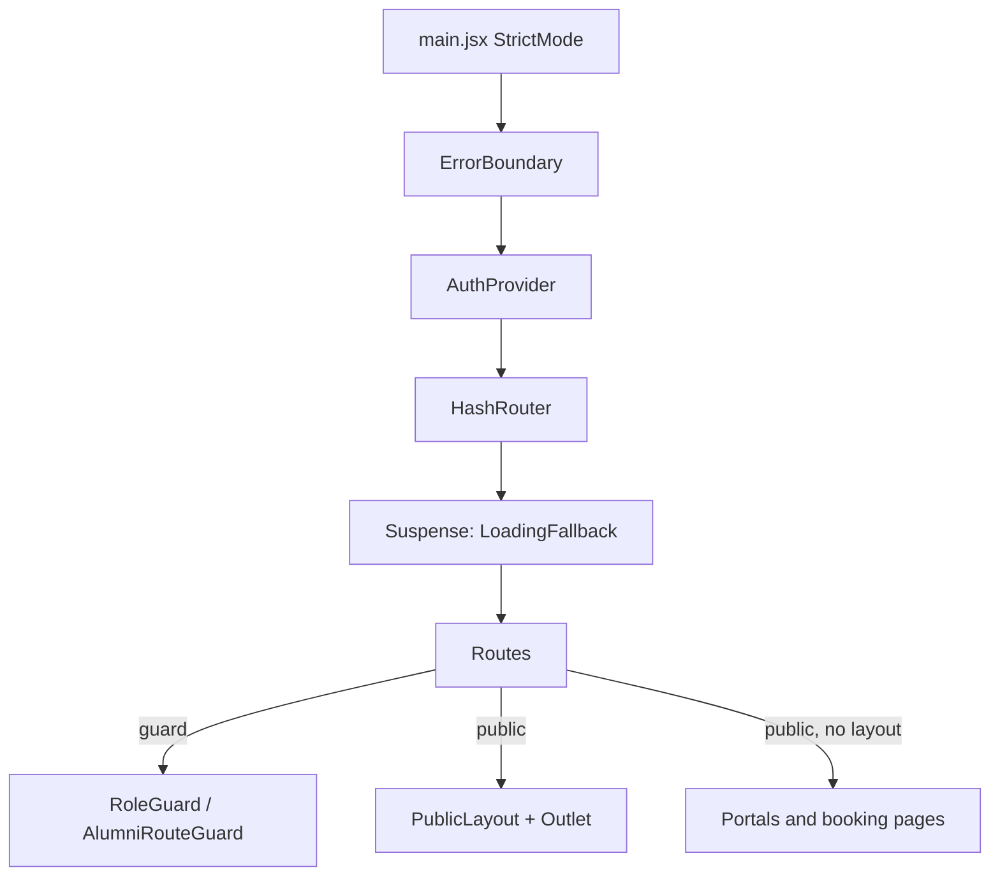

# 01 - App Shell & Infrastructure (as-is)

> Scope: root configuration, build/deploy pipeline, `src/main.jsx`, `src/App.jsx` (routing, guards, lazy loading), `AuthContext`, shared hooks, shell/UX components, `src/lib/{supabase,utils,translations,excel}.js`, global CSS, and root-level clutter (loose logs, scratch files, backups, `dist/`).
> This document describes what exists today. It contains no recommendations. Secret values are never reproduced; only variable/key names are given.
> Line references are `file:line` relative to the project root. Where a file was untracked in git at the time of analysis this is noted as **(untracked)**.

---

## 1. Project at a glance

| Item | Value | Source |
|---|---|---|
| Package name | `event-operation` (private, v0.0.0, ESM) | `package.json:2-6` |
| Product name shown to users | "Athar Programs Platform / منصة أثر للبرامج" | `index.html:7` |
| Login page title | "Project Manager" | `src/components/LoginPage.jsx:50-55` (local line numbers) |
| Framework | React 19 + Vite 7 + Tailwind 3 | `package.json:14-44` |
| Backend | Supabase (Postgres, Auth, Realtime, Edge Functions); no custom server | `src/lib/supabase.js` |
| Router | `HashRouter` (react-router-dom 7) | `src/App.jsx:14` (import), `:122` (use) |
| Language | JavaScript (JSX) for app code; one generated TS types file `src/types/database.types.ts`; Deno/TS for edge functions | tree |
| Package managers | Both `bun.lock` and `package-lock.json` exist; CI uses Bun | `.github/workflows/deploy.yml:28-34` |
| Tests | None (no test runner, no `test` script) | `package.json:7-13` |
| Git history | 86 commits; recent messages are "1" | `git log` |

### Directory map (app-relevant)

```
/                     root config + loose clutter (see section 14)
.github/workflows/    deploy.yml (GitHub Pages)
public/               .htaccess, .nojekyll, athar-dot.svg
src/
  main.jsx            entry
  App.jsx             router + lazy loading + guards + prefetch
  index.css           Tailwind layers + CSS variables + utilities
  contexts/           AuthContext.jsx (only context in the app)
  hooks/              useLanguage, usePresence, useQueryParams (all 3 use different patterns)
  lib/                api.js (4971 lines), supabase.js, utils.js, translations.js, excel.js, googleSheets.js, ...
  components/         ~55 top-level components + alumni/ (22) + forms/ (14)
  assets/             EMPTY directory
  types/              database.types.ts (generated)
supabase/             functions/, migrations/, backups/, seed_alumni.sql, .temp/
google-apps-script/   Code.gs + appsscript.json
scratch/              ad-hoc scripts and SQL
dist/                 build output (git-ignored but present on disk)
docs/                 (this folder; empty before these docs)
```

---

## 2. Build, tooling and deployment

### 2.1 Vite (`vite.config.js`)

| Setting | Value | Line |
|---|---|---|
| Plugins | `@vitejs/plugin-react` | 6 |
| `base` | `'./'` (relative asset URLs) | 7 |
| Dev server | host `127.0.0.1`, port `process.env.PORT` or `8080`, `strictPort:false` | 8-12 |
| Manual chunks | `lucide-icons` (id includes `lucide-react`), `supabase-lib` (id includes `@supabase` or `supabase`), `xlsx-lib` (id includes `xlsx`) | 16-27 |
| React core | Deliberately not split ("stable references" comment) | 26 |

Observations:
- `id.includes('supabase')` (`vite.config.js:20`) is a substring match on the full module path; it will also match any project file whose path contains "supabase" (e.g. `src/lib/supabase.js`, `src/types/...` paths with that string).
- Because `base:'./'` and `HashRouter` are used, the built app is relocatable under any sub-path with no server rewrite rules (see 2.4 for why `.htaccess` still exists).
- `dist/index.html` confirms the build rewrites `/athar-dot.svg` (from `index.html:8`) to `./athar-dot.svg` and injects three `modulepreload` links (lucide, supabase, xlsx chunks) plus the main entry and CSS.

### 2.2 Tailwind / PostCSS / ESLint

| File | Content summary |
|---|---|
| `tailwind.config.js` | `darkMode:["class"]`; content `./index.html`, `./src/**/*.{js,ts,jsx,tsx}`; shadcn-style semantic colors bound to CSS variables (`border,input,ring,background,foreground,primary,secondary,muted,accent,card,popover`); custom `athar.{black,blue,yellow}`; font `manrope`; radius `lg/md/sm` from `--radius`; extra screen `xs: 480px`; plugin `tailwindcss-animate` (`:2`, `:61`) |
| `postcss.config.js` | `tailwindcss`, `autoprefixer` |
| `eslint.config.js` | Flat config; ignores `dist`; applies `js.recommended`, `react-hooks` flat recommended, `react-refresh` vite preset to `**/*.{js,jsx}`; one custom rule `no-unused-vars` with `varsIgnorePattern: '^[A-Z_]'` (`:25-27`). No TypeScript lint; `.ts` files are not linted. |

### 2.3 Environment variables

| Variable | Where declared | Where actually read | Notes |
|---|---|---|---|
| `VITE_BASE_PATH` | `.env.example:7`, `.env` | `src/lib/utils.js:11` (`import.meta.env.VITE_BASE_PATH ?? '/EventsOperations'`) | Only env var read by browser code. Used to build public share links (`getAppBaseUrl`). Default value is a production sub-path. |
| `GOOGLE_APPS_SCRIPT_WEB_APP_URL` | `.env.example:2`, `.env` | **No reader found** in `src/`, `supabase/functions/`, `google-apps-script/`, `scripts` | Not prefixed with `VITE_` so Vite would not expose it to the client even if referenced. Appears to be a leftover (see section 15). |
| `PORT` | n/a | `vite.config.js:10` | Dev-server only. |
| `SUPABASE_KEY` | n/a | `scratch/test_fetch.js:5` | Script-only, undefined by default. |

Supabase URL and the publishable (anon) key are **hardcoded** in `src/lib/supabase.js:3-4` (constants `SUPABASE_URL`, `SUPABASE_ANON_KEY`), not read from env. The same project ref appears in `package.json:12` (`gen-types` script) and `public/.htaccess:6`. The anon key literal is also hardcoded in `test-meet-generation.js` and `scratch/test_fetch_events.js`. `.env` is git-ignored (`.gitignore:14-16`), `.env.example` is tracked.

### 2.4 Deployment pipeline

```mermaid
flowchart LR
  A[push to main / manual dispatch] --> B[GitHub Actions: build job]
  B --> C[checkout@v4]
  C --> D[setup-bun@v2 bun latest]
  D --> E[bun install --frozen-lockfile]
  E --> F[bun run build  = vite build]
  F --> G[upload-pages-artifact ./dist]
  G --> H[deploy job: deploy-pages@v4]
  H --> I[GitHub Pages environment]
```

- Workflow: `.github/workflows/deploy.yml` (single file). Triggers: push to `main`, `workflow_dispatch` (`:3-6`). Permissions `contents:read, pages:write, id-token:write` (`:12-15`). Concurrency group `pages` with `cancel-in-progress: true` (`:17-19`). Env `FORCE_JAVASCRIPT_ACTIONS_TO_NODE24: true` (`:9`). Bun version `latest` (unpinned, `:30`).
- The workflow does **not** run lint, tests, or type checks, and does not set any env var (so `VITE_BASE_PATH` is undefined in CI builds and the fallback `/EventsOperations` is used).
- `package.json:4` declares `homepage` as a GitHub Pages URL (`mostafavipecoder.github.io/Event_Operaation/`), while `.env.example:4-7`, `.env` and `src/lib/utils.js:3-4` reference the production host `athareg.com/EventsOperations` (Apache-style hosting, evidenced by `public/.htaccess`). Two deployment targets are implied; see section 15.
- `public/.nojekyll` (GitHub Pages marker) and `public/.htaccess` (Apache) are both shipped in `dist/`.
- `public/.htaccess`: (a) 301 redirect `^share/?$` to a Supabase functions URL ending in `/share-event` (`:6`); (b) SPA fallback rewrite to `/index.html` for unknown files (`:8-11`). `RewriteBase /` (`:3`) is root, while the app is described as living under `/EventsOperations/`. Because `HashRouter` is used, (b) is only exercised for non-hash paths.
- `index.html:20` and `src/index.css:1` both import Google Fonts (Manrope, Hepta Slab, Jomhuria, Tajawal) - the font list is loaded twice (HTML `<link>` and CSS `@import`), with slightly different weight specs (`Hepta+Slab:wght@1..900`, `Manrope:wght@200..800` vs explicit weights in CSS).

### 2.5 Edge-function and Apps Script touchpoints (from the shell's perspective)

`public/.htaccess:6` points to function name `share-event`, but the directory under `supabase/functions/` is named `share` (listing: `_shared, generate-google-meet, notify-google-apps-script, process-booking, send-acceptance-emails, send-booking-notifications, send-interview-invitations, send-rejection-emails, share`). The mismatch is recorded in section 15.

---

## 3. Dependency inventory and usage

Usage determined by grep of `src/`, `supabase/functions/`, `scratch/`, and root `*.js`.

### 3.1 `dependencies`

| Package | Version | Used in | Status |
|---|---|---|---|
| `react`, `react-dom` | ^19.2.0 | everywhere; `react-dom` only in `src/main.jsx:2` | used |
| `react-router-dom` | ^7.11.0 | `App.jsx` and ~70 components | used |
| `@supabase/supabase-js` | ^2.117.2 | `src/lib/supabase.js:1` (also scratch scripts, `test-meet-generation.js`, edge functions import it separately) | used |
| `lucide-react` | ^0.562.0 | nearly every component; own manual chunk | used |
| `@dnd-kit/core` | ^6.3.1 | `EventBuilder`, `ExpertManager`, `StartupManager`, `forms/QuestionsBuilder` | used |
| `@dnd-kit/sortable` | ^10.0.0 | `CompanyCard`, `EventBuilder`, `ExpertCard`, `ExpertManager`, `forms/QuestionsBuilder`, `StartupManager` | used |
| `@dnd-kit/modifiers` | ^9.0.0 | `ExpertManager`, `StartupManager` | used |
| `@dnd-kit/utilities` | ^3.2.2 | `CompanyCard`, `EventBuilder`, `ExpertCard`, `forms/QuestionsBuilder` | used |
| `quill` | ^2.0.3 | `RichTextEditor.jsx:2` only | used (single consumer) |
| `dompurify` | ^3.4.13 | `RichTextEditor.jsx:3` only | used (single consumer) |
| `html-to-image` | ^1.11.13 | `alumni/CertificateGenerator.jsx` only | declared; that component has **no importers** (section 15) so effectively unreachable |
| `xlsx` | ^0.18.5 | `lib/excel.js`; direct `import * as XLSX` in `alumni/AlumniDirectory.jsx:11`, `alumni/ImpactDashboard.jsx:10`, `alumni/MEWorkspace.jsx:14` | used (own chunk; imported both via `lib/excel` and directly) |
| `tailwindcss-animate` | ^1.0.7 | `tailwind.config.js:2,61` | used (build-time) |

### 3.2 `devDependencies`

| Package | Used by | Status |
|---|---|---|
| `vite`, `@vitejs/plugin-react` | build | used |
| `tailwindcss`, `postcss`, `autoprefixer` | build | used |
| `eslint`, `@eslint/js`, `eslint-plugin-react-hooks`, `eslint-plugin-react-refresh`, `globals` | `eslint.config.js` | used |
| `@types/react`, `@types/react-dom` | no TS source in `src/` references React types (only `database.types.ts`) | declared, no consumer found |
| `supabase` (CLI) | `package.json:12` `gen-types` script | used by script |
| `nodemailer` | **not imported by any frontend/node file**; edge functions import it as `npm:nodemailer` (Deno specifier) in `send-acceptance-emails/index.ts:3`, `send-booking-notifications/index.ts:3`, `send-interview-invitations/index.ts`, `send-rejection-emails` | declared in package.json but not consumed from it |

### 3.3 Used but not declared

- `dotenv` is imported in `scratch/get_schema.js` but is not in `package.json`.

---

## 4. Entry point and boot sequence

`src/main.jsx` (12 lines): imports `./index.css`, mounts `<App/>` inside `<StrictMode>` on `#root` (`:8-12`). No other providers here; all providers live in `App`.

Boot sequence at module-evaluation time of `src/App.jsx`:

1. Lazy component declarations (`App.jsx:7-60`, 54 `lazy()` imports).
2. `prefetch` object exported (`:64-79`).
3. **Side-effecting code at module top level** (`:100-116`): reads `window.location.search`; if the `agenda` query parameter exists (social-share links of the form `https://host/path/?agenda=<id>&...`), it rewrites the URL with `history.replaceState` to `pathname#/agenda/<id>?<other params>` and force-adds `lang=ar` when no `lang` is present. This runs once, before React renders.
4. `App` component renders `ErrorBoundary > AuthProvider > HashRouter > Suspense(LoadingFallback) > Routes` (`:118-124`).



`LoadingFallback` (`App.jsx:86-97`) is English-only text ("Loading Portal / Please wait a moment") regardless of language.

---

## 5. Route table (`src/App.jsx`)

Guards:
- **RoleGuard** = `src/components/RoleGuard.jsx` (**untracked**). With no `allowedRoles` it only requires an authenticated user (plus redirect rules for founder / alumni_manager).
- **AlumniRouteGuard** = `src/components/alumni/AlumniRouteGuard.jsx` (lazy-loaded inside the route element, `App.jsx:60`).
- **none** = no guard; page is reachable by anyone.
- `PM` = `['super_admin','project_manager']`.

Line numbers below are `src/App.jsx` lines.

### 5.1 Authenticated internal platform

| Path | Component | Guard | Layout | Line |
|---|---|---|---|---|
| `/login` | `LoginPage` | none | none (page has its own full-screen design, `dir="rtl"`) | 125 |
| `/profile` | `UserProfile` | RoleGuard (no roles) | none | 128-134 |
| `/` | `Dashboard` | RoleGuard (no roles) | none | 135-139 |
| `/companies` | `CompaniesPage` | RoleGuard PM | none | 141-145 |
| `/experts` | `MasterExpertsList` | RoleGuard PM | none | 147-151 |
| `/library` | `LibraryManager` | RoleGuard PM | none | 153-157 |
| `/event/:eventId` and `/events/:eventId` | `EventDashboard` | RoleGuard PM | none | 160-169 |
| `/event(s)/:eventId/forms` | `FormEditor` | RoleGuard PM | none | 171-181 |
| `/form-library`, `/forms-library` | `FormLibraryManager` | RoleGuard `['super_admin']` | none | 183-193 |
| `/event(s)/:eventId/visuals` | `EventVisualManager` | RoleGuard PM | none | 321-330 |
| `/event(s)/:eventId/agenda` | `BuilderWrapper` -> `EventBuilder` | RoleGuard PM | none | 333-342 |
| `/event(s)/:eventId/experts` | `ExpertManager` | RoleGuard PM | none | 344-353 |
| `/event(s)/:eventId/startups` | `StartupManager` | RoleGuard PM | none | 355-364 |
| `/event(s)/:eventId/lists` | `ListsManager` | RoleGuard PM | none | 366-375 |
| `/event(s)/:eventId/library` | `LibraryManager` | RoleGuard PM | none | 377-386 |
| `/event(s)/:eventId/selection` | `SelectionProcessManager` | RoleGuard PM | none | 388-397 |
| `/event(s)/:eventId/analytics` | `MarketingAnalytics` | RoleGuard PM | none | 399-408 |
| `/event(s)/:eventId/join-athar` | `JoinAtharDashboard` | RoleGuard PM | none | 410-419 |
| `/event/:eventId/mentor-booking` | `MentorBookingAdmin` | RoleGuard PM | none | 443-447 |
| `/event/:eventId/mentor-booking/:mentorId` | `MentorDetails` | RoleGuard PM | none | 448-452 |
| `/event/:eventId/ather-team-booking` | `AtherTeamBookingAdmin` | RoleGuard PM | none | 456-460 |
| `/event/:eventId/mentoring-distribution` | `MentoringDistributionAdmin` | RoleGuard PM | none | 464-468 |

Every `/event/:eventId/...` route listed with "(s)" is registered twice (`/event/` and `/events/` variants) as two separate `<Route>` elements; the mentor-booking, ather-team-booking and mentoring-distribution routes exist only under `/event/`.

### 5.2 Alumni portal

| Path | Component | Guard | Layout | Line |
|---|---|---|---|---|
| `/alumni/login`, `/alumni/signin` | `AlumniLoginPage` | none | none | 195-196 |
| `/alumni/signup` | `AlumniSignupPage` | none | none | 197 |
| `/alumni` | `<div/>` (placeholder; guard performs a redirect) | AlumniRouteGuard | none | 201 |
| `/alumni/admin` | `Navigate -> /alumni/admin/dashboard` | none | none | 204 |
| `/alumni/admin/dashboard` | `AlumniManagerDashboard` | AlumniRouteGuard `requireAdmin` | `AlumniManagerLayout` | 205-211 |
| `/alumni/admin/invitations` | `AlumniInvitationsPage` | same | `AlumniManagerLayout` | 212-218 |
| `/alumni/admin/notifications` | `AlumniNotificationsPage` | same | `AlumniManagerLayout` | 219-225 |
| `/alumni/admin/analytics` | `AlumniAnalyticsPage` | same | `AlumniManagerLayout` | 226-232 |
| `/alumni/admin/opportunities` | `OpportunitiesHub` | same | `AlumniManagerLayout` | 233-239 |
| `/alumni/admin/impact` | `ImpactDashboard` | same | `AlumniManagerLayout` | 240-246 |
| `/alumni/admin/workspace` | `MEWorkspace` | same | `AlumniManagerLayout` | 247-253 |
| `/alumni/admin/directory` | `AlumniDirectory` | same | `AlumniManagerLayout` | 254-260 |
| `/alumni/admin/company/:id` | `CompanyProfilePage` | same | `AlumniManagerLayout` | 261-267 |
| `/alumni/founder` | `Navigate -> /alumni/founder/dashboard` | none | none | 270 |
| `/alumni/founder/dashboard` | `FounderDashboard` | AlumniRouteGuard | `FounderLayout` | 271-277 |
| `/alumni/founder/programs` | `FounderProgramsPage` | AlumniRouteGuard | `FounderLayout` | 278-284 |
| `/alumni/founder/opportunities` | `FounderOpportunitiesPage` | AlumniRouteGuard | `FounderLayout` | 285-291 |
| `/alumni/founder/notifications` | `FounderNotificationsPage` | AlumniRouteGuard | `FounderLayout` | 292-298 |
| `/alumni/founder/profile` | `FounderProfilePage` | AlumniRouteGuard | `FounderLayout` | 299-305 |
| `/alumni/founder/progress` | `FounderProgressPage` | AlumniRouteGuard | `FounderLayout` | 306-312 |
| `/alumni/founder/company/:id` | `CompanyProfilePage` | AlumniRouteGuard | `FounderLayout` | 313-319 |

Layouts here are wrapper **components** (children), not React Router layout routes with `<Outlet/>`; each page repeats the guard + layout wrapper.

### 5.3 Public portal

| Path | Component | Guard | Layout | Line |
|---|---|---|---|---|
| `/agenda/:eventId` | `ViewerWrapper` -> `AgendaViewer` | none | `PublicLayout` (route layout with `<Outlet/>`) | 422-428 (`:423`) |
| `/view/:eventId/experts` | `ExpertViewer` | none | `PublicLayout` | 424 |
| `/view/:eventId/startups` | `StartupViewer` | none | `PublicLayout` | 425 |
| `/view/:eventId/library` | `LibraryViewer` | none | `PublicLayout` | 426 |
| `/view/:eventId/join-athar` | `JoinAtharView` | none | `PublicLayout` | 427 |
| `/events/:eventId/register/company` | `CompanyPortal` | none | none | 431 |
| `/events/:eventId/register/expert` | `ExpertPortal` | none | none | 432 |
| `/events/:eventId/register/form/:formId` | `GenericFormPortal` | none | none | 433 |
| `/events/:eventId/form/:formId` | `GenericFormPortal` | none | none | 434 |
| `/forms/:eventId/:formId` | `GenericFormPortal` | none | none | 435 |
| `/forms/:formId` | `GenericFormPortal` | none | none | 436 |
| `/verify-certificate/:code` | `CertificateVerifier` | none | none | 198 **and** 439 (duplicate) |
| `/verify-certificate` | `CertificateVerifier` | none | none | 440 |
| `/book/:mentorId` | `MentorBookingPage` | none | none | 453 |
| `/ather-team-book/:memberId` | `AtherTeamBookingPage` | none | none | 461 |
| `/view/:eventId/mentoring/live` | `MentoringLiveView` | none | none (not inside `PublicLayout`) | 469 |
| `/view/:eventId/mentoring/matrix` | `MentoringMatrixView` | none | none (not inside `PublicLayout`) | 470 |

There is **no catch-all (`*`) route**: unknown paths render nothing (blank page inside the Suspense boundary).

### 5.4 Route-level helpers

- `BuilderWrapper` (`App.jsx:480-483`): reads `eventId`, renders `<EventBuilder event={{event_id: eventId}} onBack={() => window.history.back()} />`. Passes a stub event object containing only `event_id`.
- `ViewerWrapper` (`:485-488`): reads `eventId`, renders `<AgendaViewer eventId={eventId} />`.
- Both wrapper functions are defined **after** `App` that references them (function hoisting makes this valid).

### 5.5 Lazy loading and prefetch

- 54 `lazy(() => import(...))` declarations (`App.jsx:7-60`), one `Suspense` for the whole route tree (`:123-124`). Vite emits ~77 files under `dist/assets/` (e.g. `Dashboard-*.js`, `AlumniDirectory-*.js`, `ActiveUsers-*.js`, `ExpandableText-*.js`).
- `LoginPage` is lazy-loaded; `RoleGuard`, `PublicLayout`, `AuthProvider`, `ErrorBoundary` are eager imports (`:4`, `:81-83`).
- `export const prefetch` (`:64-79`) has 14 keys: `dashboard, eventDashboard, agenda, experts, startups, forms, visuals, selection, analytics, masterExperts, lists, library, joinAthar, alumni`.
  - It is imported from `'../App'` by `Dashboard.jsx:18` (uses `prefetch.eventDashboard()` at `:42`) and `EventDashboard.jsx:5` (uses `prefetch[module.prefetchKey]?.()` at `:703`).
  - `EventDashboard` module cards use `prefetchKey` values `agenda`, `lists`, `forms`, `mentor-booking`, `selection`, `library`, `mentoringDistribution`, `joinAthar` (`EventDashboard.jsx:314-386`). **`mentor-booking` and `mentoringDistribution` are not keys of `prefetch`** (safe because of `?.()`, but the prefetch silently does nothing for those two cards).
  - Keys never referenced by any caller: `dashboard, experts, startups, visuals, analytics, masterExperts, alumni`.
  - `App.jsx` -> lazy `Dashboard` -> imports `App.jsx` back: a **circular import** (App <-> Dashboard/EventDashboard). ESLint flags it: `lint-output.txt` reports `react-refresh/only-export-components` at `src/App.jsx:30:14` in an older version of the file.
- Components not wrapped in `lazy` or loaded via route but statically imported by others (e.g. `ActiveUsers`, `ExpandableText`) became separate chunks only because Rollup split them.

---

## 6. Authentication, session and role model (frontend view)

### 6.1 Supabase client (`src/lib/supabase.js`)

- Hardcoded URL + publishable key (`:3-4`).
- Singleton stored on `globalThis.__supabaseClient` to survive HMR (`:11`).
- Auth options: `persistSession: true`, `autoRefreshToken: true`, `detectSessionInUrl: true`, `storage: window.localStorage`, and a **custom no-op `lock`** `(_name,_acquireTimeout,fn)=>fn()` that disables `navigator.locks` (`:22`).
- A module-level `visibilitychange` listener calls `supabase.auth.getSession()` whenever the tab becomes visible (`:28-32`).
- JSDoc types the client with `../types/database.types` `Database`.

### 6.2 `AuthContext` (`src/contexts/AuthContext.jsx`, 227 lines)

State: `user`, `profile`, `roles` (string[]), `loading` (`:32-35`).

Exposed value (`:199-216`): `signUp, signIn, signOut, changePassword, updateProfile, refreshAuth, user, profile, roles, primaryRole, hasRole, isSuperAdmin, isProjectManager, isAlumniManager, isFounder, loading`. The `value` object is recreated on every render (not memoized).

Role priority constant (`:7-12`): `super_admin 4 > project_manager 3 > alumni_manager 2 > founder 1`. `primaryRole` = highest priority among `roles` (`:153-156`), else `null`.

Helper semantics:

| Helper | Definition | Line |
|---|---|---|
| `hasRole(r\|r[])` | false if no roles; **true for any query when user is `super_admin`**; else membership | 158-163 |
| `isSuperAdmin` | roles includes `super_admin` | 165 |
| `isProjectManager` | `project_manager` OR `super_admin` | 166 |
| `isAlumniManager` | `alumni_manager` OR `super_admin` | 167 |
| `isFounder` | `founder` OR `super_admin` | 168 |

`signIn` = `supabase.auth.signInWithPassword`, `signUp` = `supabase.auth.signUp` (`:200-201`). `signUp` from the context has no callers; invitation-based signup is done separately with `supabase.auth.signUp` inside `api.js:3778` (`acceptInvitation`).

`changePassword` (`:170-177`): client-side minimum 6 characters, then `supabase.auth.updateUser({password})`.
`updateProfile` (`:179-184`): calls `api.updateUserProfile` then merges into `profile` state.
`signOut` (`:186-197`): clears role/profile cache keys, resets state, calls `supabase.auth.signOut()`.

### 6.3 Session / role loading flow

```mermaid
sequenceDiagram
  participant UI as AuthProvider effect (:107-150)
  participant SB as supabase.auth
  participant LD as loadUserData (:37-95)
  participant API as api.getUserRoles/getUserProfile
  participant ST as session/localStorage cache

  UI->>SB: onAuthStateChange(listener)
  UI->>SB: getSession()
  SB-->>UI: session (event or promise, whichever first)
  UI->>LD: loadUserData(user)
  LD->>ST: read cached roles (sessionStorage || localStorage)
  LD-->>UI: setRoles(cached) immediately (avoid flash)
  LD->>API: Promise.all(getUserRoles, getUserProfile) with 1 retry
  Note over LD,API: raced against 9s timeout
  alt timeout
    LD->>ST: re-read cache, setRoles(cache); profile NOT set
  else success
    LD-->>UI: setRoles(final) + write localStorage cache; setProfile(profile or fallback)
  end
  UI-->>UI: setLoading(false)
```

Details and quirks (all in `AuthContext.jsx`):
- `loading` becomes `false` only after `loadUserData` completes (or the 9 s timeout fires) (`:111-122`), so route guards show a spinner until roles are resolved or the timeout elapses.
- `SIGNED_OUT` event short-circuits (`:127-132`); every other event, including `TOKEN_REFRESHED`, runs `syncSession` -> a full roles+profile refetch (`:134`).
- `isHandled` flag stops the `getSession()` fallback from running a second sync if the listener already handled it (`:109,122,139`).
- Cached role shape handled in two formats: legacy `string[]` and `{roles, timestamp}` (`:14-26`). `parseCachedRoles` swallows parse errors.
- Cache keys: `user_roles_<uid>` in **both** `sessionStorage` and `localStorage` (read from either: `:45`; written by `api.getUserRoles` to both, by `AuthContext` to localStorage only `:81`). `user_profile_<uid>` is removed in `refreshAuth`/`signOut` (`:101,190`) and in `api.updateUserProfile`, but **no code writes or reads `user_profile_*`** in the files in scope (profile is fetched fresh each time).
- `api.getUserRoles` (`src/lib/api.js:4037-4076`) has its own 60-second cache check before hitting the `user_roles` table; on error it falls back to the (possibly stale) cached value; roles are `Array.from(new Set(...))`.
- If the network refresh returns an **empty** role array while a non-empty cached array existed, the cached roles are kept (`:78`), i.e. revoked roles can persist until the cache is cleared.
- If `getUserProfile` returns null (missing row, or error), a synthetic profile is used: `{id, full_name from metadata or email prefix, avatar_color '#059669', avatar_url null}` (`:84-89`).
- `refreshAuth` is exposed but its callers were not found in scope.

### 6.4 Role model as seen from the frontend

Roles (string values from table `user_roles.role`, enum `app_role` per `USER_ROLES_FIX.md`): `super_admin`, `project_manager`, `alumni_manager`, `founder`.

| Role | Landing | Allowed areas (per guards) |
|---|---|---|
| `super_admin` | `/` | everything; bypasses RoleGuard checks (`RoleGuard.jsx:30`) and AlumniRouteGuard (`AlumniRouteGuard.jsx:38`) |
| `project_manager` | `/` | `PM` routes (all internal event routes); blocked from `/form-library` |
| `alumni_manager` | `/alumni/admin/dashboard` | `/alumni/*` only (RoleGuard redirects any non-alumni path) |
| `founder` | `/alumni/founder/dashboard` | `/alumni/founder/*` only |
| no role (empty `roles`) | `/` | see anomaly below |

Frontend model is **multi-role** (array, priority-resolved), whereas `api.assignUserRole` documents "ON CONFLICT (user_id) -> replaces existing role (one role per user)" (`api.js:4081-4086`), and `USER_ROLES_FIX.md` describes the table constraint cleanup. Both coexist (see section 15).

Labels / icons per role live in `ROLE_LABELS` exported from `UserNavDropdown.jsx:7-32` (en/ar labels, Tailwind color classes, lucide icons) and imported by `UserProfile.jsx:10`.

### 6.5 Guards in detail

**`RoleGuard.jsx`** (70 lines, untracked):

| Step | Behavior | Line |
|---|---|---|
| 1 | While `loading`, full-screen spinner | 10-19 |
| 2 | No `user` -> `Navigate` to `/alumni/login` if pathname starts with `/alumni`, else `/login`, passing `state.from` | 21-26 |
| 3 | `super_admin` -> render children | 30-32 |
| 4 | `primaryRole === 'founder'` and (admin path OR not an alumni path) -> `/alumni/founder/dashboard` | 38-42 |
| 5 | `primaryRole === 'alumni_manager'` and (founder path OR not alumni path) -> `/alumni/admin/dashboard` | 45-49 |
| 6 | If `allowedRoles` non-empty and user has none of them -> redirect: founder -> founder dashboard; alumni_manager -> admin dashboard; project_manager -> `/`; otherwise `/` | 52-65 |
| 7 | Otherwise render children | 69 |

Observations: (a) RoleGuard is used in `App.jsx` only for non-alumni paths, so the `/alumni` branches inside it (`isAlumniPath`, `isFounderPath`, `isManagerPath`) only matter when a founder/alumni_manager hits an internal route (they are then redirected). (b) The `project_manager` branch (`:56-58`) returns `/` exactly like the default (`:59`) - identical outcome. (c) A user with **no role** passes `RoleGuard` on `/` and `/profile` (no `allowedRoles`) and is redirected to `/` from PM-only routes, which renders `Dashboard`; the guard does not detect "authenticated but role-less" as unauthorized. (d) Role checks are UI-only; real enforcement relies on RLS (not verified here).

**`AlumniRouteGuard.jsx`** (61 lines): `loading` spinner; no user -> `/alumni/login`; `/alumni` root redirects super_admin/alumni_manager to admin dashboard, others to founder dashboard (`:30-35`); super_admin passes; admin routes require `alumni_manager`, else redirect to founder dashboard (`:43-49`); founder routes: only an `alumni_manager` who is **not** a founder is redirected (`:52-57`) - a user with neither role (e.g. `project_manager` only) is allowed through founder routes; `requireAdmin` guard with a path not under `/alumni/admin` is also enforced via the flag.

**`ProtectedRoute.jsx`** (16 lines): redirects to `/login` when `!user`; it ignores `loading`. **Not imported anywhere** (dead code).

### 6.6 Login / Change password / profile / user menu

| Component | Behavior | Notes |
|---|---|---|
| `LoginPage.jsx` (142 lines) | Email+password form -> `signIn`; on success `navigate(location.state.from.pathname || '/', {replace:true})` (`:15,25`). Whole page `dir="rtl"`, Arabic copy hardcoded; footer "(c) 2026 Athar Accelerator" (`:135`). | No "forgot password" flow; no role-based redirect after login (target is `from` or `/`; RoleGuard then redirects founders/alumni managers). Error fallback text is Arabic. Only the `from.pathname` is preserved (query/hash dropped). |
| `ChangePasswordModal.jsx` (159 lines, untracked) | `isOpen/onClose` modal; min length 6; confirm match; calls `AuthContext.changePassword`; auto-closes after 1.6 s (`:34-39`). English-only strings. | Used by `UserNavDropdown` and `UserProfile`. |
| `UserNavDropdown.jsx` (203 lines, untracked) | Avatar+name+role badge dropdown with links: Founder Portal (if founder), Alumni Portal (if alumni_manager or super_admin), `/profile`, Change Password, Sign Out (`navigate('/login')`). Bilingual labels written inline as "English / Arabic". | Used by `Dashboard.jsx` and `EventDashboard.jsx`. Only `roleConfig.en` is rendered; `.ar` labels in `ROLE_LABELS` are rendered only in `UserProfile` (`:51`, shown as `(ar)`). Not used inside alumni layouts (not checked there). |
| `UserProfile.jsx` (342 lines, untracked) | Edits `full_name`, `avatar_color` (8 preset colors, `:12-21`), `avatar_url` (free-text URL) via `updateProfile`; shows email (read-only), roles, role descriptions, change-password, sign-out. | "Back" link always goes to `/` (`:~100`) even for founders/alumni managers (who are redirected). Avatar is a URL text field, not an upload. |

---

## 7. Hooks (`src/hooks/`)

| Hook | File | Purpose | Consumers |
|---|---|---|---|
| `useLanguage()` | `src/hooks/useLanguage.js` (30 lines, untracked) | Reads/writes `localStorage['alumni_lang']` (default `'en'`), exposes `{lang,isRtl,isLtr,setLang}`; `setLang` also sets `document.documentElement.dir/lang` (`:16-21`); mount effect syncs `dir/lang` with empty dependency array (`:23-27`, an ESLint `exhaustive-deps` suppression is absent). Comment says "Alumni Manager flow is English-only; lang is fixed to 'en'" but the hook does allow `'ar'`. | `alumni/AlumniAnalyticsPage`, `AlumniInvitationsPage`, `AlumniNotificationsPage` only |
| `usePresence(roomId='global')` | `src/hooks/usePresence.js` (121 lines) | Supabase Realtime presence. Fetches `profiles(full_name, avatar_color)` (`:22-26`), builds channel `presence:<roomId>` with key=`user.id`, removes pre-existing channels with the same topic (StrictMode workaround, `:49-52`), tracks `{user_id, full_name, avatar_color, online_at}` after `SUBSCRIBED` (`:81-88`), exposes `{activeUsers, profile}` (first presence entry per key). Cleanup uses a `safeRemoveChannel` helper that swallows errors (`:110-116`). | `Dashboard.jsx:278` (`'global_dashboard'`), `EventDashboard.jsx:22` (`event_dashboard_<id>`) |
| `useQueryParams()` | `src/hooks/useQueryParams.js` (30 lines, untracked) | Thin wrapper over `useSearchParams` with `getParam/setParam/resetParams`. | `alumni/AlumniAnalyticsPage` only |

Language state is **not** shared through a context/hook across the app (see section 10).

---

## 8. Shell and shared components

| Component | File (lines) | Role | Used by |
|---|---|---|---|
| `ErrorBoundary` | `src/components/ErrorBoundary.jsx` (53, untracked) | Class component; catches render errors; shows English "Something went wrong" with error message and a "Reload Page" button (`window.location.reload()`). Wraps everything in `App`. Does not catch errors in event handlers/async code; no reporting beyond `console.error`. | `App.jsx` |
| `PublicLayout` | `src/components/PublicLayout.jsx` (129) | Layout route for public pages. Language from `?lang=ar` (else `en`) (`:11`). Loads `getEvent(eventId)` for `header_settings.customExpertsLabel[Ar]` (`:14-28,38-40`). Tabs: agenda / experts / companies / library / join-athar. Query params `tabs=a,b` and `mode=agenda_only|agenda_experts` filter the nav (`:32-69`); `agenda_only` hides header and bottom nav. Desktop sticky header + mobile floating bottom nav. | `App.jsx` public routes |
| `ActiveUsers` | `src/components/ActiveUsers.jsx` (52) | Presentational avatar stack (max 4 + "+N"), "N Online" pill (hardcoded English). | `Dashboard`, `EventDashboard` |
| `LazyImage` | `src/components/LazyImage.jsx` (192) | IntersectionObserver lazy image with ordered URL fallbacks, shimmer, optional background mode, and a "auto-heal" cache: stores the first working URL in `localStorage['WorkingImg_<firstUrl>']` and evicts it on failure (`:33-42,91-98,112-121`). Console logs with emoji. | 10 components (Ather team booking, CompanyCard, ExpertCard, ExpertManager, MasterExpertsList, MentorBooking*, MentorDetails, StartupManager) |
| `ExpandableText` | `src/components/ExpandableText.jsx` (91) | Multi-line clamp with Read More/Less (en/ar labels inline); uses `useLayoutEffect` measuring; ESLint suppression for `react-hooks/set-state-in-effect` (`:30`). | `CompanyCard`, `ExpertCard` |
| `RichTextEditor` | `src/components/RichTextEditor.jsx` (134, untracked) | Quill 2 wrapper (toolbar: size, bold, italic, link, clean). Emits HTML sanitized by DOMPurify with whitelist tags/attrs (`:50-53`). Injects a `<style>` block per instance. The `onChange` passed at mount is captured by the one-time init effect (`:22-63`, deps `[]` with eslint-disable) so later changes to the `onChange` prop are not picked up (stale closure). `placeholder` is only read at init. | `SelectionProcessManager`, `MentorBookingAdmin`, `alumni/AlumniNotificationsPage` |
| `SyncButton` | `src/components/SyncButton.jsx` (197) | Two-step "Sync With Sheet" (preview then confirm) calling `api.syncEventFromCloud(eventId, dryRun)`; modal in Arabic (`dir="rtl"`) with experts/companies change lists. `StatBadge` hides when `count === 0` but sums like `experts.added + companies.added` can be `NaN` if stats missing. | `EventDashboard`, `ExpertManager`, `StartupManager` |

---

## 9. Utilities

### 9.1 `src/lib/utils.js` (216 lines)

| Export | Purpose | Used by |
|---|---|---|
| `getAppBaseUrl` (`:10`) | `window.location.origin + VITE_BASE_PATH (default '/EventsOperations')` | `Dashboard`, `forms/SourceTrackingToolbar`, `GenericFormPortal` |
| `formatDate` (`:16`) | `toLocaleDateString`, default `en-US` (options spread can override `locale` key accidentally into Intl options) | `AgendaViewer`, `EventBuilder` (and `.bak`) |
| `formatTime` (`:29`) | Handles Excel fraction numbers, `HH:mm[:ss]` strings, ISO dates; AM/PM or ص/م | `AgendaViewer`, `EventBuilder` |
| `extractGoogleDriveId` (`:73`) | Regex set to pull Drive ID | only inside `utils.js` |
| `getGoogleDriveFallbackUrls` (`:115`) | 4 thumbnail URL fallbacks (small) | 10 components |
| `getGoogleDriveFullSizeUrls` (`:150`) | 4 large URL fallbacks | only inside `utils.js` (via `getGoogleDriveDirectLink`) |
| `getGoogleDriveDirectLink` (`:181`) | first full-size URL | 10 components |
| `exportToCSV` (`:186`) | CSV download with BOM | **no callers** |

Duplicated logic: the "is Drive-like URL" predicate is copy-pasted in `getGoogleDriveFallbackUrls` (`:118-123`) and `getGoogleDriveFullSizeUrls` (`:153-158`). `formatDate` and `formatTime` use different locale handling from `translations`-driven pages (each page passes language itself).

### 9.2 `src/lib/excel.js` (439 lines, wraps `xlsx`)

Exports: `generateAgendaTemplate` (`:77`), `parseWorkbook` (`:117`), `parseGenericWorkbook` (`:292`), `parseGenericExcel` (`:331`), `fetchAndParseGenericGoogleSheet` (`:352`), `parseAgendaExcel` (`:387`), `fetchAndParseGoogleSheet` (`:407`), `exportToExcel` (`:433`). Internals: `formatDateToISO` (`:9`), `convertExcelSerial` (`:60`), `safeSplit` (`:283`).

Usage: `EventBuilder.jsx:21` (template, parse, fetch Google Sheet), `lib/api.js:2` (`fetchAndParseGoogleSheet` at `api.js:1097`, `fetchAndParseGenericGoogleSheet` at `api.js:2188`), `alumni/AlumniAnalyticsPage.jsx:11` (`exportToExcel`). `parseGenericExcel` has no external caller. `AlumniDirectory`, `ImpactDashboard`, `MEWorkspace` each define their own export and call `XLSX.writeFile` directly instead of using `exportToExcel`; `AlumniDirectory.jsx:87` even declares a local function also named `exportToExcel`. A separate `src/lib/googleSheets.js` (234 lines, untracked) also exists for Sheets access (outside this scope).

### 9.3 `src/lib/translations.js` (404 lines)

See section 10.

---

## 10. Internationalization (i18n)

There is **no i18n library** and no global language state. Four co-existing mechanisms:

| Mechanism | Where | Details |
|---|---|---|
| (a) Central dictionary object | `src/lib/translations.js` | One exported `translations` object keyed by component: `AgendaViewer, CompanyCard, CompanyPortal, ExpertCard, ExpertPortal, ExpertViewer, GenericFormPortal, LibraryViewer, PublicLayout, StartupViewer, Alumni` (`:2,28,56,102,116,156,174,204,272,288,308`), each with `en` and `ar` sub-objects. Consumed as `translations.<Component>[lang]` by 14 components (AgendaViewer, CompanyCard, CompanyPortal, ExpertCard, ExpertPortal, ExpertViewer, LibraryViewer, PublicLayout, StartupViewer, and 5 alumni pages: AlumniDirectory, CompanyProfilePage, ImpactDashboard, MEWorkspace, OpportunitiesHub). `GenericFormPortal` has a dictionary key but does not import `translations` (no import found). Indentation is inconsistent (`CompanyCard` block is indented 2 spaces vs 4 elsewhere, `:28-55`). |
| (b) URL-driven language | `PublicLayout.jsx:11`, `AgendaViewer`, public viewers, portals | `?lang=ar` query parameter (HashRouter search params), default `en`; `App.jsx:100-116` sets `lang=ar` on social-share redirects; `dir` set on the layout wrapper element only. |
| (c) `useLanguage` hook | alumni pages | `localStorage['alumni_lang']`, sets `document.documentElement.dir/lang` globally (`useLanguage.js:16-21`); used by only 3 alumni pages. |
| (d) Inline strings | most admin components, `LoginPage` (Arabic), `ChangePasswordModal`/`ErrorBoundary`/`LoadingFallback` (English), `SyncButton` (Arabic), `UserNavDropdown` ("English / Arabic" in one string) | No dictionary, no switching. Arabic and English are mixed per component. |

Fonts: `font-arabic` -> Tajawal; Manrope is the default; `Hepta Slab` (`.font-hepta`) and `Jomhuria` (`.font-jomhuria`) are defined as utilities (`src/index.css`). Also `.font-taguel` (spelling) duplicates `.font-arabic`'s font stack.

---

## 11. State management approach

- **No state library** (no Redux/Zustand/React Query/SWR; grep found none). One React Context (`AuthContext`).
- All other state is component-local `useState/useEffect` with direct calls into `src/lib/api.js` (4971 lines; an in-memory/API cache with `clearApiCache()` is referenced at e.g. `api.js:4032`, documented elsewhere).
- Browser storage usage (counts of `localStorage/sessionStorage` call sites): `AuthContext` 12, `api.js` 7, `LazyImage` 3, `useMentoringTimer` 2, `useLanguage` 2, `MentorBookingAdmin` 2, `AgendaViewer` 1. Keys known in scope: `user_roles_<uid>` (session + local), `user_profile_<uid>` (cleared only), `alumni_lang`, `WorkingImg_<url>`.
- URL as state: search params drive public layout language/tabs/mode; `useQueryParams` for alumni analytics.
- Realtime: `usePresence` only (Supabase channels).
- `dark` mode: Tailwind `darkMode:["class"]` and `.dark` CSS variables exist, but no code toggles a `dark` class on `<html>` (grep for `classList` + `dark` found none), and `dark:` utilities appear in only `EventDashboard`, `LibraryViewer`, `MentoringDistributionAdmin`, `ProjectManagersManager`, `UserNavDropdown`, `UserProfile`. Dark theme is effectively unreachable.

---

## 12. Styling system

- `src/index.css` (247 lines): font `@import` (`:1`), Tailwind directives, `@layer base` CSS variables for light (`:root`) and `.dark` (shadcn naming; primary = Athar Blue in light and Athar Yellow in dark), base reset (`border-border`, `overflow-x:hidden`, body font/background), `@layer utilities` (`scale-in-center`, `font-*`, `transition-premium`, `shadow-premium`, `safe-top/bottom`, `no-overflow-x`, `modal-mobile`, `tap-target`, `float-bar`, and custom `line-clamp-1/2/3` that duplicate Tailwind's own `line-clamp-*` utilities), keyframes `scale-in-center`, `fadeIn`, `slideInRight`, `shimmer`, and an `@media print` block (A4 portrait, `.print-page`, `.print-content-scale`, `.no-print`).
- Brand tokens (`tailwind.config.js:42-46`): `athar-black #0d0e0e`, `athar-blue hsl(234,77%,44%)`, `athar-yellow hsl(54,100%,63%)`. Many components also hardcode `#1a27c9` / `#0d0e0e` directly (e.g. `PublicLayout.jsx:88-89`, `RichTextEditor.jsx:83-120`, `SyncButton.jsx`), bypassing tokens.
- `styling-guide.md` (Arabic, 12.8 KB): step-by-step guide to replicate Athar design in another React+Tailwind project - fonts import, `tailwind.config.js` content (identical to the real file), `index.css` variables (identical to real file), plus usage rules. It is a portable guide, not specific to this app. Tracked in git.
- `athar-branding.md` (Arabic, 7 KB): prompt-style brand spec ("you are now an expert UI/UX designer...") listing brand colors (black `#0d0e0e`, blue `#1a27c9`, yellow `#ffe92c`), Manrope weights usage, shadcn variable mapping (blue primary in light, yellow primary in dark), gradient/noise recipes, color proportions (70-80% neutral, 10-15% blue, 5-10% yellow), radius `0.5rem`. It references a remote noise texture (`grainy-gradients.vercel.app/noise.svg`), whereas `LoginPage.jsx:38-41` uses an inline SVG noise "to avoid 404s". Tracked in git.
- Brand yellow discrepancy: branding doc says `#ffe92c`; Tailwind token is `hsl(54,100%,63%)` (approx `#ffee50`).

---

## 13. Public assets

- `public/athar-dot.svg` (544 bytes, favicon, `index.html:8`), `public/.htaccess`, `public/.nojekyll`.
- `src/assets/` exists but is empty. No og:image or social preview image is defined (`index.html:10-16` has only `og:type`, `og:title`, `twitter:card`, `twitter:title`; `twitter:card` is `summary_large_image` but no image tag). The "branded share" is intended to be served by the `share` edge function per `.htaccess`.
- `index.html` `lang="en"` is static; no `dir` default.

---

## 14. Root-level clutter inventory

Tracked status from `git ls-files` / `git status`. "Referenced?" = referenced by code/config/other files (not counting itself).

### 14.1 Loose markdown logs and notes

All Arabic-named `.md` files and `Debug Supabase Column Error.md` are **tracked** and are exported AI-chat transcripts (header "> Workspace: c:\Users\Abdullah Shaban\Desktop\Coding\agenda-builder", an older folder name for this project). None is referenced by code/config.

| File | Size | Tracked | Content (as observed) | Referenced? |
|---|---|---|---|---|
| `Debug Supabase Column Error.md` | 45 KB | yes | Chat log: debugging a Supabase column error (event fetch) | no |
| `إرسال رابط Google Meet بعد حجز المواعيد.md` | 34 KB | yes | Chat log: send Google Meet link after selection-process booking | no |
| `إصلاح خطأ تنسيق وقت تقويم Google.md` | 53 KB | yes | Chat log: fixing Google Calendar time-format errors in Apps Script | no |
| `إعادة هندسة نظام حجز المواعيد.md` | 12 KB | yes | Chat log: re-engineering the mentor booking system (refers to a `1-1\` folder) | referenced by name inside another chat log |
| `استكمال مهمة توزيع المنتورينج.md` | 7 KB | yes | Chat log: continue Mentoring Distribution task | no |
| `حل مشكلة تحميل الصورة.md` | 26 KB | yes | Chat log: image-loading problem (LazyImage / Drive URLs) | referenced by name inside another chat log |
| `دليل-إعداد-Google-Apps-Script.md` | 6 KB | yes | A real **guide** (not a chat): create/deploy Google Apps Script bound to a calendar account; relates to `google-apps-script/Code.gs` | no |
| `متابعة نظام حجز المواعيد.md` | 45 KB | yes | Chat log: continuation of booking system re-engineering | referenced by name inside another chat log |
| `مشكلة تعدي المينتوردينج ديستريبيوشن.md` | 13 KB | yes | Chat log, **but its H1 title is "حل مشكلة تحميل الصورة"** (copy of the image-problem title while content is about mentoring distribution) | no |
| `مشكلة روابط جوجل ميت لا تعمل.md` | 35 KB | yes | Chat log: Google Meet links not working (40 emails sent) | no |
| `معالجة مشكلة تحميل الصورة في صفحة الموجهين.md` | 6 KB | yes | Chat log: image load failure on mentors page (LazyImage / lh3 URLs) | referenced by name inside another chat log |
| `ALUMNI_PLATFORM.md` | 7.5 KB | **untracked** | Technical doc of the Alumni & Impact platform v1.0 (2026-09-25) | no |
| `ALUMNI_PHASE_1_FOUNDER.md` | 3 KB | untracked | Phase 1 doc: founder experience + RBAC | no |
| `ALUMNI_PHASE_2_MANAGER.md` | 8.6 KB | untracked | Phase 2 doc: manager interfaces ("Author: Antigravity AI Engineering") | no |
| `ALUMNI_BUGFIX.md` | 1.5 KB | untracked | Bug log 2026-10-05: `lang is not defined` crash after a PowerShell batch edit removed hook setup lines (garbled encoding visible) | no |
| `ALUMNI_SHARED_HOOKS_FIX.md` | 2 KB | untracked | Fix note: same root cause across 6 pages | no |
| `USER_ROLES_FIX.md` | 6.3 KB | untracked | Documentation of `user_roles` cleanup (redundant `role_key` vs `role`, constraint fix); relates to migration `20261004000000_fix_user_roles_drop_role_key.sql` and `supabase/backups/user_roles_backup_20261004.json` | no |
| `README.md` | 1 KB | yes | Unmodified Vite React template README; says nothing about the project | no |
| `scratch/gemini_google_section.md` | 3 KB | untracked | Notes: Google service-account JSON parse error `Bad escaped character in JSON`, how `google_settings.service_account_key` can be malformed | companion to `scratch/test_parse.js` |

Encoding: `ALUMNI_BUGFIX.md` and `ALUMNI_SHARED_HOOKS_FIX.md` contain mis-encoded characters (shown as replacement characters in places).

### 14.2 Lint outputs

| File | Tracked | Notes |
|---|---|---|
| `lint-output.txt` (28.8 KB) | yes | ESLint output redirected from PowerShell (UTF-16 LE with BOM, hence unreadable by default tools). Paths show `...\Desktop\Coding\agenda-builder\...` (old folder), dated 2026-04-29. |
| `lint_output.txt` (24.5 KB) | yes | Second capture, 4 minutes later (same encoding). Hyphen vs underscore duplicate names. |

They record e.g. unused variables, a "Cannot access variable before it is declared" error in `AgendaViewer.jsx` (`loadAgenda`), and `react-refresh/only-export-components` for `App.jsx`. Not referenced by anything; reflect April code, not current.

### 14.3 Root test scripts

| File | Tracked | What it is | Referenced? |
|---|---|---|---|
| `test-founder-name.js` | yes | Standalone node script with a **copy** of an `extractSmartFirstName` function (Arabic-name "Abd/Abdul" prefix logic) and sample cases. Equivalent function exists server-side in `supabase/functions/_shared/nameParser.ts` (tracked). | no |
| `test-meet-generation.js` | yes | Node script invoking edge function `generate-google-meet` via `supabase.functions.invoke` using a **hardcoded URL and anon key** and real-looking event/slot UUIDs and a personal Gmail address. | no |
| `test_api.js` | yes | Imports `createDay/createSlot/deleteDay` from `./src/lib/api.js` and creates test rows (day 99) in a real event id to test Arabic localization; would run against production DB. Imports a browser-oriented module (`api.js` imports `supabase.js` which touches `window`) so it cannot run under plain Node as written. | no |

None is hooked to `package.json` scripts. No test framework exists.

### 14.4 `scratch/` folder

Tracked (5): `get_schema.js`, `test_fetch.js`, `test_persistence.js`, `test_urls.js`, `verify_library.js`.
Untracked (7): `add_avatar_url.sql`, `backfill_responses.js`, `fix_infinite_recursion.sql`, `gemini_google_section.md`, `test_fetch_events.js`, `test_parse.js`, `verify_phase2.sql`.

| File | Description |
|---|---|
| `get_schema.js` | Supabase schema fetch script; imports `dotenv` (not a declared dependency) and reads `.env.local` (which does not exist). |
| `test_fetch.js` | Creates a client with a hardcoded URL and `process.env.SUPABASE_KEY`; comment "I don't have this, but I can use execute_sql instead"; selects `library_resources`. |
| `test_persistence.js` | Imports `updateSlotsOrder` from `./src/lib/api.js` (a **wrong relative path** from `scratch/`, would resolve to `scratch/src/lib/api.js`); contains only comments. |
| `test_urls.js` | HEAD-requests a list of URLs (image link diagnosis). |
| `verify_library.js` | Calls `createLibraryResource/getLibraryResources/deleteLibraryResource` against hardcoded event ids (production data). |
| `backfill_responses.js` | One-off backfill of `company_submissions` with `form_id` into the new responses model; imports `../src/lib/supabase.js`. |
| `test_fetch_events.js` | Queries `events` with a **hardcoded anon key**. |
| `test_parse.js` | Standalone `safeParseServiceAccount` JSON repair helper (also mirrored in an edge function presumably). Companion to `gemini_google_section.md`. |
| `add_avatar_url.sql` | `ALTER TABLE profiles ADD COLUMN IF NOT EXISTS avatar_url` - **not in `supabase/migrations/`**, yet the frontend (`UserNavDropdown`, `UserProfile`, `AuthContext`) uses `profile.avatar_url`. |
| `fix_infinite_recursion.sql` | Creates SECURITY DEFINER helper `is_project_owner` to fix `project_managers` RLS recursion - **not a migration**; exists only in `scratch/`. |
| `verify_phase2.sql` | Read-only counts of `user_roles`, `profiles`, column lists. |

Hence database schema changes exist outside the migration history (`scratch/*.sql`). Nothing references any scratch file.

### 14.5 Other root items

| Item | Tracked | Notes |
|---|---|---|
| `api-agennda-intervew.gs` (14.6 KB; "agennda-intervew" misspelled) | yes (modified in working tree) | Google Apps Script source, near-duplicate of `google-apps-script/Code.gs` (13.2 KB, also tracked, also modified). A diff shows the root copy adds `meetingLinkMode` / `shared_google_meet_link` handling (shared vs unique Meet link) and drops the `'Interview: '` summary prefix. So the root file is the **newer** variant; `google-apps-script/Code.gs` is older. Neither is referenced from JS code (the web-app URL env var is unread; invocation is presumably from the `notify-google-apps-script` edge function). |
| `src/components/Dashboard.jsx.bak` (387 lines, **tracked**) | yes | Old version of `Dashboard.jsx` (current is 769 lines; the diff is ~1147 lines). Still imports `prefetch` from `../App` and `usePresence`, i.e. it is a stale copy; it is not imported anywhere (Vite ignores `.bak`). ESLint `files` glob (`**/*.{js,jsx}`) does not cover `.bak`. |
| `dist/` | **no** (git-ignored, `.gitignore:11`) but present on disk | Build output dated 2026-10-05 (77 asset files, `index.html`, copied `.htaccess`, `.nojekyll`, `athar-dot.svg`). Contains lazy chunks for components such as `AlumniDirectory`, `ActiveUsers`, `ExpandableText`; chunk list can be compared with source to detect staleness (e.g. components added after Oct 5 are not in it). |
| `bun.lock` (73 KB) and `package-lock.json` (97 KB) | both tracked | Two lockfiles for two package managers; `package-lock.json` dated Aug 4, `bun.lock` Oct 5 (newer); CI uses `bun install --frozen-lockfile`. |
| `google-apps-script/` | yes | `Code.gs`, `appsscript.json`. |
| `supabase/.temp/` | `cli-latest` tracked (modified); seven other files untracked | Supabase CLI link/state files (`project-ref`, `pooler-url`, versions). |
| `supabase/backups/` | untracked | Contains `user_roles_backup_20261004.json`: a data backup (user-role rows) not ignored by `.gitignore` and not tracked yet. |
| `supabase/seed_alumni.sql` | untracked | Alumni seed data. |
| `.env` | git-ignored | contains `VITE_BASE_PATH` and `GOOGLE_APPS_SCRIPT_WEB_APP_URL` (values not recorded here). |
| `.gitignore` | yes | Ignores `node_modules, dist, dist-ssr, *.local, .env, .env.*` (keeps `.env.example`), logs, editor dirs. It does **not** ignore `*.bak`, `scratch/`, `supabase/backups/`, `supabase/.temp/`, or lint output files. |
| `docs/` | - | Empty before this analysis. |

### 14.6 Git tracking of source files (important for builds)

The following source files that `src/App.jsx` and other tracked files import are **untracked** (not yet committed), so a fresh clone (and therefore the GitHub Actions build) cannot resolve them:
`src/components/RoleGuard.jsx`, `ErrorBoundary.jsx`, `ChangePasswordModal.jsx`, `UserNavDropdown.jsx`, `UserProfile.jsx`, `FormLibraryManager.jsx`, `JoinAtharDashboard.jsx`, `JoinAtharView.jsx`, `ProjectManagersManager.jsx`, `RichTextEditor.jsx`, the entire `src/components/alumni/` and `src/components/forms/` directories, `src/hooks/useLanguage.js`, `src/hooks/useQueryParams.js`, `src/lib/googleSheets.js`, `src/lib/phoneValidation.js`, `src/lib/useMentoringTimer.js`, plus ~15 migration files (2026-08-20 onward). Roughly 37 additional tracked files are also modified. The latest commit messages are "1".

---

## 15. Duplications, Conflicts & Anomalies (as-is)

### 15.1 Routing and guards

1. **Duplicate routes with different prefixes**: nearly every event-scoped admin route is declared twice (`/event/:eventId/...` and `/events/:eventId/...`) - `App.jsx:160-169, 171-181, 321-419`. The mentor-booking, ather-team-booking and mentoring-distribution routes exist only under `/event/` (`:443-468`). Public registration routes use `/events/` only (`:431-436`), and public views use `/view/` or `/agenda/`. Three different prefixes (`event`, `events`, `view`) plus `forms`.
2. **Duplicate route definition**: `/verify-certificate/:code` is declared twice (`App.jsx:198` and `:439`), first one wins.
3. **Multiple routes -> same component**: `GenericFormPortal` has four URL shapes (`:433-436`); `FormLibraryManager` has two (`/form-library`, `/forms-library`, `:183-193`); `AlumniLoginPage` has two (`/alumni/login`, `/alumni/signin`, `:195-196`).
4. **Routes order is not grouped**: alumni routes are in the middle of the file, then event sub-routes continue (`:321+`), then public, then more admin routes (mentor-booking etc.).
5. **Three guard implementations with overlapping responsibility**: `RoleGuard` (used), `AlumniRouteGuard` (used), `ProtectedRoute` (unused, no importers, ignores `loading`). `RoleGuard` embeds alumni-specific redirects too (`RoleGuard.jsx:21-49`), so the alumni routing rules are split across two guards, and the two guards disagree on edge cases: e.g. `AlumniRouteGuard` lets a `project_manager` (no founder role) into founder routes (`:52-57`), while `RoleGuard` is never applied to `/alumni/*`.
6. **No catch-all route** (`*`) and no 404 page.
7. **Root `/alumni` route** renders `<AlumniRouteGuard><div/></AlumniRouteGuard>`; relies on the guard always redirecting (`:201`).
8. **Wrapper layout pattern**: `PublicLayout` uses `<Outlet/>` while `AlumniManagerLayout`/`FounderLayout` wrap children per route - two layout styles. `/view/:eventId/mentoring/*` are "view" URLs but sit outside `PublicLayout` (`:469-470`).
9. **Public mentor booking routes lack the guard** (`/book/:mentorId`, `/ather-team-book/:memberId`, `:453,461`) - consistent with being public booking pages, but record that all `/events/:id/register/*`, `/forms/*` and `/book/*` are unauthenticated by design.
10. **Role-less authenticated users** pass `RoleGuard` on `/` and `/profile` (no `allowedRoles`) and get `Dashboard`; PM-only routes redirect them to `/`, which again renders `Dashboard` (`RoleGuard.jsx:52-65`).
11. **Identical branches**: in `RoleGuard.jsx:56-59` the `project_manager` branch and the default both return `<Navigate to="/">`.
12. **Login redirect is not role-aware**: `LoginPage.jsx:15,25` goes to `from.pathname` or `/`; founders/alumni managers rely on RoleGuard redirects. Alumni login (`AlumniLoginPage`) is a separate page and sign-out in `UserNavDropdown` always goes to `/login` (`:73`), including for founders/alumni managers.

### 15.2 Auth and role model

13. **Multi-role vs single-role**: frontend sorts by `ROLE_PRIORITY` among an array of roles (`AuthContext.jsx:7-12,153-156`) and `getUserRoles` returns a set; `api.assignUserRole` comment and upsert enforce one role per user (`api.js:4081-4086`). `USER_ROLES_FIX.md` records an earlier mismatch (two role columns).
14. **Role cache duplicated in two storages and in two modules**: `api.getUserRoles` writes to both `sessionStorage` and `localStorage` (`api.js:4067-4071`) with a 60 s TTL read gate; `AuthContext` writes only localStorage with its own timestamp (`:81`) and reads either (`:45,71,92`). Cached roles are used as fast-path to avoid layout flashing and as timeout fallback; a stale cache can keep revoked privileges in the UI (`:78`).
15. **`user_profile_<uid>` keys**: cleared in three places (`AuthContext.jsx:101,190`, `api.js:4142`) but never set in scope (dead cache invalidation).
16. **`value` object not memoized**; context consumers re-render on every provider render. `signIn/signUp/changePassword/updateProfile/signOut` are not stabilized with `useCallback`.
17. **`signUp` in context is unused**; real signup path is `api.acceptInvitation` (`api.js:3778`) calling `supabase.auth.signUp` directly, bypassing the context.
18. **Profile data in two places**: `AuthContext` loads `profiles.*`; `usePresence` separately loads `profiles(full_name, avatar_color)` again (`usePresence.js:22-26`) and keeps its own `profile` state, returned but not used by the two callers.
19. **Custom auth `lock: fn => fn()`** removes cross-tab locking (`supabase.js:22`) and a global `visibilitychange` refresh adds extra `getSession()` calls (`:28-32`); `TOKEN_REFRESHED` events re-run full role+profile fetch (`AuthContext.jsx:134`).
20. **Timeout path leaves `profile` unset** (`AuthContext.jsx:69-74`), so UI shows fallback names until a later event.
21. **Hardcoded credentials/URLs**: Supabase URL and anon key are in source (`supabase.js:3-4`), plus in `test-meet-generation.js` and `scratch/test_fetch_events.js`; they are public-by-design anon keys but are not environment-driven, so there is no way to point the build at another Supabase project.

### 15.3 Config, build and deployment

22. **Two deployment targets implied**: GitHub Pages (`deploy.yml`, `package.json:4` homepage, `.nojekyll`) and Apache/athareg.com (`.htaccess`, `VITE_BASE_PATH=/EventsOperations`, `utils.js:3-14`). The CI build does not set `VITE_BASE_PATH`, so the `/EventsOperations` fallback is baked into share links even when served from GitHub Pages' `/Event_Operaation/` path.
23. **`GOOGLE_APPS_SCRIPT_WEB_APP_URL`** appears in `.env.example:2` and `.env` but is read nowhere; it lacks the `VITE_` prefix.
24. **`.htaccess` redirect target name mismatch**: points to `.../share-event` while the deployed folder in repo is `share` (`.htaccess:6` vs `supabase/functions/share/`). Also `RewriteBase /` while the app lives in a subpath.
25. **Two lockfiles** (`bun.lock`, `package-lock.json`) with different dates; only Bun is exercised by CI.
26. **CI has no lint/test/typecheck** and uses `bun-version: latest`; `package.json` has no `engines`, no `test` script.
27. **Unused/undeclared dependencies**: `nodemailer` (devDependency, not imported from `package.json` consumers; edge functions use `npm:` specifiers); `@types/react*` (no TS consumers); `dotenv` imported in `scratch/get_schema.js` but undeclared; `html-to-image` is used only by a component with no importers (`CertificateGenerator`).
28. **`xlsx` import style split**: via `lib/excel.js` and directly (`import * as XLSX`) in three alumni pages; `vite.config.js:23` isolates `xlsx` in a manual chunk, but only `excel.js`/alumni pages load it.
29. **Fonts loaded twice** (`index.html:20` and `index.css:1`) with different weight lists; `font-taguel` and `font-arabic` utilities both map to Tajawal; `.font-hepta`/`.font-jomhuria` are defined but their usage was not verified.
30. **`line-clamp-1/2/3` re-declared in `index.css`** while Tailwind 3.4 ships `line-clamp-*` built in.
31. **Dark mode is configured but unreachable**: `.dark` variables and `darkMode:["class"]` exist, no toggle code; a few components carry `dark:` classes.
32. **ESLint**: `react-refresh/only-export-components` is violated by `App.jsx` (exports `prefetch` and default component) and by `UserNavDropdown.jsx` (exports `ROLE_LABELS` constant next to a component); the rule `no-unused-vars` with `^[A-Z_]` pattern also hides unused capitalized constants. `lint-output.txt`/`lint_output.txt` show previous errors that are checked in as files.
33. **`vite.config.js:20` manual chunk** `id.includes('supabase')` is a loose substring test.
34. **Package name/homepage** (`event-operation`, `Event_Operaation` with typo) differ from product name ("Athar Programs Platform"), the Login page ("Project Manager") and the old folder name (`agenda-builder`).
35. **Empty `src/assets/`**, **empty `docs/`**.

### 15.4 Duplicated or dead code (shell scope)

36. `Dashboard.jsx.bak` (387 lines) tracked next to `Dashboard.jsx` (769 lines).
37. `api-agennda-intervew.gs` vs `google-apps-script/Code.gs`: two diverged copies of the same Apps Script.
38. `ProtectedRoute.jsx`: no importers. `alumni/CertificateGenerator.jsx`: no importers found (and it is the only user of `html-to-image`).
39. `utils.exportToCSV`, `utils.extractGoogleDriveId`/`getGoogleDriveFullSizeUrls` (internal only), `excel.parseGenericExcel`, `AuthContext.refreshAuth`/`signUp`/`hasRole`/`isProjectManager`/`isAlumniManager`/`isFounder`/`isSuperAdmin` have no external callers in the files checked (guards re-derive roles from `roles` instead of using the helpers).
40. Prefetch map entries unused/misnamed (see 5.5).
41. Drive-URL predicate duplicated in two functions (`utils.js:118-123` and `:153-158`); `LazyImage`'s `urlsDep` memo; `UserProfile`/`UserNavDropdown` both compute `initials`, `roleConfig` fallback, and sign-out logic separately.
42. `exportToExcel` exists in `lib/excel.js:433` but `AlumniDirectory.jsx:87`, `ImpactDashboard`, `MEWorkspace` re-implement export locally with raw `XLSX.writeFile`.
43. `test-founder-name.js` re-implements `extractSmartFirstName` locally (copy of logic from `supabase/functions/_shared/nameParser.ts`).
44. `scratch/test_persistence.js` and `test_api.js` import `./src/lib/api.js` using paths that are wrong relative to their location (scratch) or that need a browser environment.

### 15.5 Language / copy inconsistencies

45. Mixed languages and direction per component: `LoginPage` (Arabic, RTL fixed), `ChangePasswordModal`/`ErrorBoundary`/`LoadingFallback`/`ActiveUsers` (English), `SyncButton` (Arabic), `UserNavDropdown` ("English / Arabic" combined strings), `ExpandableText` (en/ar props).
46. `useLanguage` comment claims English-only fixed language but the hook supports `ar`; it is used by 3 of ~22 alumni pages while others use `translations.Alumni` + URL param.
47. `translations.js` has a `GenericFormPortal` section but `GenericFormPortal` was not found importing the dictionary; indentation style of `CompanyCard` section differs.
48. Login page copyright year `2026` hardcoded (`LoginPage.jsx:135`).
49. `README.md` is the unmodified Vite template.

### 15.6 Repository hygiene

50. 11 chat-export markdown files and 2 lint dumps are tracked at repo root; one chat export has a heading that does not match its content (`مشكلة تعدي المينتوردينج ديستريبيوشن.md`).
51. Large volume of untracked work (see 14.6) vs committed state; commit messages "1".
52. `supabase/backups/` data backup is outside `.gitignore`; `supabase/.temp/` is partially tracked.
53. Root scripts with real event IDs, an email address and anon keys are tracked (`test-meet-generation.js`, `test_api.js`, `scratch/verify_library.js`).

---

## 16. Open Questions (for the owner)

1. Which deployment is authoritative: GitHub Pages (`deploy.yml`) or `athareg.com/EventsOperations` (Apache `.htaccess`)? Is the CI build ever used in production, and how are `VITE_BASE_PATH` / the `.htaccess` copy handled there?
2. Is `GOOGLE_APPS_SCRIPT_WEB_APP_URL` still needed? Who consumes it (edge function secret, older frontend code)?
3. Which Apps Script copy is deployed: `api-agennda-intervew.gs` (newer, shared/unique Meet link mode) or `google-apps-script/Code.gs`? Is `notify-google-apps-script` the only caller?
4. `.htaccess` redirects `/share` to `share-event`, but the repo function is named `share`. Which name is deployed, and does branded sharing (`?agenda=` flow in `App.jsx:100-116`) depend on it?
5. Is the intended role model one role per user (as `assignUserRole` states) or multiple roles (as the frontend supports)? Can a user be both `founder` and `project_manager`?
6. Should a `project_manager` be able to open founder routes (`AlumniRouteGuard` allows it) and should role-less authenticated users see the Dashboard?
7. How is the `profiles.avatar_url` column provisioned in production (only `scratch/add_avatar_url.sql` exists), and was `scratch/fix_infinite_recursion.sql` applied manually (not in migrations)?
8. Is `alumni/CertificateGenerator.jsx` meant to be used (no importer)? Is the `/verify-certificate` flow complete without it?
9. Is dark mode planned? There is no toggle but variables and a few `dark:` classes exist.
10. Are `nodemailer`, `@types/react*` and the second lockfile (`package-lock.json`) intentionally retained?
11. Who uses `refreshAuth`, `hasRole`, `isFounder`, etc. from the context (no callers found in scope), and who writes `user_profile_<uid>` (only cleared)?
12. `useLanguage` is "English-only" per comment but supports Arabic; what is the intended language policy for the alumni module versus the public portal (`?lang=`)?
13. Were the chat-export `.md` files and lint dumps meant to be part of the repository, or only local notes? Is `Dashboard.jsx.bak` safe to consider obsolete?
14. Are the test/scratch scripts expected to run against the production Supabase project (they use real event IDs)? Is there any intended test strategy?
15. Is the public `/view/:eventId/mentoring/*` unauthenticated exposure intentional (live view and matrix without login)?
16. Many files are untracked while `App.jsx` imports them - is the working tree the source of truth for deployment, and has CI been failing since those imports were added?
17. `EventDashboard` module cards use `prefetchKey` values `mentor-booking` and `mentoringDistribution` that do not exist in `prefetch`; was this deliberate?
18. Why is the Supabase client configured with a no-op lock (`supabase.js:22`) - was `NavigatorLockAcquireTimeoutError` observed in production, and are multi-tab session conflicts accepted?
