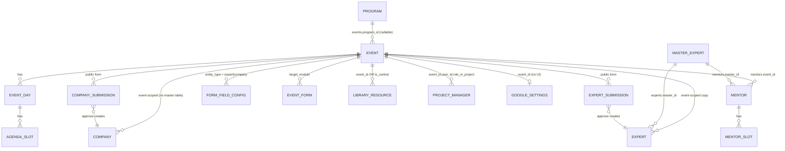

# 03 - Frontend: Event Management & Core Entity UI (as-is)

Scope: the event-management and core-entity components in `src/components/` of the React 19 + Vite + Supabase app. This document is **descriptive only**: it records what the code does today, including duplication, contradictions and dead code. It contains no improvement plan. No secret values are printed anywhere in this document.

Conventions used below:

- `File.jsx:NN` means `src/components/File.jsx`, line NN (unless a path is given, e.g. `lib/api.js:NN` = `src/lib/api.js`).
- "api" = `src/lib/api.js` (4,971 lines, 168 exports). Tables are Supabase tables.
- Routes come from `src/App.jsx` (HashRouter, all page components lazy-loaded, `App.jsx:6-60`).
- Role names: `super_admin`, `project_manager` (plus `founder`, `alumni_manager` for the alumni portal, out of scope here). Role checks are done by `RoleGuard` (`RoleGuard.jsx:6-70`) and `useAuth()` (`contexts/AuthContext.jsx:165-166`).

---

## 1. Inventory and size

| Component | Lines | `useState` | `useEffect` | Kind |
|---|---:|---:|---:|---|
| `EventBuilder.jsx` | 2132 | 37 | 2 | Admin page (agenda editor) |
| `ExpertManager.jsx` | 1317 | 27 | 2 | Admin page / embeddable |
| `StartupManager.jsx` | 1243 | 19 | 1 | Admin page / embeddable |
| `EventDashboard.jsx` | 948 | 25 | 2 | Admin page (event hub) |
| `Dashboard.jsx` | 769 | 18 (+ 2 sub-components) | 3 | Admin home |
| `LibraryManager.jsx` | 580 | 10 | 1 | Admin page |
| `MasterExpertsList.jsx` | 566 | 9 (+ 3 sub-components) | 1 | Admin page |
| `CompanyCard.jsx` | 476 | 1 | 0 | Shared card (admin + public) |
| `AgendaViewer.jsx` | 458 | 6 | 1 | Public page |
| `CompanyPortal.jsx` | 407 | 8 | 1 | Public form |
| `ExpertPortal.jsx` | 371 | 8 | 1 | Public form |
| `ExpertCard.jsx` | 386 | 1 | 0 | Shared card (admin + public) |
| `MentorDetails.jsx` | 386 | 7 | 1 | Admin page |
| `ProjectManagersManager.jsx` | 343 | 9 | 1 | Admin widget |
| `LibraryViewer.jsx` | 242 | 4 | 1 | Public page |
| `SubmissionAnalytics.jsx` | 232 | 2 | 1 | Widget |
| `EventVisualManager.jsx` | 204 | 6 | 1 | Admin page |
| `CompaniesPage.jsx` | 165 | 5 | 1 | Admin page |
| `ExpertViewer.jsx` | 156 | 6 | 1 | Public page |
| `StartupViewer.jsx` | 137 | 6 | 1 | Public page |
| `ListsManager.jsx` | 105 | 1 | 0 | Wrapper (tabs) |
| `MarketingAnalytics.jsx` | 56 | 0 | 0 | Wrapper |
| `Dashboard.jsx.bak` | 387 | - | - | Backup copy, not imported anywhere |

Total in scope: 12,066 lines (including the `.bak`). Only `ExpertManager.jsx:97-125`, `StartupManager.jsx:89-114`, `Dashboard.jsx:296-311` etc. fetch data inside effects; there is no shared data layer, state manager or custom data hook in these components (the only shared hook used is `usePresence`, `Dashboard.jsx:278`, `EventDashboard.jsx:22`).

---

## 2. Domain model as seen from the UI

### 2.1 Entity relationships

### 2.2 Vocabulary mismatch (same thing, several names)

| Concept (DB) | Names used in UI | Where |
|---|---|---|
| `events` row | "Event", "Project" ("Create Project", "Unassigned Projects", "N projects"), "Event Orchestrator", "Brand" | `Dashboard.jsx:189,559,604,638`; `EventBuilder.jsx:1079`; `EventDashboard.jsx:684` |
| `experts` / `master_experts` | "Expert", "Mentor" ("Mentors Hub", "Manage Mentors & Startups"), "Speaker", "Visionary", "Athar Expert Networks", "Global Expert Library", "Athar Network" | `ExpertManager.jsx:436,1201`; `ListsManager.jsx:45,50`; `MasterExpertsList.jsx:104-106` |
| `companies` | "Company", "Startup", "Venture", "Builder", "Ecosystem" | `StartupManager.jsx:321,720,1136`; `CompanyCard.jsx:56,58` |
| `mentors` (table) | separate from `experts`, optionally linked by `mentors.master_id` | `lib/mentorBooking.js:36-90` |
| `programs` | "Program" (Dashboard grouping container) | `Dashboard.jsx:159-270` |

### 2.3 How the pieces connect (UI view)

- **Program** is only a grouping on the home screen. `Dashboard.jsx` lists programs, each with its events (`getEventsForProgram`, `Dashboard.jsx:402`), plus an "Unassigned Projects" block (`Dashboard.jsx:400,554-583`). Only `name` is edited in the UI (`createProgram(name)`, `updateProgram(id,{name})`); the table also has `name_ar`, `program_type`, `year`, `status` (`types/database.types.ts`) which no component in scope touches.
- **Event** is the root. `EventDashboard` is the per-event hub: 8 module cards (`EventDashboard.jsx:316-390`) - Agenda Builder, Lists, Form Builder, Mentor Booking, Selection Process, Library, Mentoring Distribution, Join Athar. It also embeds `ProjectManagersManager` (`EventDashboard.jsx:693`).
- **Agenda** = `event_days` -> `agenda_slots`. Edited in `EventBuilder`, read publicly by `AgendaViewer` via `getFullAgenda`.
- **Experts** are per-event rows in `experts` that are kept denormalised copies of a global `master_experts` row (`createExpert`, `lib/api.js:605-673`; `updateMasterExpert` syncs all linked copies, `lib/api.js:555-584`). `MasterExpertsList` is the global hub view ("Athar Expert Networks").
- **Companies/Startups** are per-event rows in `companies`. There is **no** master table for companies. `CompaniesPage` shows *all* rows from `companies` across all events via `getStartups()` (`lib/api.js:298-304`).
- **Lists** (`ListsManager`) is a tab wrapper that mounts `ExpertManager` ("Mentors") or `StartupManager` ("Startups") with `isEmbedded` (`ListsManager.jsx:96-100`). It is the only in-app navigation path to those two screens (see 5.3).
- **Submissions**: public portals insert into `expert_submissions` / `company_submissions`; the manager "Review Desk" tab approves (copy into `experts`/`companies`) or rejects.
- **Form config**: `form_field_configs` (rows keyed by `event_id` + `entity_type`) drive (a) public form fields, (b) `is_required` markers in manager modals, (c) `show_in_card` card visibility. `ExpertManager`/`StartupManager` "Card Settings" modals edit and save it (`saveFormConfig`).
- **Library**: `library_resources` rows are either event-scoped (`event_id`) or central (`is_central = true`); `getLibraryResources(eventId)` returns both (`lib/api.js:901-915`).
- **Public tab set** for an event is *computed* from data (`getAgendaTabs`, `lib/api.js:263-296`): agenda always, experts if any, companies if any, library if any, join-athar if page has content. `EventDashboard` uses it to build share links with a `tabs=` query (`EventDashboard.jsx:226-227,265-269`).

```mermaid
flowchart TD
    subgraph Admin["Admin (RoleGuard: super_admin | project_manager)"]
        D["/ Dashboard"] -->|navigate| ED["/event/:id EventDashboard"]
        D --> ME["/experts MasterExpertsList"]
        D --> LM0["/library LibraryManager (central)"]
        D --> FL["/form-library"]
        D --> AL["/alumni"]
        ED -->|card| EB["/event/:id/agenda EventBuilder"]
        ED -->|card| LS["/event/:id/lists ListsManager"]
        LS --> EM["ExpertManager (embedded)"]
        LS --> SM["StartupManager (embedded)"]
        ED -->|card| FE["/event/:id/forms FormEditor"]
        ED -->|card| MB["/event/:id/mentor-booking"]
        MB --> MD["/event/:id/mentor-booking/:mentorId MentorDetails"]
        ED -->|card| LM["/event/:id/library LibraryManager"]
        ED --> PMM["ProjectManagersManager (super_admin only)"]
        ED -.no link.-> EVM["/event/:id/visuals EventVisualManager"]
        ED -.no link.-> MA["/event/:id/analytics MarketingAnalytics"]
        ED -.no link.-> EM2["/event/:id/experts ExpertManager (standalone)"]
        ED -.no link.-> SM2["/event/:id/startups StartupManager (standalone)"]
        D -.no link.-> CP["/companies CompaniesPage"]
    end
    subgraph Public["Public (no auth)"]
        AV["/agenda/:eventId AgendaViewer"]
        EV["/view/:id/experts ExpertViewer"]
        SV["/view/:id/startups StartupViewer"]
        LV["/view/:id/library LibraryViewer"]
        CPo["/events/:id/register/company CompanyPortal"]
        EPo["/events/:id/register/expert ExpertPortal"]
    end
    CPo -->|company_submissions| SM
    EPo -->|expert_submissions| EM
```

---

## 3. Route / role matrix for in-scope components

Role gate = `RoleGuard` with `allowedRoles` from `App.jsx`. `super_admin` always bypasses (`RoleGuard.jsx:30-33`).

| Component | Route(s) | Guard / who can reach it |
|---|---|---|
| `Dashboard` | `/` (`App.jsx:135-139`) | `RoleGuard` **without** `allowedRoles`: any authenticated user except `founder`/`alumni_manager` (redirected away, `RoleGuard.jsx:35-44`). A user with no role at all can also pass (see Open Q 1). |
| `CompaniesPage` | `/companies` (`App.jsx:141-145`) | super_admin, project_manager. No in-app link (grep: no `to="/companies"`). |
| `MasterExpertsList` | `/experts` (`App.jsx:147-151`) | super_admin, project_manager. Linked from `Dashboard.jsx:440`. |
| `LibraryManager` | `/library` (global mode, no `eventId`) and `/event(s)/:eventId/library` | super_admin, project_manager (`App.jsx:153-157,377-386`). |
| `EventDashboard` | `/event/:eventId`, `/events/:eventId` | super_admin, project_manager (`App.jsx:160-169`). |
| `EventBuilder` | `/event(s)/:eventId/agenda` via inline `BuilderWrapper` (`App.jsx:333-342,480-483`) | super_admin, project_manager. |
| `EventVisualManager` | `/event(s)/:eventId/visuals` | super_admin, project_manager (`App.jsx:321-330`). No in-app link. |
| `ExpertManager` | `/event(s)/:eventId/experts` and embedded in `ListsManager` | super_admin, project_manager (`App.jsx:344-353`). |
| `StartupManager` | `/event(s)/:eventId/startups` and embedded in `ListsManager` | super_admin, project_manager (`App.jsx:355-364`). |
| `ListsManager` | `/event(s)/:eventId/lists` | super_admin, project_manager (`App.jsx:366-375`). |
| `MarketingAnalytics` (+ `SubmissionAnalytics`) | `/event(s)/:eventId/analytics` | super_admin, project_manager (`App.jsx:399-408`). No in-app link. |
| `ProjectManagersManager` | embedded in `EventDashboard` | Component returns `null` unless `isSuperAdmin` (`ProjectManagersManager.jsx:56`); data is only loaded for super_admin (`:49-53`). The parent route itself admits project managers. |
| `MentorDetails` | `/event/:eventId/mentor-booking/:mentorId` (`App.jsx:448-452`) | super_admin, project_manager. (Only the `/event/` form exists; no `/events/` twin.) |
| `AgendaViewer` | `/agenda/:eventId` inside `PublicLayout` via `ViewerWrapper` (`App.jsx:423,485-488`) | Public. `:eventId` may be UUID or name-slug. |
| `ExpertViewer` / `StartupViewer` / `LibraryViewer` | `/view/:eventId/experts` / `startups` / `library` (`App.jsx:424-426`) | Public. |
| `ExpertPortal` / `CompanyPortal` | `/events/:eventId/register/expert` / `company` (`App.jsx:431-432`) | Public, outside `PublicLayout`. Only the plural `/events/` form exists. |
| `ExpertCard` / `CompanyCard` | not routed (shared children) | - |
| `Dashboard.jsx.bak` | not routed, not imported | - |

Route-level observations (as-is): nine admin modules are registered twice, `/event/:id/...` and `/events/:id/...` (`App.jsx:160-419`); the form portal has four URL shapes (`App.jsx:433-436`); `/verify-certificate/:code` is declared twice (`App.jsx:198` and `:439`). In-scope components navigate with the singular `/event/` form exclusively (e.g. `Dashboard.jsx:541`, `ListsManager.jsx:34`, `EventDashboard.jsx:321-386`).

---

## 4. Component reference

Legend for each component: **Purpose / Route / Props / State / Effects / API & tables / Roles / Rules / Sub-sections / i18n / Size**.

### 4.1 `Dashboard.jsx` (769 lines) - admin home

- **Purpose**: list events grouped by program; create/rename/delete programs; create/delete/move events; copy public link.
- **Route**: `/`. **Props**: none.
- **Local components** (same file): `EventCard` (`:26-157`, props `event, programs, copiedId, onManage, onCopy, onDelete, onMove`; own `showMoveMenu` state and a `mousedown` outside-click effect `:30-36`) and `ProgramCard` (`:159-270`, own `expanded`, `showMenu`, same outside-click effect `:168-174`).
- **State** (main): `events, programs, loading, error`; three modal flags; `newEventName, createEventStatus('idle'|'loading'|'success'), targetProgramId, newProgramName, createProgramStatus, renamingProgram, renameValue, copiedId` (`:274-293`).
- **Effects**: `useEffect(loadAll, [])` (`:311`); `usePresence('global_dashboard')` for the active-users avatars (`:278`).
- **API**: `getEvents`, `getPrograms` (parallel, `:300`), `createEvent`, `deleteEvent`, `createProgram`, `updateProgram`, `deleteProgram`, `assignEventToProgram`, `getEventSlug` (imports `:9-13`). Tables touched indirectly: `events`, `programs`. Imports `prefetch` from `../App` (`:18`) to warm chunks on hover (`:42`).
- **Roles**: see matrix.
- **Business rules**: deleting a program only unassigns its events (`:380`, backed by `ON DELETE SET NULL` per `lib/api.js:2452`); "active" = `status === 'active' || !status` (`:176,401`); after creating an event with a target program, calls `assignEventToProgram` as a second request (`:324-327`); success state auto-navigates to `/event/:id` after a 1.5 s timer (`:329-335`); event delete uses native `confirm()` and re-fetches everything (`:343-346`).
- **Sub-sections**: sticky header with nav links (Alumni Platform `:431`, Form Library `:434`, Central Library `:437`, Experts Network `:440`), program/event create buttons, `UserNavDropdown`; welcome banner; loading/error/empty states; program cards; unassigned events grid; three modals (create event `:589-671`, create program `:674-729`, rename program `:732-765`).
- **i18n**: none (`translations.js` unused). English UI copy with Arabic literals in error dialogs (`:305,339,344,358,375,380,397`).
- **Complexity**: moderate. Whole data set is reloaded after every mutation (`loadAll` at `:345,357,381,396`).

### 4.2 `Dashboard.jsx.bak` (387 lines) vs `Dashboard.jsx`

Tracked in git (commit `0684846`), not imported by anything. Differences:

| Aspect | `.bak` | current |
|---|---|---|
| Programs | none | full program grouping (`Dashboard.jsx:159-270`) |
| Branding | "Athar Planner / Professional Event Ecosystem" (`.bak:118-120`) | "AtharOS" (`Dashboard.jsx:423`) |
| Sign-out | inline button using `useAuth().signOut` (`.bak:20-29,163-169`) | delegated to `UserNavDropdown` (`Dashboard.jsx:460`); `useAuth` import left unused (`:14`) |
| Nav links | Library, Experts, `/mentor-booking-admin` (`.bak:147-153`, no such route in `App.jsx`) | Alumni, Form Library, Library, Experts |
| Copy link | `${window.location.origin}/#/agenda/${eventId}` (UUID) (`.bak:91-96`) | slug + `getAppBaseUrl()` (`Dashboard.jsx:348-354`) |
| Counts | `events.length` as "active" | filtered active count |

### 4.3 `EventBuilder.jsx` (2132 lines) - agenda editor

- **Purpose**: edit days and time slots of an event (EN/AR titles, presenter, bullet points), reorder slots by drag-and-drop, shift a day's times by +/-1h, duplicate a day, set the agenda cover image and header "visual identity".
- **Route**: `/event/:eventId/agenda` through `BuilderWrapper`, which passes `event={{event_id}}` and `onBack={() => window.history.back()}` (`App.jsx:480-483`). Props: `event`, `onBack`.
- **Local components**: `SortableSlot` (`:43-175`, dnd-kit `useSortable`; mobile and desktop action rows are two duplicated blocks `:71-104` and `:145-172`), `TimeAmPmInput` (defined *inside* the component body, `:211-221`; despite its name it is a native `<input type="time">`).
- **State** (37 `useState`, `:178-290,957`): `days`, `slots` (map `day_id -> slot[]`), `activeTab ('days'|'settings')`, `slotModal` (one object with 13 fields), add-day form fields, edit-day fields, `eventDetails`, cover/upload flags, sync report fields, `stableState`, `pendingDeletions`, `pendingDayDeletions`, `invalidSlotIds (Set)`, `headerSettings`, `imageUrls`, `toast`, `confirmState`, `isSavingChanges`.
- **Effects**: load effect on `[event.event_id, eventDetails?.gsheets_url]` (`:477-484`); `beforeunload` guard while `hasUnsavedChanges` (`:486-495`).
- **API**: `getEvent`, `getEventDays`, `getAgendaSlots` (one call per day, in parallel, `:521-530`), `createDay`, `updateDay`, `deleteDay`, `deleteSlot`, `updateSlotsOrder` (insert-or-upsert split, `lib/api.js:2320-2368`), `updateEvent`, `uploadImage` (bucket `event-assets`, `lib/api.js:871-895`), `importAgendaData`, `getEventSlug`; `parseAgendaExcel`, `fetchAndParseGoogleSheet` from `lib/excel.js`. Tables: `events`, `event_days`, `agenda_slots`; storage `event-assets`.
- **Staged-save model** (the central business rule):
  1. Edits to days/slots mutate local state only (`handleAddDay :553`, `handleSaveSlot :612-672` makes **no** API call, `handleDeleteDay :674`, `handleDeleteSlot :725`, `handleDuplicateDay :696`, `handleShiftDayTime :804`, `handleTogglePresenter :777`).
  2. New rows get temp ids (`day-temp-<ts>`, `temp-<ts>`) and `isOptimistic: true`. Deleting a real row pushes its id to `pendingDayDeletions` / `pendingDeletions`.
  3. A JSON "stable" snapshot is taken at load (`serializeState :294-334`, normalising `HH:MM:SS` to `HH:MM`) and compared on every render (`hasUnsavedChanges :337-343`). A floating bar appears with discard/save (`:1140-1191`).
  4. `handleFinalSave` (`:959-1044`) runs sequentially, un-transactionally: delete days -> delete slots -> for each day (sorted by date) create or update the day, then `updateSlotsOrder` the whole slot list (insert for temp ids, upsert for existing) -> `updateEvent({show_day_names})` -> reload.
  5. Save is disabled while `invalidSlotIds.size > 0` (`:1172`).
- **Validation rule**: `validateAgendaOrder` flags two consecutive slots invalid if `current.start_time > next.start_time || current.end_time > next.start_time` using **string comparison** (`:846-857`). It does not normalise `HH:MM:SS` vs `HH:MM` the way `serializeState` does.
- **Visual settings tab** (`:1584-1874`): hero visible toggle, cover type image/colour, image URL or upload, section height, overlay title + colour, overlay dimming slider, brand name input, font family (3 options), title/content size & weight. Saved by `handleSaveImages` to `events.header_image_url, header_settings (jsonb), header_height, show_day_names` (`:415-431`).
- **Other sub-sections**: sync error/report panels (`:1193-1279`, only populated by the dead `handleGoogleSheetSync`), "Agenda Cover" card (`:1281-1335`, uploads and saves to `events.header_image_url` **immediately**, `:373-389`), "Display settings" toggle for day names (`:1340-1367`), "Add Day" form (`:1370-1425`), day cards with +1/-1/Add Slot/Duplicate/Delete (`:1429-1572`), slot modal (`:1878-2075`), custom confirm modal (`:2079-2113`), toast (`:2116-2129`).
- **i18n**: none via `translations.js`. Hard-coded bilingual strings: Arabic toasts/confirm text (`:354-357,573,675,692,722,746,905`) mixed with English labels. Bullet points are separate EN/AR arrays.
- **Complexity**: highest in the scope. Very large single component, 37 states, UI-only metadata (`isOptimistic`) mixed into data rows.

### 4.4 `EventDashboard.jsx` (948 lines) - per-event hub

- **Purpose**: header with rename, public-link dropdowns (EN/AR with tab selection), Sheets sync modal, `SyncButton`, duplicate-event modal, status chip, module cards, project-managers panel.
- **Route**: `/event/:eventId`, `/events/:eventId`. Reads `params.eventId || params.id` (`:18`). **Props**: none.
- **State**: 25 `useState` (`:20-57`): event, loading, theme colours, sync-modal flags, URL fields, Google settings fields, duplicate modal, rename, dropdowns, tab selection.
- **Effects**: load event + Google settings on `[eventId]` (`:132-136`); outside-click + Esc listener (`:236-254`).
- **API/tables**: `getEvent`, `updateEvent`, `duplicateEvent`, `getEventSlug`, `getAgendaTabs`; **direct** `supabase.from('google_settings')` select/upsert (`:62-67,105-114`) - the only direct Supabase call in the in-scope components. Components: `SyncButton` (-> `syncEventFromCloud`, `lib/api.js:1090`), `ProjectManagersManager`, `ActiveUsers`, `UserNavDropdown`.
- **Business rules**:
  - Public link: `${origin}${pathname}?agenda=<slug>&lang=<en|ar>&tabs=<csv>` (`:265-269`); `App.jsx:99-116` rewrites such a URL into `#/agenda/<slug>?...` at load.
  - Tab checklist is built from live data (`getAgendaTabs`), all pre-selected (`:226-228`).
  - Two Google-Sheet URLs are stored on the event: `gsheets_url` (all modules) and `selection_process_gsheets_url` (`:153-178`).
  - Duplicate clones event config, days/slots, experts, companies, library and forms (`:898`, `lib/api.js:354-517`).
  - `SyncButton onSyncComplete={() => window.location.reload()}` (`:627`) - full page reload after sync.
- **Module cards** (`:316-390`): `manageLink` navigations; only the first card has a `previewLink` (`/agenda/<slug>`). `prefetchKey` values `'mentor-booking'` and `'mentoringDistribution'` do not exist in `prefetch` (`App.jsx:64-79`), so those hovers are no-ops (`:703` uses optional call).
- **Dead/unused code**: `_saveTheme` (`:138-151`) and `experts_color`/`startups_color` state (`:25-27`) have no UI; the theme colours are only *read* from the DB (`:221-222`). The whole Google Settings feature (state `:49-52`, `loadGoogleSettings :60-81`, `handleSaveGoogleSettings :83-130`) has no rendered form. `isSyncOpen` (`:28`) unused.
- **i18n**: no `translations.js`; EN dropdown vs AR dropdown are two near-identical JSX blocks (`:464-537` and `:539-613`) with inline Arabic strings.
- **Complexity**: moderate; large JSX, three modals/dropdowns in one component.

### 4.5 `EventVisualManager.jsx` (204 lines)

- **Purpose**: upload "Background Image" and "Footer Image" for the public agenda.
- **Route**: `/event(s)/:eventId/visuals`. No props. State: `loading, saving, success, event, settings{background_image_url, footer_image_url}, uploading{...}`.
- **API**: `getEvent`, `updateEvent(eventId, settings)`, `uploadImage(file,'visuals')`, `getEventSlug`. Table `events`; storage `event-assets`.
- **Rules**: staged until "Save Changes" (unlike `EventBuilder` cover upload which saves immediately). Preview link `#/agenda/<slug>` (`:162`).
- **Notes**: `ImageSection` is declared as an inner component inside the render function (`:92-140`) so it is a new component type every render. Not reachable from any in-app link.
- **i18n**: none; one Arabic subtitle per section (`:189,196`).

### 4.6 `ExpertManager.jsx` (1317 lines) - per-event experts ("Mentors Hub")

- **Purpose**: curated expert grid with drag-reorder, add/edit modal, "Import from Network" (master library), "Review Desk" for pending submissions, card-settings modal, sync button.
- **Routes**: `/event(s)/:eventId/experts` and embedded by `ListsManager` (`isEmbedded` prop, default `false`, `:32`). Reads `eventId` from `useParams` (so embedding depends on being inside a route that has `:eventId`).
- **State** (27, `:35-83`): `experts, loading, error, searchTerm, showAddModal, isSubmitting, isUploading, editingExpert, activeTab('curated'|'review'), submissions, selectedSubmission, showPreview, actionLoading, activeId, formConfig, showSettingsModal, settingsSaving, showLibraryModal, libraryExperts, libraryLoading, event, tempLabel, tempLabelAr, tempHideTitle, formData{...,display_config}`; `_selectedFile`, `isSearchExpanded` are unused placeholders.
- **Effects**: `loadData` on `[eventId, activeTab]` (`:122-125`) - always fetches form config **and** event even for the review tab (`:100-104`); settings modal initialiser (`:128-135`).
- **API**: `getExperts`, `createExpert`, `updateExpert`, `deleteExpert`, `uploadImage('experts/<eventId>')`, `getSubmissions(eventId,'expert','pending')`, `approveSubmission`, `rejectSubmission`, `bulkUpdateExperts`, `getFormConfig`, `saveFormConfig`, `getMasterExperts`, `getEvent`, `updateEvent`. Tables: `experts`, `master_experts`, `expert_submissions`, `form_field_configs`, `event_forms`, `events`.
- **Business rules**:
  - Required markers come from `form_field_configs.is_required` via `isFieldRequired(name)` (`:176-178`) for `name,title,company,bio,linkedin_url,photo_url`.
  - Import from library blocks duplicates by `master_id` (`:225-229`), then `createExpert({... master_id, sort_order: experts.length+1})`.
  - Editing an expert syncs fields back to the master and to every other linked event (`lib/api.js:675-723` -> `updateMasterExpert`).
  - Approve runs `approveSubmission('expert')` -> `createExpert` (`lib/api.js:1338-1348`); reject asks `window.prompt` for a reason (`:205`).
  - Drag-reorder persists immediately via `bulkUpdateExperts` (`:312-335`).
  - Card settings modal saves `form_field_configs` **and** writes `events.header_settings.customExpertsLabel / customExpertsLabelAr / hideExpertListTitle` (`:575-595`), which `ExpertViewer` and `getAgendaTabs` consume (`ExpertViewer.jsx:101-104`, `lib/api.js:281-283`).
- **Sub-sections**: header + action bar (`renderActionBar :337-417`, rendered in two header variants for standalone vs embedded `:422-457`), card settings modal (`:460-609`), grid with `DndContext` (`:627-660`), review list (`:661-747`), add/edit modal (`:764-1065`), submission preview modal (`:1068-1187`), library modal (`:1189-1312`).
- **i18n**: none via `translations.js`. Each text field has an EN input and a hand-written AR input; bilingual toggles label "Show on Card / عرض على الكارت" (11 repetitions in `ExpertManager.jsx`/`StartupManager.jsx`).
- **Complexity**: high; multiple modal state machines, three data sources, dnd.

### 4.7 `ExpertCard.jsx` (386 lines)

- **Purpose**: presentational card (grid + list variants), used in admin grid, preview modal, public viewer.
- **Props**: `expert, config, customColor='#1a27c9', viewMode='grid', onEdit, onDelete, previewMode=false, priority=false, forceExpanded=false`.
- **State**: `expanded` (mobile read-more). Calls `useSortable` unconditionally (disabled when `previewMode`, `:21-24`) even in the public viewer, which has no `DndContext`.
- **Language**: reads `?lang=` from the URL itself (`:36-38`) and `translations.ExpertCard[lang]` (`:42`).
- **Visibility rule** (`:57-76`): if `config` is an array (global `form_field_configs`) use `show_in_card !== false` per field; else fall back to `expert.display_config`. Since both admin and viewer always pass `config`, the per-expert `display_config` toggles in the add/edit modal are never consulted when a config array exists (see 7.3).
- **Notes**: list variant (`:83-221`) has no caller (both viewers hard-code `viewMode = 'grid'`). Hard-coded English confirm text (`:209,263`) and fallbacks `'Unknown Expert'`, `'Not Specified'`. `sanitizeName` hides names that look like URLs (`:45-52`).

### 4.8 `ExpertViewer.jsx` (156 lines) - public

- **Route**: `/view/:eventId/experts`. **State**: `event, experts, config, loading, themeColor, viewMode (constant 'grid')`.
- **API**: `getEvent`, `getExperts`, `getFormConfig(eventId,'expert')` (parallel, `:31-35`). Sets `document.title` (`:47-49`). Theme colour from `events.experts_color` (`:42-44`). Background from `events.background_image_url`; font from `events.header_settings.fontFamily` (`:83-97`).
- **Rules**: title hidden when `header_settings.hideExpertListTitle` or exactly one expert (`:101`); a single expert is rendered force-expanded and centred (`:134-136,149`). Custom tab title from `customExpertsLabel(Ar)`.
- **i18n**: `translations.ExpertViewer[lang]`, `?lang=ar`.
- **Roles**: public.

### 4.9 `ExpertPortal.jsx` (371 lines) - public expert registration

- **Route**: `/events/:eventId/register/expert`. **State**: event, `formFields`, `formValues`, `errors`, `loading`, `submitting`, `submitted`, `error`.
- **Flow**: `getEvent` -> checks `expert_portal_enabled` and `submission_deadline` (`:53-64`) -> `getFormConfig(eventId,'expert')` -> render `DynamicFormBuilder` -> client validation (required, email, url, `validation_rules` min/max/pattern, `:93-130`) -> `submitExpertRegistration` (-> `expert_submissions`, status `'pending'`, `lib/api.js:1249-1271`). Uploads via `uploadImage('expert-photos')`.
- **i18n**: `const t = isArabic ? translations.ar : translations.en` (`:33`) - see 7.1: `translations` has no top-level `ar`/`en`.
- **Rendering**: header image/colour/title from `events.header_settings`, `header_image_url`/`form_cover_image_url`, `header_height`; the "live preview" box shows only explanatory text (no card, unlike `CompanyPortal`).

### 4.10 `MasterExpertsList.jsx` (566 lines) - global expert library

- **Route**: `/experts`. **State**: `experts, loading, searchTerm, viewMode('grid'|'list'), editingExpert, _error, successMessage, showMobileSearch`.
- **Sub-components**: `MasterExpertCard` (`:243-335`), `ExpertRow` (`:337-405`), `ExpertEditModal` (`:407-566`).
- **API**: `getMasterExperts` (master rows + `linked_events`, `lib/api.js:523-553`), `updateMasterExpert`, `deleteMasterExpert`.
- **Rules**: edit warns it affects all linked events (`:438-443`) and `updateMasterExpert` overwrites every `experts` row with that `master_id` (`lib/api.js:575-581`); delete detaches (`master_id = null`) then deletes the master (`lib/api.js:586-603`), with an Arabic `confirm` that shows the linked event count (`:57-62`). Search covers `name,title,company` (EN fields only, `:74-78`). No create button: masters are created only as a side-effect of `createExpert`.
- **i18n**: none; Arabic literals in confirm/success messages (`:45,59-60,66,70`).
- Edit form state is `{...expert, ...normalised}` (`:410-422`), i.e. it carries virtual `linked_events` and ids; `updateMasterExpert` strips them (`lib/api.js:558-562`).

### 4.11 `StartupManager.jsx` (1243 lines) - per-event startups ("Company Grid")

- **Purpose / structure**: mirror of `ExpertManager` for `companies` (curated grid, review desk, add/edit modal, card settings, drag-reorder). No master-library import and no custom tab-label settings.
- **Routes**: `/event(s)/:eventId/startups`; embedded in `ListsManager`. Prop `isEmbedded`.
- **State** (19, `:31-87`): includes `formData` with 17 fields + `display_config`, `links[]` array.
- **API/tables**: `getCompanies`, `createCompany`, `updateCompany`, `deleteCompany`, `uploadImage('startup-logos')`, `getSubmissions(eventId,'company','pending')`, `approveSubmission('company')`, `rejectSubmission`, `bulkUpdateCompanies`, `getFormConfig`, `saveFormConfig`. Tables: `companies`, `company_submissions`, `form_field_configs`.
- **Rules**: `links` normalised from JSON string / array / legacy `website_url` (`:119-130`); stage is a fixed dropdown of 6 values (`:873-880`); governorate is a hard-coded list of 27 Egyptian governorates (`:907-935`); drag disabled while searching (`:552`); search covers `name`, `industry` (`:304-307`); approve reloads the grid (`:186`) (the expert twin does not).
- **Sub-sections**: `renderHeaderTop`/`renderActionBar` (`:309-411`), settings modal (`:432-522`), grid (`:540-596`), review list (`:597-679`), add modal (`:683-1143`), preview modal (`:1146-1238`).
- **i18n**: none; bilingual labels inline. Accepts an `industry_ar`, `founder_ar`, `governorate_ar`, `location_ar` set of fields in `formData` (`:62-87`), but the modal has no input for `location_ar` and `CompanyCard` reads `location_ar` rather than `governorate_ar` for the governorate (see 7.4).

### 4.12 `StartupViewer.jsx` (137 lines) - public

Same shape as `ExpertViewer`: `getEvent`, `getCompanies`, `getFormConfig(eventId,'company')`; theme from `events.startups_color`; renders `CompanyCard` grid with `previewMode`. `translations.StartupViewer[lang]`. Route `/view/:eventId/startups`.

### 4.13 `CompanyCard.jsx` (476 lines)

- **Props**: `company, config, customColor, viewMode, onEdit, onDelete, previewMode, priority`. State `isExpanded` (mobile). `useSortable` unconditional (`:26-36`). Language from `?lang` (`:48-54`) + `translations.CompanyCard[lang]`.
- **Field fallbacks** "database schema and legacy mock data" (`:55-64`): `startup_name || name`, `logo_url || logoUrl`, `industry || sector`, `location || governorate`, `description || bio`. Legacy `company.status === 'Profitable'` badge (`:283-292`). Link icons via local `LinkIcon` switch (`:11-22`), up to 3 links in grid view (`:427`).
- **Visibility mapping** to `form_field_configs.field_name` (`:79-89`): `logo_url`, `startup_name`, `industry`, `location`, `description`, `founder_name`, `founder_role`, `startup_stage`, `website_url`. See 7.4.
- Unused imports: `Plus`, `Banknote`; list variant (`:113-260`) has no caller.

### 4.14 `CompaniesPage.jsx` (165 lines)

- **Route** `/companies`. Lists **all** `companies` rows across events with `CompanyCard` (`getStartups`, `:23`). Search on `startup_name`/`industry` (`:33-36`), key `startup_id` (`:146`). "Add Company" button has no `onClick` (`:90-93`). `AlertCircle` is used (`:130`) but not imported (`:2`), so the error branch would throw a `ReferenceError`. Error strings in Arabic (`:27,137`), rest English.
- The `companies` type has `name`, `company_id` (no `startup_name`/`startup_id`; `types/database.types.ts`), so the search predicate on `startup_name` never matches by name and the `key` is `undefined`.

### 4.15 `CompanyPortal.jsx` (407 lines) - public company registration

Same flow as `ExpertPortal` (checks `company_portal_enabled`, deadline, loads `getFormConfig(eventId,'company')`, validates, `submitCompanyRegistration` -> `company_submissions` with status `'screening'`, `lib/api.js:1221-1242`). Differences: shows a **live `CompanyCard` preview** built from `formValues` (`:367-377`, keys `name|startup_name`, `logo_url`, `industry|sector`, `location`, `description|bio`); blue theme; uploads to `company-logos`. Same `translations.ar/en` access issue (`:35`).

### 4.16 `AgendaViewer.jsx` (458 lines) - public agenda

- **Route** `/agenda/:eventId` (UUID or slug). Props: `eventId`. **State**: `agenda, loading, selectedDay, experts, error, headerSettings`.
- **Effects**: initial `localStorage.getItem('event_header_settings_<eventId>')` (`:43-46`; key is never written anywhere in `src/`), `loadAgenda` immediately and every 30 s (`:48-51`).
- **API**: `getFullAgenda` + `getExperts` in parallel (`:57-60`); `experts` state is never rendered (`:14`), `Linkedin` import unused (`:7`). `getFullAgenda` already returns `experts` and `companies`, so experts are fetched twice per refresh.
- **Rules**: day tabs only if `days.length > 1`; single-day hero label otherwise (`:233-271`); bullet points and presenter only if `show_presenter`; EN/AR fallbacks per field; header image/colour/title overlay from `events.header_settings`; fixed footer image; SEO tags updated via `document.querySelector` (only updates existing `<meta>` tags, `:78-98`). Print layout duplicates the whole header/day/slot rendering for `window.print()` (`:356-446`).
- **i18n**: `translations.AgendaViewer[lang]`; additional Arabic literals (`:88,102`). `translations.AgendaViewer` also defines `experts, companies, from, to` which this component does not use (the tab bar is rendered elsewhere, see `PublicLayout.jsx:32-33`).
- Reads `agendaData.event.description` for SEO (`:88`) - `events` has no `description` column in `types/database.types.ts`.

### 4.17 `LibraryManager.jsx` (580 lines)

- **Routes** `/library` (central only; no `eventId`) and `/event(s)/:eventId/library`. **State**: `resources, searchTerm, modal flags, editingResource, resourceForm{title_en,title_ar,resource_type,url,is_central,sort_order}`.
- **API**: `getLibraryResources(eventId)` (event + central rows), `createLibraryResource`, `updateLibraryResource`, `deleteLibraryResource`, `uploadImage('library/<eventId|global>/<docs|audio|videos>')`. Table `library_resources`.
- **Rules**: `is_central` forced `true` without an `eventId` (`:62`); central rows get `event_id = null` (`:66`); deleting a central row warns it affects all events (`:113-115`); optimistic delete with rollback (`:119-129`); resources grouped by `resource_type` (`readable|audible|visual|link`, `:147-152`).
- **Sub-sections**: header + search, grouped tables (`renderResourceTable :154-269`), "Global Pool" modal (`:368-456`, central cards, edit only), resource modal (`:459-574`).
- **i18n**: none. Title search calls `r.title_ar.includes(...)` (`:144`) which throws if `title_ar` is null.
- Global Pool edit passes the whole DB row into the form (`:397`) and the submit payload spreads it into the update (`:63-67`), including `resource_id`, `created_at`.

### 4.18 `LibraryViewer.jsx` (242 lines) - public

`getLibraryData(eventId)` -> `{resources}`; tabs `all|readable|audible|visual|link`; search on `title_en`/`title_ar`; table per type; `translations.LibraryViewer[lang]`; route `/view/:eventId/library`. No Supabase table access of its own.

### 4.19 `ListsManager.jsx` (105 lines)

Tab wrapper "Lists - Unified": `activeList 'mentors' | 'Startups'` (mixed-case literals, `:20`); renders `<ExpertManager isEmbedded />` or `<StartupManager isEmbedded />` (`:96-100`). Back button -> `/event/:eventId` (`:34`). Imports unused: `Filter, LayoutGrid, MoreVertical, Search` (header icons not used) - only `Users`, `Rocket`, `ArrowLeft`, `Settings` are rendered. "Real-time Sync" label (`:88`) is static text.

### 4.20 `MarketingAnalytics.jsx` (56) + `SubmissionAnalytics.jsx` (232)

- Route `/event(s)/:eventId/analytics`. `SubmissionAnalytics({eventId})` calls `getSubmissions(eventId,'company','all')` and `(...,'expert','all')` in parallel (`:28-31`), merges, derives:
  - channel = first non-empty of `additional_data.source | utm_source | channel | ref | from`, else "Direct / Unknown" (`:43-51`), capitalised (`:54`);
  - per-day counts keyed by `toLocaleDateString()` (`:58`), later sorted by re-parsing that localised string (`:193`);
  - "recent" = submissions in last 7 days (`:68-71`).
- It only sees `company_submissions` / `expert_submissions`, not `form_responses` (the newer generic form pipeline, `lib/api.js:1879-2025`). English only. Not linked from any in-app navigation.

### 4.21 `ProjectManagersManager.jsx` (343 lines)

- Embedded in `EventDashboard` with props `eventId, eventName` (`eventName` unused). Renders nothing unless `isSuperAdmin`.
- **API/tables**: `getProjectManagers` (`project_managers` + `profiles`), `assignProjectManager`, `removeProjectManager`, `updateProjectManagerRole`, `getAllEligibleProjectManagers` (`user_roles` where role in `project_manager|super_admin`, then `profiles`), `lib/api.js:4147-4248`.
- **Rules**: role in project is `owner` or `collaborator`, toggled by clicking the badge (`:112-125`); eligible list excludes already-assigned users (`:127-129`); empty state says "All Super Admins can access this project by default" (`:180`); the add modal labels owner as "Can manage other PMs" (`:315`) but nothing in this component or in-scope code enforces that (only super admins can see the panel).
- `assignProjectManager` writes duplicate column pairs: `event_id`/`project_id`, `assigned_by`/`added_by`, `assigned_at`/`added_at` (`lib/api.js:4179-4188`).

### 4.22 `MentorDetails.jsx` (386 lines)

- **Route** `/event/:eventId/mentor-booking/:mentorId`. **State**: `mentor, slots, loading, showAddSlot, editingSlot, newSlot, copied`.
- **API** (all from `lib/mentorBooking.js`, not `lib/api.js`): `getMentorById`, `getSlots`, `createSlot`, `updateSlot`, `deleteSlot`, `ADVANCE_NOTICE_OPTIONS`, `isSlotWithinNoticeWindow`. Tables `mentors`, `master_experts` (lookup fallback, `mentorBooking.js:68-90`), `mentor_slots`.
- **Rules**: a slot is shown as available only if `is_available` and not inside the mentor's advance-notice window (default 1440 min = 24 h, `:248-249`); creating a slot inside the window shows a warning but is allowed (`:332-342`); booking link `#/book/<mentorId>` (`:92`).
- Name collisions: `createSlot/updateSlot/deleteSlot` here are the *mentor* slot functions; `api.js` exports same-named *agenda slot* functions (`lib/api.js:830-866`), and `mentorBooking.js` also exports its own `getEvent` (`:5`) next to `api.getEvent`.
- Uses native `confirm`/`alert`; English only. Reads datetime values with `.slice(0,16)` (`:219,231`).

---

## 5. Cross-cutting behaviour

### 5.1 Data access pattern

- All components call exported functions from `lib/api.js`; only `EventDashboard` touches `supabase` directly (`google_settings`), and `Dashboard.jsx:20` imports `supabase` without using it.
- `lib/api.js` wraps reads in a 60 s in-memory cache (`withCache`, `lib/api.js:61-78`) and monkey-patches `supabase.from` to clear the **whole** cache on any `insert/update/delete/upsert` (`lib/api.js:45-59`). Reads such as `getEvents`, `getExperts`, `getCompanies`, `getMasterExperts`, `getPrograms`, `getLibraryResources` are cached; `getEventDays`, `getAgendaSlots`, `getSubmissions`, `getFormConfig` are not.
- Event identifiers may be a UUID or a name slug; `getEvent` resolves slugs by name matching (`ilike`, then normalised comparison over **all** events, `lib/api.js:112-173`). `getEventSlug` builds the slug from `event_name` (`lib/api.js:98-110`).

### 5.2 Public link formats (four different builders)

| Where | Format |
|---|---|
| `Dashboard.jsx:348-354` | `getAppBaseUrl()/#/agenda/<slug>` (base path defaults to `/EventsOperations`, `lib/utils.js:10-14`) |
| `EventDashboard.jsx:265-269` | `<origin><pathname>?agenda=<slug>&lang=&tabs=` (rewritten by `App.jsx:99-116`) |
| `EventBuilder.jsx:824` | `<href up to #>/#/agenda/<slug>` |
| `EventDashboard.jsx:650,758`, `EventVisualManager.jsx:162`, `Dashboard.jsx:77` | relative `#/agenda/<slug>` |
| `lib/api.js:35-37` `getShareUrl(eventId)` | external `SHARING_BASE_URL?id=<eventId>` (not used by in-scope components) |

Slug = event name, so renaming an event (`EventDashboard.jsx:180-196`) changes the slug of every previously shared link; two events with equal normalised names resolve to the most recently created one (`lib/api.js:134-142`).

### 5.3 In-app reachability

The per-event screens `/experts`, `/startups`, `/visuals`, `/analytics` and the global `/companies` are registered but have no link from any in-scope component (the event hub module list `EventDashboard.jsx:316-390` has no Experts, Startups, Visuals or Analytics card; Experts and Startups are reached through "Lists"). Prefetch entries `experts, startups, visuals, analytics` exist in `App.jsx:68-73` but are not called by any in-scope component.

### 5.4 Dialogs and feedback

Native `alert()`/`confirm()`/`prompt()` are the dominant feedback mechanism: Dashboard 4/2/0, EventDashboard 9/0/0, ExpertManager 12/0/1, StartupManager 9/0/1, LibraryManager 3/1/0, MentorDetails 3/1/0, ProjectManagersManager 2/1/0, MasterExpertsList 2/1/0. Only `EventBuilder` has a custom toast and confirm modal (`:360-371,2079-2129`).

### 5.5 i18n usage summary

| Component | `translations.js` key | Language switch |
|---|---|---|
| `AgendaViewer` | `AgendaViewer` | `?lang=ar` |
| `ExpertViewer` | `ExpertViewer` | `?lang=ar` |
| `StartupViewer` | `StartupViewer` | `?lang=ar` |
| `ExpertCard` | `ExpertCard` | `?lang=ar` (read inside the card) |
| `CompanyCard` | `CompanyCard` | `?lang=ar` (read inside the card) |
| `LibraryViewer` | `LibraryViewer` | `?lang=ar` |
| `ExpertPortal` / `CompanyPortal` | **`translations.ar/en` (nonexistent keys)** | `?lang=ar` |
| Dashboard, EventBuilder, EventDashboard, EventVisualManager, ExpertManager, StartupManager, MasterExpertsList, LibraryManager, ListsManager, ProjectManagersManager, MentorDetails, CompaniesPage, Marketing/SubmissionAnalytics | none | none (hard-coded EN/AR strings) |

Admin screens have no localisation layer; Arabic appears as literals in alerts, placeholders and labels.

---

## 6. Repeated UI / logic patterns (with references)

| # | Pattern | Occurrences (file:line) | Notes |
|---|---|---|---|
| P1 | **Manager page skeleton**: tabs `curated|review`, `loadData` on `[eventId, activeTab]`, search, DnD grid, review list, add/edit modal, settings modal, preview modal | `ExpertManager.jsx:97-125,337-417,627-747,764-1187` vs `StartupManager.jsx:89-114,329-411,540-679,683-1238` | ~1,300 vs ~1,240 lines; copy-adapted. Differences: green vs indigo accent, master import, tab labels, links array. |
| P2 | **Approve / reject handlers** | `ExpertManager.jsx:190-219` vs `StartupManager.jsx:181-211` | Identical except entity type; only startup reloads after approve; both use `prompt()`. |
| P3 | **Card Settings modal** (toggle "Card View"/"Required" per `form_field_configs` row) | `ExpertManager.jsx:476-516` vs `StartupManager.jsx:448-488` | Mutates `formConfig[idx]` in place (`newConfig[idx].show_in_card = ...`, shallow copy of array only). |
| P4 | **Add/edit modal with "Show on Card / عرض على الكارت" toggle per field** | `ExpertManager.jsx:855-1031` (5 toggles) vs `StartupManager.jsx:772-1016` (7 toggles) | 11 identical toggle JSX blocks. |
| P5 | **Default `display_config` object literal repeated 4x in ExpertManager (`:76-82,150-156,286-292,783-788`), 3x in StartupManager (`:78-86,148-156,257-265`) plus a divergent 4th (`:698-705`)** | see refs | Reset values differ between the three StartupManager copies (see 7.5). |
| P6 | **dnd-kit setup** (`PointerSensor distance:8` + `KeyboardSensor` + `sortableKeyboardCoordinates`) | `EventBuilder.jsx:864-873`, `ExpertManager.jsx:86-95`, `StartupManager.jsx:50-59` | Three copies. |
| P7 | **Registration portal page** | `ExpertPortal.jsx` (371) vs `CompanyPortal.jsx` (407) | `diff` reports ~70 differing lines; load/validate/submit/header JSX identical. Validation function duplicated `ExpertPortal.jsx:93-130` / `CompanyPortal.jsx:105-150`. |
| P8 | **Public viewer page** (load event+list+config, theme colour, background image, loading/error screens) | `ExpertViewer.jsx` vs `StartupViewer.jsx` | Near-identical; loading/error JSX duplicated (`:59-81` / `:61-82`). |
| P9 | **Card component pair** (grid/list variants, glow blobs, read-more, `useSortable`, `?lang` read) | `ExpertCard.jsx:11-384` vs `CompanyCard.jsx:24-473` | Two ~400-line cards with the same structure and same dead list variant. |
| P10 | **Public header block** (image/colour/overlay/title) | `ExpertPortal.jsx:227-303`, `CompanyPortal.jsx:250-326`, `AgendaViewer.jsx:172-225` | Third variation in AgendaViewer uses `` instead of cover crop; print copy `AgendaViewer.jsx:361-388`. |
| P11 | **Page background image style object** (`backgroundSize cover, fixed`) | `ExpertViewer.jsx:90-97`, `StartupViewer.jsx:91-98`, `ExpertPortal.jsx:217-225`, `CompanyPortal.jsx:240-248`, `AgendaViewer.jsx:162-170` | 5 copies; default background colours differ (`#f5f1f1ff` vs `#f1f5f9`). |
| P12 | **Noise-texture SVG background** (long data-URI inline style) | `Dashboard.jsx:410,595`, `EventDashboard.jsx:284,300,398`, `CompaniesPage.jsx:44`, `LibraryViewer.jsx:141` (+ `LoginPage.jsx:41`, `MentoringDistributionAdmin.jsx:752` outside scope) | 7 copies in scope. |
| P13 | **`cn()` helper** | `Dashboard.jsx:23`, `EventDashboard.jsx:13` (+ `JoinAtharDashboard.jsx:11`, `JoinAtharView.jsx:6`) | Four local definitions. |
| P14 | **Outside-click-to-close effect** | `Dashboard.jsx:30-36,168-174`, `EventDashboard.jsx:236-254` | Three copies. |
| P15 | **Client-side search filter** (`toLowerCase().includes`) with different fields per page | `ExpertManager.jsx:303-306` (name, company), `StartupManager.jsx:304-307` (name, industry), `MasterExpertsList.jsx:74-78` (name, title, company), `CompaniesPage.jsx:33-36` (startup_name, industry), `LibraryManager.jsx:142-145`, `LibraryViewer.jsx:39-44`, ExpertManager library modal `:1220-1228` (mutates `_visible` on state) | None search AR fields except libraries. |
| P16 | **Mobile search toggle + expandable search bar** | `MasterExpertsList.jsx:112-162`, `CompaniesPage.jsx:70-109`, `StartupManager.jsx:360-387` | Same markup copied. |
| P17 | **Loading spinner / error / empty states** | every page (e.g. `Dashboard.jsx:482-528`, `ExpertManager.jsx:613-626`, `StartupManager.jsx:526-539`, `MasterExpertsList.jsx:174-191`) | Each hand-written. |
| P18 | **Image upload field (URL input + file button)** | `ExpertManager.jsx:988-1016`, `StartupManager.jsx:1087-1114`, `EventBuilder.jsx:1651-1677`, `EventVisualManager.jsx:92-140`, `LibraryManager.jsx:517-541` | Each calls `uploadImage(file, '<folder>')` with a different ad-hoc folder (`covers`, `visuals`, `experts/<id>`, `startup-logos`, `expert-photos`, `company-logos`, `library/...`). |
| P19 | **Google Drive URL helpers** around every `` | `getGoogleDriveFallbackUrls` in cards/managers/`MentorDetails.jsx:147-148`; `getGoogleDriveDirectLink` in viewers/portals/EventBuilder/VisualManager | Two helper families used inconsistently. |
| P20 | **Bilingual EN/AR input pairs** (`xxx` + `xxx_ar`, `dir="rtl"`) | ExpertManager, StartupManager, MasterExpertsList (`:447-530`), EventBuilder (slot modal `:1911-1955`, days `:1381-1399`), LibraryManager | No shared component. |
| P21 | **Success/loading/idle 3-state modal** | `Dashboard.jsx:598-667` (events), `:679-725` (programs) | Different timers (1500 ms vs 1000 ms). |
| P22 | **EN vs AR dropdown blocks** | `EventDashboard.jsx:464-537` vs `:539-613` | Same block twice with different text. |
| P23 | **Mobile/desktop duplicated action rows** | `EventBuilder.jsx:71-104` vs `:145-172` | Two renderings of the same three buttons. |
| P24 | **Moving-to-program dropdown / kebab menus** | `Dashboard.jsx:99-145` and `:207-230` | Two local implementations. |
| P25 | **Hard-coded constants** | Stage list `StartupManager.jsx:873-880`; governorates `:907-935`; link icons `:1040-1046` vs `CompanyCard.jsx:11-22`; font options `EventBuilder.jsx:1781-1785`; module card colours `EventDashboard.jsx:324-389`; default accent colours `#1a27c9` (indigo), `#059669`, `#9333ea` spread across files; template sheet id `EventDashboard.jsx:832`; resource types `LibraryManager.jsx:473` and `LibraryViewer.jsx:177-181`; icon/colour maps for resource types repeated in `LibraryManager.jsx:160-165,191-196,405-410` and `LibraryViewer.jsx:56-64` | |
| P26 | **Event link builders** | see 5.2 | 4+ variants. |
| P27 | **Slug/identifier resolution** | `getExperts`, `getCompanies`, `getAgendaTabs`, `getLibraryResources`, `getFormConfig` each re-implement "if not UUID, resolve via `getEvent`" (`lib/api.js:227-232,248-253,263-268,901-906,1114-1119`) | Same snippet copied 5 times. |

---

## 7. Duplications, Conflicts & Anomalies (as-is)

Items are ordered roughly by how likely they are to affect runtime behaviour. "Verified" means checked by reading the code and, where noted, by executing a script against the file.

### 7.1 Runtime-breaking or suspected-broken

1. **Registration portals read nonexistent translation keys.** `CompanyPortal.jsx:35` and `ExpertPortal.jsx:33` compute `translations.ar` / `translations.en`. `lib/translations.js` exports only per-component keys (`AgendaViewer, CompanyCard, CompanyPortal, ExpertCard, ExpertPortal, ExpertViewer, GenericFormPortal, LibraryViewer, PublicLayout, StartupViewer, Alumni`); verified by importing the file in Node: top-level keys contain no `ar`/`en`. The intended objects are `translations.CompanyPortal.<lang>` and `translations.ExpertPortal.<lang>`. As written `t` is `undefined`, and `t.closedError`, `t.loading` (`ExpertPortal.jsx:156`, `CompanyPortal.jsx:177`) etc. throw. The `catch` blocks read `t.loadError` (`ExpertPortal.jsx:77`, `CompanyPortal.jsx:89`), which would throw again. Consequence: both public portals cannot render without hitting the `ErrorBoundary`.
2. **`CompaniesPage` references an unimported icon**: `AlertCircle` used at `CompaniesPage.jsx:130`, import list at `:2` lacks it, so the error state throws `ReferenceError`. Also: "Add Company" button has no handler (`:90`), search and key use `startup_name`/`startup_id` (`:34,146`) which are not columns of `companies` (`types/database.types.ts`), so search by name never matches and list keys are `undefined`.
3. **Company review desk likely never receives new submissions.** `submitCompanyRegistration` and the Selection-Process branch of `submitToForm` insert `company_submissions` with `status: 'screening'` (`lib/api.js:1232,1970`), but `StartupManager` loads `getSubmissions(eventId,'company','pending')` (`StartupManager.jsx:93`). Expert submissions use `'pending'` (`lib/api.js:1261`) and match `ExpertManager.jsx:101`. Unless another process rewrites `screening -> pending`, the startup "Review Desk" is empty for forms created through these paths.
4. **Per-expert `display_config` is never persisted.** `ExpertManager.jsx:76-82,860-1029` edits `formData.display_config`, but `updateExpert` destructures `display_config` and `event_id` and drops them (`lib/api.js:679-685,689-695`), `createExpert` ignores it (`lib/api.js:605-673`), and `experts` has no `display_config` column in the types. In addition `ExpertCard` prefers the global `config` array whenever one is passed (`ExpertCard.jsx:57-66`), which both manager and viewer always do. The "Show on Card / عرض على الكارت" switches in the expert modal therefore have no effect.
5. **`duplicateEvent` expert/slot handling looks inconsistent with the schema.** It reads `rawExperts` and maps `oldExp.id -> newExperts[idx].id` (`lib/api.js:393-407`) but `experts` is keyed `expert_id` (`ExpertManager.jsx:318`, `lib/api.js:728`); it strips `id` but not `expert_id` before insert (`:393`), so the copy carries the original primary key. For slots it writes `expert_ids` and `company_ids` on every inserted slot (`lib/api.js:453-461`), columns that do not exist on `agenda_slots` in `types/database.types.ts`. Whether duplication succeeds depends on the live database, not on this code (Open Q 5).
6. **`EventBuilder.jsx` time-format comparison**: `validateAgendaOrder` compares times as strings (`:852`) while `serializeState` explicitly normalises `HH:MM:SS` vs `HH:MM` (`:295-301`). Slots loaded from the DB carry `HH:MM:SS` and locally edited ones `HH:MM`, so equal boundary times can compare as "overlap" in mixed lists.
7. **`handleDragEnd` bypasses the staged-save model.** Drag reorder in `EventBuilder` immediately calls `updateSlotsOrder` for that whole day (`:909-914`), persisting any unsaved edits of that day's slots and inserting temp slots, while the header banner still claims "unsaved changes" and while days deletions stay pending.
8. **`EventBuilder` "Event Branding Name" input is never saved.** It edits `eventDetails.event_name` locally (`:1771`) but neither `handleSaveImages` (`:418-423`) nor `handleFinalSave` (`:1030-1032`) writes `event_name`.
9. **`headerSettings` in `EventBuilder` is write-only.** Initial state is a hard-coded default object (`:273-286`); it is never hydrated from `events.header_settings`, although `handleSaveImages` writes it back (`:420`). Re-opening the builder and pressing "Save Changes" overwrites any stored settings with defaults (including values written elsewhere, e.g. `ExpertManager`'s `customExpertsLabel` keys, because the whole `header_settings` JSON object is replaced). Likewise `imageUrls.height` defaults to `'400px'` (`:289`) while public pages default to `'16rem'`.
10. **`MasterExpertsList.ExpertEditModal` posts the whole row** including `linked_events` and id (`:410-422,557`); it relies on `updateMasterExpert` to strip them (`lib/api.js:558-562`). `LibraryManager` does the same with Global Pool rows (`:397`) but there nothing strips `resource_id`/`created_at` before the update.
11. **Closed registration portals still show the form shell.** On `closedError`/`deadlineError` the portals set `error` and `return` while `event` is set (`ExpertPortal.jsx:53-62`, `CompanyPortal.jsx:58-70`); the "error and no event" screen only triggers for `!event` (`:162`/`:184`), so a disabled/expired portal falls through to the main layout with an empty form and the error text rendered under it.
12. **`StartupManager` modal reset inconsistent.** Closing with the X resets `formData` to a different shape (`startup_name`, no `name`, `founder`, `role`, `*_ar`, `show_logo`; `:690-706`) than the initial shape (`:62-87`); the Cancel button (`:1120`) resets nothing and keeps `editingCompany`; only the successful submit path resets properly (`:240-266`).
13. **`ImageSection` defined inside `EventVisualManager` render** (`:92-140`) re-creates the component each render, remounting its subtree on every state change (e.g. each `uploading` toggle).

### 7.2 Dead, unused or orphaned code

| Item | Evidence |
|---|---|
| `Dashboard.jsx.bak` | not imported; superseded by `Dashboard.jsx` (see 4.2) |
| `EventBuilder`: `handleImportExcel` (`:434-450`), `handleGoogleSheetSync` (`:452-475`), `syncError`/`syncReport`/`lastSyncTime` panels (`:1193-1279`), `TIME_OPTIONS` (`:184`), `to12h`/`to24h` (`:192-208`), `isSubmittingDay` (`:182`), `_selectedDay`/`_dayError`/`_isSyncing`/`_gsheetsUrl`, imports `useRef, useNavigate, createSlot, updateSlot, syncEventFromCloud, generateAgendaTemplate, FileSpreadsheet, Download, UploadCloud` | ESLint no-unused-vars + manual read: no UI invokes the import/sync handlers |
| `EventDashboard`: Google Settings (state `:49-52`, `:60-130`), `_saveTheme` (`:138-151`), `isSyncOpen` (`:28`), unused icons (`Rocket, Settings, Palette, BarChart3, ChevronUp`) | not rendered |
| `Dashboard.jsx`: imports `useAuth` (`:14`), `supabase` (`:20`) unused; `ChevronRight` used only in program header | ESLint |
| `AgendaViewer`: `experts` state and `getExperts` request (`:14,57-62`), `Linkedin`, `index` param (`:276`), localStorage read for a never-written key (`:43`) | ESLint + `grep` |
| `ExpertCard` / `CompanyCard`: list variants (`ExpertCard.jsx:83-221`, `CompanyCard.jsx:113-260`), unused imports (`MapPin, Twitter, ExternalLink, Globe`; `Plus, Banknote`) | both viewers pass constant `viewMode='grid'` |
| `ExpertManager`: `_selectedFile`, `_setIsSearchExpanded`, `isSearchExpanded` effectively constant, `_verticalListSortingStrategy` import | ESLint |
| `StartupManager`: `verticalListSortingStrategy` import | ESLint |
| `ProjectManagersManager`: `eventName` prop unused | ESLint |
| `ListsManager`: imports `Filter, LayoutGrid, MoreVertical, Search` unused; `Settings` button inert | read |
| `MasterExpertsList`: `_error` state set but never shown (`:20,36`) | read |
| `AgendaViewer` translation keys `experts, companies, from, to` (`translations.js`) unused here | grep |
| `CompanyCard` legacy mock fallbacks (`sector`, `logoUrl`, `bio`, `status==='Profitable'`) | `:55-64,283-292` |
| `.bak` link `/mentor-booking-admin` | no such route |

### 7.3 Contradictions between layers

- **Card visibility has three overlapping sources**: global `form_field_configs.show_in_card` (modal "Card Settings"), per-row `display_config` (modal toggles), and hard-coded flags in `CompanyCard` (`show_name: true`, `:99`). Only one is honoured depending on whether `config` is passed (`ExpertCard.jsx:57-76`, `CompanyCard.jsx:76-108`).
- **Two places edit the event header/visuals**: `EventBuilder` "Visual Settings" tab + "Agenda Cover" card write `header_image_url`, `header_settings`, `header_height`; `EventVisualManager` writes `background_image_url`, `footer_image_url`. `EventBuilder` has two separate state copies of the header image (`coverImageUrl :255` saved immediately, `imageUrls.header :288` saved on "Save Changes") that both write `events.header_image_url`.
- **Immediate vs staged persistence** is inconsistent: `EventBuilder` days/slots staged, cover upload immediate, drag-reorder immediate, "Save Changes" in the visual tab separate; `EventVisualManager` staged; `ExpertManager`/`StartupManager` drag-reorder immediate, forms explicit.
- **Order is saved but not read back for companies**: `bulkUpdateCompanies` writes `sort_order` (`lib/api.js:2396-2407`) but `getCompanies` orders by `name` (`lib/api.js:259`), so manual company order is lost after reload; experts are read by `sort_order` (`:238`). The two grids also differ in whether public viewers show manager order.
- **Search while dragging**: `ExpertManager` can drag within a filtered subset and then computes indexes against the unfiltered `experts` array (`:318-321` using `filteredExperts` ids), while `StartupManager` disables sorting when a search term is present (`:552`).
- **Status vocabulary**: expert submissions `'pending'`, company submissions `'screening'`, review tabs query `'pending'` for both; `approveSubmission` sets `'approved'`; `updateSubmissionStatus` is company-only (`lib/api.js:2305`).
- **Field-name vocabularies differ between form config, card, manager and defaults** (see 7.4).
- **Roles**: route guard admits `project_manager`, but `ProjectManagersManager` assumes super-admin only and states "Owner (Can manage other PMs)" without enforcement visible in scope. `/` admits users with no role.
- **Entity naming**: UI says "Mentors" for the `experts` list, while a separate `mentors` table backs Mentor Booking (`lib/mentorBooking.js:36`) with its own `master_id` link.
- **Public tab label vs list title**: `customExpertsLabel` (set in the expert settings modal) feeds both the public tab (`lib/api.js:281`) and the `ExpertViewer` heading (`ExpertViewer.jsx:102-104`), but the admin screen is titled "Mentors Hub" regardless.
- **Program UI vs schema**: program only has `name` editable; `programs` also stores `name_ar`, `program_type`, `year`, `status`.
- **Experts PK naming**: code uses `expert.expert_id || expert.id` in 8+ places (`ExpertManager.jsx:262,318-319,326,636,642`, `ExpertCard.jsx:22,210,264`), whereas `master_experts` uses `id`; `duplicateEvent` uses `id`.
- **Duplicate DB columns** written together: `project_managers` (`event_id/project_id`, `assigned_*/added_*`, `lib/api.js:4179-4188`); `events` has both `name` and `event_name`/`id` and `event_id` (types), and `getEvent` still compares `ev.name` (`lib/api.js:159`).
- **`events.description` / `*_portal_message_ar`** are read in `AgendaViewer.jsx:88`, `ExpertPortal.jsx:295-297`, `CompanyPortal.jsx:318-320`, but are absent from the generated types (`events` Row).

### 7.4 Naming mismatch for company fields

| Meaning | `getDefaultFormConfig` (`lib/api.js:1398-1437`) | `StartupManager` form / `isFieldRequired` | `CompanyCard` visibility lookup (`:80-88`) | `submitCompanyRegistration` | `companies` column |
|---|---|---|---|---|---|
| name | `startup_name` | `name` (`:728-730`) | `startup_name` | `startup_name` | `name` |
| founder | - | `founder` (`:794`) | `founder_name` | in `additional_data` | `founder` |
| role | - | `role` (`:834`) | `founder_role` | in `additional_data` | `role` |
| stage | - | `stage` (`:866`) | `startup_stage` | in `additional_data` | `stage` |
| link | - | `links[]` | `website_url` | in `additional_data` | `links` / `website_url` |
| location | `location` | `governorate` (+`location_ar`) | `location` | `location` | `governorate`, `location` |

Consequences (as written): `isFieldRequired('name')` and the card-visibility toggles for founder/role/stage/links never match the default config names (the lookup returns `undefined`, and `undefined !== false` makes the field visible), so those "Card View" switches cannot hide them unless a custom form uses exactly those names. `approveSubmission` for companies spreads `additional_data` straight into the `companies` insert (`lib/api.js:1317-1324`), so any custom form field key must also be a `companies` column.

`CompanyCard` additionally computes `governorate` from `location_ar` in Arabic (`:60`) although the manager stores `governorate_ar` (`StartupManager.jsx:62-87`), and `location_ar` has no input in the modal.

### 7.5 Copy/paste divergences worth recording

- Three `display_config` default objects in `StartupManager` use `show_founder/show_role/show_stage/show_governorate/show_industry/show_description/show_links` (`:78-86,148-156,257-265`); the fourth (close-X reset) uses a different set including `show_logo` and `startup_name` (`:691-705`). `CompanyCard`'s legacy branch maps `show_logo` from `show_photo` (`:98`).
- Expert modal `required` attributes are driven by `isFieldRequired`, but only for 6 hard-coded field names (`ExpertManager.jsx:811-992`); config rows with other names have no effect in the modal.
- Expert approval does not refresh the curated grid, startup approval does (`ExpertManager.jsx:190-202` vs `StartupManager.jsx:181-194`).
- English vs Arabic dropdowns in `EventDashboard` differ by whether `sm:left-0` is applied (`:480` vs `:556`).
- Loading/error screens have different tones and copy in each viewer (e.g. "Syncing with workspace..." vs "Establishing Visionary Signal..." vs "Scanning Ecosystem...").
- `EventBuilder.jsx:1060` uses `max-w-[1600]` (missing unit) so the class has no effect; `EventDashboard.jsx:402` has the stray token `; top-0` inside a `className` (probably intended `sticky top-0`).
- `toast` type `'warning'` (`EventBuilder.jsx:905`) is rendered with the error colours (`:2117`).
- `EventBuilder.handleToggleDayNames` is `async` but contains no `await` (`:787-791`).
- `ExpertManager` library-modal fetch has no `catch` (`:388-393`), so the modal can stay in a loading state on failure.
- `SubmissionAnalytics` sorts localised date strings by re-parsing them (`:193`), which is locale/format dependent.
- `LibraryManager` title search assumes `title_ar` non-null (`:144`) while `LibraryViewer` guards for null (`:40-41`).
- `AgendaViewer` timer polling every 30 s re-fetches experts too (`getFullAgenda` already includes them).
- `getAgendaTabs` always returns at least the agenda tab (`lib/api.js:295`), including when the event lookup failed.
- `App.jsx:99-116` converts `?agenda=` URLs before React mounts and defaults `lang=ar` when absent, while `AgendaViewer` itself defaults to English when `?lang` is missing (`AgendaViewer.jsx:19`).

---

## 8. Open Questions (for the product/code owner)

1. **Role-less users on `/`**: `RoleGuard` on `/` has no `allowedRoles` and its "unauthorised" fallback also redirects to `/` (`RoleGuard.jsx:60-68`). Is it intended that an authenticated user with no role (or any future role) can open the project dashboard, and is access to events then purely enforced by Supabase RLS? Where is the RLS that makes `project_managers` assignments matter (the empty-state text says managers "gain access to this project", `ProjectManagersManager.jsx:180`), and does `getEvents()` really return only assigned events for project managers?
2. **Are the public portals (`CompanyPortal`, `ExpertPortal`) currently broken in production**, or is a different build/version deployed? The `translations.ar/en` lookups (`ExpertPortal.jsx:33`, `CompanyPortal.jsx:35`) look wrong against `lib/translations.js`. Which of the registration portal URL families (`/events/:id/register/...`, `/forms/...`, `GenericFormPortal`) is the supported one for expert/company intake?
3. **Company submission statuses**: is a process (Selection Process module, Edge Function, DB trigger) responsible for moving `screening -> pending`, or is `StartupManager`'s "Review Desk" legacy now that Selection Process exists (`SelectionProcessManager`)? Which module is the intended approval path for companies?
4. **Where should `display_config` live?** Is the per-expert/per-company `display_config` (modal toggles) meant to be retired in favour of global `form_field_configs.show_in_card`? `experts` has no such column and the API drops the value, but `companies` has it.
5. **`duplicateEvent`** (`lib/api.js:354-517`): does `agenda_slots` really have `expert_ids`/`company_ids` columns in the live database (they are missing from `types/database.types.ts`), and is the PK of `experts` `expert_id` or `id` in production? Has this function been run successfully on events that have slots and experts?
6. **Why does `getCompanies` order by `name` while the UI persists `sort_order`** (`lib/api.js:259`, `bulkUpdateCompanies`)? Is manual company order supposed to appear in the public Startup list?
7. **Are `/event/:id/experts`, `/startups`, `/visuals`, `/analytics` and `/companies` meant to remain reachable?** No in-scope component links to them; are they bookmarked/shared internally? Is `CompaniesPage` ("Companies Hub", cohort management) a planned alumni feature or superseded by the alumni directory?
8. **Event vs Project vs Program wording**: should the UI keep calling `events` "projects" and what is the business definition of a Program versus an Event (programs only group events and have `program_type`, `year`, `status` that no screen edits)?
9. **Public link strategy**: which of the four link builders is canonical (`?agenda=` redirect, `#/agenda/<slug>`, `getShareUrl`'s external sharing URL for social previews)? Is the slug-from-name design intentional given that renaming an event breaks existing links and that two similarly named events collide?
10. **Two header editors**: is the `EventBuilder` "Visual Settings" tab or `EventVisualManager` the intended home for event visuals? Does anything else read the `event_header_settings_<eventId>` key that `AgendaViewer` looks up in `localStorage`?
11. **`google_settings` / service account key**: `EventDashboard` contains code to read and upsert `google_settings.service_account_key` directly from the browser (`:60-130`) but no UI renders it. Is this feature abandoned (the Edge Functions read the table server-side)? If it is intended, should a secret ever be fetched into the client?
12. **`EventDashboard` module list**: should Experts, Startups, Analytics and Visuals appear as cards? Prefetch keys for `mentor-booking` and `mentoringDistribution` are referenced but not defined (`App.jsx:64-79`).
13. **Owner vs collaborator** project-manager roles: what permissions differ? Only the label states "Can manage other PMs".
14. **Duplicate `project_managers` columns** (`event_id`/`project_id`, `assigned_*`/`added_*`) and duplicate event identifiers (`events.id` / `event_id`, `name` / `event_name`): which are legacy?
15. **`bulkUpdateCompanies` uses `upsert` with a partial row** (`company_id`, `sort_order`, `lib/api.js:2396-2407`): does it succeed against a `companies` table with NOT NULL columns (e.g. `name`)? Same question for `updateSlotsOrder`'s whole-row upsert of agenda slots.
16. **`master_experts` lifecycle**: masters are created by name matching only (`lib/api.js:615-619`, exact, case-sensitive). Is the global library supposed to be edited only through `MasterExpertsList`, and should it support manual creation/merge of duplicates?
17. **Mentors vs experts**: how are rows in `mentors` created (Mentor Booking admin, outside this scope) relative to event `experts`, and why does `ListsManager` label the experts list "Mentors"?
18. **Marketing analytics source**: should `SubmissionAnalytics` also count `form_responses` (the generic form engine) since `submitToForm` records `source` and `tracking_data` there (`lib/api.js:1880-1930`)?
19. **`Dashboard.jsx.bak`** - keep as reference or remove? Branding changed from "Athar Planner" to "AtharOS" - which name is current?
