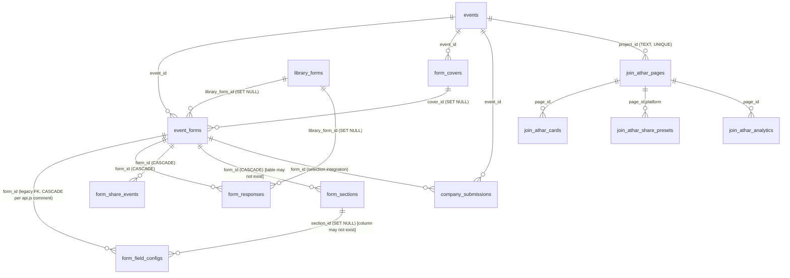
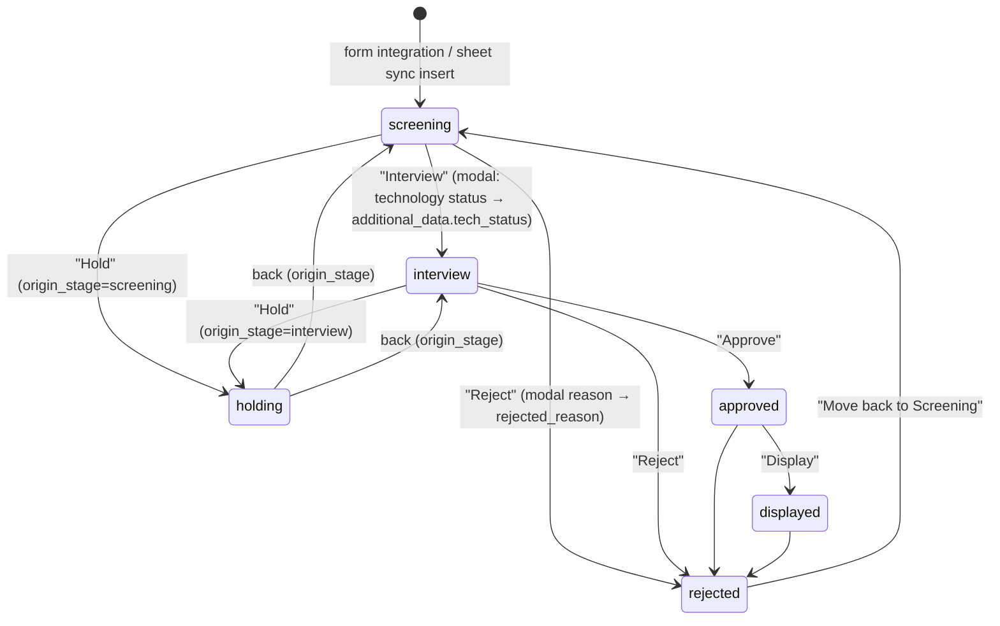
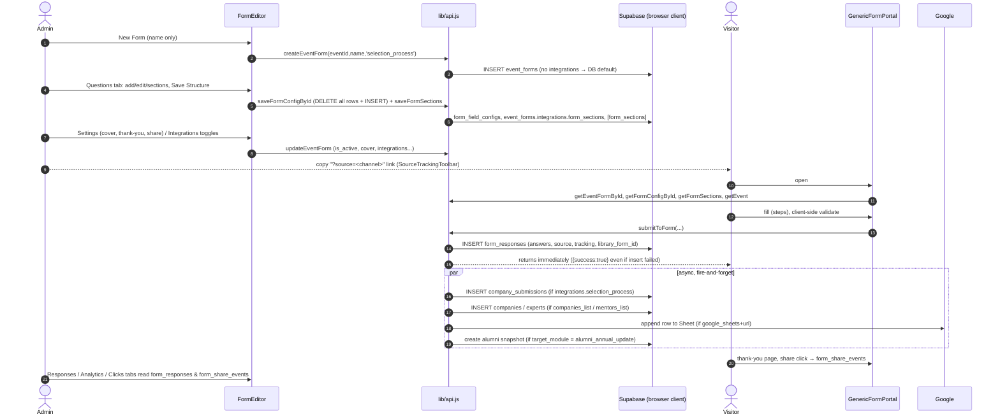
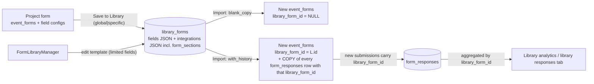

# 04 — Frontend: Forms, Form Builder, Selection Process & Join Athar (as-is)

> Scope: `src/components/FormEditor.jsx`, `DynamicFormBuilder.jsx`, `GenericFormPortal.jsx`, `FormLibraryManager.jsx`, `SelectionProcessManager.jsx`, `JoinAtharView.jsx`, `JoinAtharDashboard.jsx`, everything in `src/components/forms/*`, `src/lib/googleSheets.js`, `src/lib/phoneValidation.js`, and the form/selection/join parts of `src/lib/api.js`.
> This is a documentation-only snapshot of the code **as it exists today**. No improvement plan is proposed. Line references are `file:line` against the working tree at the time of writing (the tree has uncommitted modifications; see `git status`).
> No secret values are reproduced in this document.
> DB-side objects are only cross-referenced here (another analyst documents the database); where the DB shape matters to the frontend behaviour it is quoted from the migrations `20260824000000`, `20260906000000`, `20260907000000`, `20260908000000`, `20260909000000`, `20260911000000` and from `src/types/database.types.ts`.

---

## 1. Executive summary

The "forms" area is a **hub-and-spoke admin screen (`FormEditor`) plus a public renderer (`GenericFormPortal` → `DynamicFormBuilder`)**, backed by a "new" form engine (`event_forms` + `form_field_configs` + `form_responses` + `form_covers` + `form_share_events` + `library_forms`) that coexists with a **legacy engine** (`CompanyPortal` / `ExpertPortal` + `getFormConfig(eventId, 'company'|'expert')` + `company_submissions` / `expert_submissions` + manual approve/reject in `StartupManager` / `ExpertManager`).

Key structural facts:

* There are **three different question editors** (`forms/QuestionsBuilder.jsx` for project forms, an inline mini-editor inside `FormLibraryManager.jsx` for library templates, and the legacy `form_field_configs` editors embedded in `StartupManager`/`ExpertManager`). `DynamicFormBuilder` is **not an editor**: it is the respondent-side renderer used by three portals.
* The "Selection Process" is **not a feature of the form engine**: it is a Kanban-style reviewer UI over the **legacy table `company_submissions`**. Form responses reach it only if the form's `integrations.selection_process` flag is on (copy-on-submit from the browser) or via a manual Google-Sheet pull.
* **Sections** are persisted in a JSONB bucket inside `event_forms.integrations.form_sections` with an optional relational `form_sections` table; the relational migrations (`20260908`, `20260909`) are duplicates of each other and the generated TypeScript types do not contain the table or `form_field_configs.section_id`, so it is unclear whether they have been applied.
* Almost all privileged work (writing responses, routing to other tables, Google Sheets append using a service-account key read from the DB) is done **from the browser** with the public Supabase client; the only server-side code in this area is the three `send-*-emails` edge functions.
* UI language is mixed: `FormEditor` + `forms/*` tabs are English/LTR, library components (`FormLibraryManager`, `ImportFromLibraryModal`, `SaveToLibraryModal`, `LibraryAnalyticsDashboard`, `ChipsOptionInput`, `PhoneValidationConfig`) are Arabic/RTL, `QuestionsBuilder` mixes both within single labels.

---

## 2. Routes and entry points

Source: `src/App.jsx`.

| Route(s) | Guard | Component | Notes |
|---|---|---|---|
| `/event/:eventId/forms`, `/events/:eventId/forms` (`App.jsx:171-180`) | `RoleGuard super_admin, project_manager` | `FormEditor` | Both singular and plural variants registered for every event sub-route. Entry from `EventDashboard` card `manageLink: /event/${eventId}/forms` (`EventDashboard.jsx:340`). |
| `/form-library`, `/forms-library` (`App.jsx:183-192`) | `RoleGuard super_admin` only | `FormLibraryManager` | Linked from `Dashboard.jsx:434` and `alumni/ImpactDashboard.jsx:246`. Two aliases. |
| `/event/:eventId/selection`, `/events/:eventId/selection` (`App.jsx:388-397`) | `super_admin, project_manager` | `SelectionProcessManager` | `eventId` here is whatever is in the URL (UUID or slug) and is passed raw to `getEvent` and, as `eventId`, to the edge functions and `company_submissions.event_id` filters (see anomalies A-23). |
| `/event/:eventId/join-athar`, `/events/:eventId/join-athar` (`App.jsx:410-419`) | `super_admin, project_manager` | `JoinAtharDashboard` | |
| `/view/:eventId/join-athar` (`App.jsx:427`) | public, inside `PublicLayout` | `JoinAtharView` | `PublicLayout.jsx:47-62` adds a "Join Athar" nav tab. |
| `/events/:eventId/register/form/:formId`, `/events/:eventId/form/:formId`, `/forms/:eventId/:formId`, `/forms/:formId` (`App.jsx:433-436`) | public, no layout | `GenericFormPortal` | **Four** URL shapes for the same component. The canonical shareable URL generated by the admin UI is `${getAppBaseUrl()}/#/forms/${eventId}/${form_id}` (`SourceTrackingToolbar.jsx:29`, `FormEditor.jsx:341`, `GenericFormPortal.jsx:312`). `/forms/:formId` carries no `eventId` (see A-17). |
| `/events/:eventId/register/company`, `/events/:eventId/register/expert` (`App.jsx:431-432`) | public | `CompanyPortal`, `ExpertPortal` (legacy engine) | Out of scope except where they share `DynamicFormBuilder` / tables. |

`getAppBaseUrl()` (`utils.js:10-14`) = `window.location.origin + (VITE_BASE_PATH ?? '/EventsOperations')`. The app uses a hash router, so every generated public link has the shape `<origin><basePath>/#/forms/<eventId>/<formId>?source=<key>`.

---

## 3. Component relationship map

```mermaid
flowchart TD
  subgraph Admin["Admin (RoleGuard)"]
    FE[FormEditor.jsx<br/>"Engagement Hub"]
    FE --> SRC[forms/SourceTrackingToolbar]
    FE --> QB[forms/QuestionsBuilder]
    FE --> FST[forms/FormSettingsTab]
    FE --> FRT[forms/FormResponsesTab]
    FE --> FAT[forms/FormAnalyticsTab]
    FE --> FCT[forms/FormClicksAnalyticsTab]
    FE --> FIT[forms/FormIntegrationsTab]
    FE --> GFA[forms/GlobalFormsAnalytics]
    FE --> CLM[forms/CoverLibraryModal]
    FE --> IFL[forms/ImportFromLibraryModal]
    FE --> STL[forms/SaveToLibraryModal]
    QB --> CHIP[forms/ChipsOptionInput]
    QB --> PVC[forms/PhoneValidationConfig]
    FST --> CLM
    FLM[FormLibraryManager.jsx] --> LAD[forms/LibraryAnalyticsDashboard]
    FLM --> CHIP
    FLM --> PVC
    PVC --> PV[lib/phoneValidation.js]
    SPM[SelectionProcessManager.jsx] --> RTE[RichTextEditor.jsx]
    SPM --> ATB[AtherTeamBookingAdmin.jsx embedded]
    JAD[JoinAtharDashboard.jsx]
  end
  subgraph Public["Public"]
    GFP[GenericFormPortal.jsx] --> DFB[DynamicFormBuilder.jsx]
    GFP --> PV
    CP[CompanyPortal.jsx - legacy] --> DFB
    EP[ExpertPortal.jsx - legacy] --> DFB
    JAV[JoinAtharView.jsx]
  end
  FE -. "shares API" .-> API[(lib/api.js)]
  GFP --> API
  SPM --> API
  API --> GS[lib/googleSheets.js]
  API --> PV
```

### 3.1 How `DynamicFormBuilder`, `FormEditor` and `QuestionsBuilder` relate (precise)

| Aspect | `FormEditor` (+ `forms/*`) | `forms/QuestionsBuilder` | `DynamicFormBuilder` | Library inline editor (`FormLibraryManager.jsx:381-513`) |
|---|---|---|---|---|
| Role | Container / navigation / tab host for one event's forms ("Engagement Hub") | **Admin question editor** (question cards, sections, drag & drop) for a single `event_forms` row | **Respondent-side renderer** only. Never used in admin screens. | Second admin question editor, for `library_forms.fields` JSON |
| Consumers | `App.jsx` route | Rendered by `FormEditor.jsx:395-405` under tab `questions` | `GenericFormPortal.jsx:543`, `CompanyPortal.jsx:337`, `ExpertPortal.jsx:313` | Only `FormLibraryManager` |
| Field types supported | n/a | `text, textarea, email, tel, number, url, select, multiselect, file` (`QuestionsBuilder.jsx:229-237`) | `hidden, text, email, url, tel, number, textarea, select, multiselect, file` (`DynamicFormBuilder.jsx:126-386`); anything else → `null` (field silently not rendered) | `text, textarea, email, **phone**, number, select, url, file` (`FormLibraryManager.jsx:447-454`) |
| Sections | yes (via `QuestionsBuilder` + `sections` state) | yes — add/rename/remove/move/drag (`QuestionsBuilder.jsx:450-527`) | no (the **portal** builds the steps, `GenericFormPortal.jsx:90-123`) | **no** (sections are not editable in library; they travel only inside `integrations.form_sections`, see §6.3) |
| Validation UI | n/a | required, custom error, min/max length (text/textarea), min/max value (number), phone country list | n/a (HTML attrs `required/minLength/maxLength/pattern`, `DynamicFormBuilder.jsx:154-157`; real validation lives in `GenericFormPortal.validateFieldList`) | required + phone country list only |
| "Other" option | `ChipsOptionInput` produces `{label, value:'__other__', is_other:true}` | uses it | renders it (`DynamicFormBuilder.jsx:184-334`) | uses it for `select`/`multiselect` |
| Persistence | `FormEditor.handleSaveQuestions` (`FormEditor.jsx:272-291`) → `saveFormConfigById` + `saveFormSections` | state is owned by `FormEditor` (`fields`, `sections`) | stateless w.r.t. persistence | `updateLibraryForm(activeForm.id, activeForm)` (`FormLibraryManager.jsx:123`) |

Overlap / duplication, factually:

1. `FormEditor.jsx:56-72` redefines `isCoreField` and `getIconForType`, identical to `QuestionsBuilder.jsx:25-41`; the copies in `FormEditor` are **never referenced** (grep: only the definitions).
2. `QuestionsBuilder` and the library inline editor are two separate implementations of "edit a list of questions"; they edit different JSON shapes (rows of `form_field_configs` vs. elements of `library_forms.fields`) and support different type lists (`tel` vs `phone`, `multiselect` present/absent).
3. `FormLibraryManager` is a **second admin shell** (list, create modal, per-form editor, responses table, analytics) that parallels `FormEditor`, with a different language (Arabic/RTL) and visual language.
4. `DynamicFormBuilder` has its own URL-prefill effect (`DynamicFormBuilder.jsx:17-33`), and `GenericFormPortal` independently pre-fills from the same URL params (`GenericFormPortal.jsx:73-78`) — two overlapping prefill mechanisms.

---

## 4. Data model (as used by the frontend)

### 4.1 Entity map



### 4.2 `event_forms` (form definition)

Columns as seen in `database.types.ts:811-833` and migration `20260824`: `form_id`, `event_id`, `form_name`, `form_name_ar`, `description`, `target_module`, `is_active`, `cover_id`, `cover_image_url`, `thank_you_message`, `thank_you_image_url`, `show_thank_you_image`, `share_title`, `share_description`, `share_image_url`, `social_channels_config` (JSONB), `integrations` (JSONB), `library_form_id`, `created_at`, `updated_at`. Migration `20260908` additionally adds `sections JSONB DEFAULT '[]'` (to both `event_forms` and `library_forms`) — **no frontend code reads or writes that column**; sections live in `integrations.form_sections` instead (see §6.3). The base `CREATE TABLE event_forms` / `form_field_configs` / `company_submissions` is **not in the migration folder** (only `ALTER`s exist).

JSONB shapes written by the UI:

```jsonc
// social_channels_config  (SourceTrackingToolbar.jsx:31-38, DB default migration 20260824)
{ "facebook": true, "whatsapp": true, "linkedin": true, "telegram": true, "instagram": true,
  "custom": [ { "key": "newsletter", "label": "Email Newsletter", "active": true } ] }

// integrations  (FormIntegrationsTab.jsx:10-17 + sections + library import)
{ "google_sheets": false, "google_sheets_url": "", "selection_process": false,
  "companies_list": false, "mentors_list": false, "attendees_list": false,
  "form_sections": [ { "id": "sec_1712345678901", "title": "...", "order_index": 0 } ] }
```

`target_module` values encountered in code: `selection_process` (default and the only value the create modal can produce, `FormEditor.jsx:78`, `api.js:1512`), `company`, `expert` (legacy engine, `FormEditor.jsx:40-53`, `api.js:1126`), `companies_list`, `mentors_list` (library / import path, `FormLibraryManager.jsx:908-910`, `ImportFromLibraryModal.jsx:149-154`), `attendees_list` (only handled in `importFormFromLibrary`, `api.js:2684`) and `alumni_annual_update` (only tested in `submitToForm`, `api.js:2012`; **no UI creates it**).

### 4.3 `form_field_configs` (questions)

Row (`database.types.ts:1233-1252`): `config_id, event_id, form_id, entity_type, field_name, field_label, field_type, field_options (Json), is_required, show_in_card, placeholder, help_text, is_custom, display_order, validation_rules (Json), created_at, updated_at`. No `description`, `field_label_ar` or `section_id` column in the generated types (migrations `20260908/09` would add `section_id`, see §6.3).

Because those columns may be absent, `saveFormConfigById` packs extra metadata inside `validation_rules` (`api.js:1617-1621`):

```jsonc
validation_rules: {
  customError, minLength, maxLength, minValue, maxValue,   // free-form, strings from <input>
  allowed_countries: ["EG","SA","AE"],                      // phone
  description: "<question description>",                    // duplicate of help_text
  section_id: "sec_171234..." | null                        // section membership
}
```

and `getFormConfigById` (`api.js:1567-1580`) back-fills `description`, `help_text`, `section_id` from `help_text` / `validation_rules.description` / `validation_rules.section_id`.

Question object as held in React state (`QuestionsBuilder.handleAddField`, `QuestionsBuilder.jsx:423-448`): `field_name` (`custom_<Date.now()>`), `field_label`, `field_label_ar` (always `''`, **never persisted**), `field_type`, `is_required`, `placeholder`, `description`, `help_text`, `is_custom`, `display_order`, `section_id`, `field_options` (array of `{label,value,is_other}` for select/multiselect), `validation_rules`.

**Question types** (builder → renderer):

| Type | Builder label | Renderer behaviour (`DynamicFormBuilder`) | Portal validation (`GenericFormPortal.validateFieldList`) |
|---|---|---|---|
| `text` | Short Text | `<input>`; `minLength/maxLength/pattern` HTML attrs | required, min/max length |
| `textarea` | Paragraph | `<textarea>` | required, min/max length |
| `email` | Email Address | `<input type=email>` | required + regex `^[^\s@]+@[^\s@]+\.[^\s@]+$` |
| `tel` | Phone Number (advanced validation) | `<input type=tel>` | required + `validatePhoneNumber(val, rules.allowed_countries)` |
| `number` | Number | `<input type=number>` | required + `minValue/maxValue` |
| `url` | Website URL | `<input type=url>` | required only (no URL check beyond browser) |
| `select` | Dropdown | `<select>` + free text if option `is_other` | required |
| `multiselect` | Checkboxes | checkbox list + free text for "Other" | required (non-empty array) |
| `file` | File / Image upload | hidden input, `accept="image/*,.pdf,.doc,.docx"`, uploads via `uploadImage(file,'portal-uploads')` → stores **public URL string** | required |
| `hidden` | (not offered in builder) | `<input type=hidden>`; the portal removes hidden fields from the rendered list (`GenericFormPortal.jsx:70-71`) but keeps their URL-param values in state | none |
| `phone` | only in library editor | **no `case` → renders nothing** (`DynamicFormBuilder.jsx:384`) | the portal still applies phone validation if the *name* contains `phone/mobile` or equals `whatsapp` (`GenericFormPortal.jsx:147`) |

"Other" encoding: a selected "Other" is stored in the answer as the literal `__other__` (nothing typed) or `__other_text__:<free text>`; for multiselect the array contains those sentinel strings (`DynamicFormBuilder.jsx:41-54, 184-334`). The sentinels are persisted verbatim into `form_responses.answers` and into all integration copies.

### 4.4 Sections

* In-memory shape: `{ id: 'sec_<Date.now()>', title, order_index }` (`QuestionsBuilder.jsx:450-457`); `description` is **never editable in the UI**, although the portal reads `sec.description` (`GenericFormPortal.jsx:106`) and `saveFormSections` writes `description` to the relational table (`api.js:2967`).
* Persistence: see §6.3.
* Rendering: `GenericFormPortal` converts sections into **wizard steps** (`steps` memo, `GenericFormPortal.jsx:90-123`): no sections → single step; otherwise sorted sections, plus a synthetic "General Information / البيانات الأساسية" step (first) holding fields with no/unknown `section_id`. Steps with zero fields are still rendered as empty steps.

### 4.5 `form_responses` (primary store)

Columns (`database.types.ts:1308-1330`, migrations `20260824/0906/0907`): `response_id, form_id, event_id (NOT NULL), library_form_id, source, tracking_data (JSONB), answers (JSONB), status (default 'submitted'), submitted_at, created_at, updated_at`. Answers are keyed by `field_name` (i.e. `custom_<timestamp>` for builder-created fields), **not by label**, so exports/readers must join to `form_field_configs` to show labels (`FormResponsesTab` does this; `FormLibraryManager.jsx:809-816` and the Selection detail modal do not).

`status` values used by the UI: `submitted` (default), `reviewed`, `approved`, `rejected` (badge colours only, `FormResponsesTab.jsx:275-283`); no control in the UI can change them (see A-12).

### 4.6 Source tracking / share analytics

* Inbound attribution: portal reads `source, utm_source, utm_medium, utm_campaign, channel, ref, from` (`GenericFormPortal.jsx:24-28`); `source = ?source || ?utm_source || 'direct'`; saved as `form_responses.source` and as `tracking_data` (`api.js:1917-1924`, which both lists the four named UTM keys and then spreads the whole `trackingMeta`, so `source` appears inside `tracking_data` too).
* Outbound link generation: `SourceTrackingToolbar` builds `…/#/forms/<eventId>/<formId>?source=<key>` for 5 fixed platforms (facebook, whatsapp, linkedin, telegram, instagram) plus user-defined custom sources stored in `social_channels_config.custom[]`.
* Post-submission "share" buttons on the thank-you screen (`GenericFormPortal.jsx:427-472`) insert a row into `form_share_events` (`platform`, `user_agent`) via `trackFormShareEvent` (`api.js:1750-1767`) and open the platform share URL with `?source=<platform>`.
* There is **no page-view/impression event**; "Clicks & Sources" = count of responses by source + count of `form_share_events` rows (`FormClicksAnalyticsTab.jsx:35-71`). Instagram share (`handleShareClick` switch, `GenericFormPortal.jsx:316-340`) has no `case`, so the button is not even rendered on the thank-you page, yet "instagram" is tracked/listed in analytics and toolbar.

### 4.7 Phone validation

`src/lib/phoneValidation.js`:

* `SUPPORTED_COUNTRIES` = EG, SA, AE, KW, QA, BH, OM, JO (`phoneValidation.js:6-15`).
* Specific validators exist only for **EG** (mobile `^(10|11|12|15)\d{8}$` after stripping `0020/+20/20/0`; landline by area-code list), **SA** (`^5\d{8}$`) and **AE** (`^5\d{8}$`); everything else goes to `validateAndSanitizeGeneral` (7-15 digits, prefixes `+`).
* `validatePhoneNumber(raw, allowedCountries)` (`:175-217`): empty → valid; iterates allowed countries (only EG/SA/AE branches do anything); if exactly one country allowed returns its specific error; **otherwise falls back to the general validator for any number**.
* Config UI: `PhoneValidationConfig` (checkbox chips, minimum 1 country; default `['EG','SA','AE']`); stored in `field.validation_rules.allowed_countries`. New questions get `allowed_countries: ['EG','SA','AE']` pre-set even for non-phone types (`QuestionsBuilder.jsx:444`).
* Error messages are hard-coded Arabic strings.
* Sanitization (E.164) is applied in `submitToForm` (`api.js:1883-1892`), **not** in the portal (see A-9, A-10).

### 4.8 Cover library

* Table `form_covers (cover_id, event_id, name, image_url, …)`, per event. UI: `CoverLibraryModal` (upload to storage bucket `event-assets`, folder `covers/`, via `uploadImage`, `api.js:871-895`; list `getEventCovers`; delete `deleteFormCover`).
* Selection is stored on the form as **both** `cover_id` and a denormalised `cover_image_url` (`FormSettingsTab.jsx:48-49`).
* Portal image priority (`GenericFormPortal.jsx:479`): `formMeta.form_covers.image_url` (joined through `cover_id`) → `formMeta.cover_image_url` → `event.form_cover_image_url` (an `events` column, `database.types.ts` events Row).
* Images pass through `getGoogleDriveDirectLink` (`utils.js:181-184`) which rewrites Google-Drive URLs.
* `updateFormCover` (`api.js:1682-1691`) is exported and unused; the modal footer promises "Changes to a library cover immediately reflect across all linked forms" (`CoverLibraryModal.jsx:255`) but no edit action exists.

### 4.9 Central Form Library (`library_forms`)

Migration `20260907`: `id, form_name, form_name_ar, description, target_module, scope ('global'|'specific'), event_id, fields JSONB, cover_id, cover_image_url, thank_you_*, share_*, social_channels_config, integrations, import_count, created_at, updated_at` + `event_forms.library_form_id`, `form_responses.library_form_id`. RLS: public select/insert/update/delete (`USING (true)`).

`fields` is an array of portable question objects (`saveProjectFormToLibrary`, `api.js:2623-2637`) containing the same keys as `form_field_configs` rows **without** ids, and with `validation_rules` carrying `section_id`/`description` (§4.3).

### 4.10 Selection-process data (`company_submissions`)

Columns (`database.types.ts:653-676`): `submission_id, event_id, form_id, startup_name, company_name, founder_name, founder_email, national_id, phone, industry, location, logo_url, additional_data (Json), status, rejection_reason, reviewed_at, reviewed_by, email_send_count (Json), submitted_at, created_at, updated_at`.

`status` values used by the UI: `screening` (initial), `interview`, `approved`, `displayed`, `holding`, `rejected`. `additional_data` is a **dual-purpose bag**: either (a) one Google-Sheet row keyed by sheet header text + `_column_order` (sheet sync, `api.js:2217-2220`) or (b) form answers keyed by `field_name` (form integration, `api.js:1969`); reviewer notes are written into the same bag as `tech_status`, `<status>_reason`, `origin_stage` (`SelectionProcessManager.jsx:358-368, 1379`).

`email_send_count` is `{interview?:n, rejection?:n, acceptance?:n}` (edge functions). An `email_audit_log` table is written by the edge functions (`send-interview-invitations/index.ts:187-227`); the frontend never reads it.

### 4.11 Join Athar data

Migration `20260911` (`join_athar_pages` keyed by `project_id TEXT UNIQUE`, `join_athar_cards`, `join_athar_share_presets (page_id, platform) UNIQUE`, `join_athar_analytics (event_type: tab_view|card_share|image_upload|image_download)`). All four tables have a `FOR ALL USING (true)` public policy.

---

## 5. Component reference

### 5.1 `FormEditor.jsx` (725 lines) — "Form Builder & Engagement Hub"

* **Purpose**: list the forms of one event; create / duplicate / delete / (de)activate; open one form in a 6-tab workspace; import from / save to the central library; project-level analytics.
* **Route params**: `useParams().eventId || .id` (`:140`). No props.
* **State**: `forms`, `fieldCounts` (map form_id → #questions), `loading`, `error`, modal flags (`showCreateModal`, `showCoverLibraryModal`, `showImportFromLibraryModal`, `showSaveToLibraryModal`), `libraryToast`, `editingForm` (the selected `event_forms` row or `null`), `activeMainTab` (`forms|global_analytics`), `activeFormTab` (`questions|settings|responses|response_analytics|clicks_analytics|integrations`), `formFields`, `sections`, `fieldsLoading/Saving/Success`.
* **API calls**: `getEventForms`, `createEventForm`, `deleteEventForm`, `updateEventForm`, `getFormConfigById` (once per form to count questions, `:184-186` — N+1), `saveFormConfigById`, `duplicateEventForm`, `getFormSections`, `saveFormSections`.
* **Behaviour / business rules**
  * Creating a form: name only; `target_module` is fixed to `'selection_process'` (state `targetModule` at `:78` has no UI control), seeds no fields for that module (`getDefaultFormConfig` returns `[]`, `api.js:1488-1489`).
  * Questions + sections are saved together with `Promise.all` (`:278-281`) — two independent writes, not atomic.
  * Active toggle writes `is_active` immediately (`:259-270`); the portal enforces it client-side only (`GenericFormPortal.jsx:368`).
  * "Preview Form" opens `#/forms/<eventId>/<formId>` (`:341`) — it is the live public form (submissions are real).
  * Delete uses `window.confirm`; cascade relies on FK cascades in DB.
  * Success toast text is hard-coded Arabic with an embedded LRM char (`:457`, `:708`).
* The `SourceTrackingToolbar` is rendered above **every** tab (`:387-391`), not only the share-related tab.
* `MODULE_META` (`:32-54`) includes `company` and `expert` badge/label definitions for legacy modules; list cards default unknown modules to the `selection_process` styling (`:587`).

### 5.2 `forms/QuestionsBuilder.jsx` (727 lines)

* **Props**: `form, fields, setFields, sections, setSections, saving, onSave, success, error` (state owned by `FormEditor`).
* **Features**: `@dnd-kit` sortable list over `field_name` ids (`:582-702`); 6-dot drag handle, 3-dot menu (duplicate / move to section); add/rename/remove sections; "Add Question" (top, inside section, bottom).
* **Rules**:
  * Core fields (`startup_name, logo_url, expert_name, photo_url`) cannot be deleted nor have their type changed (`:25-26, 193, 224, 470-476`). These exist only for legacy-seeded `company`/`expert` forms.
  * Dropping a question onto another adopts that question's `section_id` (`:513-521`); there is no drag across empty sections (only the 3-dot menu).
  * Duplicate: deep clone with `field_name = custom_<now>`, label suffix `(نسخة)`, inserted right after the source (`:398-421`).
  * Removing a section un-assigns (does not delete) its questions (`:459-464`).
  * `handleValidationChange` copies the current `fields` array (`:486-497`) while `handleFieldChange` uses a functional `setFields(prev => …)` (`:478-484`): inconsistent update styles on the same state.
  * `pattern` validation is honoured by the renderer (`DynamicFormBuilder.jsx:157`) but has no editor control; `hidden` type has no editor control; `field_label_ar` has no control.
  * Sections cannot be re-ordered (no drag/up-down for sections; order = array order).
* Unused imports: `ShieldCheck, ArrowDownUp, HelpCircle, ChevronRight, Sparkles` appear only in the import list (`:18-21`).

### 5.3 `forms/FormSettingsTab.jsx` (406 lines)

* **Props**: `form, eventId, fields, onFormUpdate`.
* **State**: initialised once from `form` (no re-sync if `form` changes while mounted): name, description, `isActive`, `selectedCover`, thank-you message/image/show flag, share title/description/image.
* **Save** → one `updateEventForm(form_id, {form_name, description, is_active, cover_id, cover_image_url, thank_you_message, thank_you_image_url, show_thank_you_image, share_title, share_description, share_image_url})` (`:44-58`).
* Thank-you dynamic tokens offered as pills: `{name} {company} {email} {phone}` + `{<field label>}` for the first 5 questions (`:246-267`). Only some are honoured by the portal (A-14).
* Uploads: thank-you image → bucket path `posters/`, share image → `og-images/` (both in `event-assets`).
* Default thank-you text `'Thank you {name}! …'` and share description are **prefilled into the form state** and persisted on first save even if the user never edited them (`:23-25, 32-35`).
* `share_description` and `share_image_url` are stored but **not consumed anywhere**: the `share` edge function only reads `events` (`supabase/functions/share/index.ts`), and the portal only uses `share_title` (`GenericFormPortal.jsx:313`).

### 5.4 `forms/FormIntegrationsTab.jsx` (285 lines)

* **Props**: `form, onFormUpdate`. Local state `integrations` initialised from `form.integrations || {defaults}` (`:10-17`).
* Toggles: Google Sheets (+ URL), Selection Process, Companies list, Mentors & Experts list (sets `mentors_list` and `attendees_list` together). Save writes the whole `integrations` object (`:38-44`), forcing `attendees_list = mentors_list || attendees_list`.
* Business rule text: "Responses are always recorded first… integrations receive copies in the background".
* The "defaults" branch (`selection_process: form.target_module === 'selection_process'`) is effectively unreachable: DB default is non-null (`{"selection_process": false, "companies_list": false, "attendees_list": false}`), `duplicateEventForm` copies `{}` (truthy). Hence a freshly created `selection_process` form has the Selection toggle **off** (A-15).
* Because the object being saved is the full `integrations` JSON, it also contains `form_sections` (§6.3) and can overwrite it with a stale copy (A-16).

### 5.5 `forms/SourceTrackingToolbar.jsx` (318 lines)

Described in §4.6. Writes `social_channels_config` on toggle / add custom / delete custom (`updateEventForm`). "Hide channel" only changes styling (`isVisible` at `:168` is used for opacity), the "Copy Link" button is always active; the flag is not read by `GenericFormPortal` (the portal always shows its 5 share buttons except Instagram is missing).

### 5.6 `forms/FormResponsesTab.jsx` (430 lines)

* **Props**: `form, fields`. Loads `getFormResponses(form_id)` (all rows, no pagination).
* Search = `JSON.stringify(answers) + source + tracking_data` substring; source filter; table shows first 4 fields; detail modal lists all `fields` + orphan answer keys + tracking data; delete (permanent, confirm).
* **Export CSV**: client-side, BOM-prefixed, exports `filteredResponses` with columns `ID, Source, Status, Submitted At, <field labels…>`; object values (multiselect arrays) are `JSON.stringify`-ed **without** doubling inner quotes before being wrapped in `"…"` (`:106-113`) → malformed CSV for arrays/objects.
* Dead code: `selectedStatus` state + filter predicate (`:13, 78`) and `handleStatusChange` (`:51-61`, imports `updateFormResponseStatus`) have **no UI controls**; the filter grid is `sm:grid-cols-3` with two filters only (`:168-193`).
* No "send to Selection", no "export to Google Sheet", no Excel export here; the only response → downstream paths are the integrations applied at submit time.

### 5.7 `forms/FormAnalyticsTab.jsx` (245 lines)

All computed client-side from `getFormResponses`: total, average field completion (mean of per-field completion %), "Active Questions" (= `fields.length`), 7-day bar chart (UTC date keys), per-question completion bars, choice distribution for `select/multiselect` (counts raw stored values, so `__other_text__:*` appear as separate buckets, and a multiselect "Other" appears as `__other__`). `%` per option divides by *total responses*, not by total selections.

### 5.8 `forms/FormClicksAnalyticsTab.jsx` (197 lines)

`getFormResponses` + `getFormShareEvents`; source breakdown by `form_responses.source` (lower-cased) and share-click counts by platform (`facebook, whatsapp, linkedin, telegram, instagram, other`).

### 5.9 `forms/GlobalFormsAnalytics.jsx` (184 lines)

Event-level roll-up: `getEventForms`, `getEventFormsResponses(eventId)`, `getEventShareEvents(eventId)` → KPI cards, global source breakdown, per-form table with "Manage Form" (jumps into `FormEditor` questions tab).

### 5.10 `forms/CoverLibraryModal.jsx`, `ImportFromLibraryModal.jsx`, `SaveToLibraryModal.jsx`

* `CoverLibraryModal` — props `eventId, selectedCoverId, onSelectCover, onClose`; two call sites: `FormSettingsTab` (with `onSelectCover`) and the list view of `FormEditor` (**without** `onSelectCover`, `FormEditor.jsx:676-680`) → clicking a cover or "No Cover" there invokes `onSelectCover(...)` unguarded (`CoverLibraryModal.jsx:180, 205`) and throws `TypeError` (only the upload path guards with `if (onSelectCover)`, `:48`).
* `ImportFromLibraryModal` — props `eventId, isOpen, onClose, onImportSuccess`. Step 1: pick template (search + module filter pills `all|selection_process|companies_list|mentors_list`); step 2: choose `with_history` (links `library_form_id`, copies **all historical responses** of that library form into this project, re-link module, optional Google-Sheet URL) or `blank_copy` (deep copy, `library_form_id = null`). Calls `getLibraryForms({eventId})`, `importFormFromLibrary`.
* `SaveToLibraryModal` — props `form, eventId, isOpen, onClose, onSuccess`; fields: EN name, AR name, description, scope (`global|specific`). Calls `saveProjectFormToLibrary`. Name state is initialised once from `form` props (no reset when reopened for another form).

### 5.11 `forms/ChipsOptionInput.jsx`, `forms/PhoneValidationConfig.jsx`, `forms/LibraryAnalyticsDashboard.jsx`

* `ChipsOptionInput` normalises options (strings or objects) to `{label,value,is_other}` and always emits objects; "Other" option = `{label:'أخرى (Other)', value:'__other__', is_other:true}`; always RTL.
* `PhoneValidationConfig` — RTL; explanatory text claims "stored in E.164" and shows Egypt-specific rules.
* `LibraryAnalyticsDashboard` — props `onSelectForm`; uses `getLibraryAnalytics()`; KPIs (total library forms, imports, responses, avg responses per form), per-project distribution, per-form table; Arabic UI.

### 5.12 `GenericFormPortal.jsx` (635 lines) — public form

* **Route params**: `eventId` (`params.eventId || params.id`), `formId`; reads `searchParams`.
* **Load** (`:44-87`): `getEventFormById` (with joined `form_covers`), `getFormConfigById`, `getFormSections` (errors swallowed → `[]`), then `getEvent(eventId)` (wrapped separately; used for `document.title` and the event cover fallback). If `getEventForm` fails: "Form not found or unavailable".
* **Gating**: `is_active === false` → "Form is Currently Closed" screen (client-side only). No deadline / max responses / one-per-email logic exists in this component (the `events.submission_deadline` column exists but is not read here).
* **Wizard**: steps from sections (§4.4); `Next` validates only the current step's fields; `Submit` validates all fields, and jumps back to the first step with an error.
* **Validation rules** (`:130-195`): required; phone (for `tel` type **or** name containing `phone`/`mobile`/equal `whatsapp`) via `validatePhoneNumber(val, rules.allowed_countries)`; email regex; min/max length; number min/max; `customError` overrides every message; messages are Arabic or English depending on whether the *label* contains Arabic letters (`isArabicText`), not on any language setting.
* **Submit** (`:227-268`): `submitToForm(formId, eventId, formMeta.target_module, formValues, {source, ...trackingData})`; on success shows thank-you; on failure shows a generic localized error.
* **Thank-you page** (`:274-307, 389-477`): message with token replacement (A-14), optional poster image (`show_thank_you_image && thank_you_image_url`), social share block.
* **File upload** (`:270-272`): `uploadImage(file,'portal-uploads')` — anonymous upload to the `event-assets` bucket; the public URL string is stored as the answer.
* RTL/LTR: `dir="auto"` on text containers; button layout flips according to label language heuristics.

### 5.13 `DynamicFormBuilder.jsx` (410 lines) — respondent renderer

See §3.1 and §4.3. Additional facts: label = `field_label || field_label_ar || field_name` (`:90`); description precedence `field.description || help_text || help_text_ar || validation_rules.description` (`:92`); placeholder `placeholder || placeholder_ar`; `renderHelp` is a stub returning `null` (`:124`); fields sorted by `display_order` (`:389-391`) — when the portal passes per-step subsets, order comes from the global `display_order`.

### 5.14 `FormLibraryManager.jsx` (987 lines) — Central Form Library admin

* **Route**: `/form-library` (super_admin). No props.
* **State**: `forms, events, loading, activeTab ('directory'|'analytics'), filters, activeForm, singleFormTab ('questions'|'responses'), responsesList, viewingResponse, savingForm, successFeedback`.
* **API calls**: `getLibraryForms`, `getEvents`, `createLibraryForm`, `updateLibraryForm`, `deleteLibraryForm`, `duplicateLibraryForm`, `getLibraryFormResponses`.
* **Rules**: create modal seeds three questions `full_name`, `email`, `phone` (type `phone`) (`:850-854`); scope `global` vs `specific` (needs `event_id`); delete does not remove already-imported project copies (confirm text `:92`); response tab aggregates all `form_responses` where `library_form_id = <id>` across projects (`getLibraryFormResponses`, `api.js:2777-2810`).
* Save writes `updateLibraryForm(activeForm.id, activeForm)` — the entire loaded row, including `id`, `created_at`, `import_count` (`:123`).
* The module filter state `moduleFilter` is declared (`:36`) and applied in `filteredForms` (`:145`) but **no control sets it**.
* Library template metadata that the editor does **not** expose: cover, thank-you, share, integrations, social channels, sections, question description/placeholder/validation beyond phone countries.

### 5.15 `SelectionProcessManager.jsx` (1697 lines)

* **Route**: `/event(s)/:eventId/selection`. Props: none. Embeds `AtherTeamBookingAdmin` (`isEmbedded`) in the settings tab and `RichTextEditor` for the three email templates.
* **Data loading** (`loadData`, `:251-307`): `getEvent(eventId)` + `getSubmissions(eventId,'company')` (reads `company_submissions` with that exact `event_id`, ordered by `submitted_at desc`). Event columns used: `selection_process_gsheets_url`, `interview_/rejection_/acceptance_admin_emails`, `…_cc_emails`, `…_email_template_subject/body`, `meeting_link_mode`, `shared_google_meet_link`. Builds `emailStatusMap` from `company_submissions.email_send_count`.
* **Stages** (tabs): Screening → Interviews → Approved (includes `displayed`) → Holding → Rejected, plus a Settings tab (`:242-249`). Tab counters are computed from the in-memory list.
* **Status transitions** (client-driven; every one is a direct `UPDATE company_submissions` through `updateSubmissionStatus`, `api.js:2305-2318`, which sets `reviewed_at` for `approved`/`rejected` and **nulls it for every other status**):



  A modal asking for a free-text reason is shown for `rejected`, `holding`, `approved`, `interview` (not for `displayed`/`screening`) (`:346-357`).
* **Emails** (`handleSendEmail / handleSendRejectionEmail / handleSendAcceptanceEmail`, `:450-524`; bulk `handleBulkSendEmail` `:526-582`): invoke edge functions `send-interview-invitations`, `send-rejection-emails`, `send-acceptance-emails` with `{eventId, submissionIds}`; bulk sends **every** submission currently in the stage (interview / rejected / approved+displayed), in batches of 100, regardless of earlier sends (the per-row counter is only informational); result per submission updates `emailStatusMap` (`sent/failed/sending` + count).
* **Sheet sync** (`handleSync`, `:318-341`): saves `selection_process_gsheets_url` into `events` (`updateEvent`) then `syncSubmissionsFromSheet(eventId, url)`.
* **Display helpers**: `getFounderDisplayName`, `getCompanyDisplayName` (`:46-108`) infer names from `additional_data` **keys** by substring heuristics (English/Arabic header wording), falling back to DB columns.
* **Settings**: three template editors (subject plain text, body rich HTML), admin + CC email lists, Google Meet link mode (`unique` | `shared`, shared requires `https://meet.google.com/` prefix) — one "Save Settings" button writes **all** of them to `events` via `updateEvent` (`:403-418`). The Ather Team Booking tab is another component.
* Unused/locals: `_error`, `_event` are written but never read (errors are never displayed to the user); `columns` / `getColumns()` (`:599-613`) is computed on every render and never used in the markup.

### 5.16 `JoinAtharDashboard.jsx` (661 lines) — admin

* **Route**: `/event(s)/:eventId/join-athar`. State: page fields (`mainTitle`, `coverUrl`, `layoutColumns` 2|3|4, `cards[]`, `presets{platform:text}`), `activeTab` (`builder|share|analytics`), analytics, toast.
* **API**: `getJoinAtharPage`, `saveJoinAtharPage`, `getJoinAtharAnalytics`, `uploadImage(file, 'join-athar/<eventId>')`.
* **Rules**: unlimited cards (image, title, description, button text/URL); reorder with up/down; image either uploaded or pasted URL; platform presets (WhatsApp, Twitter/X, LinkedIn, Instagram, Telegram) with `{link}` placeholder; analytics tab shows "no data" until `tabViews > 0`.
* Public URL displayed/copied: `…<pathname>#/view/<eventId>/join-athar` (`:193`).
* **Save** (`api.js:3069-3128`): `upsert` page on `project_id`, then **delete all cards and re-insert** (new UUIDs every save), then `upsert` presets. `canvas_background_url` and `canvas_overlay_position` are always overwritten with `null` / default because the dashboard never supplies them (`api.js:3084-3086`).
* Back link: `/event/${eventId}` (singular) whereas `FormEditor` uses `/events/${eventId}` (plural) — both exist in the router.

### 5.17 `JoinAtharView.jsx` (410 lines) — public

* **Route**: `/view/:eventId/join-athar` in `PublicLayout`; `lang` from `?lang=ar` (default `en`).
* Loads `getJoinAtharPage(eventId)` (UUID or slug; slug resolved via `getEvent`), logs `tab_view` on every load. Empty-state when no page or no cover and no cards.
* Cards grid (2/3/4 columns), per-card "Join" link (`button_url`) and "Share" modal: 5 platforms (`instagram` just copies text to the clipboard) and an **image maker**: user uploads a photo (kept in the browser), canvas 1080×1080 composites the card image (blurred), a circular photo, title, page title, wrapped description, page URL, then downloads a PNG. Events `image_upload` (fired before generation) and `image_download` are tracked.
* `pageUrl` used for share text = `<origin><pathname>?agenda=<eventId>&lang=<lang>&tabs=join-athar` (`:51`); `App.jsx:99-116` rewrites any `?agenda=` URL into `#/agenda/<id>?…&tabs=join-athar`, i.e. the shared link resolves to the **agenda route** filtered by `tabs=join-athar`, not to `/view/:eventId/join-athar` (A-22).
* Presets: `preset.replace('{link}', pageUrl)` — only the first occurrence is replaced.

### 5.18 `lib/googleSheets.js` (234 lines)

* `extractSpreadsheetId(url)`, `safeParseServiceAccount(rawKey)` (accepts strings, double-stringified JSON, repairs invalid escapes), `getGoogleSheetsAccessToken(eventId)`: reads **`google_settings`** (`select('*')`, ordered so an `event_id`-specific row wins over the global row), builds a JWT with scopes `spreadsheets` + `drive`, signs it with Web Crypto (`RSASSA-PKCS1-v1_5`/SHA-256) **in the browser**, optionally sets `sub` from `impersonate_email`, exchanges it at `https://oauth2.googleapis.com/token`.
* `appendFormResponseToSheet({sheetUrl,eventId,formName,fields,answers,source,submittedAt})`: appends one row `[submittedAt (en-US locale string), source, …answers in field order]` to `A1:append` of the **first sheet tab** with `valueInputOption=USER_ENTERED`. It never writes a header row, never validates that the tab layout matches the form, and returns result objects (never throws).
* Only caller: `submitToForm` (`api.js:1944-1954`). Migration `20260716000002` gives `google_settings` public SELECT/INSERT/UPDATE policies.

---

## 6. Subsystem behaviour

### 6.1 Form lifecycle (create → publish → submit → manage)



### 6.2 `submitToForm` step by step (`api.js:1879-2025`)

1. `source = trackingMeta.source || formData.source || formData.utm_source || 'direct'` (a form question literally named `source` can override attribution).
2. Phone sanitisation: for every answer whose **key** contains `phone`, `tel`, `mobile` or equals `whatsapp`, run `validatePhoneNumber(val)` **without** the field's allowed countries; if valid, replace the stored value with the E.164 string. Keys such as `custom_<timestamp>` never match.
3. Look up `event_forms.library_form_id` (swallow errors) so the response can be aggregated in the library.
4. `INSERT form_responses` (status `submitted`). On error: only `console.error`; no throw.
5. Fire-and-forget IIFE (not awaited, errors only logged): re-read the form (`getEventFormById`) to get `integrations`, then:
   * Google Sheets → `appendFormResponseToSheet` with raw `formData` (not `sanitizedAnswers`).
   * `selection_process` → insert a `company_submissions` row (`status 'screening'`, `form_id`, `additional_data = formData`, `startup_name` = `startup_name || company_name || first answer value || 'Applicant'`, `logo_url/industry/location` only if those exact keys exist).
   * `companies_list` → insert into `companies` only if `company_name|startup_name|name` exists.
   * `mentors_list || attendees_list` → insert into `experts` (title defaults to `'Mentor'`; no master-expert linking, unlike `createExpert`).
   * `targetModule === 'alumni_annual_update'` and `formData.company_id` → `createSnapshotFromFormResponse` (reads back the stored response).
6. Return `primaryResponse || { success: true }`.

All of steps 4–5 run with the browser's Supabase client under the visitor's identity (anon); correctness therefore depends on public INSERT policies on `form_responses`, `company_submissions`, `companies`, `experts`.

### 6.3 How sections are persisted (three overlapping stores)

| Store | Written by | Read by | Notes |
|---|---|---|---|
| `event_forms.integrations.form_sections` (JSONB) | `saveFormSections` step 1 (`api.js:2924-2945`) | `getFormSections` primary (`:2889-2903`); copied implicitly by `duplicateEventForm` (`:1835`), `saveProjectFormToLibrary` (`:2656`), `importFormFromLibrary` (`:2679`) | The real store in practice. |
| relational `form_sections` table | `saveFormSections` step 2: probes the table, `DELETE` all rows, re-`INSERT` with `id = undefined` for ids that start with `sec_` (so new UUIDs are generated) (`:2947-2978`) | `getFormSections` secondary (only when the JSONB list is empty) | Because new UUIDs are generated while `validation_rules.section_id` still holds the `sec_*` id, rows read back from this table would not match the stored question→section links. |
| `form_field_configs.section_id` (UUID FK) / `event_forms.sections` (JSONB, migration `20260908`) | never written by the frontend | `getFormConfigById` reads `f.section_id` first, then `validation_rules.section_id` | Effective membership is `validation_rules.section_id`. |

Evidence on migration state: the TS types contain `join_athar_*` (migration `20260911`) but contain **no** `form_sections` table, no `form_field_configs.section_id` and no `event_forms.sections` (migrations `20260908`/`20260909`), and `api.js` comments say the table "does not exist yet" (`:2918, :2977`). Whether the tables exist in production cannot be determined from the repo (see Open Questions).

### 6.4 Central library flow



Facts: `importFormFromLibrary` (`api.js:2666-2772`) re-derives `integrations.{selection_process,companies_list,mentors_list,attendees_list}` from the chosen `reLinkModule` (overwriting whatever the template had, also for `blank_copy` because the modal passes `selectedForm.target_module` as `reLinkModule`), sets `target_module = reLinkModule`, creates the form, then calls `saveFormConfigById(newForm.form_id, eventId, module, libForm.fields)` (`entity_type = module`), copies responses (with history), and increments `library_forms.import_count` with a read-modify-write (`import_count + 1` from the previously read value). Responses copied with history keep `library_form_id`, so they are counted again in `getLibraryAnalytics` (which counts rows, `api.js:2860-2863`).

### 6.5 Selection Process pipeline & interview emails

```mermaid
flowchart TD
  F[Public form submit] -->|"integrations.selection_process = true"| CS[(company_submissions<br/>status=screening<br/>additional_data = answers by field_name)]
  GS[Google Sheet<br/>"anyone with link"] -->|"Sync Sheet: browser fetches export?format=xlsx"| UP{upsert by<br/>national_id / email / phone / company+founder}
  UP --> CS
  CS --> SPM[SelectionProcessManager<br/>Screening → Interview → Approved/Displayed<br/>Holding / Rejected]
  SPM -->|"supabase.functions.invoke(send-interview-invitations)"| EF1[Edge fn: SMTP via nodemailer<br/>uses events.interview_* templates]
  SPM -->|"send-acceptance-emails"| EF2[Edge fn]
  SPM -->|"send-rejection-emails"| EF3[Edge fn]
  EF1 & EF2 & EF3 --> CNT[company_submissions.email_send_count++ ; email_audit_log insert]
  EF1 -->|booking link| ATB["/#/event/<eventId>/ather-team-booking (admin route)"]
```

Edge-function facts that matter to the frontend contract (cross-reference for the backend analyst):

* Payload `{eventId, submissionIds[]}`; the function loads `events` by `eventId` and `company_submissions` by `submission_id IN (…)` — it does **not** verify the submissions belong to that event nor that their status matches the email type.
* Recipient extraction re-implements (a third time, in TS) the e-mail/name heuristics (`send-interview-invitations/index.ts:13-109`), similar to `extractPrimaryEmail` and `getFounderDisplayName` on the frontend.
* Template variables actually substituted: body → `{{company_name}}, {{founder_name}}, {{first_name}}, {{project_manager_name}}` (+ `{{booking_link}}` for interview); **subject** → only `company_name`, `founder_name`, `first_name` (`:195-196`). `first_name` equals the full display name (`firstName: finalName`, `:108`); `project_manager_name` is the constant `'Athar Team'`.
* Admin e-mails are added to **CC**, together with the CC list (`:198`); there is no separate "to admin" send.
* The booking link is `${req.headers.origin || 'https://agenda-builder.vercel.app'}/#/event/<eventId>/ather-team-booking` — the *admin* booking route (`App.jsx:456`, RoleGuard), not the public `/ather-team-book/:memberId` page.
* `send-rejection-emails` and `send-acceptance-emails` are 247-line near-identical copies (diff is only the template defaults and the email type label).
* The functions use the service-role client and CORS `*`; JWT verification settings are not in the repo (no `config.toml`).

### 6.6 Inbound Google-Sheet sync (selection)

`syncSubmissionsFromSheet` (`api.js:2186-2300`): the **browser** downloads `https://docs.google.com/spreadsheets/d/<id>/export?format=xlsx` (`excel.js:352-382`; requires the sheet to be "anyone with the link can view" and CORS allowing it), picks the sheet tab named like `total responces / total responses / selection prosses / selection process / responses / form responses 1` else the first, derives `founder_name, company_name, founder_email, national_id, phone, timestamp` by header-keyword heuristics (`extractDynamicSheetFields`, `:2094-2181`), then loops rows sequentially, matching existing rows **in memory** against all `company_submissions` of the event (priority: national id → e-mail → phone → company+founder). Matches are `UPDATE`d with a new `additional_data` (the sheet row + `_column_order`), unmatched are `INSERT`ed (`status 'screening'`, **no `form_id`, no `submitted_at` from the sheet**). Rows are processed one at a time (N round-trips).

---

## 7. End-to-end flow checklist (what exists vs. what does not)

| Step | Exists? | Where |
|---|---|---|
| Build form (questions, sections, DnD) | yes | `FormEditor` → `QuestionsBuilder` |
| Publish | partial: "publish" = `is_active=true` + share link; no draft/published versioning, no schedule | `FormEditor.jsx:259-270`, `FormSettingsTab` |
| Public submit | yes (anonymous) | `GenericFormPortal` → `submitToForm` |
| Store responses | yes, `form_responses` is the primary store | `api.js:1910-1932` |
| Responses UI | yes (search, filters, details, delete, CSV) | `FormResponsesTab` |
| Analytics | response analytics, source/share analytics, project roll-up, library roll-up | `forms/*` |
| Export | CSV (client) only; Google Sheet append per submission (opt-in) | `FormResponsesTab`, `googleSheets.js` |
| Integrate | Sheets, Selection, Companies, Mentors, Alumni snapshot | `submitToForm` |
| Selection process | yes (Kanban over `company_submissions`) | `SelectionProcessManager` |
| Interview invitations / acceptance / rejection e-mails | yes, per-row or bulk | edge functions via `supabase.functions.invoke` |
| Response status workflow in the form engine (`reviewed/approved/rejected`) | API only (`updateFormResponseStatus`), no UI | — |
| Move a `form_responses` row into the selection board manually | **no** | — |

---

## 8. Legacy vs. new form engine coexistence

| Concern | Legacy engine | New engine |
|---|---|---|
| Definition | one form per `(event_id, target_module IN ('company','expert'))`, found by "first created" (`getFormConfig`, `api.js:1114-1152`); falls back to hard-coded `getDefaultFormConfig` if no rows | many forms per event, identified by `form_id` (`getFormConfigById`) |
| Fields | `form_field_configs` filtered by `event_id + entity_type [+ form_id]` | `form_field_configs` filtered by `form_id` only; `entity_type = target_module` |
| Public page | `CompanyPortal` / `ExpertPortal` at `/events/:id/register/{company,expert}` | `GenericFormPortal` |
| Submission | `submitCompanyRegistration` → `company_submissions` (status `screening`, core cols + `additional_data`); `submitExpertRegistration` → `expert_submissions` (status `pending`) | `submitToForm` → `form_responses` + async copies |
| Review | `StartupManager` / `ExpertManager` ("pending" tab, `approveSubmission` → copy into `companies`/`experts`) and `SelectionProcessManager` (company submissions) | Responses tab only |
| Field editor | form-config editors inside `StartupManager.jsx:503` / `ExpertManager.jsx:579` using `saveFormConfig` | `QuestionsBuilder` |
| Viewers | `StartupViewer.jsx:34`, `ExpertViewer.jsx:34` read `getFormConfig` to decide displayed fields (`show_in_card`) | n/a |

Interactions between the two:

* `getFormConfig` picks "the first form with `target_module = 'company'`" — new forms created from the UI are always `selection_process` (or `companies_list`/`mentors_list` through import), so they never become the "company" form of the legacy lookups.
* `saveFormConfig` creates a "Default Startup/Expert Form" row in `event_forms` when none exists (`api.js:1172-1184`), polluting the new Forms directory with legacy-module forms (those render with the `company` / `expert` badges in `FormEditor`).
* The Selection board is the meeting point: legacy `submitCompanyRegistration` and the new form integration both insert into `company_submissions` (`status 'screening'`), with different `additional_data` shapes (§4.10), so the same board shows both.
* Migrations `20260824…20260909` only add/alter objects for the new engine; they do not touch `company_submissions`/`expert_submissions` (their `CREATE TABLE`s are outside the migrations folder).

---

## 9. Duplications, Conflicts & Anomalies (as-is)

Numbered for cross-reference. `file:line` references are to the current working tree.

### 9.1 Duplication

| # | Finding | Where |
|---|---|---|
| A-1 | Three question editors (project `QuestionsBuilder`, library inline editor, legacy editors in `StartupManager`/`ExpertManager`); library editor lacks sections/description/placeholder/validation/`multiselect` entry. | `QuestionsBuilder.jsx`; `FormLibraryManager.jsx:381-513`; `StartupManager.jsx:503`, `ExpertManager.jsx:579` |
| A-2 | `isCoreField` + `getIconForType` duplicated in `FormEditor` (unused) and `QuestionsBuilder`. | `FormEditor.jsx:56-72` vs `QuestionsBuilder.jsx:25-41` |
| A-3 | Two admin shells for forms: `FormEditor` (EN/LTR) and `FormLibraryManager` (AR/RTL) each re-implement list/filter/create/details/responses. | — |
| A-4 | `SaveToLibraryModal` and the "library saved" toast are rendered twice in `FormEditor`; the second instance (list view, guarded by `editingForm`) is unreachable because `editingForm` is null in that branch. | `FormEditor.jsx:449-471` vs `:699-722` |
| A-5 | Sections stored in **three** places (`integrations.form_sections`, relational `form_sections`, `event_forms.sections` column that nobody reads) and `section_id` stored in `validation_rules` *and* a `form_field_configs.section_id` column; migrations `20260908` and `20260909` create the same table/column/index/policies twice (the second is titled "Fix for 404"). Migration `20260908` is named `…_and_phone_validation` but contains no phone-validation DDL. | §6.3 |
| A-6 | Question description stored three ways: `help_text`, `validation_rules.description`, in-memory `description`. Same for `integrations` carrying both config and `form_sections`. | `api.js:1574-1579, 1601-1622` |
| A-7 | `PLATFORM_META` (platform list) defined separately in `JoinAtharView.jsx:8-14` and `JoinAtharDashboard.jsx:22-28`; social platform lists are redefined in `SourceTrackingToolbar`, `GenericFormPortal`, `FormClicksAnalyticsTab`, `FormResponsesTab` (colours). | — |
| A-8 | `send-rejection-emails` ≈ `send-acceptance-emails` (and the interview one differs by ~10 lines); recipient/name extraction re-implemented in `api.extractPrimaryEmail`, `SelectionProcessManager.getFounderDisplayName`, `excel/extractDynamicSheetFields`, and the edge function. | `supabase/functions/send-*/index.ts`, `api.js:2028-2181`, `SelectionProcessManager.jsx:46-108` |
| A-8b | Two URL-prefill mechanisms for form fields (portal + renderer) — the renderer's `useEffect` depends on `[fields]` and calls `onChange({...values, ...prefilled})`, so each time the multi-step wizard swaps `fields` it re-applies URL params over whatever the respondent typed for same-named fields. | `GenericFormPortal.jsx:73-78`, `DynamicFormBuilder.jsx:17-33` |
| A-8c | Module vocabularies differ between engines: `selection_process/company/expert` vs `selection_process/companies_list/mentors_list/attendees_list` vs `alumni_annual_update`. | §4.2 |
| A-8d | `integrations.mentors_list` and `attendees_list` kept in sync by hand "for backward compatibility". | `FormIntegrationsTab.jsx:41-43, 263-270` |

### 9.2 Conflicts / contradictions between UI promises and behaviour

| # | Finding | Where |
|---|---|---|
| A-9 | UI promises "saved in E.164" (`PhoneValidationConfig.jsx:32`), but the portal validates and **stores the raw typed value**; sanitisation happens only in `submitToForm`, only for keys containing `phone/tel/mobile` or `whatsapp`, and with default countries EG/SA/AE rather than the field's `allowed_countries`. Builder-created fields are named `custom_<timestamp>`, so a question of type `tel` is validated but **not sanitised**. Key match on `tel` also catches names like `hotel…`, `telegram…`. | `GenericFormPortal.jsx:147-153`; `api.js:1883-1892` |
| A-10 | Phone "allowed countries": for ≥2 allowed countries any 7–15-digit international number passes through the general fallback (`phoneValidation.js:209-210`), and KW/QA/BH/OM/JO can be ticked but have no specific validator. | `phoneValidation.js:175-217` |
| A-11 | Field type `phone` (library editor + default library questions) is not a type the renderer knows → question silently disappears from the public form; required-ness is still enforced by the portal for the hidden question (it is in `fields`), which would block submission. Builder dropdown has no `phone` option either (select shows empty). | `FormLibraryManager.jsx:450, 853`; `DynamicFormBuilder.jsx:384`; `QuestionsBuilder.jsx:229-237` |
| A-12 | Response `status` workflow (`submitted/reviewed/approved/rejected`) has API (`updateFormResponseStatus`), badge styles, a filter state, but no UI to change or filter it. | `FormResponsesTab.jsx:13, 51-61, 78, 275-283` |
| A-13 | "Hide channel" in `SourceTrackingToolbar` only dims the card; link copying stays active and the public portal ignores the config. Instagram is a tracked/configurable channel but has no share button/handler in the portal. | `SourceTrackingToolbar.jsx:168-205`; `GenericFormPortal.jsx:316-340, 427-472` |
| A-14 | Thank-you tokens: Settings offers `{name} {company} {email} {phone}`; the portal replaces `{name}`, `{company}`, the Arabic tokens `{اسم_المشارك}`, `{اسم_الشركة}`, `{البريد_الإلكتروني}`, `{رقم_الهاتف}` and `{<field_label>}` — but **never** `{email}` or `{phone}` (variables computed at `:283-284` are only used by the Arabic tokens). `{name}` falls back to the *first key of formValues* when no `startup_name/expert_name/name` answer exists (builder fields are `custom_*`), and label tokens are used as an **unescaped RegExp** (`new RegExp(labelToken,'g')`). | `FormSettingsTab.jsx:246-267`; `GenericFormPortal.jsx:274-307` |
| A-15 | `FormIntegrationsTab` shows Selection default = `target_module==='selection_process'`, but because DB default JSON is non-null it never applies: a new `selection_process` form does **not** feed the Selection Process until the toggle is turned on and saved. The tab also gives the default state `{}` (from `duplicateEventForm`) a pass as "set". | `FormIntegrationsTab.jsx:10-17`; migration `20260824`; `api.js:1835` |
| A-16 | Stale-state overwrite risk: `FormIntegrationsTab` initialises its state from `form.integrations` once and saves the **whole** object; `handleSaveQuestions` writes sections into the DB `integrations.form_sections` without refreshing `editingForm`. Saving integrations after editing sections in the same session can overwrite `form_sections` with the stale/absent value. | `FormEditor.jsx:272-291`; `FormIntegrationsTab.jsx:35-44`; `api.js:2924-2945` |
| A-17 | `submitToForm` always returns success: a failed `form_responses` insert (RLS, `event_id` NOT NULL, network) is only logged, and the visitor sees "Submitted successfully". With route `/forms/:formId` (no `eventId`) `eventId` is `undefined` → the insert would violate `event_id NOT NULL`, and the async integrations would run with `event_id: undefined`. | `api.js:1931-1935, 2024`; `App.jsx:436`; `GenericFormPortal.jsx:20` |
| A-18 | Integration copies use raw `formData`, the primary store uses sanitised phone numbers (`sanitizedAnswers`) → same submission holds two different phone representations. | `api.js:1884-1925` vs `:1951, 1969, 1976-2006` |
| A-19 | Selection integration inserts `additional_data = formData` keyed by `field_name` (`custom_*`), whereas the Selection UI heuristics (`getFounderDisplayName`, `getCompanyDisplayName`, detail modal labels) are written for sheet **header text**; for form-sourced rows the founder/company are derived mostly from the fallback `startup_name` (first answer value), and the detail modal prints raw `custom_…` keys instead of question labels. | `api.js:1957-1971`; `SelectionProcessManager.jsx:46-108, 1538-1551` |
| A-20 | Sheet re-sync overwrites `company_submissions.additional_data` with the fresh sheet row, discarding reviewer data kept in the same object (`tech_status`, `<status>_reason`, `origin_stage`). Status itself is preserved. | `api.js:2255-2271` vs `SelectionProcessManager.jsx:358-368` |
| A-21 | Sync matching reads `existing.email` (no such column in `company_submissions` types) and sheet-inserted rows have no `form_id`/`submitted_at`. | `api.js:2238-2240, 2255-2264` |
| A-22 | Join Athar share link goes through `?agenda=<id>&tabs=join-athar` (rewritten to `#/agenda/<id>?…`), i.e. the agenda viewer filtered to the join tab; the admin-copied "public link" is `#/view/<id>/join-athar`. Two different URLs for the same page. Presets replace only the first `{link}`. | `JoinAtharView.jsx:51-57`; `JoinAtharDashboard.jsx:193`; `App.jsx:99-116` |
| A-23 | `eventId` in the Selection screen can be a slug (the router does not normalise); `getSubmissions` filters `company_submissions.event_id = <that value>` and the edge functions look up `events.event_id` by it, so only UUID URLs work end-to-end (other screens use `getEvent` to resolve slugs, e.g. `getJoinAtharPage`, `getFormConfig`). | `SelectionProcessManager.jsx:111-114, 254-258`; `api.js:1279-1294` |
| A-24 | `CoverLibraryModal` opened from `FormEditor` list view has no `onSelectCover`; clicking any tile throws. Footer text about live cover updates is untrue (no update path). Deleting a cover sets `cover_id` NULL by FK but leaves `cover_image_url` populated on forms. | `FormEditor.jsx:676-680`; `CoverLibraryModal.jsx:180, 205, 255` |
| A-25 | `events` has no `title` column (it has `event_name`/`event_name_ar`) but library code selects `events.title` (`api.js:2794, 2821`) and renders `ev.title` in dropdowns (`FormLibraryManager.jsx:372, 949`). `getLibraryFormResponses`/`getLibraryAnalytics` ignore the resulting error, so projects appear as "Unknown/Unnamed Project" and the scope=`specific` selector shows blank names. (Based on `database.types.ts`; verify against the live DB.) | — |
| A-26 | `importFormFromLibrary(with_history)` **copies** every historical response row (keeping `library_form_id`), so the same logical response exists in several projects and is counted multiple times in library analytics; subsequent imports copy the copies as well. `updateLibraryForm` is called with the whole object (including `import_count`) from stale UI state and may overwrite counters. | `api.js:2729-2752, 2815-2863`; `FormLibraryManager.jsx:123` |
| A-27 | `duplicateEventForm` drops field `description` (copies `help_text` and `validation_rules` only), drops `field_label_ar` (never stored anyway), resets `is_active = true`, does not copy `library_form_id`; the clone shares section ids with the original via the copied `integrations` JSON. | `api.js:1802-1873` |
| A-28 | `saveFormConfigById` and `saveFormConfig` replace field sets with **DELETE then INSERT** (no transaction): a failed insert after the delete leaves a form with no questions; `config_id`s change on every save. | `api.js:1585-1643, 1160-1214` |
| A-29 | CSV export produces invalid CSV for object/array values (inner quotes not escaped); it exports only `filteredResponses` though the button is disabled/enabled by `filteredResponses.length` and the guard checks `responses.length`. | `FormResponsesTab.jsx:93-125` |
| A-30 | `bulk` e-mail sends: toast type `'warning'` is passed (`:574`) but the toast renders only `success` vs "else = error" styling (`:1683`); the bulk path re-sends to everyone in the stage every time; `bulkConfirmModal` wording says "startups". | `SelectionProcessManager.jsx:526-582, 1683` |
| A-31 | Email template defaults conflict: the Selection UI default **subject** contains HTML and `{{booking_link}}`, `{{project_manager_name}}` (`:265`), but the edge function substitutes only `company_name/founder_name/first_name` in subjects, and the UI help text lists `{{company_name}} {{founder_name}} {{project_manager_name}} {{booking_link}}` but not `{{first_name}}` that the defaults use. Edge-function fallback bodies are plain text with `{{founder_name}}`; UI defaults are HTML with `{{first_name}}`. `project_manager_name` is a constant `'Athar Team'`. | `SelectionProcessManager.jsx:265-278, 859, 1104, 1221`; `send-interview-invitations/index.ts:177-196` |
| A-32 | `reviewed_at` is set to `now` for `approved|rejected` and to `NULL` for every other status, so moving a rejected item back to screening erases the review date; the column `reviewed_by`/`rejection_reason` are never written by this screen (reasons go into `additional_data`). | `api.js:2305-2318` |

### 9.3 Dead code / unreachable / unused

| # | Finding | Where |
|---|---|---|
| A-33 | `FormEditor`: unused `isCoreField`, `getIconForType`; lucide imports `GripVertical` and `AlertCircle` never used, and `Upload, FileText, Mail, Hash, Phone, Globe` referenced only by the dead `getIconForType`; `fieldsLoading` is set but never read for display; `MODULE_META.company/expert` only serve legacy data. | `FormEditor.jsx:1-72` |
| A-34 | `FormResponsesTab`: `selectedStatus`, `handleStatusChange`. `FormLibraryManager`: `moduleFilter` (no setter UI), imports that appear only in the import list (`Edit3, Download, ChevronDown, History, BookmarkPlus, Sparkles, ArrowLeft, AlertCircle, FileSpreadsheet`, and `Filter` only in a comment). `QuestionsBuilder`: unused icons. `SelectionProcessManager`: `_error`, `_event`, `columns`. | see above |
| A-35 | API exports unused by any component: `updateFormCover`, `deleteFormSection`, `getLibraryFormById` (internal only), `updateFormResponseStatus` (imported, unused). `DynamicFormBuilder.renderHelp()` stub. `field_label_ar`/`help_text_ar`/`placeholder_ar` read by the renderer but never produced by the builder. | `api.js`; `DynamicFormBuilder.jsx:124` |
| A-36 | `canvas_background_url` / `canvas_overlay_position` exist in Join Athar schema/API but have no UI and are reset on each save; `byCard` analytics are computed (`api.js:3171-3173`) but never displayed. Card ids change at every save (delete-all + insert), and `join_athar_analytics.card_id` is `ON DELETE SET NULL`, so per-card history detaches after every save. | `api.js:3084-3108, 3145-3191` |
| A-37 | Share metadata `share_description` / `share_image_url` are persisted but not consumed; OG tags are only produced for events by the `share` edge function. | `FormSettingsTab.jsx:32-36`; `supabase/functions/share/index.ts` |
| A-38 | Status `displayed` ("Display Publicly") is set by the Selection screen but nothing in `src` reads it (no viewer filters on it; no SQL mentions it). | `SelectionProcessManager.jsx:1428, 1581` |

### 9.4 Inconsistencies (naming, routing, UI)

| # | Finding |
|---|---|
| A-39 | Singular/plural route duplication (`/event/…` and `/events/…`) for every admin route; components link to either (`JoinAtharDashboard` → `/event/:id`, `FormEditor` → `/events/:id`, `SelectionProcessManager` → `/event/:id`). |
| A-40 | `eventId` param read as `params.eventId || params.id` in some components (`FormEditor`, `GenericFormPortal`, `JoinAtharDashboard`) but only `useParams().eventId` in others (`JoinAtharView`, `SelectionProcessManager`). |
| A-41 | `join_athar_pages.project_id` is `TEXT` while every other table uses `UUID event_id`; the API resolves slugs to UUIDs before reads/writes but nothing enforces it. |
| A-42 | Language per screen: English (FormEditor + tabs), Arabic (library screens, ChipsOptionInput, PhoneValidationConfig), mixed (QuestionsBuilder labels, toasts with Arabic inside English screens), validation messages follow label script, thank-you/closed screens follow *form name* script. No i18n layer is used here (`translations.js` only has `joinAthar` nav labels). |
| A-43 | Two `Google` access models: inbound Selection sync requires a publicly shared sheet fetched without credentials; outbound form append requires a service account row in `google_settings`; plus a separate `events.gsheets_url` column (agenda import) and `events.selection_process_gsheets_url`. |
| A-44 | Cache invalidation: `api.js:46-59` monkey-patches `supabase.from` to clear the whole in-memory cache on any `insert/update/delete/upsert`; all form reads in this area are uncached (not wrapped in `withCache`), except `getEvent`/`getEvents` used here. |
| A-45 | `FormSettingsTab` default texts are written into state and saved even if untouched (thank-you message, share description) — an unedited form gets those strings persisted on the first Settings save. |

### 9.5 Security-relevant observations (as-is, not remediation)

| # | Finding | Evidence |
|---|---|---|
| S-1 | A Google service-account JSON (private key) is stored in `google_settings.service_account_key`, which has a public (`USING (true)`) SELECT policy, and is **read and used to sign a JWT in the browser** on every public submission that has Sheets integration enabled. | `googleSheets.js:91-137`; migration `20260716000002` |
| S-2 | `form_responses`, `form_covers`, `form_sections`, `library_forms`, `join_athar_*` have `FOR ALL USING (true)` or equivalent public policies: any anonymous client can read, update or delete responses (which contain personal data) and edit/delete templates. | migrations `20260824`, `0906`, `0907`, `0908/0909`, `0911` |
| S-3 | The public portal fetches the whole `event_forms` row (`select('*, form_covers(*)')`), which includes `integrations` (e.g. the target Google Sheet URL). | `api.js:1648-1656` |
| S-4 | Public file upload to the `event-assets` bucket (`portal-uploads/`) from the portal; no size/type check beyond the `accept` attribute. | `GenericFormPortal.jsx:270-272`; `api.js:871-895` |
| S-5 | Responses to Sheets use `valueInputOption=USER_ENTERED`, so answer text beginning with `=` is interpreted as a formula by Sheets. | `googleSheets.js:210` |
| S-6 | No bot/duplicate protection on submit (no captcha, honeypot, rate limit, uniqueness by e-mail); `is_active` is enforced client-side. | `GenericFormPortal.jsx` |
| S-7 | E-mail edge functions accept `{eventId, submissionIds}` with CORS `*`, use the service-role key, do not verify event ownership or caller role in code; `verify_jwt` configuration is not in the repo. | `send-*/index.ts` |

---

## 10. Open Questions (for the owner)

1. **Migrations `20260908` and `20260909`** both create `form_sections` and `form_field_configs.section_id`: have either/both been applied in production? The generated types (`database.types.ts`) show neither the table nor the column, while the later `join_athar_*` migration is reflected. Which store (`integrations.form_sections` vs relational) is intended as canonical, and what is the role of the unused `event_forms.sections` column?
2. Where are `CREATE TABLE` statements for `event_forms`, `form_field_configs`, `company_submissions`, `expert_submissions`, `companies`, `experts`, `events`? They are not in `supabase/migrations`. Is there an out-of-band baseline?
3. Is the **legacy engine** (`CompanyPortal`, `ExpertPortal`, `getFormConfig`, `expert_submissions`, `StartupManager`/`ExpertManager` form-config editors) still in production use, or fully superseded by `GenericFormPortal`? Should `target_module = 'company' | 'expert'` still be creatable?
4. What is `target_module = 'alumni_annual_update'` supposed to be created from (no UI produces it) and how do founders reach such a form with a `company_id` answer?
5. What should "Display Publicly" (`displayed` status) do? Nothing in the frontend reads that status; is a DB trigger or external flow expected to move such companies into `companies` / public viewers?
6. Intended behaviour when `integrations.selection_process` is off but `target_module = 'selection_process'`: should such forms feed the Selection board by default (the code in `FormIntegrationsTab` suggests yes, the DB default says no)?
7. Should `/forms/:formId` (no `eventId`) be a supported public URL? As implemented it cannot store a response (`event_id NOT NULL`).
8. Is it intentional that a respondent sees success when the primary `form_responses` insert fails?
9. Which of the following are intended: (a) copying historical responses on `with_history` import (duplicates rows), (b) library-wide counting of those copies, (c) `blank_copy` still enabling module integrations?
10. `events.title` vs `event_name`: is there a `title` column/view in the live DB (the library screens depend on it)?
11. Are `share_description` / `share_image_url` on forms meant to feed an OG-tag edge function like `share` does for events? Today they are dead data.
12. What is the expected public link for Join Athar: `#/view/:id/join-athar` or `?agenda=:id&tabs=join-athar` (which resolves to the agenda viewer)? Does `ViewerWrapper` honour `tabs=join-athar` by redirecting?
13. How is `smtp_settings` populated and how is `verify_jwt` configured for the three email functions? Who is allowed to invoke them?
14. Should `reviewed_by`, `rejection_reason`, `email_audit_log` be surfaced in the Selection UI? (Columns/tables exist; the UI uses `additional_data` free-text instead.)
15. Intended UI language policy: should admin screens be bilingual, English-only or Arabic-only? (Library screens are Arabic/RTL, hub is English/LTR.)
16. Are the supported phone countries meant to be limited to EG/SA/AE, or should KW/QA/BH/OM/JO have real validators (they are selectable but fall through to a generic 7–15-digit check)?
17. `google_settings.service_account_key` public SELECT policy and in-browser JWT signing: is this a known accepted trade-off, or a placeholder until the Sheets append moves server-side?

---

## 11. Appendix — API function inventory for this area (`src/lib/api.js`)

| Function | Lines | Tables | Used by |
|---|---|---|---|
| `getFormConfig` / `saveFormConfig` (legacy) | 1114-1214 | `event_forms`, `form_field_configs` | Company/Expert portals, Startup/Expert managers & viewers |
| `submitCompanyRegistration`, `submitExpertRegistration` | 1221-1271 | `company_submissions`, `expert_submissions` | legacy portals |
| `getSubmissions`, `approveSubmission`, `rejectSubmission` | 1279-1392 | `company_/expert_submissions`, `companies`, `experts` | Startup/Expert managers, SelectionProcessManager (`getSubmissions`), SubmissionAnalytics |
| `getEventForms`, `createEventForm`, `updateEventForm`, `deleteEventForm`, `duplicateEventForm`, `getEventFormById` | 1499-1561, 1648-1656, 1802-1873 | `event_forms`, `form_field_configs` | FormEditor, portal, tabs |
| `getFormConfigById`, `saveFormConfigById` | 1567-1643 | `form_field_configs` | FormEditor, portal, import |
| `getEventCovers`, `createFormCover`, `updateFormCover`, `deleteFormCover` | 1662-1700 | `form_covers` | CoverLibraryModal (`updateFormCover` unused) |
| `getFormResponses`, `getEventFormsResponses`, `deleteFormResponse`, `updateFormResponseStatus` | 1706-1744 | `form_responses` | Responses/analytics tabs |
| `trackFormShareEvent`, `getFormShareEvents`, `getEventShareEvents` | 1750-1796 | `form_share_events` | portal, analytics |
| `submitToForm` | 1879-2025 | `form_responses` + integrations targets | portal |
| `extractPrimaryEmail`, `extractDynamicSheetFields`, `syncSubmissionsFromSheet`, `updateSubmissionStatus` | 2028-2318 | `company_submissions` | SelectionProcessManager |
| `getLibraryForms`, `getLibraryFormById`, `createLibraryForm`, `updateLibraryForm`, `deleteLibraryForm`, `duplicateLibraryForm`, `saveProjectFormToLibrary`, `importFormFromLibrary`, `getLibraryFormResponses`, `getLibraryAnalytics` | 2482-2883 | `library_forms`, `event_forms`, `form_responses`, `events` | FormLibraryManager, library modals |
| `getFormSections`, `saveFormSections`, `deleteFormSection` | 2889-3022 | `event_forms.integrations`, `form_sections` | FormEditor, portal (`deleteFormSection` unused) |
| `getJoinAtharPage`, `saveJoinAtharPage`, `trackJoinAtharEvent`, `getJoinAtharAnalytics` | 3028-3191 | `join_athar_*` | Join Athar dashboard/view |
| `uploadImage` | 871-895 | storage bucket `event-assets` | covers, thank-you/share images, portal uploads, join cards |
| `appendFormResponseToSheet` (`lib/googleSheets.js`) | 165-234 | `google_settings` (read) + Google Sheets API | `submitToForm` |
| `validatePhoneNumber` (`lib/phoneValidation.js`) | 175-217 | — | portal, `submitToForm` |
