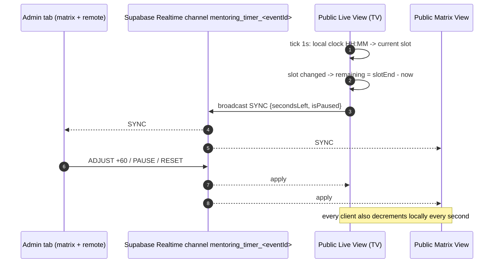

# 05 - Frontend: Booking & Mentoring Systems (as-is)

> Scope: documentation only. Nothing in this file is a recommendation. Everything below describes the code as it exists on branch `main` (working tree with uncommitted changes) on 2026-10-10. Line references are `file:line` against the working tree.
>
> No secret values are reproduced. Where a secret exists in the repository, only its location and nature are noted.

## 0. Contents

1. Overview and file inventory
2. System A - Mentor Booking (`mentors` / `mentor_slots` / `bookings`)
3. System B - Ather Team Booking (`ather_team_members` / `ather_team_slots` / `ather_team_bookings`)
4. System C - Mentoring Distribution (1-1 matchmaking, matrix, live TV view, shared timer)
5. Shared back-end touch points (Google Calendar / Meet, edge functions, email)
6. Database tables used
7. Public vs admin pages and routes
8. Side-by-side comparison of the three systems
9. Duplications, Conflicts & Anomalies (as-is)
10. Open Questions
11. Historical context (Arabic chat logs in the repo root - possibly stale)

---

## 1. Overview and file inventory

The repository contains three independent scheduling subsystems. They share a UI look (Tailwind + lucide icons) and some tables conceptually, but share **no code** (every helper is copy-pasted or re-implemented, see section 9).

| System | Purpose | Actors | Admin UI | Public UI | Lib |
|---|---|---|---|---|---|
| A. Mentor Booking | Startups pick a free time slot with an expert ("mentor") of an event; a Google Calendar event + Meet link is created | Admin (`super_admin`, `project_manager`), Mentor, Startup (booker, anonymous) | `src/components/MentorBookingAdmin.jsx` (1378 lines), `MentorDetails.jsx` (out of scope) | `src/components/MentorBookingPage.jsx` (292) | `src/lib/mentorBooking.js` (571) |
| B. Ather Team Booking | Shortlisted startups book an *interview* slot with an Athar team member (Selection Process) | Admin, Athar team member, Startup (anonymous) | `src/components/AtherTeamBookingAdmin.jsx` (965) (also embedded in `SelectionProcessManager.jsx:1229`) | `src/components/AtherTeamBookingPage.jsx` (289) | `src/lib/atherTeamBooking.js` (300) |
| C. Mentoring Distribution | Auto-generates a fixed schedule of 1-1 sessions: every mentor x every slot x every day gets a startup; matrix + live TV countdown | Admin, public viewers (TV / participants) | `src/components/MentoringDistributionAdmin.jsx` (2305) | `MentoringMatrixView.jsx` (544), `MentoringLiveView.jsx` (774) | `src/lib/mentoringDistribution.js` (1037), `src/lib/useMentoringTimer.js` (222) |

Common helper in `src/lib/api.js`:

- `notifyGoogleAppsScript(bookingId, isAtherTeam)` at `src/lib/api.js:7-26`. Despite the name it calls the Supabase Edge Function **`process-booking`** (`api.js:9`), not Google Apps Script. It is the only booking-related function in `api.js` (grep for `mentor|booking|ather_team|mentoring|meet|calendar` in `api.js` finds only lines 7-26 and unrelated "mentors_list" integration flags at 1991-2000, 2547, 2683).

Route registration: `src/App.jsx:442-470` (see section 7).

---

## 2. System A - Mentor Booking

### 2.1 Purpose and actors

- An admin builds a pool of mentors for an event (imported from the central expert network `master_experts`), creates time slots per mentor, and shares one public link per mentor (`#/book/:mentorId`).
- A startup representative opens the link, picks a slot, enters company name + email and confirms. No login.
- The mentor, booker and configured admin/CC addresses receive a Google Calendar invitation containing a Meet link (created server-side by `process-booking`).

### 2.2 Admin page (`MentorBookingAdmin.jsx`)

Tabs (`activeTab`, line 51): `mentors`, `slots`, `bookings`, `settings`.

| Tab | Behaviour | Lines |
|---|---|---|
| Mentors | Cards from `getMentors`. "Add from Network" opens a modal listing `master_experts` (via `getMasterExperts` in `api.js`), filters out experts already added (`mentor.master_id === expert.id`, lines 181-206), asks for a *booking email* (pre-filled from a `localStorage` map `mentorBookingEmails`, lines 26-42, 232-236) and inserts a `mentors` row (lines 238-276). Inline edit of name/email/advance-notice/bio (lines 527-583). Copy-link, open public page, delete. | 508-659 |
| Slots | Table of all slots of the event; checkbox bulk delete; per-row edit of start/end (`datetime-local`), Meet link, `is_available`; "Add Slot" modal creates N consecutive slots for one mentor (see 2.4). | 662-867, 1232-1375 |
| Bookings | Read-only table (company, booker email, mentor, slot time) with delete (= cancel). | 870-915 |
| Settings | Notification settings stored on the `events` row: `admin_email`, `mentor_admin_emails[]`, `mentor_cc_emails[]`, `mentor_email_template_subject/body` (rich-text). The UI has **no input** for `admin_email`; it is loaded and re-saved unchanged (lines 52, 148, 164). | 918-1095 |

Meet link generation in the UI: button "Generate" calls Edge Function `generate-google-meet` (`MentorBookingAdmin.jsx:98-106`) with `slot_id`, `event_id`, `start_time`, `end_time`, `summary: 'Mentor Session'`; the returned `meet_link` is put in the form field.

### 2.3 Public page (`MentorBookingPage.jsx`)

1. `getMentorById(mentorId)` (`mentorBooking.js:68-92`, merges `master_experts.photo_url` fallback) then `getAvailableSlots(event_id, mentorId)` (lines 23-35).
2. Slots grouped by `toDateString()` of the viewer's browser (lines 60-70) and rendered as buttons.
3. Selecting a slot shows a form `{company_name, booker_email}` (lines 17, 107-211).
4. Submit -> `createBooking({slot_id, mentor_id, event_id, ...formData})` (lines 42-58).
5. Success screen text: "You'll receive a confirmation email shortly" (line 101). The Meet link is **not** shown on the page.

### 2.4 Slot generation (what the UI actually does)

`handleCreateSlot` (`MentorBookingAdmin.jsx:299-349`):

```
start = new Date(date)            // 'YYYY-MM-DD' -> parsed as UTC midnight
start.setHours(h, m, 0, 0)        // local-time setter
for i in 0..num_slots-1:
    end = start + slot_duration minutes
    push { mentor_id, event_id, start_time: start.toISOString(), end_time: end.toISOString(), is_available: true, meet_link }
    if not last: start = end + break_time minutes
await Promise.all(each createSlot)     // N independent INSERTs
```

Defaults: `slot_duration 30`, `break_time 5`, `num_slots 1` (lines 65-73, 334-342, 679-687). The same `meet_link` (possibly empty) is applied to every generated slot (line 320). There is **no overlap check** against existing slots in this path.

### 2.5 A second, unused slot-generation engine

`src/lib/mentorBooking.js` also contains a complete day-by-day engine that no component calls:

| Function | Lines | Notes |
|---|---|---|
| `getMentorDayConfigs`, `saveMentorDayConfig`, `deleteMentorDayConfig` | 337-375 | table `mentor_day_config` (migration `20260806000000`) |
| `bulkCreateMentorSlots`, `bulkDeleteMentorSlots` | 381-399 | single batch insert / delete |
| `calculateDaySlotTimes(config)` | 422-451 | from `session_start_time`, `session_end_time`, `slot_duration_minutes`, `break_between_slots_minutes` |
| `buildMentorSlotsPayload` | 453-480 | cross product mentors x slot times for a date; uses `combineDateAndTime` (local time, line 415-420) |
| `detectMentorSlotConflicts` | 482-512 | overlap test `candStart < exEnd && candEnd > exStart` per mentor |
| `generateMentorSlotsForDay` | 514-571 | overwrite modes `skip`, `replace_all_for_day`, `replace_if_conflict` |

Grep over `src/` finds no importer of any of these (only `getAvailableSlots`, `createBooking`, etc. are used). Historical logs (section 11) state a "Schedule" tab was built in `MentorBookingAdmin.jsx` and then the user asked for it to be implemented in Mentoring Distribution instead; the library half was left behind and the tab does not exist in the current component.

### 2.5.1 Availability rule - advance notice

- Column `mentors.advance_notice_minutes` (default treated as 1440 = 24 h everywhere in code: `mentorBooking.js:138, 141, 184, 250`; UI `MentorBookingAdmin.jsx:550, 611, 808`).
- Options list `ADVANCE_NOTICE_OPTIONS` (0, 30, 60, 120, 360, 720, 1440, 2880 min) at `mentorBooking.js:123-132`.
- Public listing (`getAvailableSlots`, lines 165-188): server filter `is_available = true AND start_time > now()`, then **client-side** filter `start_time >= now + notice`.
- Booking time re-check (`createBooking`, lines 246-253): `is_available` flag and notice window.
- Admin table marks a slot "No / Within notice window" when `is_available && within notice` (lines 807-824).

### 2.6 Conflict handling and booking algorithm

`createBooking` (`mentorBooking.js:238-307`):

```
1. SELECT slot (+ mentor) by id                       -> fail if missing
2. if !slot.is_available       -> throw 'Slot is no longer available'
3. if within advance-notice    -> throw
4. INSERT bookings {...bookingData, start_time, end_time, mentor_name, mentor_email}   (copies from slot/mentor)
5. UPDATE mentor_slots SET is_available = false
6. up to 3 tries (1 s apart): notifyGoogleAppsScript(booking.id, false)  -> Edge Function process-booking
   - errors are only console.logged; the function always returns the booking
```

Conflict handling is a read-then-write sequence (steps 1-5) with **no transaction, no row lock and no unique constraint on `bookings.slot_id`** (migration `20260707000000_mentor_booking_tables.sql:25-34` only creates a non-unique index at line 39). Two concurrent submissions can both pass step 2.

Cancel (`deleteBooking`, lines 309-331): select `slot_id`, delete booking, set slot `is_available = true`. It does not touch the Google Calendar event (`calendar_event_id` is stored by the Edge Function but never read by the frontend), does not clear `mentor_slots.meet_link`, and sends no notification.

### 2.7 Timers / live view

None.

### 2.8 Sequence - mentor booking end to end

```mermaid
sequenceDiagram
    autonumber
    actor Admin
    actor Startup
    participant UI as MentorBookingAdmin / MentorBookingPage
    participant DB as Supabase (PostgREST)
    participant PB as Edge fn process-booking
    participant GC as Google Calendar API
    actor Mentor

    Admin->>UI: Add mentor from master_experts (+ booking email)
    UI->>DB: INSERT mentors
    Admin->>UI: Add Slot (date, start, duration, break, count, [Meet link])
    opt Generate button
        UI->>PB: (fn generate-google-meet) create calendar event, return Meet link
    end
    UI->>DB: N x INSERT mentor_slots
    Admin->>Startup: shares #/book/:mentorId
    Startup->>UI: open page
    UI->>DB: SELECT mentors, master_experts, mentor_slots (is_available, future, notice-filtered client side)
    Startup->>UI: choose slot + company + email
    UI->>DB: SELECT slot (re-check)
    UI->>DB: INSERT bookings (copy start/end/mentor name/email)
    UI->>DB: UPDATE mentor_slots is_available=false
    loop up to 3 tries
        UI->>PB: invoke {booking_id, is_ather_team:false}
        PB->>DB: read booking, events (mentor_admin_emails, mentor_cc_emails, meeting_link_mode, shared link), google_settings
        PB->>GC: POST events (attendees: booker, mentor, admin, cc; conferenceData; sendUpdates=all)
        GC-->>Mentor: calendar invitation e-mail (with Meet link)
        PB->>DB: UPDATE bookings (meet_link, status=confirmed, calendar_event_id); UPDATE mentor_slots.meet_link
        PB-->>UI: {success, meet_link}
    end
    UI-->>Startup: "Booking Confirmed" (regardless of notification outcome)
```

---

## 3. System B - Ather Team Booking

### 3.1 Purpose and actors

Interview scheduling for the **Selection Process**. Athar staff ("team members", not external experts) get slots; shortlisted startups book one. Same `process-booking` pipeline, but flagged `is_ather_team = true`.

### 3.2 Admin page (`AtherTeamBookingAdmin.jsx`)

- Props `eventId`, `isEmbedded` (line 22). Used standalone on route `/event/:eventId/ather-team-booking` and embedded as a settings tab in `SelectionProcessManager.jsx:1227-1230` (`settingsActiveTab === 'ather_team'`).
- Tabs: `members`, `slots`, `bookings` only (lines 296-330). **No settings tab**: the interview admin/CC/template settings live in `SelectionProcessManager` (other analyst's scope) and in `events.interview_*` columns (`atherTeamBooking.js:8` selects them but the admin component never edits them).
- Members are created manually (name, email, photo URL, bio, advance notice) - lines 114-124, 745-825 - not imported from any directory. Email is nullable (migration `20260711000001`) although the form marks it `required` (line 779).
- Slots tab / slot creation: line-for-line the same as System A (`AtherTeamBookingAdmin.jsx:147-196`), `summary: 'Interview Meeting'` for Meet generation (line 63).
- Booking link: `#/ather-team-book/:memberId` (line 236).

### 3.3 Public page (`AtherTeamBookingPage.jsx`)

Same flow as `MentorBookingPage.jsx` with texts "Book an Interview with ..." (line 230), success text "Your interview with {name} has been booked successfully." (line 100; no mention of e-mail). Photos are rendered with `src={member.photo_url}` directly (lines 126, 219) whereas System A uses `getGoogleDriveFallbackUrls` (see section 9).

### 3.4 Algorithms

Identical to System A with renamed tables/columns: availability filter `getAvailableAtherTeamSlots` (`atherTeamBooking.js:110-133`), `createAtherTeamBooking` (183-276), `deleteAtherTeamBooking` (278-300). Differences:

- `createAtherTeamBooking` has verbose `[Booking Trace]` `console.log` of the full booking payload and slot (lines 184-233).
- It calls `getEvent(bookingData.event_id)` and discards the result before notifying (line 237) - an extra round trip with no effect.
- `notifyGoogleAppsScript(booking[0].id, true)` (line 249).
- Booking rows reuse the column names `mentor_name`, `mentor_email` for the team member (lines 219-220).
- `ather_team_bookings.submission_id` exists in the schema ("optional link to company submission") but is never set by this flow.

### 3.5 Timers / live view

None.

### 3.6 Sequence - interview booking

```mermaid
sequenceDiagram
    autonumber
    actor Admin
    actor Startup
    participant SPM as SelectionProcessManager
    participant INV as Edge fn send-interview-invitations
    participant UI as AtherTeamBookingAdmin / Page
    participant DB as Supabase
    participant PB as Edge fn process-booking
    participant GC as Google Calendar
    actor Member as Athar team member

    Admin->>UI: add team members + slots
    UI->>DB: INSERT ather_team_members / ather_team_slots
    Admin->>SPM: send interview invitations
    SPM->>INV: submissionIds
    INV-->>Startup: SMTP mail with {{booking_link}} = '<origin>/#/event/<eventId>/ather-team-booking'
    Note over INV,Startup: that link is the ADMIN route (RoleGuard), see section 9
    Startup->>UI: (needs #/ather-team-book/:memberId)
    UI->>DB: SELECT member, available slots
    Startup->>UI: slot + company + email
    UI->>DB: INSERT ather_team_bookings; UPDATE slot is_available=false
    UI->>PB: invoke {booking_id, is_ather_team:true}
    PB->>DB: events.interview_admin_emails / interview_cc_emails, google_settings
    PB->>GC: create event, attendees = booker + member + interview admins + interview cc
    GC-->>Member: invitation (Meet link)
    PB->>DB: UPDATE booking (meet_link, status, calendar_event_id) and slot.meet_link
```

---

## 4. System C - Mentoring Distribution

### 4.1 Purpose and actors

Produces a static timetable for an event's "1-1 mentoring" round: for each **day**, for each **slot**, for each available **mentor** one **startup (company)** is assigned, avoiding (a) a startup being in two rooms at the same time and (b) (optionally) the same mentor/startup pair ever repeating. The admin can tweak by drag-and-drop, lock ("finalize") days, publish, and run a synchronized countdown on TV screens.

Actors: Admin (RoleGuard `super_admin`/`project_manager`), anonymous viewers of two public pages, optionally anonymous operators of the timer controls (see 4.7).

### 4.2 Data sources used by the admin page

| Data | Source | Lines |
|---|---|---|
| Global config | `mentoring_distribution_config` via `getDistributionConfig` | `MentoringDistributionAdmin.jsx:141-167` |
| Per-day config | `mentoring_distribution_day_config` via `getDayConfigs` | 170-189 |
| Event days (name/date) | `event_days` (direct `supabase.from`) | 192-201 |
| Sessions | `mentoring_sessions` via `getDistributionSessions` | 204-208 |
| Mentors | `experts` joined with `master:master_experts(*)`, merged `{...master, ...exp}`, id = `expert_id` | 211-224 |
| Startups | `companies` (`company_id`, `name`) | 227-232 |

Note: the mentors of this system are the event's **"Lists -> Mentors" expert list (`experts` table)**, not the `mentors` table of System A.

### 4.3 Configuration model (three layers)

1. **Global config** `mentoring_distribution_config` (one row per event, `UNIQUE(event_id)`): `start_time`, `num_days`, `total_round_minutes`, `slot_duration_minutes`, `break_slots` (JSON `[{after_slot, duration_minutes}]`), `unique_pairing`, `mentor_availability` (JSON per mentor), `finalized_days int[]`, `timer_state` (JSON, never read for behaviour), `is_published`.
2. **Per-day override** `mentoring_distribution_day_config` (`UNIQUE(event_id, day_index)`): `day_date`, `session_start_time`, `session_end_time`, `total_round_minutes`, `slot_duration_minutes`, `break_between_slots_minutes`, `mentor_ids uuid[]`.
3. **Per-mentor availability** (inside layer 1 JSON) - accepted shapes (`mentoringDistribution.js:170-188`): missing/`'all'`, `'excluded'`/`'none'`, array of day indexes, `'day_N'`, object `{available_days|days: number[], max_slots, slot_indices, start_time, end_time}` (the last three evaluated only by `isMentorAvailableInSlot`, lines 200-245).

`resolveDayEffectiveConfig(globalConfig, dayConfigs, dayIndex)` (`mentoringDistribution.js:600-637`):

```
slotDuration  = dayCfg.slot_duration_minutes  ?? global.slot_duration_minutes || 20
startTime     = dayCfg.session_start_time[0:5] || global.start_time || '09:00'
totalRound    = dayCfg.total_round_minutes   ?? global.total_round_minutes || 300
if (!dayCfg.total_round_minutes && dayCfg.session_end_time)  totalRound = end - start       // line 612
slots_per_day = max(0, floor(totalRound / max(slotDuration,1)))                              // line 620 - ignores gap
```

`calculateDaySlotTimes(effectiveConfig)` (lines 643-671) then lays slots out as `cursor += duration + break_between_slots_minutes`.

### 4.4 Generation algorithms

Three generators exist in `mentoringDistribution.js`; the admin uses two.

| Function | Lines | Used by | Preserves finalized days | Per-day config | Per-mentor max/time window | Global `break_slots` |
|---|---|---|---|---|---|---|
| `generateDistribution` | 286-400 | imported in admin (line 19) but **never called** | no | no (global only) | no | yes, via `calculateSlotTime` (250-274) |
| `generateDistributionFlexible` | 678-795 | "Generate" button `handleGenerate` (`Admin.jsx:530-585`) | no (wipes all) | yes | **no** | no |
| `generateDistributionWithFinalizedDays` | 801-979 | "Regenerate unfinalized" `handleRegenerateUnfinalizedDays` (292-345) | yes | yes | **yes** (via `isMentorAvailableInSlot`) | no |

Step-by-step (all three share the same core; differences noted):

```
INPUT: config, dayConfigs, mentors[], companies[], (existingSessions for variant 3)

INIT   mentorMeetCount[m][c] = 0 for all m,c
       variant 3: preserve sessions whose day_index in finalized_days and add their (m,c) pairs to mentorMeetCount
FOR day in 0..num_days-1                       (variant 3: skip finalized days)
   eff       = resolveDayEffectiveConfig(...)
   slotTimes = calculateDaySlotTimes(eff)
   mentorsToday = mentors available on this day per mentor_availability
                  AND (if day.mentor_ids non-empty) in day.mentor_ids
   metInRound[m] = {}                          // companies m already met today
   FOR slot in 0..eff.slots_per_day-1
      FOR mentor in mentorsToday (array order)
         [variant 3 only] if !isMentorAvailableInSlot(max_slots, slot_indices, start/end window)
               -> push free session with is_warning, reason 'Mentor unavailable in this slot/time window'; continue
         candidates = companies c where
               c not in metInRound[mentor]                    // not met today
           AND occupiedSlots[day][slot][c] is empty           // c not already in this slot with another mentor
           AND (!unique_pairing OR mentorMeetCount[mentor][c] == 0)   // never met in event
         if candidates empty:
               push session with company=null
               if unique_pairing and mentor has met anyone before -> is_warning (reason 'Unique Pairing limit...')
               else has_conflict = true  (reason 'No available startup: time conflict or already assigned')
               continue
         sort candidates by total meetings of the company across ALL mentors asc; ties via (Math.random() - 0.5)
         chosen = candidates[0]
         push session; update metInRound, occupiedSlots, mentorMeetCount (variant 3 also per-mentor slot counter)
RETURN sessions (variant 3: preserved + new, sorted by day, slot, mentor_name)
```

Properties of the algorithm as implemented: greedy, single pass, no backtracking, mentors processed in list order (earlier mentors win scarce startups in a slot), non-deterministic tie-break (not seeded), `Math.random() - 0.5` comparator (non-uniform shuffle). Complexity per assignment is O(C log C + C*M) because `totalMeetings(c)` re-sums over all mentors for each comparison.

Persistence after generation:

- Full generate: `saveDistributionConfig` -> `generateDistributionFlexible` -> `clearDistributionSessions(eventId)` (DELETE all) -> `saveDistributionSessions` (bulk INSERT) (`Admin.jsx:558-568`). Not transactional.
- Partial: `clearDistributionSessionsForDays(unfinalized)` -> INSERT only unfinalized days' sessions (lines 325-329).
- `saveDistributionSessions` (`mentoringDistribution.js:107-136`) writes a fixed whitelist of columns: **`is_warning` is not persisted**, so the warning/critical distinction is recomputed from `conflict_reason` by `validateDistribution` on every load.

### 4.5 Validation and manual editing

`validateDistribution(sessions, uniquePairing)` (lines 405-466) returns:

1. `TIME_CONFLICT` (error): same company twice in one (day, slot).
2. `REPEAT_MENTOR_COMPANY` (error): pair repeated (event-wide if `uniquePairing`, else per day).
3. `NOTICE_UNIQUE_PAIRING` (warning): every session with no company, not break, and a `conflict_reason` (so *all* unassigned slots, including those generated with `has_conflict = true`, surface as warnings, not errors).

The admin banner counts `criticalConflicts = !is_warning` (`Admin.jsx:133-134`).

Manual move / swap (`handleManualMoveSession`, `Admin.jsx:348-442`): drag a startup card (`draggable`, payload `JSON.stringify(session)`, lines 1897-1901) onto another mentor's cell in the same day/slot or open the reassign modal (1940-1999). If a target session exists the two startups are swapped (two `updateSession` calls, `is_manual_override = true`); else the session is re-pointed to the target mentor/slot/day. Finalized days reject edits (350-354). The cell grid only lets you drag cells with a company; the modal only offers mentors in the *same* slot.

### 4.6 Matrix view and live view (public)

`MentoringMatrixView` (`#/view/:eventId/mentoring/matrix`):

- Loads once (`loadAll`, lines 38-65): config, sessions, `experts` (**without** `master` join, line 49), day configs, `event_days`. No polling.
- Gate: shows "not configured" if no config row, "not published" if `!config.is_published` (200-222).
- Per active day: effective config -> slot rows; columns = mentors available that day (global availability + per-day `mentor_ids`) (86-107); cells from `buildMatrix(sessions, mentors, activeSlotsPerDay, num_days)` (110-113).
- Contains a full set of timer controls (lines 330-398) and a Print button (`window.print()`, 276).

`MentoringLiveView` (`#/view/:eventId/mentoring/live`):

- Loads config, sessions, `experts`(+master), `companies` (with `logo_url`), day configs, event days; re-fetches every 60 s (321-324).
- Day resolution: manual tab override > day whose `event_days.day_date` (or `day_config.day_date`) equals today's date (computed with `toISOString().slice(0,10)`, i.e. UTC) > day 0 (204-232).
- Current slot: every second compares viewer's local `HH:MM` with the day's `slotTimes` (271-301); no slot found -> "No Active Session Right Now" with upcoming list.
- When a new slot becomes current it computes remaining seconds to that slot's end from the local clock and calls `setExactSeconds` -> local state + broadcast `SYNC` (305-318).
- Shows only sessions with a company whose mentor is available that day (344-346); next-slot preview shows sessions even without company (349-351).
- Publish gate only if a config row exists: `config && !config.is_published` (385-395); if no config row at all the page renders an empty schedule.

### 4.7 Shared countdown timer (`useMentoringTimer.js`)

- State per client: `secondsLeft` (init = slot duration seconds), `isPaused`, `isMuted` (persisted in `localStorage['mentoring_timer_muted']`).
- Transport: Supabase Realtime **broadcast** channel `mentoring_timer_<eventId>`, event `timer_action`, `self:false` (lines 83-120). Message types: `PAUSE`, `RESUME`, `ADJUST(seconds)`, `RESET(seconds)`, `SYNC(secondsLeft, isPaused)`. Payload also carries `timestamp`, `dayIndex`, `slotIndex` but receivers ignore them (92-111, 128).
- Each client runs its own `setInterval(1s)` countdown (174-187); there is no server clock, no persisted state (`timer_state` column unused), no latency compensation. A late joiner starts from its own computed value.
- Audio (Web Audio API): tick at 7..4 s (700 Hz), 3..1 s (988 Hz), three-tone alarm at 0; threshold constant `ALERT_SECONDS_THRESHOLD = 7` (line 4).
- **Control surface**: the admin "Matrix & Live Remote" tab (`Admin.jsx:1684-1760`), the public matrix view (330-398) and the public live view (`CountdownTimer`, 22-109) all expose -1m / +1m / pause / reset / mute. Any holder of the public link can broadcast to every screen; the channel has no authentication in code.



### 4.8 Publish

`publishDistribution(eventId, bool)` (`mentoringDistribution.js:156-158`) calls `saveDistributionConfig(eventId, { is_published })`. See anomaly D-1 in section 9 (it upserts default values for several columns).

### 4.9 Sequence - distribution lifecycle

```mermaid
sequenceDiagram
    autonumber
    actor Admin
    participant AD as MentoringDistributionAdmin
    participant LIB as mentoringDistribution.js
    participant DB as Supabase
    actor Viewer as Public viewer (TV/phone)
    participant MV as Matrix/Live View

    Admin->>AD: open /event/:id/mentoring-distribution
    AD->>DB: config, day_config, event_days, sessions, experts(+master), companies
    Admin->>AD: edit global + per-day config, mentor availability, finalize days
    AD->>DB: upsert mentoring_distribution_config / mentoring_distribution_day_config (explicit Save buttons)
    Admin->>AD: Generate (all) or Regenerate unfinalized
    AD->>LIB: generateDistributionFlexible / ...WithFinalizedDays
    LIB-->>AD: sessions[] (no ids)
    AD->>DB: DELETE sessions (all or unfinalized days) ; INSERT new sessions
    AD->>LIB: validateDistribution -> conflicts banner
    Admin->>AD: drag/swap startups
    AD->>DB: UPDATE mentoring_sessions (only rows that have an id in local state)
    Admin->>AD: toggle Published
    AD->>DB: upsert config {is_published}
    Admin->>Viewer: share #/view/:id/mentoring/matrix and /live
    Viewer->>MV: open
    MV->>DB: read config/sessions/experts/companies/day configs (anon)
    MV-->>Viewer: matrix / current slot + shared countdown
```

---

## 5. Shared back-end touch points (Google Calendar / Meet / email)

> The functions themselves belong to another analyst's scope; this section only records what the booking frontends rely on.

### 5.1 Edge function `process-booking` (`supabase/functions/process-booking/index.ts`)

Invoked by `notifyGoogleAppsScript` after every booking (A and B).

1. Reads the booking from `bookings` or `ather_team_bookings` (line 211-222) and the event row `interview_admin_emails, interview_cc_emails, mentor_admin_emails, mentor_cc_emails, meeting_link_mode, shared_google_meet_link` (229-233).
2. `meeting_link_mode === 'shared'` with a non-empty `shared_google_meet_link` -> the shared link is attached to the calendar event; otherwise a new Meet is requested via `conferenceData.createRequest` (lines 139-164). The mode is configured in `SelectionProcessManager.jsx:281-282, 416-417` and applies to **both** A and B.
3. Service account credentials: per-event row in `google_settings`, else global row (`event_id IS NULL`), else env var `GOOGLE_SERVICE_ACCOUNT_KEY` (246-292). Optional `impersonate_email` and `calendar_id`.
4. Attendees = booker, `booking.mentor_email`, and the interview lists (B) or the mentor lists (A) (297-343). `events.admin_email` is **not** used here.
5. Creates the event with `sendUpdates=all` (line 169) - Google itself sends the invitation e-mails. Event times: `booking.start_time/end_time` with `timeZone: "Africa/Cairo"` (126-133).
6. On success updates the booking (`meet_link`, `status = 'confirmed'`, `calendar_event_id`) and the slot's `meet_link` (377-400). On failure it returns HTTP 500 `{success:false}` and does **not** write `status = 'failed'`.

### 5.2 Edge function `generate-google-meet`

Called only from the two admin pages' "Generate" buttons (`MentorBookingAdmin.jsx:98`, `AtherTeamBookingAdmin.jsx:57`). It creates a real Google Calendar event (timezone `"UTC"`, no attendees invited, no `sendUpdates`) just to harvest a Meet link (`generate-google-meet/index.ts:148-191`). Per history logs it was deployed with JWT verification disabled.

### 5.3 Other pieces that exist but are not wired from these frontends

| Piece | Evidence |
|---|---|
| `send-booking-notifications` (SMTP mails + ICS for booker, mentor, admin, admin lists) | No call site in `src/`; only `test-meet-generation.js:40-58` invokes it. It does not read `mentor_email_template_subject/body`; HTML is hard-coded (`index.ts:71-239`). |
| `mentor_email_template_subject/body`, `mentor_admin_emails`, `mentor_cc_emails` saved by `MentorBookingAdmin` Settings tab | Templates have no consumer anywhere in `supabase/functions`; the two address lists are consumed only as *calendar attendees* by `process-booking` (330-342). |
| `notify-google-apps-script` (CORS proxy to a hard-coded Apps Script web-app URL, line 4) | Superseded by `process-booking`; no frontend call site. |
| Google Apps Script `google-apps-script/Code.gs` and `api-agennda-intervew.gs` | Webhook (`doPost`) and time-driven `pollForNewBookings` that create the calendar event and PATCH `bookings`/`ather_team_bookings` via REST with a publishable key stored in the script header (lines 4-6, value not reproduced). The two files differ: `api-agennda-intervew.gs` supports shared Meet mode and a different summary text; `Code.gs` does not (diff lines 126-153, 226-239). |
| `booking_notifications` table | Written only by `send-booking-notifications` when SMTP is not configured. |

### 5.4 Who is notified, per booking type (as implemented in code that is actually invoked)

| Recipient | A. Mentor booking | B. Ather team booking | C. Distribution |
|---|---|---|---|
| Booker (startup) | Google Calendar invite (with Meet) | Google Calendar invite | none |
| Mentor / team member | Google Calendar invite | Google Calendar invite | none |
| Admin list | `mentor_admin_emails` as attendees | `interview_admin_emails` as attendees | none |
| CC list | `mentor_cc_emails` as attendees | `interview_cc_emails` as attendees | none |
| Custom e-mail template | saved but unused | n/a (templates live in Selection Process settings and are used by `send-interview-invitations` etc., not by booking) | n/a |
| On-page confirmation | "confirmation email shortly" | "booked successfully" | n/a |

---

## 6. Database tables used

| Table | System | Key columns (from migrations / `src/types/database.types.ts`) | Notes |
|---|---|---|---|
| `mentors` | A | `id uuid`, `event_id text`, `name`, `email`, `master_id text`, `bio`, `photo_url`, `advance_notice_minutes`, `UNIQUE(event_id,email)` | `photo_url` and `advance_notice_minutes` appear in `database.types.ts:2093-2101` but in no migration in the repo |
| `mentor_slots` | A | `id`, `mentor_id -> mentors ON DELETE CASCADE`, `event_id`, `start_time/end_time timestamptz`, `is_available`, `meet_link` | |
| `bookings` | A | `id`, `slot_id -> mentor_slots CASCADE`, `mentor_id`, `event_id`, `company_name`, `booker_email`, `start_time`, `end_time`, `mentor_name`, `mentor_email`, `meet_link`, `status default 'pending'`, `error_message`, `calendar_event_id` | no unique on `slot_id` |
| `mentor_day_config` | A (unused) | per event/day start, end, duration, break | `20260806000000` |
| `ather_team_members` | B | `id`, `event_id`, `name`, `email nullable`, `photo_url`, `bio`, `advance_notice_minutes`; partial unique `(event_id,email) WHERE email IS NOT NULL` | |
| `ather_team_slots` | B | as `mentor_slots` with `ather_team_member_id` | |
| `ather_team_bookings` | B | as `bookings` plus `submission_id` (unused) | |
| `master_experts` | A | central expert directory (read for import and photo fallback) | no FK to `mentors.master_id` (history: PostgREST embed failed, replaced by two queries, `mentorBooking.js:36-66`) |
| `events` | A, B | `admin_email`, `mentor_admin_emails`, `mentor_cc_emails`, `mentor_email_template_subject/body`, `interview_admin_emails`, `interview_cc_emails`, `interview_email_template_*`, `meeting_link_mode`, `shared_google_meet_link` | |
| `google_settings` | A, B (via functions) | `event_id` (unique, nullable = global), `service_account_key text`, `calendar_id`, `impersonate_email` | RLS: public SELECT/INSERT/UPDATE (`20260716000002`) |
| `booking_notifications` | A (legacy path) | `booking_id -> bookings` only (no ather link) | |
| `mentoring_distribution_config` | C | see 4.3 | RLS `FOR ALL USING (true)` |
| `mentoring_distribution_day_config` | C | `event_id UUID` (others are `TEXT`), `mentor_ids uuid[]` | RLS `FOR ALL USING (true)` |
| `mentoring_sessions` | C | `event_id`, `day_index`, `slot_index`, `mentor_id uuid`, `mentor_name`, `company_id uuid`, `company_name`, `is_break`, `has_conflict`, `conflict_reason`, `slot_start_time TIME`, `slot_end_time TIME`, `is_manual_override` | RLS `FOR ALL USING (true)` |
| `experts` | C | `expert_id` (string), `event_id`, `name`, `title`, `photo_url`, `master_id`, `sort_order` | source of C's mentors; `handleRemoveMentor` DELETEs from it (`Admin.jsx:510`) |
| `companies` | C | `company_id` (string), `name`, `logo_url` | source of C's startups |
| `event_days` | C | `day_number`, `day_name`, `day_date` | no migration in repo |

RLS summary from migrations (`20260707000000`, `20260711000000`, `20260714000001`): public SELECT on mentors/slots/ather members/slots; INSERT on bookings open to everyone; SELECT/UPDATE/DELETE on bookings and slot UPDATE restricted to `authenticated`. See Open Question Q3.

---

## 7. Public vs admin pages and routes

| Route | Component | Guard | Audience |
|---|---|---|---|
| `/event/:eventId/mentor-booking` | `MentorBookingAdmin` | `RoleGuard ['super_admin','project_manager']` (`App.jsx:443-447`) | Admin |
| `/event/:eventId/mentor-booking/:mentorId` | `MentorDetails` | same (448-452) | Admin (out of scope) |
| `/book/:mentorId` | `MentorBookingPage` | none (453) | Public |
| `/event/:eventId/ather-team-booking` | `AtherTeamBookingAdmin` | RoleGuard (456-460) | Admin |
| `/ather-team-book/:memberId` | `AtherTeamBookingPage` | none (461) | Public |
| `/event/:eventId/mentoring-distribution` | `MentoringDistributionAdmin` | RoleGuard (464-468) | Admin |
| `/view/:eventId/mentoring/live` | `MentoringLiveView` | none (469) | Public (TV) |
| `/view/:eventId/mentoring/matrix` | `MentoringMatrixView` | none (470) | Public |

Entry points: `EventDashboard.jsx:349` (mentor-booking), `:376` (mentoring-distribution); Ather team has no EventDashboard card - it is reached via `SelectionProcessManager` settings tab (`:1229`). Public links are built with `window.location.origin + pathname + '#/...'` (HashRouter style): `MentorBookingAdmin.jsx:390`, `AtherTeamBookingAdmin.jsx:236`, `MentoringDistributionAdmin.jsx:722-724`. Public booking/matrix/live links do not carry the event id except the two `/view/` links; booking links carry only the person's id.

---

## 8. Side-by-side comparison

| Aspect | A. Mentor Booking | B. Ather Team Booking | C. Mentoring Distribution |
|---|---|---|---|
| Entity of "provider" | `mentors` (copied from `master_experts`) | `ather_team_members` (manual) | `experts` of the event (+ `master_experts`) |
| Consumer of slot | Startup self-selects | Startup self-selects | System assigns startups (no self-service) |
| Time representation | `timestamptz` per slot row | `timestamptz` per slot row | wall-clock `HH:MM` strings + `day_index` (no date, no tz) |
| Slot creation | Form: date + start + duration + break + count; same Meet link on all | identical | Global config + per-day overrides + `break_slots` (dead) |
| Overlap check | none in UI (engine exists but unused) | none | n/a (computed grid) |
| Availability rules | `is_available` flag + per-person advance notice (default 24 h) | same | per-mentor day/slot/time window/max slots (JSON) + per-day `mentor_ids` |
| Conflict model | optimistic read-then-write | same | in-memory trackers (`occupiedSlots`, `metInRound`, `mentorMeetCount`) + post-hoc `validateDistribution` |
| Calendar / Meet | yes (`process-booking`) | yes (`process-booking`) | no |
| E-mail | calendar invites; settings tab for admin/CC/template | calendar invites; settings in Selection Process | none |
| Realtime | none | none | Supabase Realtime broadcast timer |
| Public gating | none (public once slots exist) | none | `is_published` (client-side check) |
| Excel / CSV export | none | none | none (print only in matrix) |
| Language of UI | English labels + Arabic strings in settings | English | English + Arabic labels/tooltips mixed |

---

## 9. Duplications, Conflicts & Anomalies (as-is)

IDs: **DUP** duplication, **CON** contradiction between parts, **BUG** behaviour that appears unintended, **DEAD** unused code, **SEC** security-relevant observation, **INC** inconsistency.

### 9.1 Duplicated logic between Systems A and B (copy-paste)

| # | What | A location | B location |
|---|---|---|---|
| DUP-1 | `ADVANCE_NOTICE_OPTIONS` (identical 8 entries) | `mentorBooking.js:123-132` | `atherTeamBooking.js:72-81` |
| DUP-2 | `isSlotWithinNoticeWindow` | `mentorBooking.js:138-143` | `atherTeamBooking.js:87-92` |
| DUP-3 | Available-slot query + client notice filter | `mentorBooking.js:165-188` | `atherTeamBooking.js:110-133` |
| DUP-4 | Booking creation (check, insert, mark unavailable, notify with 3 retries) | `mentorBooking.js:238-307` | `atherTeamBooking.js:183-276` |
| DUP-5 | Booking deletion that frees slot | `mentorBooking.js:309-331` | `atherTeamBooking.js:278-300` |
| DUP-6 | Slot-series creation (`handleCreateSlot`) | `MentorBookingAdmin.jsx:299-349` | `AtherTeamBookingAdmin.jsx:147-196` |
| DUP-7 | `generateMeetLink` (edge call + alerts) | `MentorBookingAdmin.jsx:90-127` | `AtherTeamBookingAdmin.jsx:49-86` (only `summary` text differs) |
| DUP-8 | Slots table, edit row, bulk delete, tabs, modals | `MentorBookingAdmin.jsx:662-867` | `AtherTeamBookingAdmin.jsx:489-693` |
| DUP-9 | Public booking page (grouping by date, form, success) | `MentorBookingPage.jsx` | `AtherTeamBookingPage.jsx` (differences: texts, Drive photo helper, `ather_team_member_id`) |
| DUP-10 | `getEvent` (different select lists) | `mentorBooking.js:5-13` | `atherTeamBooking.js:5-13` |
| DUP-11 | Default `1440` notice minutes repeated as a literal | `mentorBooking.js:138,141,184,250`; `MentorBookingAdmin.jsx:550,611,808` | `atherTeamBooking.js:87,90,129,206`; `AtherTeamBookingAdmin.jsx:35,385,441,634,796` |
| DUP-12 | Default slot form values `30 / 5 / 1` | `MentorBookingAdmin.jsx:65-73,334-342,679-687` | `AtherTeamBookingAdmin.jsx:36-44,182-190,506-513` |

### 9.2 Duplicated time / slot math

| # | What | Locations |
|---|---|---|
| DUP-13 | `HH:MM` parse + format helpers | `mentorBooking.js:401-413`; `mentoringDistribution.js:250-274` (`calculateSlotTime`, local `fmt`), `:643-671` (`calculateDaySlotTimes`, another local `fmt`, line 661) |
| DUP-14 | Two exported functions named `calculateDaySlotTimes` with different signatures and return types | `mentorBooking.js:422` (takes `session_start_time/session_end_time`, returns `{slotTimes, slotsCount, totalMinutes, totalHours}` or `[]`) vs `mentoringDistribution.js:643` (takes effective config with `slots_per_day`, returns array) |
| DUP-15 | 12-hour formatter in three places | `MentoringDistributionAdmin.jsx:590-596` (`timeTo12Hour`), `MentoringMatrixView.jsx:30-36` (`timeTo12Hour`), `MentoringLiveView.jsx:768-774` (`format12`) |
| DUP-16 | "Current slot from wall clock" implemented three times | `mentoringDistribution.js:495-520` (`getCurrentSlotIndex`, unused), `MentoringLiveView.jsx:271-284`, `MentoringMatrixView.jsx:118-131` (the two component copies are identical) |
| DUP-17 | Seconds-until-slot-end | `mentoringDistribution.js:525-542` (unused) vs inline in `MentoringLiveView.jsx:305-318` and `MentoringMatrixView.jsx:164-176` |
| DUP-18 | Per-day availability resolution (global `mentor_availability` + `mentor_ids`) | `MentoringLiveView.jsx:326-341`, `MentoringMatrixView.jsx:86-101`, `mentoringDistribution.js:715-719` and `858-862`; plus `isMentorAvailableOnDay` (170-188) |
| DUP-19 | The core matching loop pasted three times (candidate filter, conflict-reason text, sort, tracker updates) | `mentoringDistribution.js:286-400`, `678-795`, `801-979` |
| DUP-20 | Day/Matrix/Live "load data" blocks (config, sessions, experts, day configs, event days) with identical try/catch IIFEs | `MentoringLiveView.jsx:131-182`, `MentoringMatrixView.jsx:38-65`, `MentoringDistributionAdmin.jsx:137-238` |
| DUP-21 | Timer control bars (-1m, +1m, pause, reset, mute) | `MentoringDistributionAdmin.jsx:1717-1758`, `MentoringMatrixView.jsx:354-396`, `MentoringLiveView.jsx:62-106` |
| DUP-22 | Time/slot concepts appear in three data models: `mentor_day_config`, `mentoring_distribution_day_config`, and `mentoring_distribution_config.break_slots` | migrations `20260806000000`, `20260806000100`, `20260725000001` |
| DUP-23 | Two Google Apps Script copies | `google-apps-script/Code.gs`, `api-agennda-intervew.gs` (450 vs 477 lines) |
| DUP-24 | Calendar-event creation implemented in four places (two edge functions, two GAS files) | `process-booking/index.ts:112-187`, `generate-google-meet/index.ts:136-191`, `Code.gs:112-252`, `api-agennda-intervew.gs:112-283` |

Timezone handling duplication / divergence (relevant to DUP-13..17): see CON-9 to CON-11.

Excel export: none of the seven components or four libs in this scope exports Excel/CSV (grep for `xlsx|excel|export` yields only component names). The only "export" is `window.print()` in `MentoringMatrixView.jsx:276`.

### 9.3 Contradictions between systems / parts

| # | Contradiction | Evidence |
|---|---|---|
| CON-1 | Slot timestamps built two different ways. UI path: `new Date('YYYY-MM-DD')` (UTC midnight) then local `setHours`; library engine: `new Date(date + 'T00:00:00')` (local midnight). Same wall-clock input can resolve to different instants outside UTC+0..+N. | `MentorBookingAdmin.jsx:307-308`, `AtherTeamBookingAdmin.jsx:155-156` vs `mentorBooking.js:415-420` |
| CON-2 | "Generate" Meet link vs automatic Meet link: the admin can pre-generate a link and store it in `meet_link` of one or many slots, but in `unique` mode `process-booking` creates a *new* Meet for each booking and overwrites `slot.meet_link` (lines 363-400); in `shared` mode it uses `events.shared_google_meet_link` and also overwrites the slot's link. The pre-generated link is therefore not used by the booking flow, and each Generate click leaves an orphan event in the calendar. | `MentorBookingAdmin.jsx:98-106,1327-1354`; `process-booking/index.ts:363-400`; `generate-google-meet/index.ts:148-191` |
| CON-3 | Calendar time zone differs by function: `Africa/Cairo` in `process-booking` (lines 126-133), `UTC` in `generate-google-meet` (150-157); both pass ISO strings from timestamptz. | idem |
| CON-4 | Alert threshold: hook uses 7 s (`useMentoringTimer.js:4`), live view declares `ALERT_SECONDS_THRESHOLD = 10` (`MentoringLiveView.jsx:114`, unused) and its on-screen text says "last 7 seconds" (line 58); the chat history records a request for 10 s. | files named |
| CON-5 | `break_slots` (global breaks "after slot N") is editable (Break Slots card, `Admin.jsx:1611-1670`) and persisted, but the generators actually used (`generateDistributionFlexible`, `...WithFinalizedDays`), the matrix and the live view ignore it; only the unused `generateDistribution`, `calculateSlotTime`, `getCurrentSlotIndex`, `getSecondsUntilSlotEnd` read it. The per-day "Gap (Min)" (`break_between_slots_minutes`) is the only break that affects the schedule. | `mentoringDistribution.js:250-260, 495-520, 525-542` |
| CON-6 | Per-mentor custom start/end/`max_slots` (Participants tab) is honoured only by "Regenerate unfinalized" (`isMentorAvailableInSlot`, line 878) and **not** by the main "Generate" (`generateDistributionFlexible`), so the same settings produce different timetables depending on the button. | `mentoringDistribution.js:729-735` vs `876-906` |
| CON-7 | Full "Generate" wipes every day, including finalized (locked) days (`clearDistributionSessions`, `Admin.jsx:567`) although the UI promises locking; the confirmation dialog only warns in text (541-553). | idem |
| CON-8 | "End Time (override)" field has no effect in the default flow: `getDayConfigOrDefault` pre-fills `total_round_minutes` with the global value (`Admin.jsx:606`) and `resolveDayEffectiveConfig` only derives the total from `session_end_time` when `total_round_minutes` is falsy (`mentoringDistribution.js:612`). | files named |
| CON-9 | Number of slots ignores the gap: `slots_per_day = floor(total/duration)` (line 620) but slots are then laid out with `+ break_between_slots_minutes` (667), so a day with gaps ends later than `start + total_round_minutes` (e.g. 300/20 = 15 slots with 5 min gaps -> 70 min longer). The admin's capacity preview and the viewers use the same functions, so they agree with each other but not with the "Total Round" label. | `mentoringDistribution.js:620, 667` |
| CON-10 | "Today" detection in Live View uses UTC date (`toISOString().slice(0,10)`) while slot detection uses the viewer's local clock (`getHours()`); around local midnight in UTC+2/+3 the two refer to different dates. | `MentoringLiveView.jsx:209,225,366` vs `273-275` |
| CON-11 | Slot editors in A/B show UTC wall time while list rows show browser-local time: the edit input is `value={start_time.slice(0,16)}` on an ISO string (UTC), the row text is `toLocaleString()`. | `MentorBookingAdmin.jsx:735,740`, `AtherTeamBookingAdmin.jsx:561,566` |
| CON-12 | Who gets e-mailed: the Mentor Settings tab promises templated notifications ("isolated notification system", variables `{{company_name}}`...) but the only invoked path (`process-booking`) sends Google Calendar invitations, ignoring the template; the SMTP function that could use admin e-mail lists (`send-booking-notifications`) is never called and ignores the template too. | `MentorBookingAdmin.jsx:932-938,1046-1071` |
| CON-13 | `{{booking_link}}` in interview invitations resolves to `/#/event/<eventId>/ather-team-booking` (the **admin** route behind `RoleGuard`), whereas the public booking page is `/#/ather-team-book/:memberId`. | `send-interview-invitations/index.ts:180` vs `App.jsx:456-461` |
| CON-14 | Mentor identity differs per system: `mentors.master_id text` (A), `ather_team_members` (B), `experts.expert_id` string (C) - while `mentoring_sessions.mentor_id` and `company_id` are `uuid` and the migration comment calls `mentor_id` an FK to `mentors` (`20260725000001:25-26`). IDs of `experts`/`companies` are typed `string` in `database.types.ts`. |
| CON-15 | `event_id` type: `TEXT` in all booking and config tables, `UUID` in `mentoring_distribution_day_config` (`20260806000100:7`). |
| CON-16 | Photos: A uses `master_experts.photo_url` fallback and `getGoogleDriveFallbackUrls` + `LazyImage urls=[]`; B uses raw `photo_url` with `LazyImage`; C uses plain `` with `getGoogleDriveFallbackUrls(...)[0]` (no multi-URL fallback) and in the matrix view **does not join `master_experts`** at all, so names/photos stored only in `master` are blank there (`MentoringMatrixView.jsx:49` vs `MentoringDistributionAdmin.jsx:211-224` and `MentoringLiveView.jsx:143-157`). |
| CON-17 | Published state is enforced only in UI: Live View shows data when no config row exists (`config && !config.is_published`, line 385) while Matrix View shows "not configured" in that case (line 200); both fetch data with the anonymous client regardless. |
| CON-18 | `isMentorAvailableOnDay` default branch returns `true` for unknown shapes (line 187), but the Participants UI treats a string other than `'all'`, `'excluded'`, `'none'`, `'day_N'` as not covered (`Admin.jsx:481-485`). Minor, but the two normalisers (`handleToggleMentorDay` 471-502 and `handleMentorCustomTimingChange` 455-469) differ: one returns `'all'`/`'excluded'` strings, the other converts to `{available_days}` objects and `'excluded'` -> `available_days: []`. |

### 9.4 Bugs / defects found while reading

| # | Defect | Evidence |
|---|---|---|
| BUG-1 | Publish/unpublish resets other config columns. `publishDistribution` -> `saveDistributionConfig(eventId,{is_published})`; the upsert always writes `unique_pairing: true`, `mentor_availability: {}`, `finalized_days: []`, `timer_state: null` when those keys are absent. In the DB, toggling Published wipes mentor availability and finalized days and resets unique pairing; the admin's local state still shows old values until reload. | `mentoringDistribution.js:39-56,156-158`; `Admin.jsx:699-707` |
| BUG-2 | `validateSessionMove` is called with positional arguments `(sessions, sourceSession, targetDay, targetSlot, targetMentorId, uniquePairing)` but is defined to take a single destructured object. All fields are `undefined`, `movingCompanyId` is falsy, so it always returns `{valid:true}` - move validation never fires. Also `targetMentor` is expected as an object but an id is passed. | `Admin.jsx:356-363` vs `mentoringDistribution.js:984-1036` |
| BUG-3 | After generation, `setSessions(newSessions)` stores sessions without database ids (the INSERT result of `saveDistributionSessions` is not used). Subsequent drag/swap only calls `updateSession` `if (sourceSession.id)` / `if (targetSession.id)` yet updates local state unconditionally, so edits made before a reload look saved but are not persisted. | `Admin.jsx:331,567-570,386-399,412-420` |
| BUG-4 | Number-of-days preset buttons call `setConfig(p => ({...p, num_days: p.value}))` where the updater parameter `p` shadows the preset `p`; `p.value` is `config.value` (undefined). Only the numeric input works. | `Admin.jsx:1056-1061` |
| BUG-5 | `calculateDaySlotTimes` in `mentorBooking.js` returns `[]` for invalid input (line 429) but an object otherwise; `generateMentorSlotsForDay` destructures `{slotTimes}` and then reads `slotTimes.length`, which throws `TypeError` instead of the intended message (line 515-518). (Dead code, see DEAD-1.) | `mentorBooking.js:422-451,514-518` |
| BUG-6 | `detectMentorSlotConflicts` sets `has_booking: !!existing.bookings || !existing.is_available ? true : false` (operator precedence makes the ternary apply to the whole `||`). `bookings` is never selected by `getSlots`. | `mentorBooking.js:506` |
| BUG-7 | "Generate" then silent success: booking is committed and slot is marked unavailable even if the calendar/Meet step fails; retries happen only when the *invoke* throws, not when `{success:false}` is returned, and the UI always shows "Booking Confirmed". The booking row stays `status='pending'` with no `meet_link`; only the legacy Apps Script poller (if still deployed) would pick it up. A retry after a partial failure inside the function (event created, DB update failed) creates another calendar event. | `mentorBooking.js:272-304`, `atherTeamBooking.js:236-273`, `process-booking/index.ts:354-400` |
| BUG-8 | Race condition / double booking is possible (see 2.6); additionally the admin can set `is_available = true` on a booked slot (edit row checkbox) producing a second booking for the same slot. | `MentorBookingAdmin.jsx:801-806`, schema |
| BUG-9 | Deleting a slot, a mentor, or a team member cascades to bookings (`ON DELETE CASCADE`) without confirmation text about bookings; booking cancel does not cancel the Google event or notify anyone. | migrations `20260707000000:15,27-28`, `20260709000001:21,33-34`; `deleteBooking` |
| BUG-10 | `useMentoringTimer.togglePause` broadcasts from inside a `setState` updater (side effect inside a pure function; double-invoked in React StrictMode). | `useMentoringTimer.js:142-148` |
| BUG-11 | `isMaster` parameter of the timer hook is accepted but never used; `slotIndex` is fixed at `0` in the admin hook call (`Admin.jsx:254-259`). | `useMentoringTimer.js:11` |
| BUG-12 | New team member form reset omits `advance_notice_minutes`; "Add Slot" button resets `newSlot` without `meet_link` (controlled/uncontrolled input switch). | `AtherTeamBookingAdmin.jsx:118, 505-513` |
| BUG-13 | Generation uses `dayConfigs` from saved state; per-day edits that are unsaved (`dayEdits`, `configDirtyByDay`) and `selectedMentorsByDay` changes are silently ignored by "Generate". "Apply to All" only stages edits and replaces `configDirtyByDay` with a new object (previous dirty flags are dropped). | `Admin.jsx:560-565, 628-647` |
| BUG-14 | `handleRemoveMentor` in the distribution page deletes the row from the **event-wide `experts` list**, not from the distribution (`Admin.jsx:504-527`), and does not delete that mentor's sessions. | |
| BUG-15 | Distribution matrix (admin tab) draws `activeMatrixSlotTimes` rows but `buildMatrix(... slotsPerDay ...)` computed at line 726-728 uses the *global* slots-per-day and is never used by JSX (`matrix` is dead). Matrix View passes the active day's slot count for *all* days (`MentoringMatrixView.jsx:110-113`), so cells of other days beyond that count are dropped (only the active day is rendered, so effect is hidden). | |
| BUG-16 | Slot-level `max_slots` check counts only assigned sessions (`mentorSlotsAssignedToday`), not free slots; skipped slots are emitted as warnings so the matrix shows "Free Slot" after the quota. Unique pairing limit text is attributed even if unrelated reasons apply. | `mentoringDistribution.js:866-868,968` |

### 9.5 Dead code / unused exports

| # | Item | Evidence |
|---|---|---|
| DEAD-1 | Entire mentor-booking day-config engine (`getMentorDayConfigs`, `saveMentorDayConfig`, `deleteMentorDayConfig`, `bulkCreateMentorSlots`, `bulkDeleteMentorSlots`, `calculateDaySlotTimes`, `buildMentorSlotsPayload`, `detectMentorSlotConflicts`, `generateMentorSlotsForDay`) and table `mentor_day_config` | `mentorBooking.js:333-571` |
| DEAD-2 | `generateDistribution`, `calculateSlotTime`, `getCurrentSlotIndex`, `getSecondsUntilSlotEnd`, `isMentorAvailableInSlot` import in admin, `DEFAULT_PER_DAY_CONFIG` import; `_hasOverride` field | `mentoringDistribution.js:250,286,495,525,548,630`; `Admin.jsx:19,24,26,35` |
| DEAD-3 | `isWithin24Hours` in `MentorBookingAdmin.jsx:423-430` (never called; its role was taken by `isSlotWithinNoticeWindow`); `AtherTeamBookingAdmin.jsx:1-3` imports `useMemo`, `Search`, `Loader2`, `Briefcase`, `Database`, `AlertTriangle`, `Settings` that the component does not use; its `event` state (lines 28, 106) is set but never read | |
| DEAD-4 | `genResultByDay` state set only to `null` (`Admin.jsx:663`); its success/error banner can never render | `Admin.jsx:123,1573-1601` |
| DEAD-5 | `timer_state` column + code that loads/saves it | `mentoringDistribution.js:32,48`; `Admin.jsx:94,153` |
| DEAD-6 | `send-booking-notifications`, `notify-google-apps-script`, both `.gs` files (see 5.3); `mentor_email_template_*` columns | |
| DEAD-7 | `notifyGoogleAppsScript` name no longer matches behaviour (calls `process-booking`); error text still says Google Apps Script (`api.js:17,23`, `mentorBooking.js:274-303`) | |
| DEAD-8 | `ather_team_bookings.submission_id` never populated; `getEvent()` call at `atherTeamBooking.js:237` result discarded | |
| DEAD-9 | `docs`: guide `دليل-إعداد-Google-Apps-Script.md` tells the operator to edit `const webAppUrl` in `atherTeamBooking.js` / `mentorBooking.js`; no such constant exists now | |

### 9.6 Security-relevant observations (descriptive)

| # | Observation | Evidence |
|---|---|---|
| SEC-1 | Public `SELECT` on slots returns `*` including `meet_link` and joined `mentors(*)` (email, bio); the public pages display the mentor's e-mail. | `mentorBooking.js:165-188`; `MentorBookingPage.jsx:141`; `AtherTeamBookingPage.jsx:139`; RLS `USING (true)` |
| SEC-2 | `google_settings` (column `service_account_key`) has RLS policies allowing public SELECT, INSERT and UPDATE. | `20260716000002_add_google_settings_table.sql:15-27` |
| SEC-3 | A Google service-account JSON (including a private key) is present in plain text inside a historical chat log in the repo root (`مشكلة روابط جوجل ميت لا تعمل.md`, near the end of the file). Value deliberately not reproduced here. | |
| SEC-4 | The Apps Script files embed a Supabase publishable key and the project URL in their headers (lines 4-5 of `Code.gs` and `api-agennda-intervew.gs`); `notify-google-apps-script/index.ts:4` embeds a script web-app URL. | |
| SEC-5 | `mentoring_distribution_config`, `mentoring_sessions`, `mentoring_distribution_day_config`, `mentor_day_config` have `FOR ALL USING (true) WITH CHECK (true)` policies - anyone with the anon key can read/write them. The Realtime timer channel is unauthenticated, and the public pages include write controls (4.7). | migrations `20260725000001:45-49`, `20260806000000:25-26`, `20260806000100:26-27` |
| SEC-6 | `process-booking` accepts any `booking_id` from any caller (CORS `*`, service-role client inside); history states `generate-google-meet` was deployed without JWT verification, allowing anonymous creation of calendar events. | `process-booking/index.ts:6-10,205-208` |
| SEC-7 | `localStorage` key `mentorBookingEmails` stores mentor booking e-mails per admin browser (`MentorBookingAdmin.jsx:26-42`). | |

### 9.7 Other inconsistencies

- INC-1 Mixed language: Arabic strings inside admin and live pages (e.g. `Admin.jsx:806,817,1289-1292,1696-1700`, `MentoringLiveView.jsx:52,80-86`, `MentoringMatrixView.jsx:337`, `MentorBookingPage.jsx:200`) while the history log records a request to make Live View fully English.
- INC-2 Terminology: "booker_email", "mentor_name/mentor_email" in Ather tables; "startup", "company", "founder" used interchangeably; "slot" in A/B is a row, in C a column index.
- INC-3 Naming: `notifyGoogleAppsScript` (api.js) vs edge function `process-booking`; file `api-agennda-intervew.gs` (typo) in repo root; the Arabic file `مشكلة تعدي المينتوردينج ديستريبيوشن.md` has an H1 of another log ("حل مشكلة تحميل الصورة").
- INC-4 Admin pages use inline styles `font-manrope`/hex colours (`#1a27c9`, `#0d0e0e`) in A/B, theme tokens (`athar-blue`, `bg-card`) in C.
- INC-5 Confirm dialogs use `window.confirm`/`alert` in all three; toasts exist only in Mentor Settings (`MentorBookingAdmin.jsx:85-88`).
- INC-6 Migration history does not match code: columns `mentors.photo_url`, `mentors.advance_notice_minutes`, `ather_team_members.advance_notice_minutes`, tables `experts`, `companies`, `master_experts`, `event_days`, `smtp_settings` have no migration in `supabase/migrations`.
- INC-7 Booking pages allow the same company/e-mail to book unlimited slots with the same mentor; nothing links `booker_email` to a registered startup, `company_name` is free text.
- INC-8 Search/ordering: slots tab lists all slots of the event unpaginated; bookings list shows `mentor_slots.start_time` (joined) whereas the booking row also stores its own `start_time` copy.
- INC-9 `mentor_slots.is_available` is the only source of truth for "booked"; booking rows duplicate `start_time/end_time/mentor_name/mentor_email` (denormalised copies) so editing a slot's time later does not update the booking or the calendar event.

---

## 10. Open Questions (for the owner)

1. **Intended single source of truth for mentors.** Why do three mentor concepts exist (`mentors` for booking, `experts` for distribution, `ather_team_members`)? Should the 1-1 distribution and the self-service booking ever be linked (e.g. a mentor in distribution who also has slots)?
2. **Is `process-booking` the intended final pipeline** (and are `send-booking-notifications`, `notify-google-apps-script`, `Code.gs`, `api-agennda-intervew.gs`, `booking_notifications` obsolete)? Is the Apps Script poller still deployed/triggered in production?
3. **Live RLS policies.** Migrations give anonymous users INSERT on bookings but SELECT/UPDATE only to `authenticated`, yet the public page does `INSERT ... RETURNING` and an UPDATE on the slot. Were extra policies added directly in the dashboard? What are the actual live policies for `bookings`, `mentor_slots`, `ather_team_*`, `google_settings`, `mentoring_*`?
4. **Mentor e-mail template and `admin_email` setting.** Should the template in the Mentor Settings tab actually be used for a notification? Where is `events.admin_email` supposed to be edited (no input exists in the Mentor tab)?
5. **Meet links.** Is the slot-level `meet_link` (pre-generated by the Generate button) meant to be the link used for the booking, or is the per-booking link created by `process-booking` authoritative? Should shared mode apply to mentors as well as interviews (it currently does)?
6. **Cancellation semantics.** Should cancelling a booking delete the Google Calendar event and notify attendees? (`calendar_event_id` is stored but unused.)
7. **Duplicate-booking prevention.** Is it intended that a company can book multiple slots with the same mentor and that two people can race for a slot?
8. **Distribution break model.** Are global `break_slots` still wanted, or replaced by per-day `break_between_slots_minutes`? Should total round include gaps (CON-9)?
9. **Finalized days vs "Generate".** Should the full "Generate" ever overwrite locked days?
10. **Timer authority.** Should the public Live/Matrix pages be allowed to control the timer? Should `timer_state` be persisted/synchronised server-side?
11. **Per-mentor custom availability** (`max_slots`, `slot_indices`, time window) - should it also apply in the full "Generate"? Is `slot_indices` editable anywhere? (No UI found.)
12. **Types of IDs.** `experts.expert_id` and `companies.company_id` are strings in generated types while `mentoring_sessions.mentor_id/company_id` are `uuid`; are all current IDs valid UUIDs? What column types exist in production?
13. **Time zones.** Is the event always in Africa/Cairo? Which zone should admins' slot times, viewers' times and Live View "today" use?
14. **Public Live/Matrix gating.** Should unpublished data be protected server-side?
15. **`EventDashboard`** has cards for mentor booking and mentoring distribution but none for Ather team booking; is the embedded Selection Process tab the only intended entry?
16. **Who is the audience of the interview invitation's `{{booking_link}}`?** Should it point to each team member's public page or a chooser page?
17. **Rejected scope**: the Arabic logs mention a "Schedule" tab for Mentor Booking that was moved to Distribution. Is the remaining `mentor_day_config` table/engine to be dropped or reused?

---

## 11. Historical context (Arabic chat logs in the repository root)

> These are exported AI chat transcripts from an earlier workspace (`...\Desktop\Coding\agenda-builder`). They are **historical, partly Arabic/Egyptian dialect, may describe states that no longer match the code**, and several contain raw console dumps. File dates (mtime) are given for ordering.

| File (mtime) | What it records | Still true today? |
|---|---|---|
| `إعادة هندسة نظام حجز المواعيد.md` (Jul 7) | Original request to move mentor booking off Google Sheets into Supabase, make it a reusable module, add admin + public link. Resulting design: tables `mentors`, `mentor_slots`, `bookings`, lib `mentorBooking.js`, components `MentorBookingAdmin`/`MentorBookingPage`, route `/event/:eventId/mentor-booking`, "Add from Athar Experts Network" modal over `master_experts`. | Yes (structure matches). |
| `متابعة نظام حجز المواعيد.md` (Jul 8) | Follow-ups: MentorDetails page, "open booking page in new tab", mentor photo, removal of PostgREST embed `mentors -> master_experts` (400 PGRST200) in favour of two queries, 24-hour visibility rule, answer that at that time no notification was sent, then request for e-mail and calendar-invite features. | Photo/two-query merge yes; "24 h" is now configurable `advance_notice_minutes`. |
| `Debug Supabase Column Error.md` (Jul 14) | E-mail features of the selection process (not booking itself): templates, tags, first-name greeting rules. | Outside scope. |
| `دليل-إعداد-Google-Apps-Script.md` (Jul 16) | Operator guide to deploy `Code.gs` as web app / poller and to edit a `webAppUrl` constant in the libs. | **Stale** (flow replaced by `process-booking`; no `webAppUrl` in libs). |
| `مشكلة روابط جوجل ميت لا تعمل.md` (Jul 16) | ~40 booking e-mails were sent with fake/non-working Meet links; solution: Google Calendar API through a service account, new edge function `generate-google-meet`, global row in `google_settings`. Contains a pasted service-account credential (see SEC-3). | Architecture yes; credential exposure still present in file. |
| `إرسال رابط Google Meet بعد حجز المواعيد.md` (Jul 17) | Making Selection Process interview bookings send a Meet link in the calendar invitation; Apps Script runtime (Rhino vs V8) and OAuth scope errors; user finally asks to remove the "Google Calendar Integration" section from `SelectionProcessManager`. | Partly stale (GAS path abandoned). |
| `إصلاح خطأ تنسيق وقت تقويم Google.md` (Jul 21) | Calendar date-time format errors from the script; browser CORS failure calling the Apps Script URL; fixes in order: add CORS in script -> proxy edge function `notify-google-apps-script` -> final edge function `process-booking` (service account, `Africa/Cairo`) and `api.js` switched to it; later part also requests rejection-email settings (out of scope). | Final state matches `process-booking`. |
| `حل مشكلة تحميل الصورة.md` / `معالجة مشكلة تحميل الصورة في صفحة الموجهين.md` (Aug 6 / Aug 4) | Mentor image loading problems (Google Drive URLs, `LazyImage`); at the end the request to create the per-day 1-1 schedule workspace ("10:00 am to 12:30 pm", flexible number of slots per day). | Photo helper exists; the schedule feature is what became System C. |
| `مشكلة تعدي المينتوردينج ديستريبيوشن.md` (Aug 6; H1 says "حل مشكلة تحميل الصورة") | Per-day flexible config built first in Mentor Booking, then moved to Mentoring Distribution at the user's request: new table `mentoring_distribution_day_config`, `getDayConfigs`, `saveDayConfig`, `resolveDayEffectiveConfig`, `calculateDaySlotTimes`, `generateDistributionFlexible`; Day cards UI. Then Matrix and Live views adapted per day. | Yes (explains DEAD-1). |
| `استكمال مهمة توزيع المنتورينج.md` (Aug 6) | Continuation: fixes for `.catch()` on the Supabase builder (hence the async IIFEs), Rules-of-Hooks fix in the matrix view, test results (6 slots 4:32-6:32 PM, 20 min), request to translate Live View to English and add an alert sound in the last 10 s of the timer (Web Audio API). | Code now has 7 s threshold (CON-4). |

Timeline reconstructed from the logs and migration file names: Jul 7 mentor booking tables -> Jul 8-9 notifications/interview settings and Ather team tables -> Jul 16-17 Meet/Calendar (`google_settings`, `meet_link`, status columns, start/end copies) -> Jul 21 `process-booking` -> Jul 25-30 distribution tables, unique pairing -> Aug 6 per-day config -> Aug 10 shared Meet link mode -> Aug 20 mentor notification settings -> Aug 21 finalized days / timer state / manual override.
