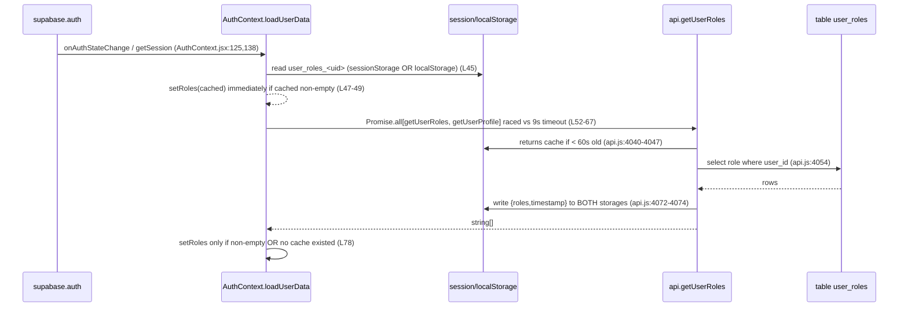
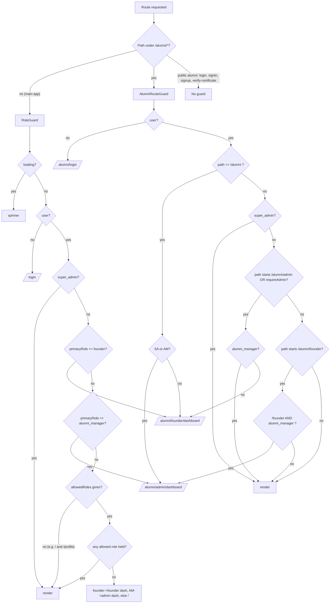
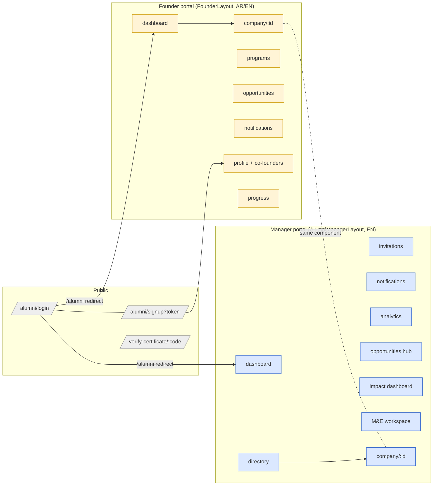
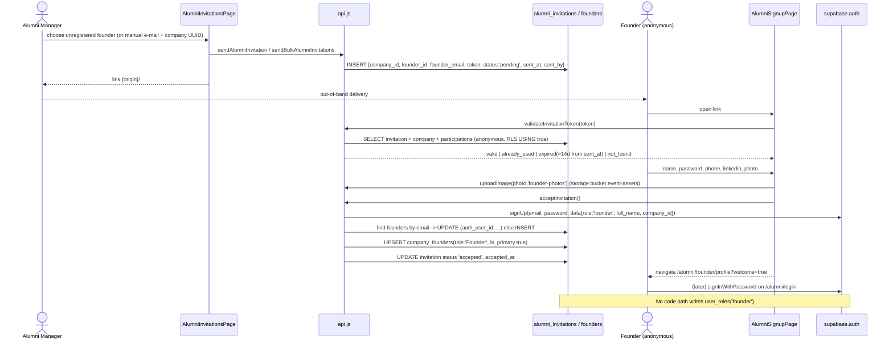
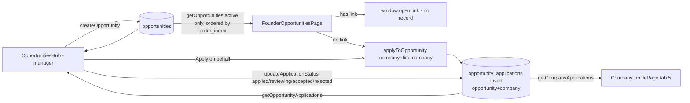

# 06 - Frontend: Alumni Platform & Role/Permission Model (as-is)

> Scope: `src/components/alumni/*` (22 files), `RoleGuard.jsx`, `alumni/AlumniRouteGuard.jsx`, `src/contexts/AuthContext.jsx`, `UserNavDropdown.jsx` (role labels), alumni/role parts of `src/lib/api.js`, alumni routes in `src/App.jsx`, hooks `useLanguage`/`useQueryParams`, and the six root docs (`ALUMNI_PLATFORM.md`, `ALUMNI_PHASE_1_FOUNDER.md`, `ALUMNI_PHASE_2_MANAGER.md`, `ALUMNI_BUGFIX.md`, `ALUMNI_SHARED_HOOKS_FIX.md`, `USER_ROLES_FIX.md`).
> Documentation only. Nothing here proposes a change plan; it records what the code does today. DB-side facts are cross-referenced to migrations `20260924000001` ... `20261004000000` (a separate document owns the DB detail).
> Notation: `file:line` refers to the repository state at time of writing. Router is `HashRouter` (`App.jsx:2`), so all URLs are `/#/...`.

---

## 1. Executive summary

* The "Alumni platform" is a second application living inside the same React SPA and Supabase project. It has **two authenticated portals** - a Founder portal (`/alumni/founder/*`, bilingual AR/EN, dark/amber branding) and an Alumni-Manager portal (`/alumni/admin/*`, English only, "Athar OS" branding) - plus a few **public** pages (alumni login, invitation signup, certificate verifier).
* Roles come from one place: table `user_roles` (enum `app_role`: `super_admin | project_manager | alumni_manager | founder`), fetched by `getUserRoles()` and cached in `sessionStorage` **and** `localStorage`. `user_metadata.role` is written at founder signup but **never read** by the frontend.
* Two different guards protect two different route families: `RoleGuard` (main app) and `AlumniRouteGuard` (alumni). `RoleGuard`'s alumni-path branches are never exercised because no alumni route is wrapped by it.
* Several pages are **non-functional or contradictory with the DB/types** as they stand (see section 12): `FounderDashboard` calls an API with the wrong signature, `AlumniDirectory` references an undeclared `isRtl`, `OpportunitiesHub`/`CompanyProfilePage` write columns that do not exist on `opportunities`/`investor_requests`, `CertificateGenerator` is imported nowhere, and nothing in the repo assigns the `founder` role to a self-signed-up founder.
* The root-level markdown docs are partly aspirational: they name files, routes and behaviours that do not exist (section 11).

---

## 2. Actors

| Actor | Auth? | How identified in code | Entry points | Notes |
|---|---|---|---|---|
| **Super Admin** | yes | `roles.includes('super_admin')` | everything; `/alumni` -> `/alumni/admin/dashboard` | Bypasses `RoleGuard` (`RoleGuard.jsx:30`) and `AlumniRouteGuard` (`AlumniRouteGuard.jsx:38`). Can open founder portal too, but `FounderLayout` then shows the admin's own e-mail as "Founder" (no founder record). |
| **Project Manager (main app)** | yes | `project_manager` | `/`, `/events/*` etc. | Has **no** alumni role. If it opens `/alumni` it is sent to `/alumni/founder/dashboard` (`AlumniRouteGuard.jsx:34`) because it is "not admin". Dashboard has an always-visible "Alumni Platform" link (`Dashboard.jsx:431`). |
| **Alumni Manager** | yes | `alumni_manager` | `/alumni/admin/*` | Manager portal. Also "M&E team" and "Athar leadership" in `ALUMNI_PLATFORM.md` are *not* separate roles in code - they are the same `alumni_manager`/`super_admin`. |
| **Founder** | yes | `founder` (+ matching `founders.auth_user_id` or `founders.email`) | `/alumni/founder/*` | Created through invitation signup (`acceptInvitation`) or by manual row in `founders`. |
| **Co-founder** | yes | same as founder, linked in `company_founders` | invited from `FounderProfilePage` | Invitation row has same `company_id`; `role: 'Founder'`, `is_primary: true` is forced at accept time (`api.js:3840`), even for co-founders. |
| **"Company"** | no separate login | rows in `companies`; a company is reached through its founders (`company_founders`) | `CompanyProfilePage` | There is no company-level account/role. |
| **M&E team** | - | not a role | `MEWorkspace` page inside manager portal | See "Alumni Manager". The role string `me_team` from `ALUMNI_PLATFORM.md` does not exist in the `app_role` enum. |
| **Investor / Partner** | no | not implemented | `ImpactDashboard` (under manager portal only); `submitInvestorRequest` API | `InvestorPortal.jsx` listed as "not started" in `ALUMNI_PLATFORM.md:10`; no `investor` role exists in the enum. |
| **Public verifier (anonymous)** | no | - | `/verify-certificate/:code` | Reads `certificates` with joined `founders(*)`, `programs(*)`, `events(...)` (`api.js:3419-3427`). |
| **Anonymous invitee** | no (becomes founder) | token in URL | `/alumni/signup?token=...` | Reads `alumni_invitations` anonymously (RLS public SELECT `USING (true)`). |

---

## 3. Role / permission model as implemented in the frontend

### 3.1 How roles are resolved



Key facts:

* Source of truth: `public.user_roles(user_id, role app_role, ...)`, unique on `(user_id, role)` (migration `20260929000000`; `role_key` column dropped by `20261004000000`). A user may hold **multiple** roles.
* `roles` is a plain `string[]` in `AuthContext`; `primaryRole` = highest of `ROLE_PRIORITY` `super_admin(4) > project_manager(3) > alumni_manager(2) > founder(1)` (`AuthContext.jsx:7-12,153-156`).
* `AuthContext` also exposes `hasRole(r|r[])` (super_admin always true), `isSuperAdmin`, `isProjectManager` (`PM || SA`), `isAlumniManager` (`AM || SA`), `isFounder` (`F || SA`) (`AuthContext.jsx:158-168`). **Only `isSuperAdmin` is consumed anywhere** (`ProjectManagersManager.jsx:16`). `hasRole`, `isProjectManager`, `isAlumniManager`, `isFounder` and `refreshAuth` are defined but unused (grep over `src/`).
* Caching: `getUserRoles` returns a cached copy if younger than 60 s from `sessionStorage` or `localStorage`; the AuthContext additionally seeds state from cache before the network call. Cache is cleared on `signOut` and `refreshAuth` (`AuthContext.jsx:97-105,186-197`) and by `assignUserRole/removeUserRole` (`api.js:4091-4094,4106-4109`).
* A role *revocation* is not reflected until sign-out: AuthContext keeps cached roles when the server returns an empty array and a cache existed (`AuthContext.jsx:78`), and on timeout/error falls back to cache (`L69-74,L90-94`).
* `profiles` row (`getUserProfile`) supplies `full_name`, `avatar_color`, `avatar_url`; if missing a synthetic profile is built from `user_metadata.full_name` (`AuthContext.jsx:84-89`).
* No frontend code **assigns** a role: `assignUserRole` / `removeUserRole` (`api.js:4079-4111`) have zero callers. `ProjectManagersManager` manages `project_managers` rows (per-event ownership), not `user_roles`.

### 3.2 Two guards, two route families



Observations:

* `RoleGuard` (`RoleGuard.jsx`) is **only applied to non-alumni routes** in `App.jsx` (`/profile`, `/`, `/companies`, `/experts`, `/library`, `/event(s)/...`, `/form-library`, mentoring routes, ...). Its `isFounderPath`/`isManagerPath`/`isAlumniPath` logic (`L21,34-35,39,46`) therefore only ever evaluates with `isAlumniPath === false`: the net effect is "founder -> founder dashboard, alumni_manager -> admin dashboard whenever they open a main-app route".
* `AlumniRouteGuard` is the **only** guard on alumni routes. It does not use `primaryRole`; it uses raw `roles.includes(...)`. So a user holding `[alumni_manager, founder]` is treated as manager by `RoleGuard` (primaryRole = alumni_manager) but as founder-capable by `AlumniRouteGuard` (L53 passes if `isFounder`).
* **Role-less authenticated user** (e.g. a freshly self-registered founder whose `user_roles` row is missing): `RoleGuard` with no `allowedRoles` lets them into `/` (Dashboard) and `/profile`; routes with `allowedRoles` bounce them to `/`; `AlumniRouteGuard` lets them into **all `/alumni/founder/*`** routes (L52-58: only redirects if `!isFounder && isAlumniManager`) and sends them to founder dashboard from `/alumni`; `/alumni/admin/*` redirects them to founder dashboard.
* Guards only gate the UI. Data protection is entirely RLS (see section 10).
* `AlumniRouteGuard` is `lazy()`-loaded as a component (`App.jsx:48`) and so is rendered inside `Suspense`; `ProtectedRoute.jsx` exists (checks only `user`, redirects to `/login`) but is imported nowhere.
* `AlumniLoginPage` does not check the role of the signing-in user; it just navigates to `from` (default `/alumni`) once `user` exists (`AlumniLoginPage.jsx:21-27,42`). The main `LoginPage` and `AlumniLoginPage` are interchangeable for any account; only the redirect target differs (`/` vs `/alumni`).

### 3.3 Role vs route matrix

Legend: **Y** = rendered; **->X** = redirected to X; **L** = redirected to login; `-` = n/a. "Role-less" = authenticated, no row in `user_roles`. FD = `/alumni/founder/dashboard`, AD = `/alumni/admin/dashboard`.

| Route | Component | Guard | Anonymous | super_admin | project_manager | alumni_manager | founder | role-less |
|---|---|---|---|---|---|---|---|---|
| `/login` | LoginPage | none | Y | Y | Y | Y | Y | Y |
| `/` | Dashboard | RoleGuard (no list) | L `/login` | Y | Y | ->AD | ->FD | **Y** |
| `/profile` | UserProfile | RoleGuard (no list) | L | Y | Y | ->AD | ->FD | **Y** |
| `/companies`, `/experts`, `/library`, `/event(s)/:id/*`, mentoring, ather-team | various | RoleGuard `['super_admin','project_manager']` | L | Y | Y | ->AD | ->FD | ->`/` |
| `/form-library`, `/forms-library` | FormLibraryManager | RoleGuard `['super_admin']` | L | Y | ->`/` | ->AD | ->FD | ->`/` |
| `/alumni/login`, `/alumni/signin` | AlumniLoginPage | none | Y | Y (auto-redirect to `from`) | same | same | same | same |
| `/alumni/signup` | AlumniSignupPage | none | Y | Y | Y | Y | Y | Y |
| `/verify-certificate/:code` (declared **twice**, `App.jsx:198,439`) and `/verify-certificate` | CertificateVerifier | none | Y | Y | Y | Y | Y | Y |
| `/alumni` | `<div/>` inside AlumniRouteGuard | AlumniRouteGuard | L `/alumni/login` | ->AD | ->FD | ->AD | ->FD | ->FD |
| `/alumni/admin` | `Navigate` -> AD | none, then AlumniRouteGuard | `Navigate` then L | ->AD Y | ->FD | Y | ->FD | ->FD |
| `/alumni/admin/dashboard` | AlumniManagerDashboard | AlumniRouteGuard `requireAdmin` | L | Y | ->FD | Y | ->FD | ->FD |
| `/alumni/admin/invitations` | AlumniInvitationsPage | same | L | Y | ->FD | Y | ->FD | ->FD |
| `/alumni/admin/notifications` | AlumniNotificationsPage | same | L | Y | ->FD | Y | ->FD | ->FD |
| `/alumni/admin/analytics` | AlumniAnalyticsPage | same | L | Y | ->FD | Y | ->FD | ->FD |
| `/alumni/admin/opportunities` | OpportunitiesHub | same | L | Y | ->FD | Y | ->FD | ->FD |
| `/alumni/admin/impact` | ImpactDashboard | same | L | Y | ->FD | Y | ->FD | ->FD |
| `/alumni/admin/workspace` | MEWorkspace | same | L | Y | ->FD | Y | ->FD | ->FD |
| `/alumni/admin/directory` | AlumniDirectory | same | L | Y | ->FD | Y | ->FD | ->FD |
| `/alumni/admin/company/:id` | CompanyProfilePage | same | L | Y | ->FD | Y | ->FD | ->FD |
| `/alumni/founder` | `Navigate` -> FD | then AlumniRouteGuard | L | Y | Y | ->AD (if not also founder) | Y | **Y** |
| `/alumni/founder/dashboard` | FounderDashboard | AlumniRouteGuard | L | Y | **Y** | ->AD (if not also founder) | Y | **Y** |
| `/alumni/founder/programs` | FounderProgramsPage | same | L | Y | Y | ->AD | Y | Y |
| `/alumni/founder/opportunities` | FounderOpportunitiesPage | same | L | Y | Y | ->AD | Y | Y |
| `/alumni/founder/notifications` | FounderNotificationsPage | same | L | Y | Y | ->AD | Y | Y |
| `/alumni/founder/profile` | FounderProfilePage | same | L | Y | Y | ->AD | Y | Y |
| `/alumni/founder/progress` | FounderProgressPage | same | L | Y | Y | ->AD | Y | Y |
| `/alumni/founder/company/:id` | CompanyProfilePage | same | L | Y | Y | ->AD | Y (**any** company id, not only own) | Y |

Cells for "project_manager" at `/alumni/founder/*` are derived from `AlumniRouteGuard.jsx:52-58` (PM is neither founder nor alumni_manager so it is allowed through).

### 3.4 Menu / navigation visibility per role

| Menu element | Who sees it | Source |
|---|---|---|
| Main dashboard header link "Alumni Platform" -> `/alumni` | every user who can render `Dashboard` (SA, PM, role-less) | `Dashboard.jsx:431` (no role check) |
| `UserNavDropdown`: "Founder Portal" | `primaryRole==='founder'` or `roles` includes founder | `UserNavDropdown.jsx:140-149` |
| `UserNavDropdown`: "Alumni Portal" | `alumni_manager` or `super_admin` | `UserNavDropdown.jsx:151-160` |
| `UserNavDropdown` mounted in | `Dashboard.jsx:460`, `EventDashboard.jsx:659` only | **not** mounted in any alumni layout |
| Founder sidebar (6 items) | anyone who reaches `FounderLayout` | `FounderLayout.jsx:53-91` |
| Manager top-nav (8 items) | anyone who reaches `AlumniManagerLayout` | `AlumniManagerLayout.jsx:26-75` |
| "Change Password" | only via `UserNavDropdown` (main app) | `ChangePasswordModal` - alumni portals have no change-password entry; alumni login's "Forgot password" is an `alert()` (`AlumniLoginPage.jsx:127`) |
| `ProjectManagersManager` | `isSuperAdmin` only | `ProjectManagersManager.jsx:56` |

### 3.5 Main-app roles vs alumni roles

| Aspect | Main app | Alumni platform |
|---|---|---|
| Roles that matter | `super_admin`, `project_manager` (+ per-event `project_managers.role_in_project` owner/collaborator, enforced by RLS on `events`) | `alumni_manager`, `founder` (`super_admin` as universal) |
| Guard | `RoleGuard` (`allowedRoles` array) | `AlumniRouteGuard` (`requireAdmin` flag + path prefixes) |
| Login page | `/login` (`LoginPage`, Arabic RTL) | `/alumni/login` (`AlumniLoginPage`, AR/EN via `?lang`) |
| Logout redirect | `UserNavDropdown` -> `/login` | Layouts -> `/alumni/login` |
| Sign-up | none (accounts created out-of-band) | Invitation-based `/alumni/signup` |
| Data scoping | per-event via `project_managers` | per-founder via `company_founders` + `founders.auth_user_id` (RLS in `20260929000002`) but overridden by permissive "Public access" policies from `20260924000001` (see section 10) |
| Role labels | `ROLE_LABELS` in `UserNavDropdown.jsx:7-32` (also used by `UserProfile`) | same labels; manager layout hard-codes "MANAGER" badge (`AlumniManagerLayout.jsx:133`) even for super_admin; founder layout hard-codes "Founder" (`FounderLayout.jsx:153`) |
| Legacy role string | `role_key` 'alumni_admin' (mapped to `alumni_manager` in migrations `20260929000000/1`) | no frontend reference |

### 3.6 Conflicting / redundant role sources (as-is)

| # | Source | Used by | Conflict |
|---|---|---|---|
| 1 | `user_roles.role` (enum) via `getUserRoles` | AuthContext, all guards | canonical |
| 2 | `auth.users.raw_user_meta_data.role = 'founder'` set in `acceptInvitation` (`api.js:3782-3786`) | nothing in repo reads it; no DB trigger in `supabase/migrations` copies it into `user_roles` | `ALUMNI_PLATFORM.md:100` says "client-side role check via `user_metadata.role`" - not what the code does |
| 3 | `founders.auth_user_id` / `founders.email` (`getFounderProfileByAuth`, `api.js:3990-4021`) | Founder pages to find *their* founder row | A user with no founder row but passing `AlumniRouteGuard` sees empty founder pages. Founder lookup also auto-**links** `auth_user_id` by e-mail match (L4003-4015). |
| 4 | `project_managers.role_in_project` (`owner`/`collaborator`) | event RLS | orthogonal to `user_roles` |
| 5 | `primaryRole` (priority) vs raw `roles.includes` | `RoleGuard` vs `AlumniRouteGuard` | different results for multi-role users (see 3.2) |
| 6 | `roles` cache in `sessionStorage` and `localStorage` under the same key | `AuthContext`, `getUserRoles` | both written, both read (sessionStorage first); shared across tabs via localStorage; stale after role change until sign-out |
| 7 | DB helpers `is_super_admin()`, `has_role()`, `get_user_roles()` | RLS only | Frontend never calls them (docs claim "bypasses guards via `is_super_admin()`", `ALUMNI_PHASE_2_MANAGER.md` section 5; actual code uses `roles.includes('super_admin')`) |

---

## 4. Alumni application map



Entities touched (all in schema `public`): `founders`, `company_founders`, `companies` (alumni columns `is_alumni, founding_year, province, description_ar, website_url`), `program_participations`, `programs`, `events` (as cohort), `company_snapshots`, `certificates`, `opportunities`, `opportunity_applications`, `investor_requests`, `alumni_invitations`, `notifications`, `user_roles`, `profiles`, `form_responses` (annual-update auto-snapshot).

---

## 5. Page-by-page reference

Common conventions: language is read from `?lang=` (default `ar`) in all founder pages and the login/signup pages; manager portal pages are English-only with a few `isRtl ? ... : ...` description strings driven by `useLanguage` (section 8.2). Loading state is local `useState`; there is no global store besides `AuthContext`. All API calls go through `src/lib/api.js` (Supabase client, no REST layer).

### 5.1 Public / auth pages

| Page | Route | Purpose | State | API / tables | Notes |
|---|---|---|---|---|---|
| `AlumniLoginPage` (186 lines) | `/alumni/login`, `/alumni/signin` | e-mail+password sign-in for founders | email, password, loading, error; `resetSent` unused (`L11`) | `useAuth().signIn` (supabase `signInWithPassword`) | Redirects to `location.state.from` or `/alumni` (`L21`). "Forgot password" is `alert()` telling to contact admin. Button label hard-coded "Sign In as Founder" though managers use the same page. Link to `/alumni/signup` ("Activate account with invitation"). |
| `AlumniSignupPage` (447) | `/alumni/signup?token=...` (also accepts `invitation_id`) | Validate invitation, create auth user + founder row | tokenInput/tokenLoading/invitationData/tokenError, form (fullName, password, confirm, phone, linkedin, photo) | `validateInvitationToken` (`alumni_invitations` + `companies` + `program_participations` + `programs`), `uploadImage(file,'founder-photos')` (storage bucket `event-assets`), `acceptInvitation` (see 6.1) | Shows company/program preview; manual token entry fallback; pre-fills name from e-mail local-part; min password length 6; on success navigates to `/alumni/founder/profile?welcome=true`. If Supabase e-mail confirmation is on, there will be no session at that moment and the guard sends the user to login (behaviour depends on project auth settings - see Open Questions). |
| `CertificateVerifier` (198) | `/verify-certificate/:code?` | Public check of a certificate code | searchCode, cert, loading, error | `verifyCertificate(code)` -> `certificates` + `founders(*)` + `programs(*)` + `events(event_name, event_name_ar)` | Hard-coded Arabic RTL only. Header link "دليل الخريجين" -> `/alumni` which requires login. Re-submits both `navigate()` and `handleVerify()` (duplicate fetch: route change triggers `useEffect` too, `L18-22,45-51`). Shows founder AR name, program, cohort, issue date, issuer, PDF link. |

### 5.2 Founder portal

`FounderLayout` (287 lines): top bar + left sidebar, `?lang` toggle (navigates with replace), unread badge from `getFounderNotifications(user.id)` (counted once on mount - never refreshed after "mark all read" on the notifications page), logout -> `/alumni/login`. Loads founder via `getFounderProfileByAuth(user.id, user.email)` just to render display name (each founder page repeats that same call).

| Page | Route | Purpose | State | API calls (tables) | Anomalies |
|---|---|---|---|---|---|
| `FounderDashboard` (771) | `/alumni/founder/dashboard` | List own companies, KPI counters, "Update Metrics" modal, "Add Company" modal | founder, companies, summaryStats, two modal forms | `getFounderProfileByAuth` (`founders` + `company_founders` + `companies`), `getFounderPrograms`, `getCertificates`, `getOpportunities`, `updateFounderCompanyWithSnapshot`, `createFounderCompany` | See 12.1 (wrong call signature, ignored params, `latestSnap` always null, `$` vs SAR). |
| `FounderProgramsPage` (195) | `/alumni/founder/programs` | Participations per company + certificate link | founder, participations, certificates | `getFounderPrograms` (`program_participations` + `programs` + `events` + `companies` for all the founder's companies), `getCertificates(founder_id)` | Certificate matched by `program_id` only; shows "Download Certificate" if `cert.pdf_url`, otherwise static text. **No way here to generate/issue a certificate** (the generator component is not mounted). |
| `FounderOpportunitiesPage` (249) | `/alumni/founder/opportunities` | Browse active opportunities and apply | opportunities, selectedType, applyingId | `getOpportunities()` (`opportunities` active), `applyToOpportunity` (upsert `opportunity_applications` on `(opportunity_id, company_id)`) | Applies for `founder.company_founders[0]` only (`L56`). If `opp.link` present just opens it in a new tab and records nothing. No "already applied" status display. Type filter includes `event` which the manager hub cannot create. |
| `FounderNotificationsPage` (168) | `/alumni/founder/notifications` | Inbox + mark-all-read | notifications | `getFounderNotifications(uid)` (`notifications` where `recipient_id = uid OR recipient_id IS NULL`), `markAllNotificationsAsRead(uid)` (updates only `recipient_id = uid`) | Renders `notif.body` as plain text although manager composes HTML (section 7). |
| `FounderProfilePage` (621) | `/alumni/founder/profile` | Edit own profile; tab "Co-Founders" with invite | profile fields, partners, invite modal | `getFounderProfileByAuth`, `updateFounder` (`founders`), `uploadImage`, `getCompanyFounders`, `inviteCoFounder` | `jobTitle` is editable but never persisted (`L110-118` omit it). Partners list expects flat founder fields (`p.name_ar`, `p.email`) while `getCompanyFounders` returns `company_founders` rows with nested `founders` (`api.js:3251-3259`) -> names render empty/initials "CO". Only first company (`company_founders[0]`) is used. Invitation produces a link to copy; **no e-mail is sent**. `?welcome=true` banner. |
| `FounderProgressPage` (100) | `/alumni/founder/progress` | "Milestone" progress bar | none | none | **Static mock**: milestones array hard-coded with fixed `done` flags (`L10-16`); "more analytics coming soon". |
| `CompanyProfilePage` (971) - shared | `/alumni/founder/company/:id` and `/alumni/admin/company/:id` | Full company profile (5 tabs: overview, snapshots, founders, certificates, applications) | profile, applications, certificates, modals, snapshot/investor/compare forms | `getAlumniCompanyProfile` (companies + company_founders + program_participations + company_snapshots), `getCompanyApplications`, `getCertificates` per founder, `createSnapshot`, `compareSnapshots`, `submitInvestorRequest` | Same UI for founder and manager: both see "Add Snapshot" (writes `source:'me_team'`) and "Request Investor Intro". Back button and error link hard-coded to `/alumni` (`L185,208`). Renders its own sticky header with `min-h-screen`, nested inside the manager layout (double header). Unused imports `linkFounderToCompany`, `unlinkFounderFromCompany`, `createFounder`; unused state `showAddFounderModal`. Link "Browse Opportunities" -> `/alumni/opportunities` (route does not exist, `L676`). |

### 5.3 Manager portal

`AlumniManagerLayout` (202 lines): sticky top header, 8-item nav (Dashboard, Invitations, Notifications, Platform Analytics, Opportunities, Impact Dashboard, M&E Workspace, Company Directory), user pill with static "MANAGER", sign-out -> `/alumni/login`, mobile drawer. English only; no language toggle.

| Page | Route | Purpose | API calls (tables) | Notes |
|---|---|---|---|---|
| `AlumniManagerDashboard` (301) | `/alumni/admin/dashboard` | 5 KPI cards + 3 charts (CSS bars, not SVG) | `getAlumniManagerDashboardStats` (founders w/ & w/o `auth_user_id`, companies count, snapshots last 30d, invitations), `getAlumniManagerChartsData` (founders.created_at, companies sector/province) | Errors are swallowed into zero-filled defaults (`api.js:4427-4436,4494-4501`). "Invite Response" = accepted/total invitations. |
| `AlumniInvitationsPage` (713) | `/alumni/admin/invitations` | Paginated list, status filter, e-mail search, single and bulk invitation, resend, revoke, copy link | `getAlumniInvitationsList`, `getUnregisteredFounders`, `sendAlumniInvitation`, `sendBulkAlumniInvitations`, `resendAlumniInvitation`, `revokeAlumniInvitation` | **No e-mail is sent anywhere** - "Create & Dispatch" only inserts a DB row and shows the link. Search is only triggered by form submit and combined with a `useEffect` on status/page (`L51-53,77-81`). Bulk success message is shown regardless of per-item failures (return value ignored, `L162-168`). Status badges use dark-theme colour classes on light cards. |
| `AlumniNotificationsPage` (476) | `/alumni/admin/notifications` | Compose rich-text broadcast, audience (all / founder / company / program), history with read counts | `sendManagerBroadcastNotification`, `getAlumniManagerNotificationsLog` (last 300 rows, grouped client-side), `getFounders`, `getAlumniCompanies` (`is_alumni=true`), `getAlumniFilterOptions` (programs) | `priority` state exists (`L30`) with no UI control. Body shown in details modal via `dangerouslySetInnerHTML` (`L419`). |
| `AlumniAnalyticsPage` (487) | `/alumni/admin/analytics` | Filterable KPIs, survival rates (6/12/24 m), revenue timeline, Excel export | `getAlumniFilterOptions`, `getAlumniPlatformAnalytics` | Filters (program, sector, province, year, stage) live in URL query. See 12.5 for data-key mismatches and a runtime error in "Reset Filters". |
| `OpportunitiesHub` (512) | `/alumni/admin/opportunities` | Create opportunities; apply on behalf of any alumni company; view/change applications status | `getOpportunities`, `createOpportunity`, `getAlumniCompanies`, `applyToOpportunity`, `getOpportunityApplications`, `updateApplicationStatus` | Create form writes columns that are not in the table (12.3). No edit/delete/deactivate UI even though `updateOpportunity`/`deleteOpportunity` exist. Hard-coded `lang='en'`. |
| `ImpactDashboard` (262) | `/alumni/admin/impact` | Cumulative KPI + sector/province distribution + Excel export | `getImpactStats`, `getAlumniCompanies` | Hard-coded `lang='en'`, `isRtl=false` (`L14-15`). Button "Manage Update Form" links to `/form-library` (super_admin only; an alumni_manager is bounced to AD). |
| `MEWorkspace` (481) | `/alumni/admin/workspace` | Company tracking table (last snapshot per company), snapshot log (100 rows), "Log Snapshot" modal, Excel export | `getAlumniCompanies`, `getImpactStats`, `createSnapshot`, direct `supabase.from('company_snapshots')` (bypasses api.js, `L55`) | Hard-coded `lang='en'`. `filterStatus`, `stats`-derived items partly unused. Mixed Arabic/English button labels ("إلغاء", "حفظ اللقطة"). |
| `AlumniDirectory` (464) | `/alumni/admin/directory` (docs say `/alumni`) | Searchable grid/list of alumni companies, Excel export | `getAlumniCompanies`, `getPrograms`, `getImpactStats` | `isRtl` undeclared (12.2). Cards navigate to `/alumni/admin/company/:id` always. |

### 5.4 Orphaned component

* `CertificateGenerator.jsx` (265 lines) - no importer anywhere in `src/` (verified by grep). Documented as a modal inside FounderDashboard/Programs; it is not mounted. See section 9.

---

## 6. Flows

### 6.1 Invitation -> signup -> first login



Invitation lifecycle (client-enforced): `pending` -> `accepted` (on accept) | `expired` (set lazily by `validateInvitationToken` when `now > sent_at + 14d`, `api.js:3704-3711`) | `revoked` (manager button, only for `pending`). `resendAlumniInvitation` generates a new token and resets status to `pending` + `sent_at`. `validateInvitationToken` has **no branch for `revoked`**: a revoked invitation that is still inside 14 days validates successfully (`api.js:3696-3714`). Token formats differ: `crypto.randomUUID().replace(/-/g,'')` (single/resend) vs `crypto.randomUUID()` with dashes (bulk, `api.js:4561`).

Co-founder invitation: `FounderProfilePage` -> `inviteCoFounder` (checks existing link by e-mail, re-uses a pending invitation by resending it, otherwise `sendAlumniInvitation` with `sentBy: inviterFounderId` - a *founder id* stored in `sent_by`, whereas manager pages store `auth user id`; column is typed `UUID` without FK in `20260925000000`).

### 6.2 Founder updating company metrics ("snapshots")

* Intended: Dashboard "Update Metrics" -> `updateFounderCompanyWithSnapshot(...)` -> insert whole company row as `company_snapshots(snapshot_type:'founder_update')` and update `companies`. Actual call is broken (12.1).
* Manager side: `CompanyProfilePage` / `MEWorkspace` -> `createSnapshot` (`source:'me_team'`, data keys `revenue_sar, employees_count, jobs_created, funding_raised_sar, is_active, milestones, challenges`).
* Form-driven: `submitToForm` integration block 5 (`api.js:2009-2018`): if `targetModule === 'alumni_annual_update'` and answer `company_id` is present -> `createSnapshotFromFormResponse` (data = raw `form_responses.answers`, `source:'founder'`, type `annual_update`). The shape of `answers` is form-defined, so such snapshots do not necessarily carry `revenue_sar` etc.
* Snapshot `data` keys in use across the code base are inconsistent (section 12.5).

### 6.3 Notifications

```mermaid
sequenceDiagram
    actor M as Alumni Manager
    participant N as AlumniNotificationsPage
    participant API as sendManagerBroadcastNotification
    participant DB as notifications
    actor F as Founder
    participant L as FounderLayout / FounderNotificationsPage

    M->>N: title, rich-text body (RichTextEditor), audience all|founder|company|program
    N->>API: {title, body(HTML), audienceType, targetId, sentBy: user.id, priority}
    API->>API: broadcast_id = randomUUID
    alt all
      API->>DB: select founders with auth_user_id NOT NULL
    else founder / company / program
      API->>DB: resolve founders (company_founders; program_participations -> companies -> company_founders)
    end
    API->>DB: INSERT one row per founder {broadcast_id, recipient_id(auth uid | NULL), founder_id, audience_type, audience_target_id, metadata{priority}}
    Note over API,DB: if no recipients resolved -> one row with recipient_id NULL
    F->>L: getFounderNotifications(uid): recipient_id = uid OR recipient_id IS NULL
    F->>L: "Mark all read": UPDATE is_read=true WHERE recipient_id = uid
    M->>N: history = last 300 rows grouped by broadcast_id (read counts, recipients)
```

Characteristics:
* One DB row per recipient; "broadcast" is a client-side grouping on `broadcast_id` (limit 300 rows -> large broadcasts can be truncated/partially grouped).
* Targeting an **unregistered** founder/company/program member creates a row with `recipient_id = NULL`; the founder inbox query (`api.js:4363`) and RLS (`notifications_read_own ... OR recipient_id IS NULL`) expose all `NULL` rows to **every authenticated user** (including other founders).
* "All founders" excludes unregistered founders (needs `auth_user_id`); no row is stored for them (unless nobody is registered).
* Mark-read is all-or-nothing and only affects rows with the user's own `recipient_id`; global (`NULL`) rows can never be marked read, so the badge count stays.
* Header unread badge counts once on mount.
* No push/e-mail; `priority` stored in `metadata` but never rendered.
* Body is HTML (Quill-like `RichTextEditor`); manager details modal renders it with `dangerouslySetInnerHTML`; founder inbox shows raw string.

### 6.4 Opportunities



Status vocabularies: DB comment `applied | shortlisted | accepted | rejected` (migration `20260924000001:128`), manager UI `applied | reviewing | accepted | rejected` (`OpportunitiesHub.jsx:489-492`). Founders never see status changes except on the company profile tab (raw value). No notification is generated on status change. Type vocabularies: DB comment `grant|investment|event|competition|partnership|other`; hub create form offers 4 (no `event`, `other`).

Opportunity cache: `getOpportunities` is memoised by `withCache` and cleared in `createOpportunity`/`updateOpportunity`/`deleteOpportunity` (`clearApiCache`).

### 6.5 Directory & Impact analytics

* `getAlumniCompanies(filters)` (`api.js:3581`): `companies` where `is_alumni = true` + embedded founders; filter keys `sector` -> `industry`, `stage`, `province`, `program_id`. Used by Directory, Impact, MEWorkspace, OpportunitiesHub, Notifications (UI never passes filters).
* `getImpactStats()` (`api.js:3607-3642`): alumni companies, **all** snapshots (latest per company by date), certificates count -> `activeCompanies` (latest snapshot `is_active !== false`), `survivalRate`, sum of `revenue_sar/jobs_created/funding_raised_sar`, `snapshotsCoverage`.
* `getAlumniPlatformAnalytics(filters)` (`api.js:4824-4971`): **all** `companies` (not restricted to `is_alumni`) with embedded participations and snapshots; client-side filtering; survival computed from `program_participations.graduation_status='graduated'` + `graduation_date` (see 12.5) with hard-coded fallback percentages 94 / 86 / 74 when no eligible data.
* Two parallel "impact" implementations therefore exist (`ImpactDashboard` vs `AlumniAnalyticsPage`) with different scopes (is_alumni vs all), key names, and currency labels (SAR vs "IQD/USD" vs `$`).

---

## 7. API layer (alumni-related functions in `src/lib/api.js`)

Section banner starts at `api.js:3194` (docs say line 3186).

| Group | Functions (line) | Tables |
|---|---|---|
| Founders | `getFounders` 3200 (cached), `getFounderById` 3209, `createFounder` 3219, `updateFounder` 3229, `deleteFounder` 3240, `getFounderProfileByAuth` 3990, `getUnregisteredFounders` 4539 | `founders` |
| Company-founder links | `getCompanyFounders` 3251, `linkFounderToCompany` 3261, `unlinkFounderFromCompany` 3272 | `company_founders` |
| Participations | `getProgramParticipations` 3284, `getCompaniesInProgram` 3294, `createParticipation` 3307, `updateParticipationStatus` 3318, `deleteParticipation` 3331, `getFounderPrograms` 4335 | `program_participations` |
| Snapshots | `getCompanySnapshots` 3343, `getLatestSnapshot` 3353, `createSnapshot` 3368, `compareSnapshots` 3386, `createSnapshotFromFormResponse` 3663, `updateFounderCompanyWithSnapshot` 4252, `createFounderCompany` 4293 | `company_snapshots`, `companies`, `form_responses` |
| Certificates | `getCertificates` 3409, `verifyCertificate` 3419, `issueCertificate` 3429 (no UI caller), `updateCertificatePdfUrl` 3439 | `certificates` |
| Opportunities | `getOpportunities` 3452, `createOpportunity` 3467, `updateOpportunity` 3478 (unused in UI), `deleteOpportunity` 3490 (unused), `getOpportunityApplications` 3502, `getCompanyApplications` 3512, `applyToOpportunity` 3522, `updateApplicationStatus` 3532 | `opportunities`, `opportunity_applications` |
| Investor | `submitInvestorRequest` 3547, `getInvestorRequests` 3557 (no UI), `updateInvestorRequestStatus` 3568 (no UI) | `investor_requests` |
| Alumni helpers | `getAlumniCompanies` 3581, `getImpactStats` 3607, `getAlumniCompanyProfile` 3644, `updateAlumniCompany` 4023, `getUniqueAlumniCompanies` 3902 (unused), `getAlumniAdminStats` 3975 (unused) | `companies` (+ others) |
| Invitations | `validateInvitationToken` 3684, `sendAlumniInvitation` 3717, `resendAlumniInvitation` 3746, `acceptInvitation` 3770, `inviteCoFounder` 3855, `getAlumniInvitations` 3889 (unused), `getAlumniInvitationsList` 4504, `sendBulkAlumniInvitations` 4555, `revokeAlumniInvitation` 4594 | `alumni_invitations`, `founders`, `company_founders`, `auth.users` |
| Notifications | `getFounderNotifications` 4358, `markAllNotificationsAsRead` 4373, `sendManagerBroadcastNotification` 4607, `getAlumniManagerNotificationsLog` 4740 | `notifications` |
| Manager analytics | `getAlumniManagerDashboardStats` 4387, `getAlumniManagerChartsData` 4439, `getAlumniFilterOptions` 4786, `getAlumniPlatformAnalytics` 4824 | multiple |
| Roles | `getUserRoles` 4037, `assignUserRole` 4079, `removeUserRole` 4098, `getUserProfile` 4113, `updateUserProfile` 4128, PM helpers 4147-4248 | `user_roles`, `profiles`, `project_managers` |
| Storage | `uploadImage` 871 (bucket `event-assets`, paths `founder-photos/...`) | storage |

General traits: functions throw on error in CRUD helpers, but all manager-portal analytics/list helpers **catch and return empty defaults** (errors invisible to UI). `withCache` memoises read helpers (`getFounders`, `getOpportunities`, `getAlumniCompanies`) and `clearApiCache()` is called in only some mutators (e.g. not in `updateFounder`, `applyToOpportunity`, `acceptInvitation` does).

---

## 8. Cross-cutting UI concerns

### 8.1 Languages

| Area | Language mechanism |
|---|---|
| Login, signup, founder layout/pages, CompanyProfilePage | `?lang=en` else Arabic (`searchParams.get('lang')`), per page |
| CertificateVerifier | Arabic only, hard-coded `dir="rtl"` |
| Manager portal | English strings hard-coded; `useLanguage()` used by invitations/notifications/analytics only for 3-6 description strings |
| AlumniDirectory / ImpactDashboard / MEWorkspace / OpportunitiesHub | `const lang = 'en'` hard-coded; call `translations.Alumni[lang]` (`translations.js:308`) for some labels |
| Certificate canvas | English text; AR only for names |

### 8.2 Shared hooks (`ALUMNI_SHARED_HOOKS_FIX.md`)

* `src/hooks/useLanguage.js`: reads `localStorage['alumni_lang']` (default `en`), exposes `lang, isRtl, isLtr, setLang`; on mount sets `document.documentElement.dir/lang` globally (never restored). Header comment says "English-only; lang is fixed to 'en'" while the hook does support switching. **No component calls `setLang`**, so there is no UI to change it.
* `src/hooks/useQueryParams.js`: thin wrapper over `useSearchParams`; only `AlumniAnalyticsPage` uses it.

### 8.3 Styling inconsistencies

Dark-theme leftovers (`bg-slate-800`, `text-indigo-400`, `text-emerald-400`, `border-indigo-900/...`) in manager pages (`AlumniInvitationsPage`, `AlumniAnalyticsPage`, `AlumniNotificationsPage`) after a "light-theme conversion" described in `ALUMNI_BUGFIX.md`; login/signup/founder portal use dark slate + amber; manager portal uses design tokens (`bg-card`, `text-foreground`, `athar-blue`).

---

## 9. Certificates: generation & verification

```mermaid
sequenceDiagram
    participant DB as certificates
    participant FP as FounderProgramsPage
    participant CG as CertificateGenerator (NOT MOUNTED)
    participant ST as Storage event-assets/certificates/<id>.png
    actor V as Public verifier
    participant CV as CertificateVerifier

    Note over DB: Rows must already exist. issueCertificate() has no UI caller; no migration/trigger auto-creates certificates.
    FP->>DB: getCertificates(founder_id) (programs, events joined)
    FP-->>FP: show "Download" link only when pdf_url is set
    CG->>DB: getCertificates(founderId)
    CG->>CG: render hidden 960px div, html-to-image toPng pixelRatio 2
    CG->>ST: upload PNG (upsert)  [column is named pdf_url but holds a PNG]
    CG->>DB: updateCertificatePdfUrl(cert_id, publicUrl)
    CG-->>V: QR (api.qrserver.com, external) -> {origin}/#/verify-certificate/<code>
    V->>CV: open link / type code
    CV->>DB: verifyCertificate(code) select certificates + founders(*) + programs(*) + events
```

Facts:
* `verification_code` default is `LEFT(gen_random_uuid()::text, 12)` (migration `20260924000001:121`), not a full UUID as stated in `ALUMNI_PLATFORM.md`.
* QR images come from the third-party service `api.qrserver.com` at generation time; the certificate content (verify URL) is sent to that service. The `` is required for `html-to-image`.
* `CertificateCanvas` reads `cert.founders?.name_*`, but `getCertificates` selects only `programs` and `events` (no `founders`) (`api.js:3412`), so the generated certificate would show the fallback name "Graduate".
* The verification result exposes whatever `founders(*)` returns to anonymous callers via RLS `Public access certificates` and `Public access founders` (permissive `USING(true)`), but the UI shows only name/program/cohort/date/issuer/PDF.
* LinkedIn share uses `linkedin.com/shareArticle` with the PNG URL or verify URL.

---

## 10. Cross-reference with migrations 20260924 - 20261004

| Migration | What the frontend relies on | Frontend/DB relationship notes |
|---|---|---|
| `20260924000001_alumni_platform_foundation` | tables `founders, company_founders, program_participations, company_snapshots, certificates, opportunities, opportunity_applications, investor_requests`; columns on `companies`/`programs` | RLS created with **permissive `USING (true)` "Public access ..."** policies for founders, company_founders, program_participations, certificates, opportunity_applications; snapshots public SELECT/INSERT; opportunities public SELECT + authenticated write; investor_requests public INSERT, authenticated SELECT/UPDATE. `ALUMNI_PLATFORM.md` section 10 still lists "RLS policies for alumni tables - not started". |
| `20260925000000_alumni_phase1` | `alumni_invitations`, `founders.auth_user_id` | Policy "Allow public read invitation by token" = `USING (true)` (anyone, anonymous included, can list **all** invitations incl. tokens and e-mails). Policy "Allow auth users to manage invitations" = `FOR ALL TO authenticated USING (true)` - any authenticated user (any role) can insert/update/delete invitations; it is never dropped by later migrations, so `invitations_manager_all` (`20260930000000`) is redundant (permissive policies OR together). |
| `20260929000000_phase2_roles_and_permissions` | `app_role`, `user_roles`, `is_super_admin()`, `has_role()`, `project_managers` | `user_roles` write policy = `is_super_admin()` only -> the browser cannot self-assign roles; seeds **every existing `profiles` row as `super_admin`** (L3 of that migration). Legacy `role_key='alumni_admin'` mapped to `alumni_manager`. |
| `20260929000001_fix_sync_triggers` | - | updates sync triggers (later dropped). |
| `20260929000002_alumni_phase1_founder` | `notifications`, `company_snapshots` (re-declared `IF NOT EXISTS`), `company_founders.role_in_company` | `company_snapshots` is defined in both `...0924` (PK `snapshot_id`, includes `form_response_id`) and here (PK `id` + extra `snapshot_id`). Whichever ran first wins; frontend uses `snapshot_id` (CompanyProfilePage keys/compare) and `form_response_id` (`createSnapshot`). `notifications_read_own` includes `recipient_id IS NULL`. `snapshots_select/insert_policy` (founder-scoped) coexist with the earlier public ones. `company_founders.role_in_company` exists but code writes both `role` and `role_in_company` inconsistently (`linkFounderToCompany` writes only `role`; `createFounderCompany` writes both). |
| `20260930000000_alumni_phase2_manager` | `alumni_invitations.founder_id`, notification broadcast columns, indexes | matches `sendManagerBroadcastNotification` fields. |
| `20261004000000_fix_user_roles_drop_role_key` | `user_roles.role` only; `get_user_roles()` | Frontend `getUserRoles` already reads `role` only. `assignUserRole` still uses `onConflict: 'user_id'` (see 11.6). |

Not found anywhere in migrations: a trigger/function that maps `raw_user_meta_data.role` or invitation acceptance to a `user_roles('founder')` row; a trigger to create `certificates` on graduation; a function used by `sendBulk...`. See Open Questions.

---

## 11. Verification of the root-level docs against the code

### 11.1 `ALUMNI_PLATFORM.md`

| Claim | Reality | Verdict |
|---|---|---|
| Routes `/alumni` (directory), `/alumni/:id`, `/alumni/founder`, `/alumni/opportunities`, `/alumni/me`, `/alumni/impact` | `/alumni` is only a role redirect; directory is `/alumni/admin/directory`, profile `/alumni/admin/company/:id` or `/alumni/founder/company/:id`, hub `/alumni/admin/opportunities`, M&E `/alumni/admin/workspace`, impact `/alumni/admin/impact`; `/alumni/opportunities` is referenced in `CompanyProfilePage.jsx:676` but not routed | mismatch |
| "Public / Athar staff" can use directory and company profile | directory and profile are behind `AlumniRouteGuard`; no public directory | mismatch |
| `CertificateGenerator` is a modal inside FounderDashboard | imported nowhere | mismatch |
| API appended "starting at line 3186" | starts at 3194 | minor |
| Roles via `user_metadata.role`; roles `admin`, `me_team`, `founder`, `public` | `user_roles` table with `super_admin/project_manager/alumni_manager/founder`; `user_metadata.role` never read | mismatch (superseded by Phase 2) |
| RLS "not started" | RLS exists (permissive) | outdated |
| `verification_code` is a UUID | 12 chars | mismatch |
| Snapshot types `program_start, graduation, six_month, annual_update, manual_import` | DB comment & code use `6_month_followup`; seed uses `six_month`; code also writes `founder_update`, `founder_create` | mismatch |
| Reminders triggered manually from MEWorkspace | no such feature in `MEWorkspace.jsx` | not implemented |
| `createSnapshotFromFormResponse` auto-trigger in `submitToForm` block 5 | present, `api.js:2009-2018` | verified (requires answer key `company_id`) |
| Self-signup "not started" | implemented as invitation-only signup | outdated |
| Seed file `supabase/seed_alumni.sql` | exists; seed snapshot keys include `employee_count` (not `employees_count`) | partially consistent |

### 11.2 `ALUMNI_PHASE_1_FOUNDER.md`

| Claim | Reality |
|---|---|
| `FounderCompaniesDashboard.jsx` | file does not exist; component is `FounderDashboard.jsx` |
| `AlumniCompanyProfile.jsx` at `/alumni/founder/company` | file does not exist; `CompanyProfilePage.jsx` at `/alumni/founder/company/:id` |
| `CertificateGenerator` modal inside Programs | not mounted |
| `RoleGuard` "guarantees" founders cannot reach main routes | true only for users whose `primaryRole === 'founder'` and only on RoleGuard-wrapped routes; role-less users pass |
| Migration `20260925000000` adds `auth_user_id` + invitations | verified |
| `20260929000002` creates `company_snapshots` | `IF NOT EXISTS`; table already created by `...0924` |
| `UserNavDropdown` shows role/portal links | verified, but only mounted in two main-app pages |

### 11.3 `ALUMNI_PHASE_2_MANAGER.md`

| Claim | Reality |
|---|---|
| Manager layout has "executive sidebar (Dashboard, Invitations, Notifications, Analytics)" | top navigation with 8 items (+Opportunities, Impact, M&E Workspace, Directory) |
| Manager domain = 4 routes | 9 routes registered (`App.jsx:204-267`) |
| "3 interactive SVG charts" | CSS-div bars/cards (no SVG) |
| Super admin bypass "via `is_super_admin()`" | via `roles.includes('super_admin')` in JS |
| Public token read access "preserved" | policy is `USING (true)` on the entire table |
| "Production build test passed; metrics verified" | not verifiable from repo |
| `exportToExcel` added to `excel.js` | exists, `excel.js:433` |
| "Redirect manager away from main platform event configuration" | true via RoleGuard primaryRole logic |

### 11.4 `ALUMNI_BUGFIX.md`

| Claim | Reality |
|---|---|
| `lang` missing in AlumniDirectory & MEWorkspace fixed with `const lang = 'en'` | present (`AlumniDirectory.jsx:15`, `MEWorkspace.jsx:18`) **but** `AlumniDirectory` still references undeclared `isRtl` (`L311,317`) and `setSearchParams` (`L59`) |
| AuthContext timeout 9 s + one retry | verified (`AuthContext.jsx:52-67`); note a retry on rejection only, and on timeout the in-flight fetch is not cancelled |

### 11.5 `ALUMNI_SHARED_HOOKS_FIX.md`

| Claim | Reality |
|---|---|
| Hooks created | verified |
| `AlumniAnalyticsPage` fixed by importing `useQueryParams` | `searchParams/setSearchParams` fixed, but `clearAllFilters` still references undeclared `lang` (`AlumniAnalyticsPage.jsx:92`) because only `isRtl` is destructured at `L15` |
| "Every Alumni Manager page must start with `useLanguage`" | `AlumniManagerDashboard`, `ImpactDashboard`, `MEWorkspace`, `OpportunitiesHub`, `AlumniDirectory` do not use it |
| Audit lists 7 tabs; "Dashboard" works | manager dashboard has no language dependencies |
| Hook "persists choice to localStorage" | true, but no setter is wired |

### 11.6 `USER_ROLES_FIX.md`

| Claim | Reality |
|---|---|
| `assignUserRole()` uses `upsert ... { onConflict: 'user_id,role', ignoreDuplicates: true }` | actual code: `onConflict: 'user_id'` with comment "one role per user" (`api.js:4081-4088`). The only unique constraints are `(user_id, role)` and PK `id`; PostgREST upsert on `user_id` alone has no matching constraint and is expected to fail. No caller exists |
| `removeUserRole()` added | exists with signature `(userId)` and deletes **all** roles of the user (`api.js:4098-4103`) |
| `getUserRoles` at `api.js#L4056-L4071`, eligible PMs at `L4214-L4240` | now `4037-4077` and `4222-4248` (line drift) |
| Role removal busts caches `sessionStorage.removeItem('user_roles_'+id)` | done in assign/remove, but AuthContext also uses `localStorage` (also cleared) |
| Links `file:///supabase/...`, `file:///src/...` | not valid relative paths |
| `supabase/backups/user_roles_backup_20261004.json` | exists |
| Final columns `id, user_id, role, assigned_at, created_at, updated_at` | matches `database.types.ts:2509`; migration `20260929000000` does not add `assigned_at` (column pre-existed) |

---

## 12. Duplications, Conflicts & Anomalies (as-is)

### 12.1 Broken or mismatched calls

| # | Location | What happens |
|---|---|---|
| 1 | `FounderDashboard.jsx:134-150` vs `api.js:4252` | UI calls `updateFounderCompanyWithSnapshot({companyId, founderId, name, name_ar, province, employees_count, annual_revenue, snapshotData})` (one object) while the function signature is `(companyId, updatedFields, source)`. The object becomes `companyId`, `updatedFields` is `undefined` -> `.eq('company_id', <object>)` / `.update(undefined)`; the feature "Update Metrics" cannot work as written. The prepared `snapshotData` is never used. |
| 2 | `FounderDashboard.jsx:174-191` vs `api.js:4293` | UI passes `{founderId, companyData, initialSnapshot}`; function ignores `initialSnapshot` and creates the snapshot from the new company row. Company is created with `sector`, `stage:'Early Traction'`, `is_alumni:true`. |
| 3 | `FounderDashboard.jsx:73-79,338-341` | `latestSnap` reads `company.company_snapshots`, but `getFounderProfileByAuth` embeds `company_founders(*, companies(*))` without snapshots -> "Latest snapshot" box and Team/Revenue stats are always empty. |
| 4 | `FounderDashboard.jsx:109-117` | Pre-fills columns that do not exist on `companies` (`employees_count`, `revenue_sar`, `annual_revenue`, `net_profit_sar`, `challenges`, `new_products`) - `database.types.ts:453-484` has `employees` (text) and no financial columns. |
| 5 | `FounderProfilePage.jsx:459-462` vs `getCompanyFounders` | expects flat founder fields; function returns `{..., founders: {...}}`. |
| 6 | `FounderProfilePage.jsx:110-118` | `jobTitle` input never saved. |
| 7 | `CertificateGenerator.jsx:24` vs `api.js:3412` | founder name join missing. |
| 8 | `FounderLayout.jsx:29-35` | unread badge never refreshed after mark-all-read (separate component instance state). |
| 9 | `FounderOpportunitiesPage.jsx:56-66` | external-link opportunities never create an application, "apply" ignores which company when a founder has several. |

### 12.2 Runtime errors (undeclared identifiers)

| # | Location | Identifier | Trigger |
|---|---|---|---|
| 1 | `AlumniDirectory.jsx:311,317` | `isRtl` (never declared in the component; `lang` is `const 'en'` at L15) | rendering the grid/list when `filteredCompanies.length > 0` -> `ReferenceError` (error boundary at `App.jsx:120`) |
| 2 | `AlumniDirectory.jsx:57-60` | `setSearchParams` undefined (`toggleLanguage`, never called - dead) | - |
| 3 | `AlumniAnalyticsPage.jsx:92` | `lang` undeclared in `clearAllFilters` | clicking "Reset Filters" |
| 4 | `ALUMNI_BUGFIX.md`/`HOOKS_FIX.md` | claim these classes of error were fixed | records partially fixed |

### 12.3 Schema mismatches (frontend vs `database.types.ts` / migrations)

| Frontend | DB |
|---|---|
| `OpportunitiesHub.handleCreate` inserts `provider`, `amount_sar`, `eligibility_criteria_ar`, `external_url` (`L72-86`) | `opportunities` has `eligibility`, `link`, `image_url`, no `provider`/`amount_sar`/`eligibility_criteria_ar`/`external_url` -> insert would be rejected by PostgREST (unknown columns) unless live DB differs |
| `FounderOpportunitiesPage` reads `opp.link`, `opp.eligibility` | matches DB (so hub-created data would never feed them) |
| Hub grid displays `opp.provider`, `opp.amount_sar` | columns absent |
| `CompanyProfilePage.handleInvestorRequest` inserts `investor_name, investor_entity, investor_email, investor_type, ticket_size_min_sar, notes` (`L151-159`) | `investor_requests` has `requester_name, requester_email, requester_org, request_type, message, company_id, status` (NOT NULL: `requester_name`, `requester_email`) -> insert fails. Form has no e-mail input (state `investor_email` unused). |
| `getInvestorRequests` selects `companies(name, logo_url, industry, stage)` | fine, but no UI uses it |
| `startup_name`, `startup_name_ar` used in 6 components (`CompanyProfilePage:195`, `AlumniDirectory`, `MEWorkspace`, `OpportunitiesHub`) | no such columns; Arabic company name is `name_ar` |
| `company.governorate`, `company.location`, `company.employees` fallbacks | columns exist (`governorate`, `location`, `employees`) alongside new `province` - three overlapping geography fields |
| `sector` vs `industry` | both exist on `companies`; manager dashboard/analytics/notifications use `sector`, Directory/Impact/MEWorkspace/CompanyProfile use `industry`; `getAlumniCompanies` filters `sector` filter on `industry` (`api.js:3588`); `getUniqueAlumniCompanies` checks both |
| Snapshot type `'6_month_followup'` (UI option) | seed uses `six_month`; docs `six_month` |
| Notification `recipient_id`, `sent_by` typed `UUID` -> `auth.users` | invitation `sent_by` receives a founder_id in co-founder invites (no FK on `alumni_invitations.sent_by`) |
| `company_founders.role` vs `role_in_company` | both exist; reads use `cf.role_in_company || cf.role`, writes vary |
| `founders.name_ar` is `NOT NULL`; `acceptInvitation` inserts `name_ar = name_en = fullName` | Arabic name field is filled with the entered (often English) name |
| `getAlumniManagerDashboardStats` counts `companies` (all) | vs `is_alumni` flag elsewhere |

### 12.4 Duplications

| Duplicate | Locations |
|---|---|
| Two guards for two route families | `RoleGuard.jsx`, `AlumniRouteGuard.jsx`; plus unused `ProtectedRoute.jsx` |
| `/verify-certificate/:code` registered twice | `App.jsx:198` and `:439` |
| Role-derivation helpers | `AuthContext` (`isAlumniManager` etc., unused) vs recomputation in `AlumniRouteGuard.jsx:22-25` and `RoleGuard.jsx:30,56-62` |
| `unregistered founders` / `manual founders` | `getUnregisteredFounders` + stats via `auth_user_id IS NULL`; and `getUniqueAlumniCompanies`/`getAlumniAdminStats` compute invitation status per company (unused) - two parallel "invitation status" models (per-invitation vs per-company `not_invited/invited/joined`) |
| Snapshot creation UI | `CompanyProfilePage` modal and `MEWorkspace` modal duplicate the same form/handler; `FounderDashboard` a third variant; `submitToForm` a fourth route |
| Impact computation | `getImpactStats` vs `getAlumniPlatformAnalytics` vs `getAlumniManagerDashboardStats`/`getAlumniManagerChartsData` (distinct filters, keys) |
| Founder lookup | every founder page + layout re-runs `getFounderProfileByAuth` (up to 2 identical network calls per page) |
| Invitation link builder | in `api.js:3741,3765`, `AlumniInvitationsPage.jsx:200,493`, `FounderProfilePage` (via API) |
| Role cache read | `AuthContext.parseCachedRoles` and `getUserRoles` both parse the same storage key with different shape tolerance |
| Opportunities browsing | `OpportunitiesHub` (manager; also lets managers apply) vs `FounderOpportunitiesPage` (type configs duplicated, different type lists) |
| `ROLE_LABELS` | defined in `UserNavDropdown.jsx`, imported by `UserProfile.jsx`, not by alumni layouts which hard-code labels |
| Manager layout vs main `Dashboard` header | both show brand + user controls; alumni portals do not reuse `UserNavDropdown` |
| `Dashboard.jsx.bak` | backup copy in `src/components` |

### 12.5 Data-key / business-logic inconsistencies

* **Revenue / jobs keys**: snapshots written by UI use `revenue_sar`, `employees_count`, `jobs_created`, `funding_raised_sar`, `is_active`; `getImpactStats` reads those; `getAlumniPlatformAnalytics` reads `revenue`/`annual_revenue`, `employees`/`team_size`/`jobs_created`, `status === 'closed'` (`api.js:4874-4894`) and Excel export uses `revenue`, `employees` (`AlumniAnalyticsPage.jsx:115-116`). Net: analytics revenue = 0 for UI-created snapshots; jobs partially (`jobs_created` fallback only).
* **Currency**: SAR in CompanyProfile/Impact/MEWorkspace/Hub; `$` in `FounderDashboard` (labels and values `L395,542,556`); "IQD/USD" in analytics export header; founder UI defaults location to "Iraq/العراق" (`FounderDashboard.jsx:373`) while seed and placeholders use Saudi data (`+966`, "Saudi" companies in `ALUMNI_PLATFORM.md`).
* **Survival rate**: `getImpactStats.survivalRate` = share of alumni with latest snapshot `is_active !== false` (including companies with *no* snapshot being counted only in denominator); analytics uses `program_participations.graduation_date` which is **not a column** in `program_participations` (`end_date` exists; `graduation_date` absent from migration and from the select) -> eligible counts are always 0 -> the displayed 6/12/24-month values are the **hard-coded fallbacks 94 / 86 / 74** whenever any company matches (`api.js:4932-4936`). `activeCount: activeCount || totalCompanies` (`L4948`) also masks zero.
* Analytics `isActive` for survival uses only `c.status !== 'inactive'`, ignoring snapshot `is_active`.
* `getAlumniPlatformAnalytics` mutates embedded arrays with `.sort` in place and runs for **all** companies (not only alumni).
* `getAlumniManagerChartsData` "registration trends" count `founders.created_at`, including manually imported founders, not registrations.
* `getUserRoles` cached 60 s, AuthContext timeout 9 s: a revoked role persists in `localStorage` indefinitely (until sign-out) because empty server results do not overwrite a non-empty cache (`AuthContext.jsx:78`).
* `acceptInvitation` runs sequential writes with no transaction; failure after `signUp` leaves an auth user without founder linkage; `authError` containing "already registered" is swallowed and `authUserId` becomes `null`, linking the founder with `auth_user_id` unchanged.
* `getFounderProfileByAuth` auto-writes `founders.auth_user_id` when a logged-in user's e-mail matches a founder row (`api.js:4009-4014`) - any authenticated account with the same e-mail inherits that founder identity.
* `sendBulkAlumniInvitations` inserts without duplicate checks; one pending invitation per (company, e-mail) is only enforced in `inviteCoFounder`.
* Pagination in invitations list uses `created_at` ordering while UI shows `sent_at`.
* `getAlumniManagerNotificationsLog` limit 300 rows (per recipient), so history for big broadcasts is truncated.
* HTML injection surface: `dangerouslySetInnerHTML` on manager-authored notification body (`AlumniNotificationsPage.jsx:419`), unsanitised.
* Role-less users see main `Dashboard` (and the "Alumni Platform" link) - the app has no "default deny" for authenticated users without roles.
* `UserNavDropdown.handleSignOut` navigates to `/login` regardless of the portal; alumni layouts navigate to `/alumni/login`.
* `AlumniManagerLayout` shows badge "MANAGER" for super admins; `FounderLayout` shows "Founder" for anyone, including super admin/PM with no founder row.
* `/alumni/founder/company/:id` accepts any company id; UI does not check membership (only RLS could).

### 12.6 Dead / unused code

* `CertificateGenerator.jsx` (not mounted), `issueCertificate`, `updateOpportunity`, `deleteOpportunity`, `getInvestorRequests`, `updateInvestorRequestStatus`, `getUniqueAlumniCompanies`, `getAlumniAdminStats`, `getAlumniInvitations`, `assignUserRole`, `removeUserRole`, `getFounderById`, `getCompaniesInProgram`, `createParticipation`, `updateParticipationStatus`, `deleteParticipation`, `getLatestSnapshot`, `createFounder`/`deleteFounder` (only `createFounder` imported unused in CompanyProfilePage), `unlinkFounderFromCompany`.
* `ProtectedRoute.jsx`; `AuthContext` flags `hasRole/isProjectManager/isAlumniManager/isFounder`, `refreshAuth`, `changePassword` (used by modal), `signUp` wrapper (unused: `acceptInvitation` calls `supabase.auth.signUp` directly).
* `RoleGuard` alumni-path branches (`isFounderPath`, `isManagerPath`, `isAlumniPath` login target).
* State/vars: `resetSent` (`AlumniLoginPage`), `selectedProgram` (`AlumniDirectory:29`), `showAddFounderModal`, `filterStatus` (MEWorkspace), `priority` (notifications), `photoFile` (FounderProfilePage).
* Unused imports across many alumni files (e.g. `useNavigate`, `Link`, many lucide icons).
* `FounderProgressPage` milestone data is fully static.

### 12.7 Documentation/behaviour drift summary

See section 11 (file names, routes, role mechanism, hooks, sidebar vs top-nav, `assignUserRole` signature, certificate generator placement).

---

## 13. Open Questions (for the owner)

1. **How does a self-registered founder receive the `founder` role?** `acceptInvitation` only sets `user_metadata.role`; `user_roles` accepts writes from `super_admin` only; no trigger exists in the repo. Is there a trigger/Edge Function/manual step in the live project not present in `supabase/migrations`?
2. Is **e-mail confirmation** enabled in Supabase Auth? It decides whether the post-signup redirect to `/alumni/founder/profile?welcome=true` lands logged in.
3. Is the intended behaviour for **role-less authenticated users** to see the main Dashboard (`/`) and all `/alumni/founder/*` pages?
4. Migration `20260929000000` assigns **all existing `profiles` as `super_admin`**. Was that intentional for production, and how are subsequent managers/PMs/founders meant to be granted roles (no UI calls `assignUserRole`)?
5. Should `assignUserRole` be "one role per user" (as coded and commented) or multi-role (as the DB unique key and `USER_ROLES_FIX.md` state)?
6. What is the live schema of `opportunities` and `investor_requests`? The hub/profile forms write columns (`provider`, `amount_sar`, `external_url`, `investor_*`) that are absent in repo types - was the live DB altered separately, or are these features currently failing?
7. Is `program_participations.graduation_date` intended (analytics reads it) - and should the 94/86/74 fallback survival percentages be real defaults or placeholders?
8. Which is the canonical field for sector (`sector` vs `industry`) and geography (`province` vs `governorate` vs `location`)?
9. What currency/country is the target (SAR/Saudi in docs, seeds and most forms; USD "$" and "Iraq/Baghdad/Erbil" in `FounderDashboard`; "IQD/USD" in analytics export)?
10. Is `CertificateGenerator` supposed to be mounted somewhere (and who issues certificates - managers or founders)? Who calls `issueCertificate`, and when should a certificate exist (graduation trigger)?
11. Should founders really be able to "Add Snapshot" (source recorded as `me_team`) and "Request Investor Intro" from the shared `CompanyProfilePage`?
12. Is the public SELECT on `alumni_invitations` (all rows, tokens included) and the broad "Public access" RLS policies on founders/certificates/opportunity_applications intentional?
13. Should alumni portals share `UserNavDropdown` (change password, profile) or stay separate? Currently founders/managers cannot change their password inside the alumni UI.
14. Is the manager portal meant to stay English-only (hook comment) or become bilingual (hook supports `setLang` but nothing calls it)?
15. How should the "M&E team", "investor/partner" and "company" actors be modelled - as roles (enum has none) or as sub-views of `alumni_manager`?
16. Where do annual-update forms (`targetModule === 'alumni_annual_update'`) get their `company_id` answer from, and what is the expected `answers` key structure compared with the snapshot `data` keys the dashboards read?
17. Notifications addressed to unregistered founders are stored with `recipient_id = NULL` and are visible to all authenticated users - is this intended as "announcements" or an unintended side effect?
