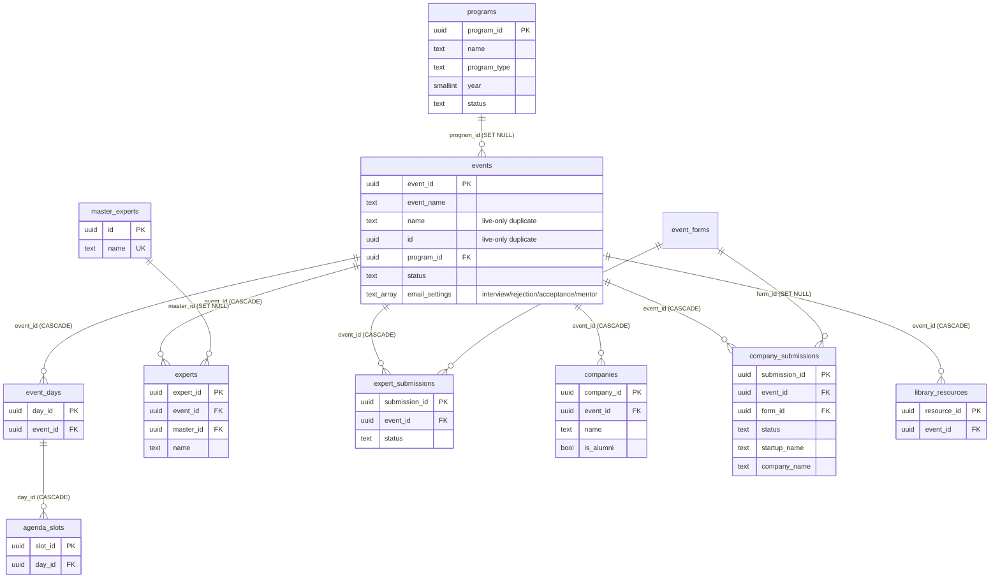
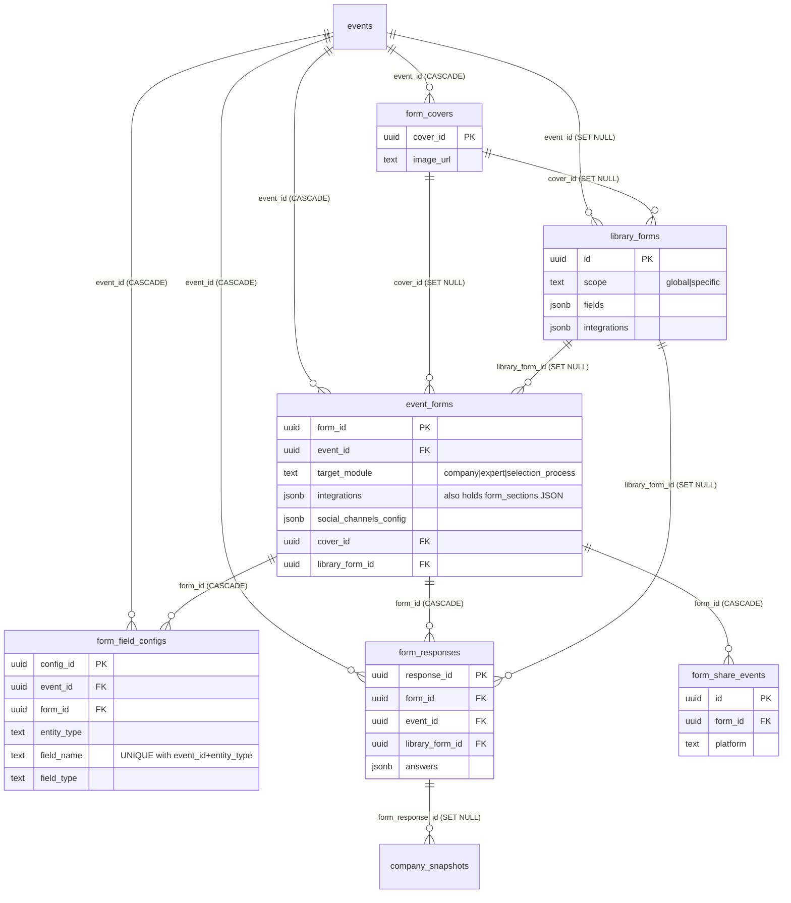
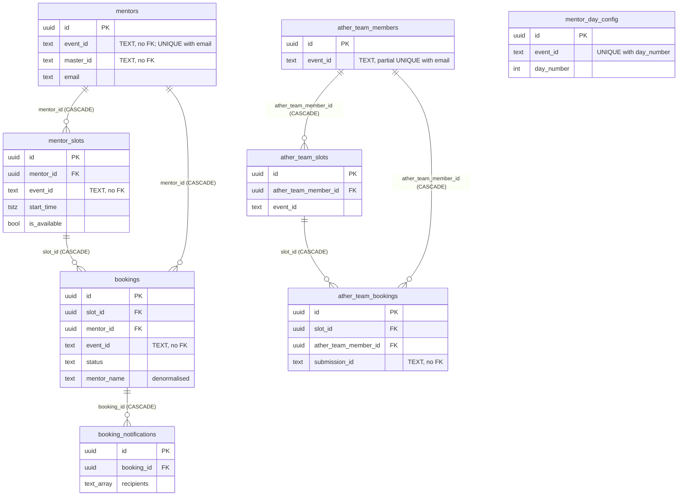
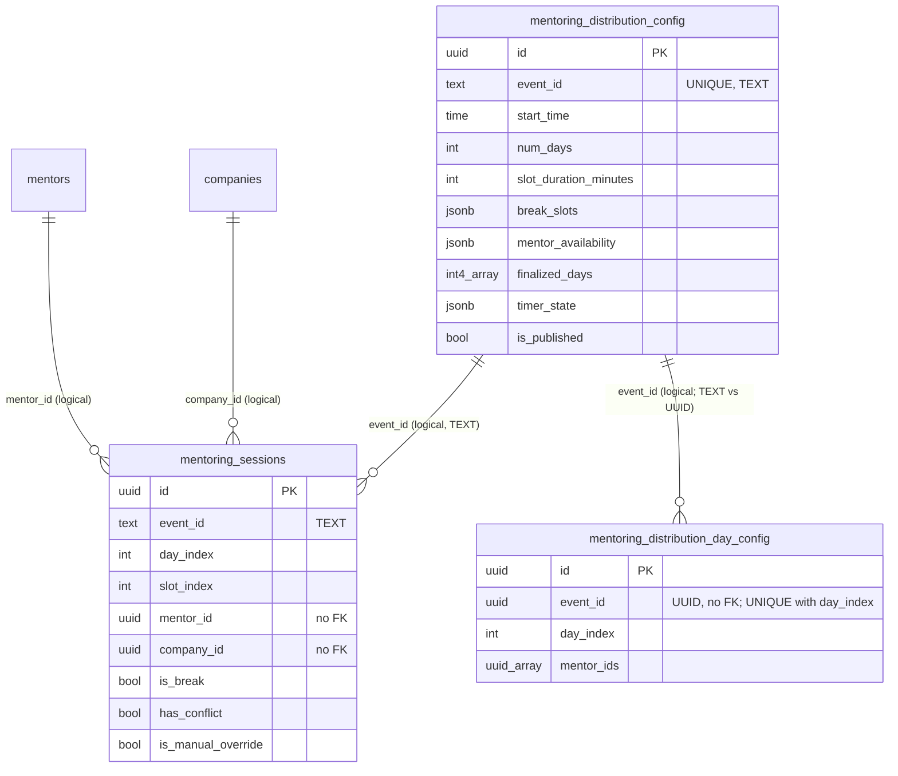
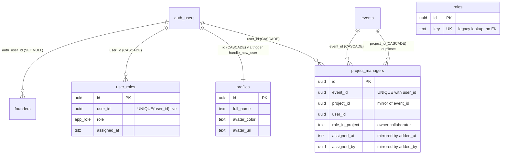
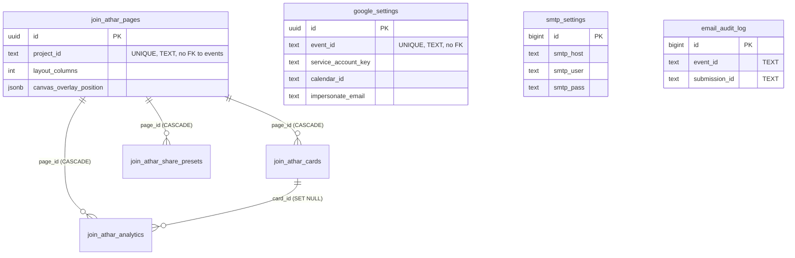

# 07 — Database Schema, RLS & Migrations (as-is)

> Scope: the entire Postgres/Supabase database of project `nipunwrewluxaikyfbzg`. Documentation only — no source file was changed, no migration applied, no write query run. Per-table detail lives in **`07a-database-table-reference.md`**; this document covers the overall picture, migrations, ER diagrams, functions, RLS, storage and every inconsistency found.
>
> **Sources used:** `supabase/migrations/*.sql` (42 files — the task brief said 40; the directory actually holds 42), `supabase/seed_alumni.sql`, `supabase/backups/user_roles_backup_20261004.json`, `scratch/*.sql` (+ the `scratch/*.js` helpers), `src/types/database.types.ts`, `Debug Supabase Column Error.md`, and — **read-only against the live project via the Supabase MCP** (access succeeded) — `information_schema`, `pg_constraint`, `pg_indexes`, `pg_policies`, `pg_proc`, `pg_trigger`, `pg_publication_tables`, `storage.buckets`, `list_migrations`, `list_extensions`, `get_advisors(security)`, `pg_stat_user_tables`. Secret values (service-account key, SMTP password, user ids/emails) were deliberately not read or printed.
>
> Snapshot date: 2026-10-10.

---

## 1. Summary

| Item | Value |
|---|---|
| Live `public` base tables | **48** (no views, no materialized views, no composite types) |
| Tables created by repo migrations and present live | 31 |
| Tables present live with **no CREATE in the repo** ("base") | 17: `events`, `experts`, `master_experts`, `expert_submissions`, `companies`, `company_submissions`, `event_days`, `agenda_slots`, `event_forms`, `form_field_configs`, `library_resources`, `profiles`, `roles`, `user_roles`, `project_managers`, `smtp_settings`, `email_audit_log` (`user_roles` and `project_managers` are re-shaped by migrations but never created by them; `companies`, `events`, `event_forms`, `programs`-linked tables are extended by them) |
| Tables defined in the repo but **absent live** | 1: `form_sections` (defined twice) |
| Enums | `app_role` (super_admin, project_manager, alumni_manager, founder), `project_role` (owner, collaborator — unused by any column) |
| Public-schema functions | 14 (5 RLS/role helpers, 2 expert-sync triggers, 1 auth trigger, 1 PM sync trigger, 5 `updated_at` triggers) |
| Installed extensions | `plpgsql`, `pgcrypto` (extensions), `uuid-ossp` (extensions), `pg_stat_statements`, `supabase_vault`. Not installed: `pg_net`, `pg_cron`, `pg_graphql`, etc. |
| Storage buckets | 1: `event-assets` (public) |
| Realtime publication (`supabase_realtime`) | only `company_submissions` |
| Largest tables | `mentoring_sessions` ~1148, `company_submissions` ~384, `agenda_slots` ~248, `companies` ~161 |
| Auth / roles data | 12 `user_roles` rows (all `super_admin`), 5 `profiles`, 0 `project_managers` |
| Live migration history (`supabase_migrations`) | 41 entries: all repo files up to `20260930000000`; **`20261004000000` is not recorded** though its effects are live |
| Types file vs live | `database.types.ts` matches live exactly (48 tables, same columns, same enums/functions) |

RLS posture in one line: 36 of 48 tables are readable and writable by anonymous callers (policies `USING (true)` for `public`/`anon`), 4 tables have RLS disabled (`ather_team_bookings`, `booking_notifications`, `email_audit_log`, `master_experts`), 1 has RLS with no policy (`smtp_settings`), and the role-based policies (super_admin / project owner / alumni_manager) are mostly neutralised by permissive "Public …" policies on the same tables. Details in sections 6 and 9.

---

## 2. Domain map

| Domain | Tables |
|---|---|
| Events / agenda | `events`, `programs`, `event_days`, `agenda_slots`, `library_resources` |
| Experts | `experts`, `master_experts`, `expert_submissions` |
| Startups / selection | `companies`, `company_submissions`, `email_audit_log` |
| Forms | `event_forms`, `form_field_configs`, `form_covers`, `form_responses`, `form_share_events`, `library_forms` (`form_sections` – repo only) |
| Mentor booking | `mentors`, `mentor_slots`, `bookings`, `booking_notifications`, `mentor_day_config` |
| Ather-team booking | `ather_team_members`, `ather_team_slots`, `ather_team_bookings` |
| Mentoring distribution | `mentoring_distribution_config`, `mentoring_distribution_day_config`, `mentoring_sessions` |
| Alumni & impact | `founders`, `company_founders`, `program_participations`, `company_snapshots`, `certificates`, `opportunities`, `opportunity_applications`, `investor_requests`, `alumni_invitations`, `notifications` |
| Roles / auth | `profiles`, `user_roles`, `roles`, `project_managers` (+ `auth.users`) |
| Join Athar | `join_athar_pages`, `join_athar_cards`, `join_athar_share_presets`, `join_athar_analytics` |
| Settings | `google_settings`, `smtp_settings` |

---

## 3. Migration chronology

All 42 files in `supabase/migrations/`, in order. "Live history" = recorded in the project's migration history (41 of 42 are; the last is not).

| # | File (timestamp_name) | What it does | Notes |
|---|---|---|---|
| 1 | 20260707000000_mentor_booking_tables | Creates `mentors`, `mentor_slots`, `bookings` (+4 indexes, RLS on, public SELECT mentors/slots, public INSERT bookings). `event_id TEXT`, UNIQUE(event_id,email). | `events` assumed to pre-exist; no FK to it. |
| 2 | 20260707000001_add_mentor_bio_and_master_id | `mentors.bio`, `mentors.master_id TEXT`, index. | Comment says "link to master_experts" but type is TEXT, no FK. |
| 3 | 20260708000000_add_admin_email_to_events | `events.admin_email`. | |
| 4 | 20260708000001_create_booking_notifications_table | Creates `booking_notifications`. | Never enables RLS. |
| 5 | 20260708000002_add_selection_process_gsheets_url | `events.selection_process_gsheets_url`. | Overlaps with `events.gsheets_url` (base). |
| 6 | 20260709000000_add_interview_settings_to_events | `events.interview_admin_emails`, `interview_email_template_subject/_body`. | Plain `ADD COLUMN` (not IF NOT EXISTS). |
| 7 | 20260709000001_create_ather_team_tables | Creates `ather_team_members/slots/bookings`, partial unique index on (event_id,email), RLS, public read, public insert bookings. | |
| 8 | 20260711000000_add_rls_policies_for_mentor_and_ather_team | Authenticated INSERT/UPDATE/DELETE on mentors/slots/team tables; SELECT/UPDATE/DELETE on bookings. | Policy names differ from those live (see §9). |
| 9 | 20260711000001_make_ather_team_email_nullable | `ather_team_members.email` DROP NOT NULL. | |
| 10 | 20260711000002_fix_ather_team_unique_constraint | Drops non-existent constraint, re-creates same partial unique index. | Redundant to #7. |
| 11 | 20260713000000_add_interview_cc_emails_to_events | `events.interview_cc_emails`. | Origin: `Debug Supabase Column Error.md` (PGRST204). |
| 12 | 20260714000001_add_insert_and_public_policies | "Allow everyone to insert" on bookings / ather_team_bookings. | Duplicates #1/#7 insert policies. Live names differ. |
| 13 | 20260716000001_add_meet_link_columns | `meet_link` on 4 tables. | |
| 14 | 20260716000002_add_google_settings_table | `google_settings` + public SELECT/INSERT/UPDATE. | Stores service-account key; public policies. |
| 15 | 20260716000003_add_google_settings_unique_constraint | UNIQUE(event_id). | |
| 16 | 20260716000004_add_impersonate_email_to_google_settings | column. | |
| 17 | 20260716000005_add_status_error_calendar_event_id_columns | status/error_message/calendar_event_id on both booking tables. | |
| 18 | 20260717000000_add_start_end_time_to_bookings | start_time/end_time/mentor_name/mentor_email on both booking tables. | Denormalised copies. |
| 19 | 20260721000000_add_rejection_email_settings_to_events | 4 rejection email columns. | |
| 20 | 20260721100000_add_programs_table | `programs`, `events.program_id`, authenticated-only RLS, updated_at trigger. | UTF-8 BOM at start of file. |
| 21 | 20260721200000_add_acceptance_email_settings_to_events | 4 acceptance email columns (nullable template, no default). | |
| 22 | 20260725000001_create_mentoring_distribution_tables | `mentoring_distribution_config`, `mentoring_sessions`, `ALL true` policies, updated_at trigger. | Arabic column comments. |
| 23 | 20260728000000_add_unique_pairing_and_availability_to_config | `unique_pairing`, `mentor_availability`. | |
| 24 | 20260730000000_fix_unique_constraint_mentoring_config | Re-adds UNIQUE(event_id) if missing + repeats #23 columns. | Idempotent duplicate of #22/#23. |
| 25 | 20260806000000_create_mentor_day_config | `mentor_day_config` + trigger + `ALL true`. | |
| 26 | 20260806000100_create_mentoring_distribution_day_config | `mentoring_distribution_day_config` (event_id UUID). | Similar purpose to #25. |
| 27 | 20260810000000_add_google_meet_link_mode_to_events | `meeting_link_mode`, `shared_google_meet_link`. | |
| 28 | 20260820000000_add_mentor_notification_settings_to_events | 4 mentor email columns. | |
| 29 | 20260821000000_enhance_mentoring_distribution | `finalized_days`, `timer_state`, `mentoring_sessions.is_manual_override`. | |
| 30 | 20260824000000_form_builder_engagement_hub_refactor | `form_covers`, extends `event_forms` (cover/thank-you/share/integrations/description/form_name_ar), creates `form_responses`, `form_share_events`, policies. | `event_forms` pre-exists (base). |
| 31 | 20260906000000_form_builder_decoupled_responses_and_integrations | Re-declares `form_responses`, 3 indexes, re-asserts policies. | Table + policies already created by #30; **3 indexes not live**. |
| 32 | 20260907000000_create_library_forms | `library_forms`, `event_forms.library_form_id`, `form_responses.library_form_id`, indexes, policies. | |
| 33 | 20260908000000_create_form_sections_and_phone_validation | `form_sections`, `form_field_configs.section_id`, `event_forms.sections`, `library_forms.sections`. | **Objects absent live**; "phone_validation" in name but no phone logic. |
| 34 | 20260909000000_create_form_sections | Same `form_sections` + `section_id` again, "Fix for 404 on form_sections table". | Duplicate of #33 (minus the `sections` JSONB columns). **Absent live.** |
| 35 | 20260911000000_create_join_athar_tables | 4 `join_athar_*` tables, indexes, `ALL true` policies. | |
| 36 | 20260924000001_alumni_platform_foundation | Extends `companies` and `programs`; creates `founders`, `company_founders`, `program_participations`, `company_snapshots`, `certificates`, `opportunities`, `opportunity_applications`, `investor_requests`; RLS; generic `update_updated_at_column()`. | Assumes `companies`, `programs`, `events`, `form_responses` exist. |
| 37 | 20260925000000_alumni_phase1 | `alumni_invitations`, `founders.auth_user_id`, policies. | Applied one day after #36 though numbered "phase1". |
| 38 | 20260929000000_phase2_roles_and_permissions | Enums `app_role`, `project_role`; re-shapes `user_roles` (adds id/role/created/updated, keeps `role_key` + sync trigger); re-shapes `project_managers` (alias columns + sync trigger); seeds every `profiles` row as super_admin; helpers `is_super_admin`, `has_role`, `is_project_owner`, `is_project_manager`; RLS for `user_roles`/`project_managers`. | Section "6. Point 2.4" is pasted twice in the file (identical statements). |
| 39 | 20260929000001_fix_sync_triggers | Rewrites both sync trigger functions (role_key↔role normalisation, `alumni_admin`→`alumni_manager`). | Overrides #38 functions; `sync_user_roles_role_columns` later dropped by #40. |
| 40 | 20260929000002_alumni_phase1_founder | `notifications`, "ensure" `company_snapshots`, `company_founders.role_in_company`, RLS for notifications/snapshots. | Timestamp sorts after #38/#39 (same day) and before #41; has a differently-shaped `CREATE TABLE IF NOT EXISTS company_snapshots` that is skipped. |
| 41 | 20260930000000_alumni_phase2_manager | `alumni_invitations.founder_id`, notification broadcast columns, analytics indexes, manager policies. | |
| 42 | 20261004000000_fix_user_roles_drop_role_key | Rewrites `get_user_roles`, `is_super_admin`, `has_role` without `role_key`; replaces 4 `events` policies; drops trigger/function `sync_user_roles_role_columns`; `DROP COLUMN role_key CASCADE`. | **Not in live migration history.** Header claims "unique constraint handling" but the file contains none. |

*Observations on ordering:* timestamps `20260716000001…5` and `20260714000001` show a hand-chosen suffix pattern (`…000001`, no `…000000`); alumni migrations were created in the order 20260924 → 20260925 → 20260929 → 20260930, while the "Phase 1 Founder" migration (20260929000002) was written after the "Phase 2 Roles" one.

---

## 4. Entity-relationship diagrams (live schema)

Only key columns are shown. `text event_id` columns without an FK are drawn with a dotted logical relationship noted in a comment because Mermaid has no "soft" relation.

### 4.1 Events, programs, experts, startups, agenda

### 4.2 Forms

`form_sections` (repo only) would hang off `event_forms` (form_id) and be referenced by `form_field_configs.section_id`; it does not exist live.

### 4.3 Mentor booking and Ather-team booking

Logical (unenforced) relations: `mentors.event_id` / `*.event_id` TEXT → `events.event_id` UUID; `mentors.master_id` TEXT → `master_experts.id` UUID; `ather_team_bookings.submission_id` TEXT → `company_submissions.submission_id` UUID.

### 4.4 Mentoring distribution

### 4.5 Alumni and impact

```mermaid
erDiagram
    companies ||--o{ company_founders : "company_id (CASCADE)"
    founders ||--o{ company_founders : "founder_id (CASCADE)"
    companies ||--o{ program_participations : "company_id (CASCADE)"
    programs ||--o{ program_participations : "program_id (CASCADE)"
    events ||--o{ program_participations : "event_id (SET NULL)"
    companies ||--o{ company_snapshots : "company_id (CASCADE)"
    founders ||--o{ certificates : "founder_id (CASCADE)"
    programs ||--o{ certificates : "program_id (CASCADE)"
    events ||--o{ certificates : "event_id (SET NULL)"
    opportunities ||--o{ opportunity_applications : "opportunity_id (CASCADE)"
    companies ||--o{ opportunity_applications : "company_id (CASCADE)"
    founders ||--o{ opportunity_applications : "founder_id (SET NULL)"
    companies ||--o{ investor_requests : "company_id (SET NULL)"
    companies ||--o{ alumni_invitations : "company_id (CASCADE)"
    founders ||--o{ alumni_invitations : "founder_id (SET NULL)"
    founders ||--o{ notifications : "founder_id (CASCADE)"
    founders }o--o| auth_users : "auth_user_id (SET NULL)"
    notifications }o--o| auth_users : "recipient_id / sent_by"

    founders {
        uuid founder_id PK
        text name_ar
        text email
        uuid auth_user_id FK
    }
    company_founders {
        uuid id PK
        text role
        text role_in_company "duplicate of role"
        bool is_primary
    }
    company_snapshots {
        uuid snapshot_id PK
        uuid id "extra, nullable"
        text snapshot_type
        jsonb data
        uuid form_response_id FK
    }
    alumni_invitations {
        uuid id PK
        text token UK
        text status
    }
    notifications {
        uuid id PK
        uuid recipient_id FK
        uuid broadcast_id
        text audience_type
    }
    certificates {
        uuid certificate_id PK
        text verification_code UK
    }
    auth_users {
        uuid id PK
    }
```

### 4.6 Roles and auth

### 4.7 Join Athar and Google/SMTP settings

---

## 5. Functions, triggers, enums, extensions (live)

### 5.1 Functions in `public`

| Function | Returns | Security | search_path | Purpose / used by |
|---|---|---|---|---|
| `is_super_admin(check_user_id uuid DEFAULT auth.uid())` | boolean | DEFINER, STABLE | `public` | `EXISTS user_roles WHERE role='super_admin'`. Used in policies of user_roles, project_managers, notifications, snapshots, alumni_invitations. Also in `database.types.ts`. |
| `has_role(role_name text, check_user_id uuid DEFAULT auth.uid())` | boolean | DEFINER, STABLE | `public` | `role::text = role_name`. Used with `'alumni_manager'`. |
| `is_project_owner(check_event_id uuid, check_user_id uuid DEFAULT auth.uid())` | boolean | DEFINER, STABLE | `public` | `project_managers` row with `role_in_project='owner'`. Used by `pm_*` policies. |
| `is_project_manager(check_event_id uuid, check_user_id uuid DEFAULT auth.uid())` | boolean | DEFINER, STABLE | `public` | Any row in `project_managers`. **Not used by any policy** (events policies inline their own EXISTS). |
| `get_user_roles(p_user_id uuid)` | text[] | DEFINER, STABLE | **mutable** | RPC for the frontend/auth context. Callable by any caller for any user id. |
| `handle_new_user()` | trigger | DEFINER | `public` | `auth.users` AFTER INSERT trigger `on_auth_user_created` → inserts a `profiles` row (full_name = email local part, random colour). |
| `handle_expert_auto_index()` | trigger | DEFINER | mutable | AFTER INSERT/UPDATE on `experts`: upsert into `master_experts` by `name`, write back `experts.master_id`. Not in any migration. |
| `broadcast_master_expert_updates()` | trigger | DEFINER | mutable | AFTER UPDATE on `master_experts`: push changed fields to linked `experts`. Not in any migration. |
| `sync_project_managers_columns()` | trigger | INVOKER | mutable | BEFORE INSERT/UPDATE mirror of event_id/project_id, assigned_*/added_*. |
| `update_updated_at_column()`, `update_programs_updated_at()`, `update_mentoring_updated_at()`, `update_mentor_day_config_updated_at()`, `update_md_day_config_updated_at()` | trigger | INVOKER | mutable | `updated_at = now()` (all identical bodies). |

Functions that existed historically and no longer exist: `sync_user_roles_role_columns()` (dropped by migration 20261004). All DEFINER functions are executable by `anon` and `authenticated` via `/rest/v1/rpc/*` (advisor WARN, 8 functions); there are no application RPCs for business logic — all domain logic is client-side or in edge functions (outside this document).

### 5.2 Triggers
See the table at the end of `07a-database-table-reference.md` (14 public triggers + `on_auth_user_created`).

### 5.3 Enums and types
`app_role`: `super_admin`, `project_manager`, `alumni_manager`, `founder` (created by migration 20260929000000; `user_roles.role` is the only column that uses it). `project_role`: `owner`, `collaborator` (created, but `project_managers.role_in_project` is TEXT + CHECK).

### 5.4 Extensions
Installed: `plpgsql`, `pgcrypto` (schema `extensions`), `uuid-ossp` (schema `extensions`; used by `uuid_generate_v4()` defaults on base tables), `pg_stat_statements`, `supabase_vault` (schema `vault`). No migration contains `CREATE EXTENSION`. The newer migrations rely on built-in `gen_random_uuid()`, older/base tables on `uuid_generate_v4()` (two UUID generators in use).

### 5.5 Views, realtime
No views. Realtime: `supabase_realtime` publication contains only `company_submissions` (set outside the migrations); the `supabase_realtime_messages_publication` partitions are Supabase-internal.

---

## 6. RLS policies and access matrix (live)

### 6.1 Helper functions used in policies
`is_super_admin()`, `has_role('alumni_manager')`, `is_project_owner(event_id)` (SECURITY DEFINER, to avoid RLS recursion on `user_roles`/`project_managers`), plus inline `EXISTS (…user_roles…)` / `EXISTS (…project_managers…)` in the `events_*` policies, `auth.role() = 'authenticated'`, `auth.uid() IS NOT NULL`, and `auth.uid() = id` (profiles).

### 6.2 Matrix
"anon" below means any caller with the public anon key. "auth" = any signed-in user (no role check). "role-based" = super_admin / alumni_manager / project owner check.
A table's effective access is the OR of all its permissive policies, so listed policies that are subsumed by an open one are noted.

| Table | RLS on? | SELECT | INSERT | UPDATE | DELETE | Comment |
|---|---|---|---|---|---|---|
| agenda_slots | yes | anon | anon | anon | anon | 4 overlapping policies, all open |
| alumni_invitations | yes | anon (2 identical policies) | auth | auth | auth | role-based `invitations_manager_all` redundant |
| ather_team_bookings | **NO** | anon (no RLS) | anon | anon | anon | 4 policies exist but inert |
| ather_team_members | yes | anon | auth | auth | auth | |
| ather_team_slots | yes | anon | auth | **anon** + auth | auth | live-only anon UPDATE policy |
| booking_notifications | **NO** | anon | anon | anon | anon | no policies |
| bookings | yes | auth | anon (2 policies) | auth | auth | |
| certificates | yes | anon | anon | anon | anon | |
| companies | yes | anon | anon | anon | anon | 5 overlapping policies |
| company_founders | yes | anon | anon | anon | anon | |
| company_snapshots | yes | **anon** (+ auth role-based) | anon (+ auth) | none | none | immutable through API; ownership-based policy moot |
| company_submissions | yes | **anon** (2 policies) | anon (2) | auth | none | contains PII fields (founder_email, national_id, phone) |
| email_audit_log | **NO** | anon | anon | anon | anon | |
| event_days | yes | anon | anon | anon | anon | 4 overlapping |
| event_forms | yes | anon | anon | anon | anon | policies named "Authenticated …" but `{public}`/`true` |
| events | yes | anon (2 public + role-based) | anon (ALL) + role-based | anon (ALL) | anon (ALL) | role-based policies ineffective |
| expert_submissions | yes | **anon** (2) | anon (2) | auth | none | |
| experts | yes | anon | anon | anon | anon | |
| form_covers | yes | anon | anon | anon | anon | |
| form_field_configs | yes | anon (2) | auth | auth | auth | `auth.uid() IS NOT NULL` |
| form_responses | yes | anon | anon | anon | anon | |
| form_share_events | yes | anon | anon | none | none | |
| founders | yes | anon | anon | anon | anon | PII (email/phone) public |
| google_settings | yes | **anon** | anon | anon | none | includes credential column |
| investor_requests | yes | auth | anon | auth | none | |
| join_athar_* (4) | yes | anon | anon | anon | anon | |
| library_forms | yes | anon | anon | anon | anon | |
| library_resources | yes | anon | anon | anon | anon | |
| master_experts | **NO** | anon | anon | anon | anon | no policies |
| mentor_day_config | yes | anon | anon | anon | anon | |
| mentor_slots | yes | anon (2) | auth | **anon** + auth | auth | |
| mentoring_distribution_config / _day_config / mentoring_sessions | yes | anon | anon | anon | anon | |
| mentors | yes | anon (2) | auth | auth | auth | |
| notifications | yes | own / NULL recipient / super_admin / alumni_manager | own / super_admin / alumni_manager | own / super_admin / alumni_manager | none | genuinely role-based |
| opportunities | yes | anon | auth | auth | auth | |
| opportunity_applications | yes | anon | anon | anon | anon | |
| profiles | yes | anon | own | own | none | |
| program_participations | yes | anon | anon | anon | anon | |
| programs | yes | auth | auth | auth | auth | only fully "authenticated-only" domain table |
| project_managers | yes | own / super_admin | super_admin / owner | super_admin / owner | super_admin / owner | genuinely role-based |
| roles | yes | auth | none | none | none | |
| smtp_settings | yes | none | none | none | none | RLS with zero policies (service role only) |
| user_roles | yes | own / super_admin | super_admin | super_admin | super_admin | genuinely role-based |

Counts: tables with an effectively fully-open (anon read+write) surface: 33; role-restricted tables: `notifications`, `project_managers`, `user_roles`, `roles`, `smtp_settings`, `programs`, `profiles` (partially), `ather_team_members`, `mentors`, `opportunities`, `bookings` (read).

### 6.3 Repo vs live policy names
Repo migrations declare, e.g., `Allow public read access to mentors`, `Allow authenticated users to read bookings`, `Allow everyone to insert bookings`. Live shows `Allow all users to select mentors`, `Allow authenticated users to select bookings`, `Allow anyone to insert into bookings`, and extra anon UPDATE policies on slots. These live names/policies come from changes made outside the repo (dashboard or untracked SQL).

---

## 7. Storage

| Bucket | Public | Size/MIME limits | Policies on `storage.objects` |
|---|---|---|---|
| `event-assets` | yes | none | `Public Access` (SELECT, `bucket_id='event-assets'`); `Allow All Uploads` (INSERT for `public`, same bucket); **no UPDATE / DELETE policy** |

Additional policies on `storage.objects` that target a bucket **`event-covers`**, folder `join-athar`: `join_athar_select` (public SELECT), `join_athar_upload` (authenticated INSERT), `join_athar_update` (authenticated UPDATE). **No bucket named `event-covers` exists live**, and the only `storage.from(...)` call in `src/` uses `event-assets` (`apiUploadImage` is called with the path prefix `join-athar/<eventId>` in `JoinAtharDashboard.jsx`). Neither the bucket nor any of these policies is created by a migration.

---

## 8. Duplications, Conflicts & Anomalies (as-is)

### 8.1 Repo vs live — objects that do not match
| # | Finding | Evidence |
|---|---|---|
| 1 | **`form_sections` is defined in two migrations (20260908, 20260909) but does not exist live**, nor does `form_field_configs.section_id`, `event_forms.sections`, `library_forms.sections`, `idx_form_sections_*`, `idx_form_field_configs_section_id`. Both migrations are nonetheless in the live migration history. | `information_schema` (live); `list_migrations`; `database.types.ts` has no such table. |
| 2 | Application code deals with the missing table by probing it and storing sections in `event_forms.integrations.form_sections` (JSONB) instead. | `src/lib/api.js` ~2898–3015 ("only if it exists in DB"). |
| 3 | `20260906…` indexes `idx_form_responses_form_id/_event_id/_submitted_at` are absent live; only `idx_form_responses_library_form_id` exists. | pg_indexes. |
| 4 | `20261004000000_fix_user_roles_drop_role_key` is applied live (no `role_key`, functions rewritten, events policies replaced) but **missing from the live migration history**. | list_migrations stops at 20260930000000. |
| 5 | `user_roles` live has `UNIQUE(user_id)` (`user_roles_user_id_unique`) whereas migrations create `UNIQUE(user_id, role)` (`user_roles_user_id_role_unique`) — which is absent live. No repo file creates `UNIQUE(user_id)`. The 20261004 header mentions "unique constraint handling" but has no such statement. The backup JSON (13 rows / 12 users, one user with both alumni_manager and super_admin) vs live (12 rows, all super_admin) suggests a duplicate role row was removed when `UNIQUE(user_id)` was added. | pg_constraint; backups file. This inference is not documented anywhere. |
| 6 | `mentors.photo_url`, `mentors.advance_notice_minutes`, `ather_team_members.advance_notice_minutes`, `profiles.avatar_url`, `events.name`, `events.id`, `company_snapshots.id` exist live and are in no migration (`avatar_url` only in `scratch/add_avatar_url.sql`). | information_schema; scratch file. |
| 7 | `ather_team_bookings` RLS is **disabled** live; the migration enables it (and 4 policies exist). | pg_class / advisor. |
| 8 | `booking_notifications` never had RLS enabled; `master_experts` and `email_audit_log` (base tables) have RLS off. | pg_class. |
| 9 | Triggers/functions `handle_expert_auto_index`, `broadcast_master_expert_updates`, `handle_new_user` + `on_auth_user_created`, the `update_updated_at_column` triggers on base tables, `get_user_roles` (original), the `roles` table, the unique `master_experts_name_idx`, `company_submissions` realtime membership, the storage bucket and its policies, and ~25 live policies are not in any migration. | pg_proc / pg_trigger / pg_policies. |
| 10 | 17 tables (all "base") cannot be recreated from the repo: migrations `ALTER`/reference `events`, `companies`, `event_forms`, `profiles`, `user_roles`, `project_managers` that are never created by repo SQL (`supabase db reset` would fail). | Migration 20260708000000 onward. |
| 11 | Seed file `supabase/seed_alumni.sql`: (a) the `DO` block has no `$$` delimiters, (b) a second `DECLARE` is nested mid-block (`DECLARE v_prog1…`), (c) inserts `companies(description)` while the alumni schema added `description_ar`, (d) uses `snapshot_type = 'six_month'` while the migration comments list `6_month_followup`, (e) file starts with a BOM, (f) `ON CONFLICT DO NOTHING` without conflict targets on tables with no natural unique key (`programs`, `founders`, `companies`) → re-runs duplicate rows. Live alumni tables are empty (0 founders, 0 snapshots), so the seed was not left applied. | seed_alumni.sql lines 42–130. |

### 8.2 Migrations overriding / duplicating each other
| Group | Detail |
|---|---|
| form_sections | 20260908 and 20260909 create the same table/column/indexes/policies; 0909's comment: "Fix for 404 on form_sections table". 0908 additionally adds `sections` JSONB to `event_forms`/`library_forms`. Both silently idempotent. |
| form_responses | Created in 20260824, re-declared in 20260906 (same DDL + 3 indexes), column added in 20260907. The same three policies are re-asserted; `Public all form_responses` (ALL) makes the separate INSERT/SELECT policies redundant. |
| user_roles | 20260929000000 (adds `role` enum + sync trigger, keeps `role_key`) → 20260929000001 (rewrites sync function) → 20261004000000 (drops trigger, function, `role_key`; rewrites helpers). Helpers `is_super_admin` / `has_role` therefore exist in 3 versions (the first checks `role`, `role::text` and `role_key`). A manual change (`UNIQUE(user_id)`) is on top, see 8.1 #5. |
| project_managers | 20260929000000 adds alias columns and a sync trigger (kept live). 20260929000001 rewrites the function. Section "6. Point 2.4" (user_roles/project_managers policies) is duplicated verbatim within 20260929000000. `scratch/fix_infinite_recursion.sql` repeats the helper functions and policies already in 20260929000000 (identical bodies) — an earlier manual hot-fix whose content was later also placed in the migration. |
| Unique constraints | `ather_team_members`: 20260709 creates the partial unique index, 20260711000002 "fixes" it with a DROP of a constraint that was never created and re-creates the same index. `mentoring_distribution_config`: 20260725 inline UNIQUE, 20260730 re-adds it and repeats columns from 20260728. `google_settings` UNIQUE added in a separate migration. |
| Alumni | 20260924 (foundation) and 20260925 (phase1: `alumni_invitations`, `founders.auth_user_id`) are consecutive and complementary but not duplicative; 20260929000002 and 20260930 add columns to tables from both (`role_in_company`, `notifications.*`, `alumni_invitations.founder_id`). The "ensure company_snapshots exists" block in 20260929000002 describes a different PK (`id` PK, `snapshot_id` plain) from the foundation table (`snapshot_id` PK); live has `snapshot_id` PK plus a stray nullable `id`. |
| events policies | Created outside the repo, replaced in 20261004 (they referenced `ur.role_key`). Coexist with 4 older/other policies that make them ineffective. |
| booking INSERT policies | 20260707 (`Allow public to create bookings`) and 20260714 (`Allow everyone to insert bookings`) both exist in the repo for `bookings`; live has `Allow public to create bookings` + `Allow anyone to insert into bookings`. |

### 8.3 Overlapping / duplicated tables and columns
| Area | Duplication |
|---|---|
| Day config | `mentor_day_config` (event_id TEXT, session start/end, slot duration, break) and `mentoring_distribution_day_config` (event_id UUID, session start/end, slot duration, break, mentor_ids) are near-twins; `mentoring_distribution_config` also holds start_time/num_days/slot_duration. |
| Booking | `mentors/mentor_slots/bookings` vs `ather_team_members/ather_team_slots/ather_team_bookings` are structural clones; the Ather bookings table carries `mentor_name`/`mentor_email` columns. `bookings` stores denormalised `mentor_name`, `mentor_email`, `start_time`, `end_time` alongside `slot_id` and `mentor_id`. |
| Experts | `experts` (per-event), `master_experts` (global, auto-indexed by trigger on `name`), `mentors` (per-event bookable, `master_id TEXT`), `expert_submissions` (form intake, 0 rows). `master_experts` has `_ar` columns that the broadcast trigger does not propagate. |
| Startups | `companies` (event-scoped showcase, now also "alumni master"), `company_submissions` (intake, 384 rows, has `startup_name` NN **and** `company_name`), `form_responses` (the "decoupled single source of truth", 0 rows; backfill script `scratch/backfill_responses.js` copies submissions). `companies` has overlapping location fields `location`/`governorate`/`province` (+`_ar`), `sector`/`industry`, `bio`/`description`, `founder` text vs `founders` table, `employees` as text. |
| Events | `event_name`/`name`, `event_id`/`id` (both extra columns live-only), `gsheets_url` / `selection_process_gsheets_url`; four email groups (`interview_*`, `rejection_*`, `acceptance_*`, `mentor_*`) of admin_emails/cc_emails/subject/body flattened into 16 columns on `events`. |
| Forms | `event_forms` and `library_forms` copy the same ~12 presentation columns; `library_forms.fields` JSONB vs `form_field_configs` rows; sections kept in JSONB `integrations.form_sections`; `event_forms.cover_id` + `cover_image_url`. `integrations` default JSON differs (`attendees_list` vs `mentors_list`). `form_field_configs` is keyed by `(event_id, entity_type, field_name)` while also carrying `form_id`. |
| Roles | `roles` table (legacy `key`), `app_role` enum on `user_roles.role`, `project_role` enum (unused), `project_managers.role_in_project` TEXT+CHECK; `user_roles.assigned_at` vs `created_at`; `project_managers` event_id/project_id, assigned_at/added_at, assigned_by/added_by pairs kept in sync by trigger; `company_founders.role` vs `role_in_company` (no sync trigger). |
| Snapshots | `company_snapshots.snapshot_id` (PK) vs extra `id`; `form_response_id` column and a `data.form_response_id` key documented in the migration comment. |

### 8.4 Naming and type inconsistencies
- **Primary-key naming:** `id` (mentors, mentor_slots, bookings, ather_team_*, google_settings, notifications, alumni_invitations, join_athar_*, roles, user_roles, project_managers, program_participations, company_founders, mentoring_*, library_forms, form_share_events), `<entity>_id` (events.event_id, programs.program_id, companies.company_id, founders.founder_id, opportunities.opportunity_id, certificates.certificate_id, event_forms.form_id, form_covers.cover_id, form_responses.response_id, experts.expert_id, event_days.day_id, agenda_slots.slot_id, *_submissions.submission_id, form_field_configs.config_id, library_resources.resource_id, company_snapshots.snapshot_id) — two conventions in the same schema.
- **`event_id` type:** `uuid` with FK in events-related tables; **`text` without FK** in `mentors`, `mentor_slots`, `bookings`, `ather_team_*`, `google_settings`, `mentor_day_config`, `mentoring_distribution_config`, `mentoring_sessions`, `email_audit_log`, `join_athar_pages.project_id`; `uuid` without FK in `mentoring_distribution_day_config`. Joining the two families needs casts.
- **`master_id`:** `experts.master_id uuid` (FK) vs `mentors.master_id text`.
- **`submission_id`:** `ather_team_bookings.submission_id text`, `email_audit_log.submission_id text` vs `uuid` PK in the submissions tables.
- **Logical FKs declared only in comments:** `mentoring_sessions.mentor_id` ("FK to mentors"), `.company_id` ("FK optional").
- **UUID defaults:** `gen_random_uuid()` (migrations, most base) vs `uuid_generate_v4()` (company_submissions, expert_submissions, form_field_configs, library_resources).
- **Timestamps:** `TIMESTAMP WITH TIME ZONE DEFAULT NOW()` vs `TIMESTAMPTZ DEFAULT now()` vs `timezone('utc', now())` (roles/alumni_invitations/notifications) — equivalent values, three spellings. `agenda_slots.start_time/end_time` are TEXT while booking slots are timestamptz and distribution sessions are TIME.
- **Plural vs singular:** tables are plural (`events`, `bookings`), except `join_athar_*` (mixed), `mentoring_distribution_config` (singular suffix), `ather_team_*`; the word "project" in code/`project_managers.project_id`/`join_athar_pages.project_id` means `events.event_id`.
- **Arabic suffix:** `_ar` on `companies`, `experts`, `master_experts`, `event_days`, `agenda_slots`, `events`, `programs`, `opportunities`, `founders` (`name_ar` NN as the *primary* name with `name_en` optional — reversed relative to other tables where the base column is the primary and `_ar` the translation).
- **Casing/spelling:** `ather_team` (Ather) vs `athar` (join_athar, "Athar" in text templates).
- **CHECK vs comment-only enums:** `event_forms.target_module`, `company_submissions.status`, `library_forms.scope`, `alumni_invitations.status` have CHECKs; `programs.program_type/status`, `program_participations.graduation_status`, `opportunities.type`, `opportunity_applications.status`, `investor_requests.status`, `bookings.status`, `snapshot_type/source`, `join_athar_analytics.event_type` are free text documented in comments.

### 8.5 Permissive and duplicate RLS policies (factual list)
1. Full anonymous write access on 33 tables (section 6.2) — all `USING (true) WITH CHECK (true)`.
2. Identical or subsuming duplicates: `alumni_invitations` SELECT x2; `company_submissions`/`expert_submissions` INSERT x2 and SELECT x2; `form_field_configs` SELECT x2; `form_responses` ALL + INSERT + SELECT; `form_covers` ALL + SELECT; `events` 8 policies; `companies`/`experts` 5 each; `agenda_slots`/`event_days` 4 each; `bookings` INSERT x2; `mentors` SELECT x2; `mentor_slots` SELECT x2 and UPDATE x2; `library_resources` 3; `company_snapshots` 4 (public + role-based).
3. Names that contradict behaviour: `Authenticated insert/update/delete event_forms` (open to public); `Allow all authenticated users to read programs` is actually the only restricted one; `Public can read their own submissions` is `USING (true)` (all rows); migration comment on `mentoring_*` "Allow all authenticated users" but policy open to public; `company_snapshots` migration comment "no UPDATE/DELETE" is true, but "Public insert/read" negates the ownership policies added later.
4. Sensitive data exposed by SELECT policies: `google_settings.service_account_key` (public SELECT), `founders` email/phone, `company_submissions` national_id/phone/email, `alumni_invitations` token + email (the migration comment says "read invitation by token" but the policy is `true`), `certificates` codes, `notifications` rows with NULL recipient (to all authenticated).
5. `alumni_invitations`: `Allow auth users to manage invitations` (ALL, `true`, any authenticated user incl. founders) alongside the role-based `invitations_manager_all`.
6. `investor_requests` SELECT/UPDATE open to any authenticated user (not manager-only).
7. `get_user_roles(p_user_id)` and the `is_*`/`has_role` helpers accept an arbitrary user id and are callable as RPC by anon.

### 8.6 Index anomalies (duplicate / redundant)
Unique constraint + separate plain index on the same columns: `alumni_invitations.token`, `certificates.verification_code`, `google_settings.event_id`, `mentoring_distribution_config.event_id`, `mentor_day_config (event_id, day_number)`, `mentoring_distribution_day_config (event_id, day_index)`, `join_athar_pages.project_id`, `join_athar_share_presets.page_id` (partly), `idx_form_configs_event` partially overlapping `form_field_configs_event_id_entity_type_field_name_key`. `program_participations` has four plain indexes on two columns (`…_company`/`…_comp`, `…_program`/`…_prog`, from 20260924 and 20260930). Missing but implied: indexes on `mentor_slots.event_id`, `bookings.event_id`, `form_share_events.form_id`, `form_covers.event_id`; `bookings` has no unique constraint on `slot_id`.

### 8.7 Other anomalies
- `smtp_settings.smtp_pass` and `google_settings.service_account_key` store secrets as plain text columns (values not read).
- `project_managers.assigned_by` FK has no ON DELETE action (blocks deleting an auth user who assigned a PM), unlike `added_by` (SET NULL).
- `profiles` count (5) is less than `user_roles` count (12): migration 20260929000000 seeded `user_roles` from `profiles`, so at least 7 `user_roles` rows pre-date or bypass `profiles` (or the base table had its own rows); the `handle_new_user` trigger creates only profiles, never roles.
- `project_managers` is empty (0 rows) while the `events_select_by_pm_or_admin` policy and the "project manager" role design depend on it.
- `events.status`, `meeting_link_mode`, `company_portal_enabled` etc. have no CHECK constraints.
- No FK from `google_settings.event_id`, `join_athar_pages.project_id`, `mentoring_*` to `events` → orphan rows survive event deletion (CASCADE only on UUID-FK tables).
- `database.types.ts` lists functions `get_user_roles`, `has_role`, `is_project_manager`, `is_project_owner`, `is_super_admin` and the two enums; trigger functions are omitted (normal for the generator).
- Edge Function source files under `supabase/functions/` use tables such as `smtp_settings`, `email_audit_log`, `google_settings`, `bookings`; they are outside this document's scope, but `smtp_settings` has RLS-without-policies (service role only), whereas `email_audit_log` (RLS off) and `google_settings` (public read) are reachable by anon.
- Security advisor snapshot (2026-10-10): ERRORs — RLS disabled on `master_experts`, `booking_notifications`, `ather_team_bookings`, `email_audit_log`; policies exist but RLS disabled on `ather_team_bookings`. WARNs — 9 functions with mutable `search_path`; 8 SECURITY DEFINER functions executable by anon and by authenticated; leaked-password protection disabled. INFO — RLS enabled with no policy on `smtp_settings`. (Performance advisors were not run.)

---

## 9. Scratch and manually-applied SQL

| File | Content | In migrations? | Live state |
|---|---|---|---|
| `scratch/add_avatar_url.sql` | `ALTER TABLE profiles ADD COLUMN IF NOT EXISTS avatar_url TEXT;` | **No** | Column exists live (applied manually) |
| `scratch/fix_infinite_recursion.sql` | Re-defines `is_project_owner`, `is_project_manager`; drops and re-creates the four `pm_*` policies (non-recursive form) | Equivalent text already inside `20260929000000` (functions + policies) | Matches live; the scratch file is a hot-fix duplicate |
| `scratch/verify_phase2.sql` | SELECT-only verification queries (counts, columns, policy count for `user_roles`/`project_managers`) | n/a | Harmless |
| `scratch/gemini_google_section.md` | A prompt/markdown note (not SQL) | n/a | |
| `scratch/*.js` (`get_schema.js`, `backfill_responses.js`, `test_*.js`, `verify_library.js`) | Client scripts using the anon key to read `experts`/`master_experts`, copy `company_submissions` → `form_responses`, etc. | n/a | `backfill_responses.js` writes data to `form_responses` (currently 0 rows live, so it was either not run to completion or its data was cleared) |
| `supabase/backups/user_roles_backup_20261004.json` | JSON dump of `user_roles` (13 rows; contains user ids, `role_key`, `role`) taken before the 20261004 migration | n/a | Documents pre-migration shape (with `role_key`) |
| `Debug Supabase Column Error.md` | Exported AI chat log: error `PGRST204 … 'interview_cc_emails' column of 'events'` while saving selection-process settings; fix = migration 20260713000000 applied through the Supabase MCP. Also adds a template-variable UI, unrelated to the schema. Workspace path in the log is a different folder (`…\Coding\agenda-builder`), i.e. the project was previously developed elsewhere. | Yes (#11) | Column present live |

Other manual/untracked drift evidence: live-only columns (section 8.1 #6), live-only policies/functions (8.1 #9), the missing `UNIQUE(user_id,role)` and extra `UNIQUE(user_id)`.

---

## 10. Realtime, storage and auth integration summary
- Realtime is used only for `company_submissions` (live-only publication membership).
- Storage: one public bucket, public upload policy, no update/delete policy; a second set of policies for a non-existent bucket (section 7).
- Auth: `auth.users` → `profiles` via trigger; roles in `user_roles` (enum); founder accounts link through `founders.auth_user_id`; alumni invitation tokens live in `alumni_invitations`.

---

## 11. Open Questions (for the owner)

1. **`form_sections`:** were migrations 20260908/20260909 applied and later rolled back, or recorded without executing? Is the relational table intended (code probes for it) or is the JSONB `integrations.form_sections` the final design? Should `event_forms.sections`, `library_forms.sections`, `form_field_configs.section_id` exist?
2. **`user_roles` uniqueness:** who created `UNIQUE(user_id)` and when, and is "one role per user" intended (it contradicts the multi-role design of `app_role` and `UNIQUE(user_id, role)` in migration 20260929000000, and the one-user-two-roles row in the backup)? Where did the extra `alumni_manager` row in the backup go?
3. **Migration 20261004000000** was applied but is not in the migration history. How was it applied (SQL editor vs MCP vs CLI)? Are other changes applied the same way?
4. **Base tables:** where is the DDL for `events`, `experts`, `master_experts`, `companies`, `company_submissions`, `expert_submissions`, `event_days`, `agenda_slots`, `event_forms`, `form_field_configs`, `library_resources`, `profiles`, `roles`, `smtp_settings`, `email_audit_log` (and original `user_roles`, `project_managers`)? Is there an older repository (the debug log references `…\Coding\agenda-builder`)?
5. Why do `events` have extra `name` and `id` columns and `company_snapshots` an extra `id` column? Are they used?
6. Why is RLS disabled on `ather_team_bookings` (migration enables it), `master_experts`, `email_audit_log`, and never enabled on `booking_notifications` — deliberate or accidental?
7. Is the fully-open anon write model intentional (the migrations call it "standard pattern used in the project"), given roles `super_admin` / `project_manager` / `alumni_manager` / `founder` and role-based policies that currently have no effect on most tables?
8. Which bucket should join-athar images use: `event-assets` (what the code uses) or `event-covers` (what the storage policies reference)? Was `event-covers` ever created?
9. The `roles` table (4 rows, legacy `key`) — is it still used by anything (the code grep found no `.from('roles')` and no `role_key`)?
10. `mentors` vs `master_experts` vs `experts`: should mentors link to `master_experts` (type is `text` and un-FK'd)? What produces `mentors.photo_url` and `advance_notice_minutes` (live-only)?
11. Why are there two day-configuration tables (`mentor_day_config`, `mentoring_distribution_day_config`) and why is one keyed by TEXT `event_id` and the other by UUID? `mentor_day_config` has 0 rows — is it used by the front-end (3 call sites found)?
12. `form_responses` has 0 rows while `company_submissions` has ~384: which one is authoritative for the form-builder going forward? Was `scratch/backfill_responses.js` executed?
13. Is `google_settings` meant to be readable by anon (service-account key column)? Where is its value consumed — client or edge functions?
14. `company_snapshots`: `snapshot_type` values in comments (`6_month_followup`) vs seed (`six_month`) — which is canonical? Are `company_snapshots.id` and `.snapshot_id` both required?
15. `profiles` (5) vs `user_roles` (12): who are the 7 extra role holders and how were they created (the signup trigger creates profiles only)?
16. `project_role` enum is unused; should `project_managers.role_in_project` use it?
17. The meaning/usage of `events.company_portal_enabled`, `expert_portal_enabled`, `header_settings`, `show_day_names`, `experts_color`, `startups_color` (base columns) is not documented in any migration.
18. `supabase/seed_alumni.sql` appears syntactically broken (missing `$$`, nested `DECLARE`) — was it ever executed as-is, or was it pasted into the SQL editor after edits?
