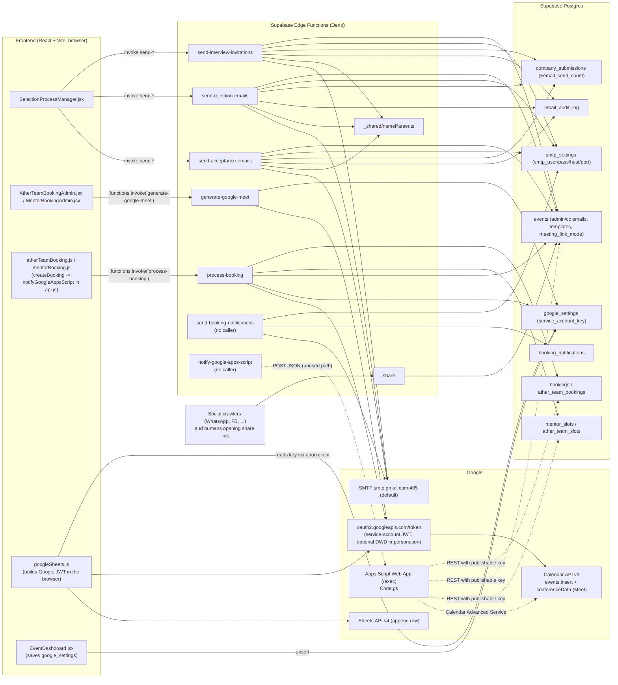
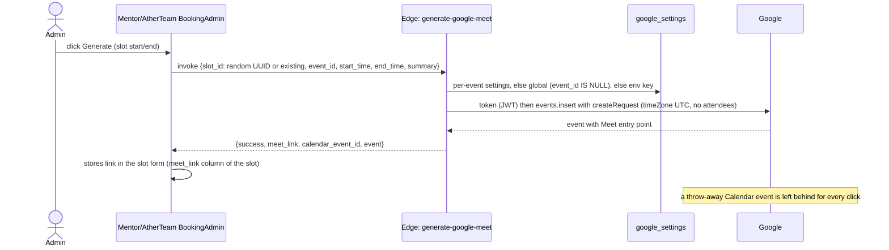
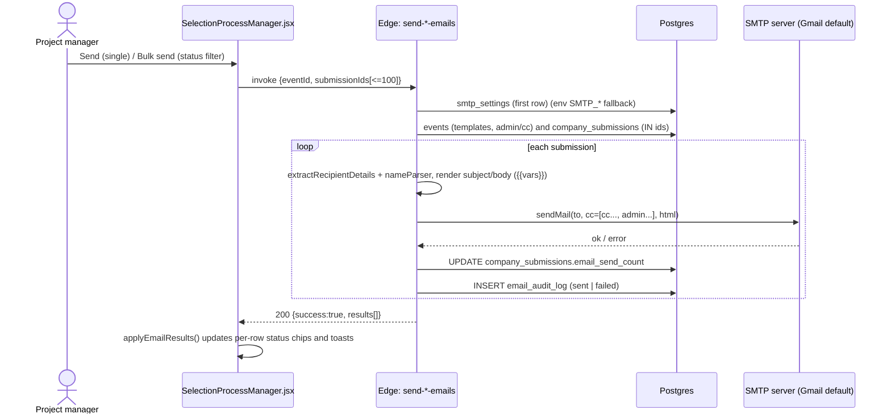
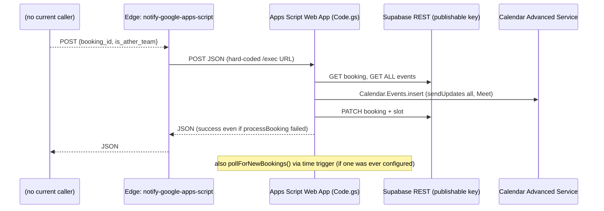
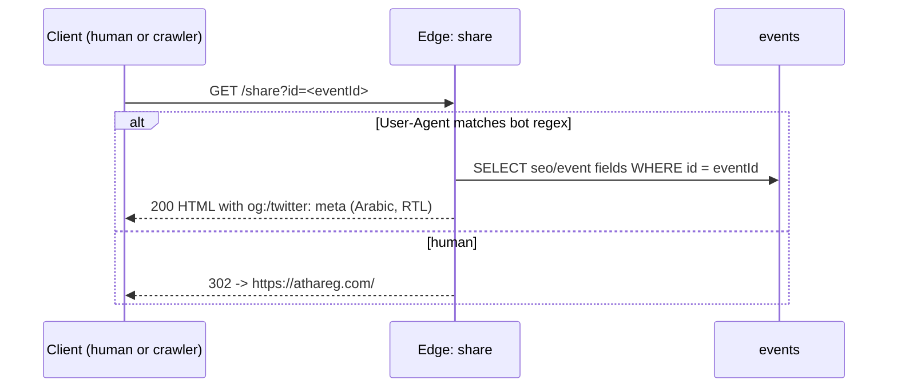

# 08 - Backend: Supabase Edge Functions & Google Apps Script (as-is)

> Scope: everything server-side that is not plain Postgres: `supabase/functions/*`, `google-apps-script/*`, the root `api-agennda-intervew.gs`, the Google setup guide, the historical Meet/Calendar debugging logs, and the ad-hoc test/scratch scripts.
> Status: documentation of the code **as it exists in the working tree** (git branch `main`, with many uncommitted modifications). Nothing was changed, deployed or executed. No secret values are reproduced; only names of variables/secrets are given.
> Conventions: `file:line` references are relative to the repo root. "FE" = the React frontend in `src/`.

---

## 1. Inventory at a glance

| # | Component | Path | Lines | Runtime | Called by (found in repo) | Status |
|---|-----------|------|------:|---------|---------------------------|--------|
| 1 | `generate-google-meet` | `supabase/functions/generate-google-meet/index.ts` | 353 | Deno edge | FE admin screens (2 call sites) | Live path |
| 2 | `process-booking` | `supabase/functions/process-booking/index.ts` | 428 | Deno edge | FE `notifyGoogleAppsScript()` (misnamed) | Live path (main booking flow) |
| 3 | `notify-google-apps-script` | `supabase/functions/notify-google-apps-script/index.ts` | 55 | Deno edge | **No caller in repo** | Orphan / superseded |
| 4 | `send-booking-notifications` | `supabase/functions/send-booking-notifications/index.ts` | 517 | Deno edge + nodemailer | **No caller in repo** (only `test-meet-generation.js`) | Orphan: FE call added in `ad96dda`, removed in later commit `0684846` |
| 5 | `send-interview-invitations` | `supabase/functions/send-interview-invitations/index.ts` | 260 | Deno edge + nodemailer | FE `SelectionProcessManager.jsx` | Live |
| 6 | `send-rejection-emails` | `supabase/functions/send-rejection-emails/index.ts` | 247 | Deno edge + nodemailer | FE `SelectionProcessManager.jsx` | Live |
| 7 | `send-acceptance-emails` | `supabase/functions/send-acceptance-emails/index.ts` | 247 | Deno edge + nodemailer | FE `SelectionProcessManager.jsx` | Live |
| 8 | `share` | `supabase/functions/share/index.ts` | 102 | Deno edge | Public URLs only (no FE `invoke`) | Live (link unfurling) |
| 9 | `_shared/nameParser.ts` | `supabase/functions/_shared/nameParser.ts` | 255 | module | functions 5, 6, 7 | Live |
| 10 | Apps Script `Code.gs` + `appsscript.json` | `google-apps-script/` | 450 / 23 | Google Apps Script (V8) | `notify-google-apps-script` (3) - which nobody calls | Effectively dormant |
| 11 | Apps Script copy | `api-agennda-intervew.gs` (root) | 477 | Google Apps Script | n/a | Divergent copy of #10 |
| 12 | Setup guide | `دليل-إعداد-Google-Apps-Script.md` | 93 | doc | n/a | Partly stale |
| 13 | Test / scratch scripts | `test-meet-generation.js`, `test-founder-name.js`, `test_api.js`, `scratch/*` | see §10 | Node | manual | Mostly stale |

Other facts about the folder:
- There is **no `supabase/config.toml`** and no per-function `deno.json`/import map in the repo. Per-function settings such as `verify_jwt` are therefore not versioned (a historical log shows `generate-google-meet` was deployed through the Supabase MCP tool with `verify_jwt=false`, `مشكلة روابط جوجل ميت لا تعمل.md:805-806`).
- There is **no CI/deploy script** in `package.json` for functions; the only Supabase script is `gen-types` (`package.json:12`). Deploys were performed manually (CLI or MCP), per the logs.
- `supabase/.temp/cli-latest` is an 8-byte file with no trailing newline containing the Supabase CLI version string `v2.118.0` (diff vs HEAD: `v2.113.0` -> `v2.118.0`). It is CLI cache metadata written by `supabase link`/CLI runs, not application config. Siblings in the same folder (`gotrue-version`, `pooler-url`, `postgres-version`, `project-ref`, `rest-version`, `storage-migration`, `storage-version`) are the same kind of CLI cache; most are untracked in git while `cli-latest` is tracked and modified.

---

## 2. System integration diagram



Reading guide:
- Solid arrows are paths that are exercised by code in the repo. Dotted arrows are paths that exist in code but have no caller in the repo.
- The Google Calendar event (with attendees and `sendUpdates=all`) is itself the notification mechanism in the live booking flow; the SMTP-based `send-booking-notifications` is not wired in any more.

---

## 3. Shared platform facts (apply to all edge functions)

### 3.1 Environment variables / secrets referenced in code

| Name | Where read | Purpose | Fallback / precedence |
|------|-----------|---------|-----------------------|
| `SUPABASE_URL` | all DB-touching functions (e.g. `process-booking/index.ts:206`) | Supabase REST base | auto-injected by Supabase; `?? ""` fallback |
| `SUPABASE_SERVICE_ROLE_KEY` | same | service-role client (bypasses RLS) | auto-injected; `?? ""` fallback |
| `SMTP_USER`, `SMTP_PASS` | `send-interview-invitations:145-146`, `send-rejection-emails:137-138`, `send-acceptance-emails:137-138`, `send-booking-notifications:283-284` | SMTP credentials | **DB row in `smtp_settings` wins**, env is fallback |
| `SMTP_HOST` | same | SMTP host | `smtp_settings.smtp_host` -> env -> `"smtp.gmail.com"` |
| `SMTP_PORT` | same | SMTP port | `smtp_settings.smtp_port` -> env (parsed) -> `465` |
| `GOOGLE_SERVICE_ACCOUNT_KEY` | `generate-google-meet:255`, `process-booking:277` | service-account JSON (string) | only used when no `google_settings` key is found |

Not env-based: the Apps Script exec URL is hard-coded (`notify-google-apps-script/index.ts:4`); site URL `https://athareg.com` is hard-coded in `share/index.ts:15,46,54`; fallback origin `https://agenda-builder.vercel.app` is hard-coded in `send-interview-invitations/index.ts:179`.

`.env.example` documents `GOOGLE_APPS_SCRIPT_WEB_APP_URL` and `VITE_BASE_PATH`. Grep shows neither is referenced anywhere in `src/` or `vite.config.js` (see §11).

### 3.2 Tables the functions depend on

| Table | Defined in repo migrations? | Used by |
|-------|-----------------------------|---------|
| `bookings`, `mentor_slots`, `mentors` | Yes (`20260707000000_mentor_booking_tables.sql`) | `process-booking` |
| `ather_team_bookings`, `ather_team_slots`, `ather_team_members` | Yes (`20260709000001_create_ather_team_tables.sql`) | `process-booking` |
| `bookings.start_time/end_time/mentor_name/mentor_email` | Yes (`20260717000000_...`) | `process-booking` |
| `bookings.meet_link/status/error_message/calendar_event_id` (and ather_team equivalents, slot `meet_link`) | Yes (`20260716000001`, `20260716000005`) | `process-booking`, Apps Script |
| `events` (+ `interview_*`, `rejection_*`, `acceptance_*`, `mentor_*`, `meeting_link_mode`, `shared_google_meet_link`, `admin_email`) | Columns added by several migrations; base `events` table is **not created** in `supabase/migrations/` | all |
| `google_settings` | Yes (`20260716000002..4`) | `generate-google-meet`, `process-booking`, FE |
| `booking_notifications` | Yes (`20260708000001`) | `send-booking-notifications` |
| `smtp_settings` | **No migration** (exists only in `src/types/database.types.ts:2482`) | email functions |
| `email_audit_log` | **No migration** (types only, `database.types.ts:740`) | email functions |
| `company_submissions` (incl. `email_send_count`, `additional_data`, `founder_name`, ...) | **No migration** in this folder | email functions |

### 3.3 CORS (all functions except `share`)
Almost every function declares `corsHeaders = { Allow-Origin: "*", Allow-Headers: "authorization, x-client-info, apikey, content-type" }` and answers `OPTIONS` with body `"ok"`. Exceptions are documented per function (notably `notify-google-apps-script`, §4.3, and `share`, which sets no CORS because it serves browsers/crawlers directly). No function sets `Access-Control-Allow-Methods` except `notify-google-apps-script`.

### 3.4 Auth model
No function inspects the `Authorization` header or the caller's identity. All business functions run with the **service-role key** and trust the request body. Whether the Supabase gateway enforces JWT (`verify_jwt`) per function is a deploy-time setting that is not in the repo (see Open Questions). The FE always calls through `supabase.functions.invoke`, which attaches the anon/user JWT.

---

## 4. Function-by-function reference

### 4.1 `generate-google-meet`

| Aspect | Detail |
|--------|--------|
| File | `supabase/functions/generate-google-meet/index.ts` |
| Trigger / caller | FE only, from the admin slot UIs: `src/components/AtherTeamBookingAdmin.jsx:57` (summary `'Interview Meeting'`, buttons at `:595`, `:937`) and `src/components/MentorBookingAdmin.jsx:98` (summary `'Mentor Session'`, button at `:769`). Also `test-meet-generation.js:14`. |
| HTTP | `POST` only (`:200`), `OPTIONS` handled (`:195`); other methods -> `405 {error}` |
| Request body | `{ slot_id: string, event_id: string, start_time: string, end_time: string, summary?: string, attendees?: string[] }` (`:11-18`). FE sends **no `attendees`** and a **random UUID as `slot_id`** when creating a new slot (`slot_id: existingSlotId \|\| crypto.randomUUID()`). `slot_id` is used only for a fallback summary `Meeting (Slot <8 chars>)` (`:291-293`). |
| Success response | `200 { success: true, meet_link, calendar_event_id, event: <full Google event> }` (`:328-339`) |
| Error responses | `400 { success:false, error:"Google Calendar API credentials not configured..." }` (`:268-280`); `500 { success:false, error, event? }` for "event created but no link found" (`:310-323`) and for any thrown error (`:340-352`) |
| Env/secrets | `SUPABASE_URL`, `SUPABASE_SERVICE_ROLE_KEY`, optional `GOOGLE_SERVICE_ACCOUNT_KEY` |
| External services | Google OAuth token endpoint (service-account JWT, scope `https://www.googleapis.com/auth/calendar`, optional `sub` = impersonated user); Google Calendar API `POST /calendars/{id}/events?conferenceDataVersion=1` |
| DB reads | `google_settings` by `event_id` (`:220-225`), then `google_settings WHERE event_id IS NULL` (`:233-239`) |
| DB writes | none |
| CORS | standard block (`:5-9`) |
| Idempotency | None. Every call creates a **new Calendar event** on the target calendar, solely to harvest a Meet link; the event is never deleted or linked to any DB row. |

Step-by-step:
1. Parse body; log it (`:207-208`, includes attendee emails).
2. Create service-role Supabase client.
3. Load per-event `google_settings` row. If it has no `service_account_key`, load the global row (`event_id IS NULL`); if that has no key either, fall back to env `GOOGLE_SERVICE_ACCOUNT_KEY`; JSON-parse errors are logged and leave the key `null` (`:217-266`).
4. If still no key -> `400`.
5. `calendarId = googleSettings?.calendar_id || "primary"`, `impersonateEmail = googleSettings?.impersonate_email` - **both taken from the per-event row only**, never from the global row (`:283-284`; see anomaly A-12).
6. Build and sign a JWT in Deno (`:65-133`) and exchange it at the token endpoint.
7. Insert Calendar event with `conferenceData.createRequest{requestId: random UUID, conferenceSolutionKey: hangoutsMeet}`, start/end `timeZone: "UTC"` (`:150-157`); no `sendUpdates` param (`:169-173`).
8. Extract `conferenceData.entryPoints[type=video].uri`, fallback `hangoutLink` (`:303-308`).
9. Return link.

### 4.2 `process-booking`

| Aspect | Detail |
|--------|--------|
| File | `supabase/functions/process-booking/index.ts` |
| Trigger / caller | `src/lib/api.js:9` inside `notifyGoogleAppsScript(bookingId, isAtherTeam)` (the name is a leftover from the Apps Script era; it calls this function, not Apps Script). Callers: `src/lib/atherTeamBooking.js:249` (`isAtherTeam=true`) and `src/lib/mentorBooking.js:282` (`false`), each wrapped in a 3-try loop with 1 s wait (`atherTeamBooking.js:236-271`, `mentorBooking.js:274-304`) after the booking row is inserted and the slot marked unavailable. Booking failure to notify never fails the booking. |
| HTTP | `POST` only; `OPTIONS` handled; else `405` |
| Request body | `{ booking_id: string, is_ather_team: boolean }` (`:12-15`) |
| Success response | `200 { success:true, meet_link, calendar_event_id }` (`:404-414`) |
| Error response | `500 { success:false, error }` for **every** failure (`:415-427`) - including "Booking not found" and missing credentials (no 400/404 distinction) |
| Env/secrets | `SUPABASE_URL`, `SUPABASE_SERVICE_ROLE_KEY`, optional `GOOGLE_SERVICE_ACCOUNT_KEY` |
| External services | Google OAuth + Calendar API `POST .../events?conferenceDataVersion=1&sendUpdates=all` (`:166-172`) - Google itself emails the invitations |
| DB reads | `bookings` or `ather_team_bookings` by id (`:218-222`); `events` (`interview_admin_emails, interview_cc_emails, mentor_admin_emails, mentor_cc_emails, meeting_link_mode, shared_google_meet_link`) by `event_id` (`:229-233`); `google_settings` per-event then global (`:248-266`) |
| DB writes | booking: `meet_link`, `status='confirmed'`, `calendar_event_id` (`:378-385`, **fatal on error**); slot (`mentor_slots`/`ather_team_slots`): `meet_link` (`:393-396`, **non-fatal**, only logged) |
| CORS | standard block (`:6-10`) |
| Idempotency | None. No check of existing `calendar_event_id`/`status`; a repeated call creates another Calendar event, re-sends invitations (`sendUpdates=all`) and overwrites `meet_link`. Combined with the FE 3-attempt retry on any non-2xx, a failure after event creation (e.g. booking update error, `:387-390`) can produce up to 3 Calendar events. On failure the function does **not** set `status='failed'`/`error_message` (the Apps Script version does). |

Step-by-step:
1. Choose tables: `ather_team_bookings`/`ather_team_slots` if `is_ather_team`, else `bookings`/`mentor_slots` (`:211-216`).
2. Fetch booking (`.single()`); missing -> throw "Booking not found".
3. Fetch event details; an error is only warned (`:235-237`).
4. Shared-link mode: `isSharedMode = meeting_link_mode === "shared" && shared_google_meet_link.trim() !== ""` (`:239-244`). If mode is `shared` but the link is empty, it silently behaves as **unique mode** (differs from the Apps Script copy, which fails).
5. Resolve Google credentials (same cascade as 4.1) (`:247-292`); `calendarId`/`impersonateEmail` again from the per-event row only (`:294-295`).
6. Attendees: `booker_email`, `mentor_email`, then admin+cc lists: for `is_ather_team` use `interview_admin_emails`+`interview_cc_emails`, else `mentor_admin_emails`+`mentor_cc_emails`; each value is `JSON.parse`d if it is a string (`:298-343`). No de-duplication or e-mail validation; a JSON parse error throws and fails the whole call.
7. Summary: `Interview: <company> with <mentor>` or `Mentor Session: <company> with <mentor>` (`:350-352`).
8. Create event with `timeZone: "Africa/Cairo"`, `guestsCanInviteOthers:false`, `guestsCanModify:false`. Shared mode: puts the link in `location`, `description` and also hand-builds `conferenceData.entryPoints`/`conferenceSolution` without `createRequest` (`:139-155`); unique mode: `createRequest` (`:157-163`).
9. Meet link: shared -> the configured link; unique -> video entry point or `hangoutLink` (`:363-375`); none -> throw.
10. Update booking, then slot; respond.

### 4.3 `notify-google-apps-script`

| Aspect | Detail |
|--------|--------|
| File | `supabase/functions/notify-google-apps-script/index.ts` (imports std `0.192.0`, others use `0.168.0`) |
| Trigger / caller | **None in repo.** It was created as a CORS proxy so the browser would not call the Apps Script URL directly (history: `إصلاح خطأ تنسيق وقت تقويم Google.md` ~lines 340-460), then the user lacked Google Admin access and the team replaced the whole chain with `process-booking`. The FE helper that once called it now calls `process-booking`. |
| HTTP | `OPTIONS` -> 204-style with `Allow-Methods: POST, OPTIONS`, `Allow-Headers: Content-Type, Authorization`, `Max-Age: 86400` (`:8-17`). Any other method (incl. GET) is treated as a POST: `await req.json()` (`:21`). |
| Request | arbitrary JSON, forwarded verbatim (expected by Apps Script: `{booking_id, is_ather_team}`) |
| Response | `200` + Apps Script JSON, or `500 {success:false,error:"Failed to notify Google Apps Script"}`; the upstream HTTP status is ignored; non-JSON upstream bodies (e.g. a Google HTML page) throw at `:33` -> 500 |
| Env | none (URL hard-coded `:4`) |
| DB | none |
| Auth | none; acts as an open relay to the Apps Script web app (which itself is `ANYONE_ANONYMOUS`) |

### 4.4 `send-booking-notifications`

| Aspect | Detail |
|--------|--------|
| File | `supabase/functions/send-booking-notifications/index.ts` |
| Trigger / caller | **No FE caller.** `git log -S` shows the FE `supabase.functions.invoke('send-booking-notifications', ...)` was added in commit `ad96dda` and removed from `src/` in commit `0684846`; today only `test-meet-generation.js:58` calls it. Logs mention it being deployed manually. |
| HTTP | `POST` only; `OPTIONS`; else `405` |
| Request body (`BookingData`, `:5-25`) | `booking_id, slot_id, mentor_id?, event_id, company_name, booker_email, start_time, end_time, mentor_name, mentor_email, mentor_photo_url?, event_name?, admin_email?, interview_admin_emails?[], interview_cc_emails?[], mentor_admin_emails?[], mentor_cc_emails?[], meet_link?, is_ather_team?` - **the caller must supply all recipients; the function does not read `events`.** |
| Response | `200 {success:true, message, emails_sent}` after SMTP sends (`:472-479`); `200 {success:true, message:"...pending SMTP config", emails_pending}` when no SMTP creds (`:498-505`); `500 {success:false,error}` otherwise |
| Env | `SUPABASE_URL`, `SUPABASE_SERVICE_ROLE_KEY`, `SMTP_USER/PASS/HOST/PORT` (DB `smtp_settings` first) |
| External | SMTP (nodemailer via `npm:nodemailer`), default `smtp.gmail.com:465` |
| DB reads | `smtp_settings` (`:273-277`) |
| DB writes | `booking_notifications` insert only in the "no SMTP" branch (`:484-492`): `{booking_id, recipients[], data, sent_at: now, status:'pending'}` - note `sent_at` is set although nothing was sent. `booking_notifications.booking_id` has an FK to `bookings(id)` (`20260708000001`), so for Athar-Team bookings (ids from `ather_team_bookings`) this insert would violate the FK; the insert error is only logged. |
| Idempotency | None; each call resends every mail. Sending is sequential and **aborts on the first SMTP failure** (`throw sendError`, `:466-469`), leaving later recipients unsent and returning 500 with no per-recipient result. |

Recipients built (`:309-456`): booker; mentor/PM; `admin_email` (global admin); for `is_ather_team` each `interview_admin_emails` and `interview_cc_emails`, otherwise `mentor_admin_emails` and `mentor_cc_emails`. Every recipient gets its **own separate message** (CC addresses are sent as `to`, not `cc`). Entries are normalised with `match(/<([^>]+)>/)?.[1] || trim()` to accept `Name <a@b>`. Each message attaches an `.ics` (`METHOD:REQUEST`).

ICS generation (`:28-68`): UID `<booking_id>@athareg.com`; `ORGANIZER` is `no-reply@athareg.com` regardless of the SMTP sender; `DESCRIPTION` embeds a real newline (`\n` inside a JS template literal) and `Google Meet Link: undefined` when `meet_link` is absent for Athar-Team bookings; an empty line is emitted when `admin_email` is missing (`:56`); no line folding/escaping.

### 4.5 `send-interview-invitations` / `send-rejection-emails` / `send-acceptance-emails`

These three are the same program with different constants (details of duplication in §7).

| Aspect | Interview | Rejection | Acceptance |
|--------|-----------|-----------|------------|
| File | `send-interview-invitations/index.ts` | `send-rejection-emails/index.ts` | `send-acceptance-emails/index.ts` |
| FE caller | `SelectionProcessManager.jsx:458` (single), `:551` (bulk) | `:483`, `:551` | `:508`, `:551` |
| Event columns read (all via `events.select('*')`) | `interview_admin_emails`, `interview_cc_emails`, `interview_email_template_subject`, `interview_email_template_body` (`:175-178`) | `rejection_*` (`:167-170`) | `acceptance_*` (`:167-170`) |
| `email_type` in audit/count | `interview` | `rejection` | `acceptance` |
| Extra template var | `booking_link` | - | - |
| Log prefix | `[Interview Invitations]` | `[Rejection Emails]` | `[Acceptance Emails]` |

**HTTP contract (all three)**
- `POST` only (`405` otherwise), `OPTIONS` handled.
- Two request shapes:
  1. *Bulk/event mode* (used by FE): `{ eventId: string, submissionIds: string[], sentBy?: string }`. The FE sends only `{eventId, submissionIds}` (`SelectionProcessManager.jsx:458-460`, `:551-553`), so `email_audit_log.sent_by` is always `null` in practice. FE bulk mode chunks into batches of **100** ids per call (`:525`, `chunkArray`), sequentially. Eligible statuses (FE-side filter, `:531-537`): interview -> `interview`; rejection -> `rejected`; acceptance -> `approved` or `displayed`.
  2. *Direct mode* (no FE caller found): `{ company_email, subject?, body?, cc_emails?[], admin_emails?[], submission_id? }` - sends the raw body as-is, no template/variable substitution, no audit log, no `email_send_count` update.
- Responses: `200 { success:true, message:"Sent N <type> email(s). M failed.", results:[{submission_id, success, email, error?}] }` even when **all** sends failed (the top-level `success` is always `true` on 200); `400 {success:false,error:'SMTP credentials missing.'}`; `404 {success:false,error:'No submissions found.'}`; `500 {success:false,error}`.
- If neither shape matches (e.g. `submissionIds: []`), the function returns `200` with `results: []` and message "Sent 0 ... email(s)".

**Business logic (bulk mode)**
1. Load `smtp_settings` (first row, `.limit(1).maybeSingle()` with no ordering) -> `smtpUser/Pass/Host/Port` with env fallbacks; error 400 if user/pass missing.
2. Build one nodemailer transporter (`secure = port === 465`). From = `"Athar Startups" <smtpUser>`.
3. Load event row and `company_submissions WHERE submission_id IN (...)`; no rows -> 404.
4. Per submission: `extractRecipientDetails(sub)` (see below). No email -> result `error:'No email found'` and an `email_audit_log` row `status:'failed', recipient:'unknown'`; continue.
5. Variables: `{company_name, founder_name, first_name, project_manager_name:'Athar Team'[, booking_link]}`. Subject: three `String.replace` calls for `company_name`, `founder_name`, `first_name` only. Body: `buildHtmlBody` replaces **every** var via `RegExp("\\{\\{key\\}\\}", "g")`; if the result contains an HTML tag (`/<[a-z][\s\S]*>/i`) it is sent as-is, else `\n` -> `<br>`.
6. CC = `[...cc_emails, ...admin_emails]` (admin emails are also sent as **CC**, not as separate messages), joined with `", "`.
7. `transporter.sendMail` per submission, sequentially. Success: result pushed, `company_submissions.email_send_count[<type>] += 1` (read-modify-write from the in-memory row), audit row `status:'sent'`. Failure: result + audit row `status:'failed'` with `error_message`.
8. Return summary.

`extractRecipientDetails(sub)` (duplicated 3x):
- Email: `sub.founder_email || sub.email || sub.contact_email`; else scan `sub.additional_data` (JSONB keyed by sheet headers, with `_column_order`): (a) the first column containing `email`/`البريد` **after** the "full name" column, (b) any key containing `email`/`البريد`, (c) any string value containing `@`; skipping keys that contain `second` or `العضو الثاني`; regex-extract the address.
- Name: starts as `founder_name || startup_name || 'Founder'`; then scans `additional_data` columns matched by `isFounderNameColumn` (English/Arabic header keywords, excludes "second"/"ثاني"); prefers a non-Arabic value, falls back to the Arabic one only if the base name is still the default; then passes through `getRecipientDisplayName` (`_shared/nameParser.ts`), defaulting to `'Founder'`.
- Company: `company_name || startup_name || 'Startup'`.
- Returns `{email, name, firstName: name, companyName}` - **`first_name` and `founder_name` are the same string**.

**Env**: `SUPABASE_URL`, `SUPABASE_SERVICE_ROLE_KEY`, `SMTP_*` fallbacks. **External**: SMTP only. **DB reads**: `smtp_settings`, `events`, `company_submissions`. **DB writes**: `company_submissions.email_send_count`, `email_audit_log` (inserts). **Idempotency**: none - repeated calls resend and increment counts; the FE tracks counts per type to display state.

`send-interview-invitations` specifics: booking link = `${req.headers.get('origin') || 'https://agenda-builder.vercel.app'}/#/event/${eventId}/ather-team-booking` (`:179-180`), i.e. depends on the browser `Origin`, ignores `VITE_BASE_PATH`, and uses a hash route (route exists at `src/App.jsx:456`).

### 4.6 `share`

| Aspect | Detail |
|--------|--------|
| File | `supabase/functions/share/index.ts` |
| Trigger / caller | Public GET: `https://<host>/share?id=<eventId>` (`src/lib/api.js:31-37` `getShareUrl`, base `https://athareg.com/share`; **`getShareUrl` has no usages** found in `src/`). The `athareg.com/share` path presumably proxies to this function (not in repo). |
| HTTP | Any method; `?id=` query param required else `400 "Missing event ID"` (`:9-11`). No CORS headers. |
| Logic | UA regex `bot\|facebookexternalhit\|whatsapp\|telegram\|twitterbot\|pinterest\|slackbot\|linkedinbot\|embedly` (`:19`). Humans -> `302` to `https://athareg.com/#/agenda/<id>` (`:15,23-26`). Bots -> service-role read of `events` **by `id`** (`:38-42`) selecting `event_name, description, header_image_url, seo_title, seo_description, seo_image_url`; not found -> `302` to site root; else returns an RTL Arabic HTML page with OG/Twitter meta tags. Drive image URLs are rewritten to `https://lh3.googleusercontent.com/d/<id>` (`:53-60`). |
| Env | `SUPABASE_URL`, `SUPABASE_SERVICE_ROLE_KEY` |
| Notes | `title`/`description`/`imageUrl` and `req.url` are interpolated into HTML with **no escaping** (`:65-97`). Event lookup uses column `id` while all other code keys events by `event_id`; the `events` type has both (`database.types.ts:913,925`, `id` nullable). `share` has no `deno.json`; it uses single-quote/no-semicolon style unlike its siblings (oldest file: mtime Apr 8). |

### 4.7 `_shared/nameParser.ts`

Exports `getRecipientDisplayName(fullName)` and `getRecipientDisplayNameWithFallback(fullName, fallback)` (the latter is **unused**). Algorithm: normalise whitespace; split into words; walk building "logical name units" using `COMPOUND_PREFIXES` (`:28-83`: Latin and Arabic patterns such as `abd al`, `abd el`, `abu`, `ibn`, `noor el`, `عبد ال`, `نور`, generic `ال`); stop after two units; **if the first unit is compound (spans >1 word) return it alone, else return the two units joined** (`:190-196`). Examples in the file's own comment/test table: `"Ahmed Mohamed Ali Hassan" -> "Ahmed Mohamed"`, `"Abd Al Rahman Ahmed Mohamed" -> "Abd Al Rahman"`. A built-in test table runs under `import.meta.main` (`:216-255`) although its header says "deno test" (`:213`) - it is a plain script, not `Deno.test`.

---

## 5. Google Apps Script layer

### 5.1 `google-apps-script/Code.gs` + `appsscript.json`

| Aspect | Detail |
|--------|--------|
| Config | hard-coded Supabase project URL (`Code.gs:4`) and a hard-coded Supabase **publishable key** (`:5`, comment says "Replace with your actual anon key"); `CALENDAR_ID='primary'` (`:6`) |
| Manifest | `timeZone: Africa/Cairo`, Advanced Service `Calendar` v3 enabled, `runtimeVersion: V8`, web app `executeAs: USER_DEPLOYING`, `access: ANYONE_ANONYMOUS`; OAuth scopes: `calendar`, `script.send_mail`, `userinfo.email`, `script.external_request` (`appsscript.json`). `script.send_mail` is requested but no `MailApp`/`GmailApp` call exists. |
| Entry points | `doPost(e)` (`:342-372`), `doGet` health-check (`:375-380`), `doOptions` (`:313`), time-driven `pollForNewBookings()` (`:385-424`), `testSetup()` (`:429-450`) |
| `doPost` contract | body `{booking_id, is_ather_team}` -> GET booking via PostgREST -> `processBooking` -> returns `{success:true,message}` **even if `processBooking` returned `false`** (the return value is ignored, `:359-364`); thrown errors -> `{success:false,error}` with `setStatusCode(500)`. |
| `processBooking` | (`:257-307`) fetches **all** rows of `events` (`supabaseRequest('events','GET')`, no filter, subject to PostgREST default row cap) and finds the event in JS; `createCalendarEvent`; on failure PATCHes the booking `{meet_link:null,status:'failed',error_message}`; on success PATCHes booking `{meet_link,status:'confirmed',calendar_event_id}` and the slot `{meet_link}`. |
| `createCalendarEvent` | (`:112-252`) validates `start_time`/`end_time`, builds `Calendar.Events.insert(event, CALENDAR_ID, {conferenceDataVersion:1, sendUpdates:'all'})`, summary `Interview: <company> with <mentor>` / `Mentor Session: ...`, always creates a new Meet (`createRequest`), same attendee/admin/cc logic as `process-booking` (booker, mentor, admin, cc), `timeZone: Africa/Cairo`. No shared-link logic. |
| Polling | selects bookings with `!meet_link && (!status || status==='pending')` from both tables; `failed` rows are never retried. The Trigger itself is not versioned (guide §7 describes manual UI setup). |
| Auth into Supabase | publishable key as both `apikey` and `Authorization: Bearer` (`:86-87`), so the script depends on RLS allowing anon read/PATCH of `events`, `bookings`, `ather_team_bookings`, `*_slots`. |
| CORS | `sendCorsResponse` calls `response.setHeader(...)` and `response.setStatusCode(...)` on a `ContentService` TextOutput, commented in code as "undocumented" (`:330`); `doOptions` is also not a documented Apps Script web-app entry point. Whether these work is unverified (see Open Questions). |

### 5.2 `api-agennda-intervew.gs` (repo root)

477 lines; a **second copy** of the same script, byte-identical in helpers, Supabase layer, `processBooking`, `doPost`, polling and `testSetup`, but with a newer `createCalendarEvent`. Diff vs `google-apps-script/Code.gs` (exhaustive):

| Topic | `google-apps-script/Code.gs` | `api-agennda-intervew.gs` |
|-------|-----------------------------|---------------------------|
| Shared Meet mode | not supported | reads `eventDetails.meeting_link_mode` (default `'unique'`) and `shared_google_meet_link`; `shared` + empty link -> returns failure `'Shared Google Meet mode is enabled, but no shared Google Meet link is configured.'` (`:127-137`) |
| Event summary (Athar Team) | `'Interview: ' + company + ' with ' + mentor` (`:129`) | `'' + company + ' with ' + mentor` - no "Interview:" prefix (`:141`) |
| `location` / `description` | `''` / `''` | shared link in both when shared mode (`:143-144`) |
| `conferenceData.createRequest` | always | only when not shared (`:159-168`) |
| Meet link | from created event | shared link when shared; else from event; failure if none (`:240-265`) |
| Filename | conventional | typo `agennda-intervew`; not in a folder; not mentioned by the guide |

Both are git-modified; the guide only references `google-apps-script/`. Which copy (if either) is deployed in Google is unknowable from the repo.

### 5.3 Setup guide `دليل-إعداد-Google-Apps-Script.md`

Eight steps (Arabic/Egyptian dialect): create project; paste `appsscript.json` + `Code.gs`; enable Calendar Advanced Service (identifier `Calendar`); run `testSetup`; deploy as Web App (Execute as *Me*, access *Anyone*); update the web-app URL in FE; optional minute-based trigger for `pollForNewBookings`; end-to-end test and checklist.

Stale/incorrect parts relative to the current repo:
- Step 6 (`:58-61`) tells the reader to edit `const webAppUrl = ...` in `src/lib/atherTeamBooking.js` and `src/lib/mentorBooking.js`. No `webAppUrl` exists any more (`grep` is empty); the FE now calls `process-booking`, and the only place that contains the Apps Script URL is `notify-google-apps-script/index.ts:4`.
- Step 2.2.3 says the anon key "is in `src/lib/supabase.js`" - true (hard-coded), but `.env.example` suggests otherwise.
- Step 8 says "emails will arrive automatically to everyone": that is Google Calendar's `sendUpdates=all`, not the SMTP flow.
- Mentions `Code.gs` only; does not mention the root `.gs` copy nor shared-link mode.
- `.env.example` still instructs setting `GOOGLE_APPS_SCRIPT_WEB_APP_URL`, never read.

---

## 6. End-to-end flows (sequence diagrams)

### 6.1 Booking -> Calendar event + Meet link (live path)

```mermaid
sequenceDiagram
    autonumber
    actor U as Booker (browser)
    participant FE as FE booking lib<br/>(createBooking / createAtherTeamBooking)
    participant DB as Supabase Postgres
    participant PB as Edge: process-booking
    participant G as Google OAuth + Calendar API
    participant MAIL as Google sends invites<br/>(sendUpdates=all)

    U->>FE: confirm booking (slot, company, email)
    FE->>DB: INSERT bookings/ather_team_bookings (+start/end, mentor_name/email copied from slot)
    FE->>DB: UPDATE slot is_available=false
    loop up to 3 attempts, 1s apart, while invoke throws
        FE->>PB: functions.invoke('process-booking', {booking_id, is_ather_team})
        PB->>DB: SELECT booking
        PB->>DB: SELECT events (admin/cc emails, meeting_link_mode, shared link)
        PB->>DB: SELECT google_settings (per-event, then event_id IS NULL)
        PB->>G: POST token (JWT RS256, scope calendar, optional sub)
        G-->>PB: access_token
        PB->>G: POST events?conferenceDataVersion=1&sendUpdates=all (attendees = booker, mentor, admin, cc)
        G-->>PB: event (id, conferenceData / hangoutLink)
        G-->>MAIL: invitation e-mails to attendees
        PB->>DB: UPDATE booking {meet_link, status='confirmed', calendar_event_id}
        PB->>DB: UPDATE slot {meet_link} (non-fatal)
        PB-->>FE: 200 {success, meet_link, calendar_event_id}
    end
    Note over FE: any error is only logged; booking is never rolled back
```

### 6.2 Admin "Generate Meet link" for a slot



### 6.3 Selection-process e-mails (interview / rejection / acceptance)



### 6.4 Legacy/dormant Apps Script path



### 6.5 Share link unfurling



---

## 7. Templates & placeholders inventory

### 7.1 Placeholder syntax and rendering

| Where | Syntax | Variables actually substituted |
|-------|--------|--------------------------------|
| Interview/rejection/acceptance **subject** (`send-*:185` / `:196`) | `{{var}}` (double curly) | `company_name`, `founder_name`, `first_name` only |
| Same functions, **body** (`buildHtmlBody`) | `{{var}}` | `company_name`, `founder_name`, `first_name`, `project_manager_name` (always the literal `Athar Team`), and `booking_link` (interview only) |
| `send-booking-notifications` | JS template-literal interpolation `${data.*}` (no user-editable templates) | `mentor_name, company_name, booker_email, mentor_email, start_time, end_time (duration), event_name, meet_link, is_ather_team` |
| Mentor-booking templates saved in `events.mentor_email_template_subject/body` | `{{var}}` (UI) | **none - stored but not consumed by any function** |

Rendering caveats: values are inserted raw (no HTML escaping); replacement strings go through `String.prototype.replace`, so `$&`-style sequences in names would be interpreted; unreplaced tokens remain literal (e.g. `{{booking_link}}` in rejection/acceptance, `{{booking_link}}`/`{{project_manager_name}}` in subjects).

### 7.2 Variables offered in the UI vs supported by the server

| Template | UI help text (file:line) | Server substitutes | Gap |
|----------|--------------------------|--------------------|-----|
| Interview | `company_name, founder_name, project_manager_name, booking_link` (`SelectionProcessManager.jsx:859`) | + `first_name` | `first_name` used in UI defaults (`:265-266`) but not documented |
| Rejection | `company_name, founder_name` (`:1104`) | + `first_name`, `project_manager_name` | undocumented extras |
| Acceptance | `company_name, founder_name, project_manager_name` (`:1221`) | + `first_name` | `first_name` undocumented |
| Mentor booking | `company_name, mentor_name, booker_email, start_time, meet_link` (`MentorBookingAdmin.jsx:1069`) | **none** | all five unsupported |

### 7.3 Default texts by layer (three layers per template)

| Template | DB column default (migration) | Edge-function fallback | FE fallback in `SelectionProcessManager.jsx` |
|----------|------------------------------|------------------------|-----------------------------------------------|
| Interview subject | `Interview Invitation: {{company_name}}` (`20260709000000:4`) | same (`send-interview-invitations:177`) | an HTML greeting+body string (`:265`) - a body-like value placed in the *subject* field |
| Interview body | `Dear Team, We would like to invite {{company_name}} ... The Ather Team` (`:5`) | `Dear {{founder_name}}, ... Please book your slot: {{booking_link}} ... The Athar Team` (`:178`) | `<p>Dear {{first_name}},</p>... <a href="{{booking_link}}">Click here</a> ... {{project_manager_name}}` (`:266`) |
| Rejection subject | `Thank You for Your Application` (`20260721000000:6`) | same (`:169`) | same (`:271` region) |
| Rejection body | long text naming "Athar Green Tech Accelerator", signed "The Ather Team" (`:7`) | short text, "The Athar Team" (`:170`) | short `<p>` text, "The Ather Team" (`:272`) |
| Acceptance subject | NULL (no default, `20260721200000`) | `Congratulations! You've been selected - {{company_name}}` (`:169`) | same (`:277`) |
| Acceptance body | NULL | plain text, "The Athar Team" (`:170`) | `<p>` text with `<strong>{{company_name}}</strong>`, `{{project_manager_name}}` (`:278`) |
| Mentor booking subject | `New Mentor Session Booking: {{company_name}} with {{mentor_name}}` (`20260820000000`) | n/a | same (`MentorBookingAdmin.jsx:151`) |
| Mentor booking body | plain text (`20260820000000`) | n/a | HTML variant (`MentorBookingAdmin.jsx:152`) |

Spelling "Ather" vs "Athar" is mixed across the defaults.

### 7.4 Hard-coded booking e-mails (`send-booking-notifications`)

| Mail | Subject | Template function | Key placeholders |
|------|---------|-------------------|------------------|
| Booker | Athar Team: `Your Interview with Athar Team (<mentor_name>) is Confirmed!`; Mentor: `Your Session with <mentor_name> is Confirmed!` (`:305-307`) | `generateBookerEmail` (`:71-127`) | with, company, local date/time, duration, event, Meet link |
| Mentor / PM | `New Interview with <company>!` / `New Session Booking with <company>!` (`:327-329`) | `generateMentorEmail` (`:129-183`) | company, booker email, date/time, duration, event, Meet |
| Admins/CCs/global admin | `New Interview Booking - <company> with <mentor> at <event|'Event'>` / `New Mentor Session Booking at <event|'Event'>` (`:347-349`) | `generateAdminEmail` (`:185-239`) | company, company email, PM/mentor + email, date/time, duration, event, Meet |

All three HTML templates repeat the same ~15-line `<style>` block and footer `© 2024 Athar`; "Interview Link (Google Meet)" label is used even for mentor sessions; dates use `toLocaleString('en-US')` in the runtime's timezone with no zone label, while the Calendar events use `Africa/Cairo`.

---

## 8. Duplicated code (precise list)

| # | Duplicated artifact | Copies (file:line) | Notes |
|---|---------------------|--------------------|-------|
| D-1 | `corsHeaders` block | `generate-google-meet:5-9`, `process-booking:6-10`, `send-acceptance-emails:6-9`, `send-rejection-emails:6-9`, `send-interview-invitations:6-9`, `send-booking-notifications:241-244`; variant inline in `notify-google-apps-script:10-14,38-40` | identical except the variant; no shared module |
| D-2 | Google service-account JWT code: `importPrivateKey`, `base64urlEncode`, `getGoogleAccessToken` | `generate-google-meet:21-133` and `process-booking:18-109` (identical logic; only error text differs) + a **third** browser implementation in `src/lib/googleSheets.js:47-86,91-160` (different scope: Sheets+Drive; handles `\\n` and malformed JSON differently) | edge copies do `.replace(/\\n/g,"\n")` on the key; the browser copy uses `safeParseServiceAccount`; the edge copies use plain `JSON.parse` |
| D-3 | `createCalendarEvent` | `generate-google-meet:136-191`, `process-booking:112-187`, `Code.gs:112-252`, `api-agennda-intervew.gs:112-279` | four variants of the same concept (see §9) |
| D-4 | Google settings resolution cascade (per-event -> global -> env) | `generate-google-meet:216-266`, `process-booking:246-292` | same flaw in both (A-12) |
| D-5 | Attendee/admin/cc assembly with `string -> JSON.parse` | `process-booking:298-343`, `Code.gs:154-215`, `api-agennda-intervew.gs:170-231` | `send-booking-notifications:368-456` repeats the same four loops again (admin x2, cc x2 for two modules) with different parsing |
| D-6 | SMTP settings loading + transporter creation | `send-interview-invitations:143-161`, `send-rejection-emails:136-153`, `send-acceptance-emails:136-153`, `send-booking-notifications:272-300` | identical precedence rules |
| D-7 | `isArabicText`, `isFounderNameColumn`, `extractRecipientDetails`, `isHtml`, `buildHtmlBody` | `send-interview-invitations:11-123`, `send-rejection-emails:11-116`, `send-acceptance-emails:11-116` | rejection and acceptance files are **identical except for 14 constant lines** (diff-verified); the interview file differs only cosmetically (multi-line `isFounderNameColumn`, an extra `.includes('.')` check and two Arabic spellings of "email" at `:51-54`, doc-comments) |
| D-8 | Whole request handler skeleton (SMTP -> submissions -> per-submission send -> audit -> response) | `send-*` three files `serve(...)` blocks | ~120 lines x 3 |
| D-9 | Email-extraction / name-extraction logic | edge `extractRecipientDetails` (x3) vs FE `src/lib/api.js:2028` `extractPrimaryEmail` and `SelectionProcessManager.jsx:44-80` `getFounderDisplayName` vs the obsolete `test-founder-name.js:4-36` `extractSmartFirstName` | four different heuristics for "the founder's name/email" |
| D-10 | Booking HTML e-mail layout (CSS, container, footer) | `send-booking-notifications:77-126`, `:135-182`, `:191-238` | three near-identical documents |
| D-11 | `safeParseServiceAccount` | `src/lib/googleSheets.js:19-42` and `scratch/test_parse.js:1-24` (regex differs: `[^"\\\/bfnrtu]` vs `[^"\\/bfnrtu]`), plus the same sanitising regex inline in `EventDashboard.jsx` save handler (`:81-95`) | not used by the edge functions, which use raw `JSON.parse` |
| D-12 | Apps Script file | `google-apps-script/Code.gs` vs `api-agennda-intervew.gs` (§5.2) | |
| D-13 | Meet-link generation | `generate-google-meet`, `process-booking`, Apps Script x2 | four implementations |
| D-14 | Method/OPTIONS preamble and error envelope | every function | same 10 lines; two different "405" body shapes (`{error}` without `success`) vs `{success:false,error}` elsewhere |
| D-15 | Booking table/slot table selection by `is_ather_team` | `process-booking:211-216`, `Code.gs:277,288,292,348`, `api-agennda...:304,315,319,375` | |
| D-16 | `.gitignore`-able Supabase URL + publishable key literals | `Code.gs:4-5`, `api-agennda-intervew.gs:4-5`, `src/lib/supabase.js:3-4`, `test-meet-generation.js:6-7`, `scratch/test_fetch_events.js:3-4`, `scratch/test_fetch.js:5` (URL only) | `package.json:12` also embeds the project ref |

---

## 9. Contradictions & divergences (as-is)

| # | Contradiction | Evidence |
|---|---------------|----------|
| C-1 | **Two Apps Script copies** that differ in behaviour (shared-mode, summary prefix, failure handling) | §5.2 |
| C-2 | **Meet generation lives in four places** with different semantics: `generate-google-meet` (UTC, no attendees, no `sendUpdates`, created per admin click), `process-booking` (Cairo TZ, attendees, `sendUpdates=all`, shared mode), Apps Script (Cairo TZ, attendees, no shared mode) and the newer Apps Script (shared mode) | §4.1, 4.2, 5 |
| C-3 | **Shared-mode, empty link**: `process-booking` falls back to *unique* mode silently (`:239-241`); newer Apps Script returns a *failure* (`:130-137`); the FE (`SelectionProcessManager.jsx` Meet settings, `meetLinkError`) validates at save time | |
| C-4 | **Shared-mode link attachment**: `process-booking` sends `conferenceData.entryPoints` with no `createRequest` (`:143-154`); Apps Script puts the link only in `location`/`description` | whether Google accepts the former is unverified |
| C-5 | **Failure bookkeeping**: Apps Script marks bookings `status='failed'` + `error_message`; `process-booking` never does, leaving `status='pending'` | `Code.gs:272-278,300-304` vs `process-booking:415-427` |
| C-6 | **Apps Script returns success when processing failed** (`doPost` ignores `processBooking` boolean) while edge returns 500 | `Code.gs:359-364` |
| C-7 | **Time zone**: `generate-google-meet` uses `"UTC"` (`:151,155`); `process-booking`/Apps Script use `"Africa/Cairo"`; ICS uses UTC `Z`; booking mails format dates in server locale | |
| C-8 | **Placeholder sets** differ between subject and body, between UI help text and server, and mentor placeholders are unsupported (§7.2) | |
| C-9 | **Placeholders `first_name` vs `founder_name`** are identical on the server (`firstName: finalName`) although the UI treats them as different concepts | `send-*:103` |
| C-10 | **Name rule**: `nameParser.ts` returns up to *two* logical units (`"mostafa shaban"` -> `"mostafa shaban"`); the earlier request recorded in `Debug Supabase Column Error.md:638-640` says the expected greeting for `mostafa shaban` is `mostafa`; `test-founder-name.js` encodes the "first word / Abd+next" rule and several of its expectations (e.g. `"John Doe" -> "John"`) do not match the current function | |
| C-11 | **Admin e-mails**: edge `send-*` treat "admin emails" as extra **CC** (`allCc = [...cc, ...admin]`); `send-booking-notifications` sends each admin/CC as an independent **To** message; `process-booking` makes both **attendees** | |
| C-12 | **Notification channel for bookings**: guide says "emails arrive automatically" (Calendar invites); `send-booking-notifications` (SMTP + ICS) still exists, still deployed per logs, but is not called; UI stores `mentor_email_template_*` that nothing uses | |
| C-13 | **Config source for Supabase credentials**: `get_schema.js` expects `VITE_SUPABASE_URL`/`VITE_SUPABASE_ANON_KEY` from `.env.local`; the app and every other script hard-code them; `.env.example` lists neither | |
| C-14 | **Setup docs vs code**: guide step 6 (`webAppUrl`), `.env.example` `GOOGLE_APPS_SCRIPT_WEB_APP_URL` - both refer to a mechanism that no longer exists | §5.3 |
| C-15 | **Function naming**: FE function `notifyGoogleAppsScript` invokes `process-booking`; edge function `notify-google-apps-script` is never invoked | `api.js:7-24` |
| C-16 | **Share URL vs deployment path**: `share` redirects to `https://athareg.com/#/agenda/<id>`; `.env.example` describes an app deployed under `/EventsOperations`; interview links use request `Origin` and also ignore the base path | `share:15`, `.env.example`, `send-interview-invitations:179-180` |
| C-17 | **Event key**: `share` queries `events.id`; every other consumer uses `events.event_id` | `share:41` |

---

## 10. Test, scratch and historical material

### 10.1 Root test files

| File | What it does | State |
|------|--------------|-------|
| `test-meet-generation.js` (78 lines) | Node ES-module; creates a Supabase client with the hard-coded URL and publishable key (`:6-9`), invokes `generate-google-meet` then `send-booking-notifications` with real-looking event/slot UUIDs and personal e-mail addresses | Only script that exercises `send-booking-notifications`; hits **production** project; relies on a real service account being configured; sends real mail if SMTP is set |
| `test-founder-name.js` (76 lines) | Standalone copy of an old `extractSmartFirstName` with 18 cases | Tests a function that no longer exists in the codebase; superseded by `_shared/nameParser.ts` (has its own embedded tests) |
| `test_api.js` (59 lines) | Imports `createDay, createSlot, deleteDay` (`deleteDay` unused) from `./src/lib/api.js` and checks Arabic columns (`day_name_ar` ...) | Not Node-runnable as is: `src/lib/supabase.js` uses `window.localStorage` at module load; hard-coded event id; creates test data and never cleans up; unrelated to edge functions |

### 10.2 `scratch/*`

| File | Purpose | Observations |
|------|---------|--------------|
| `add_avatar_url.sql` | `ALTER TABLE profiles ADD COLUMN IF NOT EXISTS avatar_url` | not in `supabase/migrations/` (the alumni migration does reference `avatar_url` - separate analyst) |
| `fix_infinite_recursion.sql` | `SECURITY DEFINER` helpers `is_project_owner/is_project_manager` for `project_managers` RLS | function names also appear in migration `20260929000000_phase2_roles_and_permissions.sql`; relation between scratch and migration is unclear |
| `verify_phase2.sql` | read-only metric queries on `user_roles`, `profiles`, `project_managers` | |
| `backfill_responses.js` | copy `company_submissions` (with `form_id`) into `form_responses`; dedup by name match | imports `../src/lib/supabase.js` (needs browser globals); one-off migration script |
| `get_schema.js` | prints columns of `experts`/`master_experts` | reads `.env.local` vars that are not otherwise used |
| `test_fetch.js` | defines `test()` for `library_resources` | never calls `test()`; needs env `SUPABASE_KEY`; comment "I don't have this" |
| `test_fetch_events.js` | counts `events` with hard-coded URL + key | |
| `test_parse.js` | demo of `safeParseServiceAccount` on a deliberately malformed key | companion of the `gemini_google_section.md` note |
| `test_persistence.js` | 5 lines; imports `updateSlotsOrder`, then only a comment | no executable test |
| `test_urls.js` | HEAD-requests six Google Drive image URL variants for one file id | related to the image-loading logs and `share`'s Drive rewriting |
| `verify_library.js` | creates central/local library resources, checks visibility, cleans up | imports `'../src/lib/api'` without extension |
| `gemini_google_section.md` | write-up of the "Bad escaped character in JSON" / `invalid_grant` incidents for `google_settings.service_account_key`; recommends JSONB storage, 3-layer sanitising, error triage table | Describes `safeParseServiceAccount` in `googleSheets.js` and normalisation in `EventDashboard.jsx` (both exist); recommends `service_account_key` JSONB, but the column is still `TEXT` (migration `20260716000002:5`, types `string`); the edge functions still use plain `JSON.parse` |

### 10.3 Historical debugging logs in repo root (context, with staleness flags)

All are exported AI-assistant chat transcripts (header: `Workspace: c:\Users\Abdullah Shaban\Desktop\Coding\agenda-builder` - a **different, older path** than the current workspace). They are narrative history, not specifications.

| Log | Relevant story | Stale / caution |
|-----|----------------|-----------------|
| `مشكلة روابط جوجل ميت لا تعمل.md` (879 lines) | 40 booking e-mails went out with non-working Meet links because the FE generated **random fake link strings**. Fix: `meet_link` columns, `google_settings` table (migration `20260716000002`), `generate-google-meet` function, "Generate" buttons in admin screens; Domain-Wide-Delegation/calendar-sharing instructions; function deployed with `verify_jwt=false` and a **global** key row inserted via SQL (event_id NULL). Ends with an API quota error and no confirmation. | **Contains a complete service-account JSON including a private key, pasted twice (`:441-452`, `:822-833`)** - see anomaly A-1. Describes a "Google Calendar Integration" section in the event dashboard. |
| `إرسال رابط Google Meet بعد حجز المواعيد.md` (794 lines) | Wires Meet generation into booking creation and `send-booking-notifications` (deployed manually); user reports invite still lacks Meet; DWD steps; then a new requirement: a standalone **Apps Script** "central automation layer" (webhook + time trigger) -> `Code.gs` + `appsscript.json` created; Rhino -> V8 runtime issue; `script.external_request` scope added; ends with user asking to **remove the Google Calendar Integration UI** from the platform. | The requested UI removal does not appear complete: `EventDashboard.jsx:63-131` still loads/saves `google_settings`. |
| `إصلاح خطأ تنسيق وقت تقويم Google.md` (1463 lines) | Fixes Apps Script `calendar.events.insert` error (start/end type mismatch) by adding `start_time/end_time/mentor_*` columns to bookings (migration `20260717000000`) and validation in `Code.gs`; browser CORS failure calling the Apps Script URL -> `notify-google-apps-script` proxy created and deployed; CORS "not solved" and user has **no Google Workspace admin access to `startups@...`** -> `process-booking` edge function written to do the whole job with the service account; later sections add rejection-email feature. | The Apps Script/proxy route it builds is the one that was later abandoned; both artefacts remain in the repo. |
| `Debug Supabase Column Error.md` (779 lines) | `PGRST204 interview_cc_emails` missing column (fixed by migration `20260713000000`); deploy of `send-booking-notifications`; tag/hyperlink in e-mail body (rich-text editor); duplicate team member delete; greeting-name rules ("Abd..." compound names) -> `_shared/nameParser.ts`. Ends unresolved on `mostafa shaban` still shown in full. | See C-10. |
| `متابعة نظام حجز المواعيد.md` (1157 lines), `إعادة هندسة نظام حجز المواعيد.md` (551 lines) | Mentor booking module rebuilt on Supabase (from Google Sheets); explains that at that time **no notification** existed; asks for e-mail + calendar invites. | Booking-flow description is outdated (now Calendar-invite based). |
| `استكمال مهمة توزيع المنتورينج.md`, `مشكلة تعدي المينتوردينج ديستريبيوشن.md` | Mentoring-distribution UI work | Out of scope here |
| `حل مشكلة تحميل الصورة.md`, `معالجة مشكلة تحميل الصورة في صفحة الموجهين.md` | Google Drive thumbnail loading failures (`lh3.googleusercontent.com/d/<id>=s400`) | Related to `scratch/test_urls.js` and `share`'s Drive rewrite; out of scope otherwise |

---

## 11. Duplications, Conflicts & Anomalies (as-is)

Numbered factual observations (not recommendations).

**Security / secrets exposure**
- A-1. The log `مشكلة روابط جوجل ميت لا تعمل.md` contains a full Google service-account key (type, project id, private key id, **private key**, client email/id) at lines 441-452 and 822-833, and the log states the same key was inserted into `google_settings` as the global row. The file is a root-level, tracked-or-trackable markdown file. (Value not reproduced here.)
- A-2. `google_settings` stores `service_account_key` as plain `TEXT` and has RLS policies `USING (true)` / `WITH CHECK (true)` for **SELECT, INSERT and UPDATE** for everyone (`20260716000002_add_google_settings_table.sql:17-28`). `src/lib/googleSheets.js:93-106` indeed reads the key into the browser and signs a JWT client-side with it (scopes `spreadsheets` + `drive`).
- A-3. `smtp_settings.smtp_pass` is stored in plaintext in a table with no migration/RLS definition in the repo.
- A-4. The Apps Script web app is deployed `ANYONE_ANONYMOUS` with no shared secret in `doPost`; `notify-google-apps-script` forwards any JSON without checking the caller; edge functions use the service-role key and never check the caller (see §3.4).
- A-5. A Supabase publishable key is hard-coded in `Code.gs:5`, `api-agennda-intervew.gs:5`, `src/lib/supabase.js:4`, `test-meet-generation.js:7`, `scratch/test_fetch_events.js:4` (publishable keys are designed to be public, but note the 5 copies).
- A-6. `share/index.ts` interpolates event title/description/image URL into HTML without escaping (`:65-97`).

**Dead / orphan code**
- A-7. `notify-google-apps-script` (no caller), `send-booking-notifications` (no caller), the whole Apps Script layer (`Code.gs`, `api-agennda-intervew.gs`, guide), `getRecipientDisplayNameWithFallback` (unused), `getShareUrl` (unused), the "direct mode" (`company_email`) branch of the three `send-*` functions (no FE caller), `appsscript.json` scope `script.send_mail` (no mail API used), FE helper name `notifyGoogleAppsScript` (misleading).
- A-8. `.env.example` variable `GOOGLE_APPS_SCRIPT_WEB_APP_URL` unused; `.env.example` has no `VITE_SUPABASE_*` although `scratch/get_schema.js:16-17` expects them.
- A-9. `scratch/test_fetch.js` never invokes `test()`; `scratch/test_persistence.js` contains no test; `test_api.js` imports an unused `deleteDay`.

**Logic quirks (observed in code)**
- A-10. FE retry loops (`atherTeamBooking.js:236-271`, `mentorBooking.js:274-304`) re-invoke a non-idempotent function on any non-2xx, possibly creating duplicate Calendar events/invitations.
- A-11. `process-booking` returns 500 for every error class and records no failure state on the booking; a failed run leaves `status='pending'`, `meet_link` null.
- A-12. **Global Google settings are only half-applied.** When the per-event `google_settings` row is missing (or has no key) the key is taken from the global row, but `calendar_id` and `impersonate_email` are still read from the per-event variable (`generate-google-meet:283-284`, `process-booking:294-295`), so the global row's `calendar_id`/`impersonate_email` are ignored (defaults `"primary"`/none).
- A-13. No FE code writes `google_settings.impersonate_email` (`EventDashboard.jsx` upsert at `:106-115` writes `event_id, service_account_key, calendar_id, updated_at`); only readers exist (`googleSheets.js:122`, both edge functions).
- A-14. `generate-google-meet` creates a Calendar event as a side-effect of every Generate click and never removes it; the event has no attendees and `slot_id` from the FE is a throw-away random UUID for new slots.
- A-15. `booking_notifications.booking_id` FK -> `bookings(id)` only; the function's fallback insert for Athar-Team bookings would reference `ather_team_bookings` ids. The row is also written with `sent_at = now()` although nothing was sent.
- A-16. `send-booking-notifications`: CC recipients are sent as individual `To` messages; sending stops at the first SMTP failure; ICS description contains a raw newline and `undefined` when no link; `ORGANIZER` differs from the SMTP sender; footer `© 2024`.
- A-17. `send-*` functions: HTTP 200 + `success:true` even when every message failed; `sent_by` never supplied by FE; `email_send_count` read-modify-write on a stale row (concurrent calls can lose increments); `smtp_settings` row selected without ordering (nondeterministic if multiple rows); 100 submissions per invocation are sent sequentially in one request.
- A-18. Subject rendering replaces fewer variables than body rendering (`project_manager_name`, `booking_link` not replaced in subjects), and `project_manager_name` is a constant `'Athar Team'` regardless of the actual project manager.
- A-19. FE fallback for interview **subject** is a multi-line HTML body-like string (`SelectionProcessManager.jsx:265`).
- A-20. `isFounderNameColumn` matches very broad tokens (`مؤسس`, `فاوندر`, `full name`) and `nameParser` treats the Arabic article `ال` and many first names as compound prefixes; behaviour on edge cases is determined by array order in `COMPOUND_PREFIXES` (e.g. `["abd","al"]` before `["abd"]`). Header comment says "exactly 2 units", code returns 1 compound unit when the first unit is compound.
- A-21. Apps Script: `supabaseRequest` for `events` and both booking tables pulls **entire tables** (no filter/limit) for every booking/poll; `setHeader`/`setStatusCode` on `TextOutput` are noted as undocumented in-code; `doOptions` is not a standard web-app handler; `processBooking` redeclares `var updates`/`bookingTable` several times; `failed` bookings are never re-polled.
- A-22. `share`: event looked up by `id` instead of `event_id`; hard-coded production domain; any `bot` substring in UA triggers the meta page.
- A-23. Mixed `std` versions: `deno.land/std@0.168.0` (most) vs `0.192.0` (`notify-google-apps-script`); `esm.sh/@supabase/supabase-js@2` unpinned; `npm:nodemailer` unpinned.
- A-24. `supabase/migrations` omit tables the functions require (`smtp_settings`, `email_audit_log`, `company_submissions`, base `events`) - the schema is not reproducible from the repo alone for the email features.
- A-25. `google_settings.event_id` is `TEXT` with a UNIQUE constraint (`20260716000003`) while NULL global rows are allowed multiple times (Postgres unique allows many NULLs), so more than one "global" row can exist and `.limit(1).maybeSingle()` picks an arbitrary one.
- A-26. Timezone mismatches (C-7): events created from Generate use UTC, from `process-booking` use Cairo; the ICS uses UTC `Z`.
- A-27. `README.md` is the unmodified Vite template and documents none of this backend.

---

## 12. Open Questions (for the owner)

1. **Which Apps Script copy (if any) is actually deployed**, and is the `/exec` URL in `notify-google-apps-script` still alive? Is the time-driven trigger for `pollForNewBookings` active? Can `Code.gs` and `api-agennda-intervew.gs` be reconciled, and why is the root copy named `agennda-intervew`?
2. Is `notify-google-apps-script` still deployed in Supabase? Same question for `send-booking-notifications`: is it intentionally unused, or was a different trigger (DB webhook / external) expected to call it? The logs show it deployed and used for booking confirmations earlier.
3. **How does production authenticate to Google Calendar?** The logs show a service account plus Domain-Wide Delegation steps, but also "no access to the Google admin console for `startups@...`". Is `impersonate_email` populated by SQL for the real row? (No UI writes it.) Does the Calendar API accept attendees from the service account in the deployed configuration?
4. Which `google_settings` rows exist in production (global row? per-event rows?) and is the key in them the same one pasted in the log? Has that key been rotated after being pasted into a markdown log?
5. Which `verify_jwt` setting is used for each deployed function (no `config.toml`)? Particularly `share` (must be public), `generate-google-meet` (logged as `false`), and the email/booking functions.
6. In shared-link mode, does Google actually accept the hand-built `conferenceData.entryPoints` payload in `process-booking`, or is the link only effective through `location`/`description`? Which behaviour is intended when shared mode has an empty link?
7. Where is `smtp_settings` populated (no UI found) and which account/limits are used? Are Gmail quotas a concern with 100 recipients per invocation, and what are the edge-function wall-clock limits in practice?
8. Intended greeting rule: full two-unit name (current `nameParser`) or first name only (as in the `mostafa shaban` request)? Is `{{first_name}}` meant to differ from `{{founder_name}}`?
9. What is `project_manager_name` meant to resolve to (hard-coded `Athar Team` today)?
10. Should the mentor-booking e-mail templates (`events.mentor_email_template_*`) be applied by some function? Today they are stored and edited but never rendered.
11. What serves `https://athareg.com/share` - a rewrite to the `share` function? Is `getShareUrl` meant to be used somewhere?
12. Are `company_submissions`, `smtp_settings`, `email_audit_log`, base `events` created by a migration outside this folder (or by the dashboard)? Is `events.id` (nullable) a legacy column still needed by `share`?
13. Is the "Google Calendar Integration" section in `EventDashboard.jsx` supposed to remain (user asked to remove it in the Meet log), given that it is the only UI that writes `google_settings`?
14. The guide and `.env.example` still describe the Apps Script webhook flow - should they be treated as historical?
15. Do the scratch SQL files (`add_avatar_url.sql`, `fix_infinite_recursion.sql`) correspond to changes already applied in the database/migrations?
16. Are the personal e-mail addresses and real UUIDs in `test-meet-generation.js` / `scratch/*` meant to stay in the repo?
