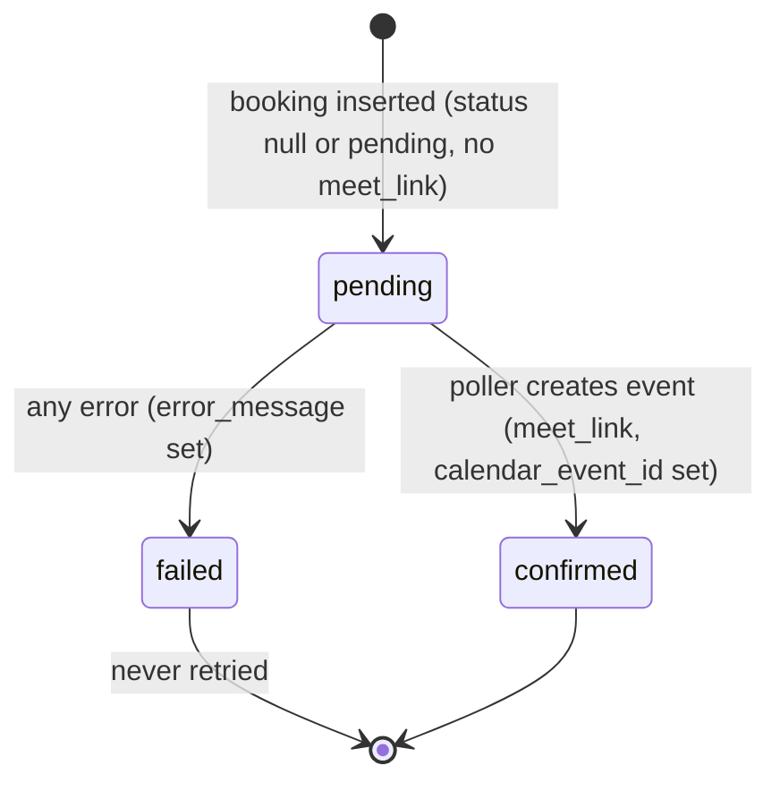

# 12 — Google Apps Script Poller: Behaviour per Row (as-is)

Source: `api-agennda-intervew.gs` (root; the newer copy that the owner states is deployed — see [11](11-owner-clarifications.md) C5/C11). `google-apps-script/Code.gs` is an older, diverged copy (differences in [08](08-backend-edge-functions-and-google-apps-script.md)). The deployed script runs in the Google account **startups@athareg.com** with a **time-driven trigger every minute** calling `pollForNewBookings()` (trigger setup itself is not in the repo; per owner). Line numbers refer to `api-agennda-intervew.gs`. Static reading only; nothing was executed.

## 1. Configuration (lines 4-6)
- `SUPABASE_URL` and `SUPABASE_ANON_KEY` (a publishable key) are hard-coded constants; the key is used as both `apikey` and `Authorization: Bearer`. (Value not reproduced here.)
- `CALENDAR_ID = 'primary'` → the primary calendar of the account the script runs under.
- Requires the **Calendar Advanced Service** (`Calendar.Events.insert`) enabled in the Apps Script project.

## 2. Entry points
| Function | Trigger | Notes |
|---|---|---|
| `pollForNewBookings` (412) | Time-driven, every minute (per owner) | The only active path |
| `doPost` (369) | Web-app webhook | Expects `{booking_id, is_ather_team}`; **no caller exists in the repo** (04/05/08) |
| `doGet` (402), `doOptions` (340) | Web-app | Health check / CORS preflight |
| `testSetup` (456) | Manual | Reads `events` and lists 1 calendar event |

The web-app endpoint (`doPost`) has no authentication in code. `sendCorsResponse` (345) calls `response.setHeader(...)` and `setStatusCode(...)` on a `ContentService` TextOutput; to my knowledge those methods do not exist in Apps Script, so `doPost`/`doGet`/`doOptions` would likely throw — **unverified, needs a test in the real environment**.

## 3. One poll cycle (every minute), step by step
1. `supabaseRequest('bookings','GET')` — fetches **all rows** of `bookings` (no filter, no column list, no ordering; subject to PostgREST's default max-rows cap).
2. Filters in the script (client-side): `!b.meet_link && (!b.status || b.status === 'pending')`.
3. Same for `ather_team_bookings`.
4. Tags each row with `is_ather_team` (`false` for `bookings`, `true` for `ather_team_bookings`) and concatenates (mentor bookings first, then Ather team).
5. Calls `processBooking(booking)` sequentially for each. **Both booking systems are polled, not only Ather team.**
6. Errors in the poll itself are caught and only logged (449-451). There is no lock (`LockService`), so a cycle that runs longer than one minute can overlap the next trigger run.

## 4. Per-row processing — `processBooking` (284-334)
For each unprocessed booking:

1. **Fetch event settings:** `supabaseRequest('events','GET')` — downloads the **entire `events` table for every booking** (once per row), then `findInArray` matches `e.event_id === booking.event_id` (291). If no match, `eventDetails` is `undefined` and processing continues with defaults.
2. **`createCalendarEvent(booking, eventDetails)`** (112):
   - Requires `start_time` and `end_time` on the booking (else throws → row marked `failed`); validates both parse as dates.
   - `meeting_link_mode` from `events` (default `'unique'`). If `'shared'` and `shared_google_meet_link` is empty → failure `"Shared Google Meet mode is enabled, but no shared Google Meet link is configured."`.
   - Event body:
     - **summary:** Ather team → `"<company_name> with <mentor_name>"` (empty-string prefix); mentor booking → `"Mentor Session: <company_name> with <mentor_name>"`.
     - **shared mode:** `location` = shared link, `description` = `"Google Meet Link: <link>"`, no conference request.
     - **unique mode:** `conferenceData.createRequest` (`hangoutsMeet`, random `requestId`).
     - `start`/`end`: `toISOString()` (UTC `Z` string) plus `timeZone: 'Africa/Cairo'`.
     - `guestsCanInviteOthers=false`, `guestsCanModify=false`.
   - **Attendees:** `booking.booker_email`, `booking.mentor_email`; then from `events`:
     - Ather team: `interview_admin_emails` + `interview_cc_emails`.
     - Mentor booking: `mentor_admin_emails` + `mentor_cc_emails`.
     - These columns may be JSON strings or arrays (parsed with `JSON.parse` if string; a malformed string throws → row marked `failed`). No de-duplication of addresses.
   - `Calendar.Events.insert(event, CALENDAR_ID, {conferenceDataVersion:1, sendUpdates:'all'})` → **Google sends invitation emails to all attendees** from the startups@athareg.com account.
   - Meet link: shared link, or `conferenceData.entryPoints[video].uri`, else `hangoutLink`. If none → failure `"Failed to obtain Google Meet link"` (the calendar event already exists at that point and is **not** deleted).
3. **On failure** (returned `success:false`, 296-307): PATCH the booking → `{meet_link:null, status:'failed', error_message:<error>}`; returns `false`.
4. **On success** (310-320):
   - PATCH booking (`bookings` or `ather_team_bookings`) → `{meet_link, status:'confirmed', calendar_event_id}`.
   - PATCH the slot (`mentor_slots` or `ather_team_slots`, by `booking.slot_id`) → `{meet_link}` (overwrites any pre-generated slot link).
5. **On exception** (324-333): PATCH booking → `{status:'failed', error_message}`; if this PATCH itself throws, the exception escapes `processBooking` and is caught by `pollForNewBookings`' outer try/catch, **aborting the rest of that cycle's rows**.

PATCH requests use `?id=eq.<id>` (line 80); they assume the booking and slot primary keys are named `id`.

### Row state machine

A `failed` row stays failed until someone resets its `status` manually (the filter only selects null/`pending`). A `confirmed` row is never touched again: no update/cancel/reschedule handling, so cancelling a booking does not delete the Calendar event.

## 5. Interaction with the `process-booking` edge function
- The frontend (not the poller) calls `process-booking` right after a booking is created (retry loop in `atherTeamBooking.js`/`mentorBooking.js`; see 05/08). On success that function writes `meet_link`, `status:'confirmed'`, `calendar_event_id` to the booking (`process-booking/index.ts:381-383`) and `meet_link` to the slot (`:395`).
- The poller only picks rows that still have **no `meet_link` and null/`pending` status**. The two paths therefore overlap when: the booking was just inserted and `process-booking` has not yet written back (the poller can run in that window → **two Calendar events/Meet links for one booking**), or `process-booking` failed after creating the event but before writing back (the poller then creates a second event).
- Which path is the intended primary in production is unconfirmed (open).
- Differences between the two paths (timezone `Africa/Cairo` vs ISO UTC, summary text, attendee list) are catalogued in 08.

## 6. Operational characteristics (facts, not recommendations)
- Every minute: 1 `bookings` GET + 1 `ather_team_bookings` GET even when idle, plus N full `events` downloads per cycle (N = unprocessed rows). Nothing is filtered server-side, so data volume grows with table size.
- Uses the **anon key**; this works only because live RLS currently lets anon read/update `bookings`, `ather_team_bookings`, `events` and update slots (07: `ather_team_bookings` has RLS disabled; ~25 policies exist only live). Any RLS change ([11](11-owner-clarifications.md) C1) changes this script's behaviour.
- Latency from booking to invite: up to ~1 minute plus Apps Script trigger jitter.
- Google-side quotas apply (UrlFetch calls per day, Calendar event/invite limits for the account); not measured here.

## 7. Differences from `google-apps-script/Code.gs` (summary)
The root copy adds shared-Meet-link mode and drops the `"Interview:"` summary prefix; `Code.gs` has neither. Full list in 08.

## 8. Open questions
1. Has `doPost`/the web-app URL ever been used (e.g. as a Supabase database webhook)? Is the web app still deployed with "anyone" access?
2. Does the deployed script exactly match this file (the key line carries a "Replace with your actual anon key" comment)? Paste the deployed version if it differs.
3. What does the Apps Script "Executions" page show (last-run status, errors)? Are there `failed` rows in production tables?
4. Are duplicate Calendar events/Meet links for one booking known to happen?
5. Is the poller meant to handle mentor `bookings` as well (it does today)?
