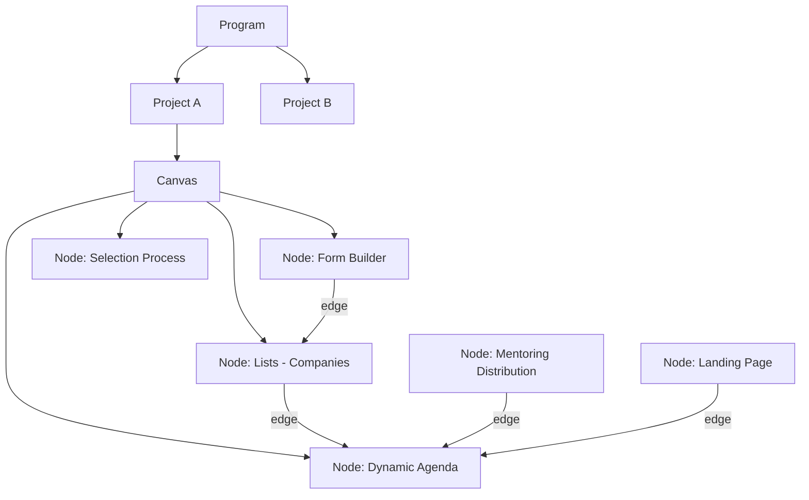
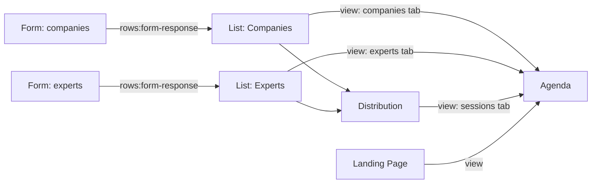

# Design 00 — Conceptual Model (DRAFT for owner review)

Status: **design only — no implementation has started.** Everything marked **[Decided]** comes from the owner (see `docs/11` and `docs/13`). Everything marked **[Proposal]** is the analyst's suggestion and needs the owner's approval. The other design documents (`01`–`07`) build on the terms defined here.

## 1. Vocabulary
| Term | Meaning |
|---|---|
| **Program** | Top-level container created by a project manager (PM). Has settings: description, cover, status (active/completed), etc. Today: table `programs` (3 rows). |
| **Project** | Belongs to one Program. A blank **canvas** of nodes. Today's closest thing: an `events` row (≈16). |
| **Node** (module/tool) | An instance of a **Node Type** placed on a project's canvas. The same type may be added many times in one project. |
| **Node Type** | Definition in the **node registry** (code): its configuration, ports, views, emails, visibility options. |
| **Port** | A typed input or output of a node type (e.g. `companies` rows, `experts` rows, `agenda-tab` view). |
| **Edge** | A connection from an output port of one node to an input port of another node. |
| **View / Tab** | A renderable panel a node can contribute to the **Agenda view page** (e.g. "Experts", "Companies", "Distribution", "Landing"). |
| **Founder / Participant** | A founder of a **startup participating in Athar programs** (not Athar's own founders). Has an Alumni-platform account with role `founder`. |
| **Athar Network** | Registry of all trainers/mentors across programs (unchanged concept). |

## 2. Hierarchy

**[Decided]** A new project opens an **empty canvas** with a **sidebar** listing all tools; the PM imports only the tools needed, as many times as needed (e.g. 3 selection processes in one project, 2 agendas, several forms).

## 3. Node types (v1 catalogue) — [Decided] list, details in design 01
1. **Dynamic Agenda** (today: `EventBuilder`/`AgendaViewer`, tables `event_days`, `agenda_slots`)
2. **Form Builder** (today: `FormEditor` + form engine: `event_forms`, `form_field_configs`, `form_responses`, `form_covers`, `library_forms`)
3. **Lists** — experts/mentors, companies, or any custom named list (today: `experts`, `companies`, `master_experts`)
4. **Selection Process** — can appear more than once (multi-stage) (today: `SelectionProcessManager` over `company_submissions`)
5. **Mentor Booking** — online sessions (today: `MentorBooking*`, `mentors`, `mentor_slots`, `bookings`)
6. **Ather Team Booking / interviews** — (today: `AtherTeamBooking*`) *(open: stays a separate node or becomes a mode of the booking node — see design 01)*
7. **Mentoring Distribution** — offline sessions in the training hall (today: `MentoringDistribution*`)
8. **Resource Library** (today: `LibraryManager`, `library_resources`)
9. **Landing Page** — new; edit-mode evolves from today's Join Athar (`join_athar_*`); view-mode design = `landing-page.html`
10. **Certificates** — new; PM uploads a template with variables (e.g. participant name)
Email sending is **inside** the nodes (selection: acceptance/rejection/interview; booking: online-session invitations/notifications), not a separate node. **Project Details** (location, map link, offline days count, transportation) is a project-level panel, not a node.

## 4. Node Type definition (the registry) — [Proposal]
Every node type is declared by one manifest so the canvas, sidebar, validation and (later) AI-built nodes use the same contract:
```text
NodeType {
  key, version, name (ar/en), icon, category
  configSchema            // what the PM edits ("edit mode")
  ports: { in: [...], out: [...] }   // typed; see §5
  contributesViews: [ { key, title, component } ]  // tabs for the Agenda view
  visibility: { supported: ['private','platform','public'], showToParticipants: bool }
  emails: [ { key, trigger, templateFields } ]
  ownsTables / storage    // data it owns
  EditComponent, ViewComponent, SettingsComponent
}
```
Rule: a node type never reads another node's tables directly; it receives data **only through its input ports** (edges).

## 5. Ports and edges — data-flow semantics
**[Decided]** An edge **displays** the source node's data inside the target node; it does **not copy rows** into other tables. Data shown through an edge refreshes **right after the source is saved** (explicit Save), not per keystroke and not trigger-based.

**[Decided]** For Form → List, the list item is a **reference to the source row plus list-specific extra fields** (status, notes, assigned mentor, …).

Port families **[Proposal]**:
| Port type | Carries | Example edge |
|---|---|---|
| `rows:<entity>` | A set of references to rows of an entity kind (`form-response`, `company`, `expert`, `participant`, …) | Form (`responses`) → List (`items-in`) |
| `rows:list-items` | Items of a list (reference + overlay) | List → Agenda (`companies-tab`), List → Distribution (`mentors`, `companies`) |
| `view` | A renderable tab the target shows | Distribution → Agenda; Landing → Agenda |
| `schedule` | Time slots | Agenda → Booking |
| `participants` | Participant records with status | Selection → Participants (see §7) |


A list item (conceptual): `{ id, list_node_id, source_ref: {kind, table, row_id} | null, overlay: {...} }`. Manual items have no `source_ref`. If a source row is deleted, the item shows as "source removed" (behaviour to be fixed in design 02).

## 6. Visibility and access — [Decided]
- Per item (program link, form, landing page, node view) the PM chooses **public link** or **platform only**.
- **Founders** see the founder experience only (decided by account type/role). **Users can have several roles** (live DB currently enforces one — to be changed).
- A founder sees a Program in their **Programs page** if: (a) manually assigned to the project, or (b) filled the outreach form and was **accepted through Selection**.
- **Program page** for the founder shows only what the PM added/enabled: description, **cover** (same as the project's agenda cover), **Program Agenda** button (project's agenda view only, when enabled), mentors present, companies attending, offline location + map link + number of offline days + transportation (Project Details), the **Resource Library**, and the **certificate** after the program is completed. Nothing appears by default.
- **Participant status [Decided]:** accepted / attended / withdrawn. **Certificates only for `attended`.**
- **Program completion:** the PM marks the program "completed" in the new **Program Settings** page; that unlocks certificates.

## 7. Participants — [Proposal]
A `participant` links a founder account (and the company, if any) to a **project**, with `status` and `source` (`manual` | `selection`). Invited founders arrive linked to their company; self-registered founders create their own company (see `docs/11` C8–C10). Selection nodes write participant records when a founder is accepted (display/derivation rules in design 02/03).

## 8. Out of scope / deferred
- **AI-generated nodes** (describe → Claude builds → shared library → chat-edit): **deferred entirely** by the owner. The registry in §4 must not prevent it later, but no design of AI code execution is included.
- Alumni platform internals and Athar Network beyond the integration points above.
- TypeScript migration (stack stays **React + JavaScript on Supabase**), choice of canvas library (open; see design 05).

## 9. Constraints carried from the as-is analysis
(Details in docs 01–10.) The new model must resolve, not inherit: open RLS (`USING (true)` on ~33 tables); `event_id` typed TEXT without FK; duplicated booking systems and form engines; role model mismatch; hard-coded Supabase credentials; service-account key readable by the browser; two form engines (legacy submissions vs `form_responses`); 17 base tables without migrations.

## 10. Document map
| Doc | Content |
|---|---|
| `01-node-catalog.md` | Per node type: purpose, config, ports, views, emails, visibility, mapping from current code/tables |
| `02-data-flow-and-connections.md` | Port types, edge rules, list items (reference + overlay), save/refresh semantics, agenda tabs, validation |
| `03-roles-permissions-and-rls.md` | Role model (multi-role), founder access, participant visibility, RLS design per table family |
| `04-database-design.md` | New schema, relationships, naming, ID types, storage buckets |
| `05-migration-plan.md` | Old→new table/column mapping, data transforms, verification on the local DB |
| `06-frontend-architecture.md` | Canvas, sidebar, routing, registry, shared components replacing duplicated code, founder program page |
| `07-emails-integrations-and-certificates.md` | Per-PM Gmail sending, Google Meet/Calendar, Apps Script replacement, certificates, share presets |
