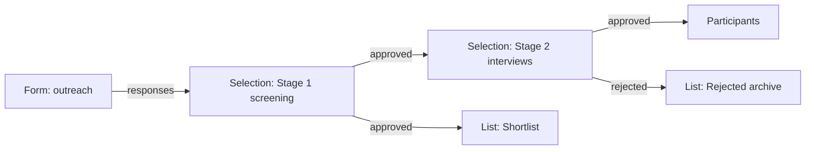
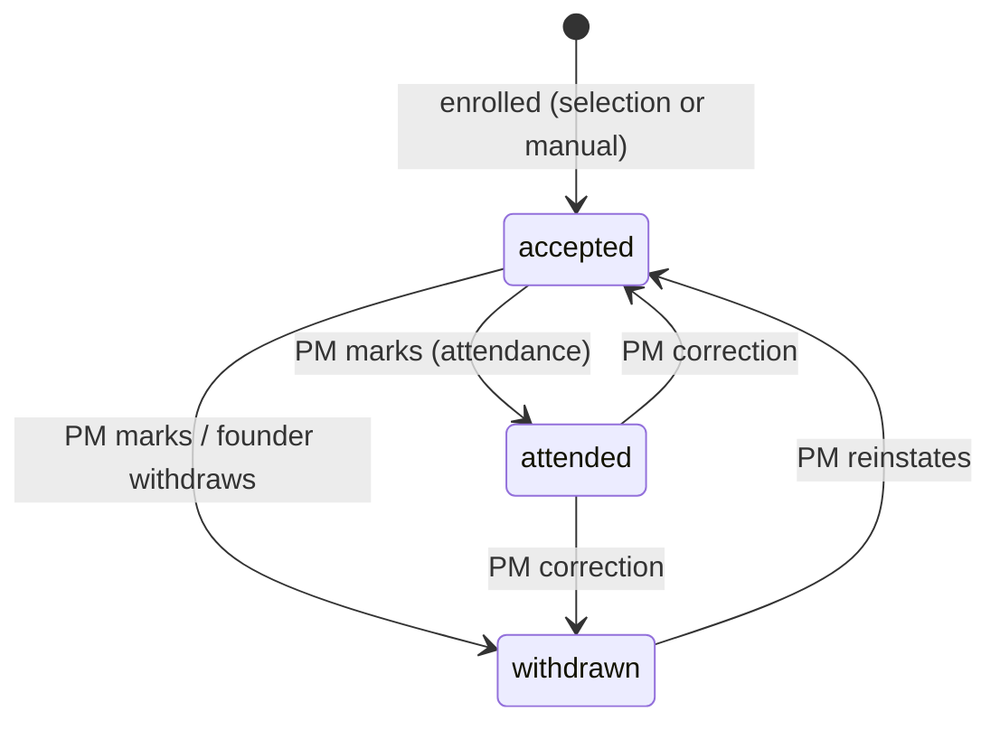
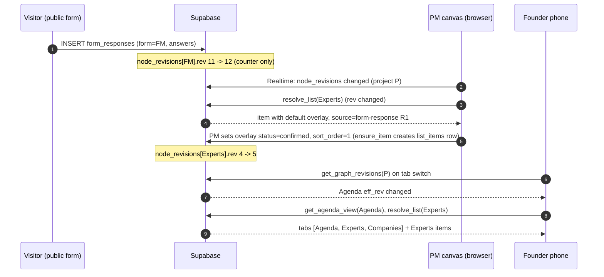

# Design 02 - Data Flow and Connections (DRAFT for owner review)

Status: **design only, nothing is implemented.** Labels: **[Decided]** = owner said so (`docs/11`, `docs/13`); **[As-is]** = found in code/DB (file:line or table); **[Proposal]** = analyst recommendation with reasons and alternatives. Terms follow `00-conceptual-model.md` (Program, Project, Node, Node Type, Port, Edge, View/Tab, Participant). Anything the owner must decide is collected in section 13.

Scope of this document: how data moves between nodes on a project canvas: ports and edges, the "reference + overlay" list-item model, how tabs reach the Agenda view page, when connected data refreshes, draft vs saved, selection chaining and participants, and how today's mechanisms map onto this model. Node-by-node details are in `01`, roles/RLS in `03`, schema in `04`, migration in `05`.

---

## 1. Principles

| # | Principle | Label |
|---|---|---|
| P1 | An edge **displays** source data in the target; it never copies rows into another table. | [Decided] docs/13 section 3 |
| P2 | Connected data refreshes **right after the source is explicitly saved** (not per keystroke, not trigger-driven like n8n). | [Decided] |
| P3 | A list item = **reference to the source row + list-specific extra fields** (status, notes, assigned mentor...). | [Decided] docs/13 "Update (2)" #2 |
| P4 | A node reads other nodes' data **only through its input ports** (never other nodes' tables). | [Proposal, from 00 section 4] |
| P5 | Anything that is a *new fact* (a decision, a status, an assignment, a session) is stored by the node that owns it, keyed by a reference; it is never a copy of someone else's field values. | [Proposal] |
| P6 | Ports carry a **query descriptor** (what to read), not rows. The consumer asks the source node's resolver for rows at render time. | [Proposal] |

Why P6: if a port carried rows, every consumer would hold a snapshot, which is exactly the duplication the owner wants to avoid and the source of today's stale-copy bugs (expert profile pushed to every `experts` row, `api.js:555-584`).

---

## 2. Port type system

### 2.1 Entity kinds [Proposal]

An **entity kind** names what a row *is*. Compatibility is checked on kinds.

| Kind | What it is | Canonical store (design 04 finalises names) | Today |
|---|---|---|---|
| `form-response` | One submission of a Form node | `form_responses` | `form_responses`, also legacy `company_submissions`, `expert_submissions` |
| `network-expert` | Person in the Athar Network (global) | `master_experts` | `master_experts` (42 rows) |
| `company` | A company/startup record | `companies` | `companies` (per-event rows, no master table, [As-is] doc 03 2.1) |
| `participant` | Enrollment of a founder/company in a project, with status | `project_participants` (new) | none (`program_participations` is alumni-side and unused by UI, [As-is] doc 02 3.11) |
| `list-item` | An item of a List node (reference + overlay) | `list_items` (new) | per-event `experts` / `companies` rows |
| `session` | One mentoring meeting (mentor item + company item + time) | `mentoring_sessions` | `mentoring_sessions` |
| `slot` | A bookable or scheduled time slot | `agenda_slots`, `mentor_slots` | same |

`list-item` has a **subkind** describing its payload: `list-item<company>`, `list-item<expert>`, `list-item<generic>`. A List node has exactly one subkind (set at creation: Companies / Experts-Mentors / Custom). `generic` is the subkind of a custom named list.

### 2.2 Port families

Extends 00 section 5. A port is declared in the node type manifest as `{ key, direction, family, kind?, cardinality, label{ar,en}, required }`.

| Family | Carries | Direction examples |
|---|---|---|
| `rows:form-response` | Query: "responses of form F" + the form's field schema | out: Form `responses`; in: List `items-in`, Selection `applicants` |
| `rows:list-item<K>` | Query: "resolved items of list/selection L, optionally filtered" | out: List `items`, Selection `approved`/`rejected`/`holding`/`all`; in: List `items-in`, Selection `applicants`, Distribution `mentors`/`companies`, Booking `mentors` |
| `rows:participant` | Query: "participants of project P (optionally with status filter)" | out: Participants `participants`; in: Certificates, Program page, Agenda (personalisation) |
| `view` | A renderable tab definition (see section 5) | out: any contributing node; in: Agenda `tabs` |
| `schedule` | Day/slot structure of an Agenda | out: Agenda `schedule`; in: Booking `schedule`, Distribution `schedule` |

[Proposal] `schedule` direction: Agenda is the owner of days/slots (today `event_days`, `agenda_slots`); Booking and Distribution *consume* the day structure (number/dates of offline days) instead of keeping three parallel day models ([As-is] doc 05 DUP-22: `mentor_day_config`, `mentoring_distribution_day_config`, `break_slots`). Whether Distribution may also run without an Agenda is Open Decision 12.

### 2.3 What a port carries: schemas [Proposal]

Every port value is a descriptor:

```json
{
  "node_id": "uuid-of-source-node",
  "port": "responses",
  "family": "rows:form-response",
  "schema_rev": 7,
  "schema": { "...see below..." },
  "filter": { "status_in": ["approved", "displayed"] }
}
```

`rows:form-response` schema (the form's field list, so a List can build its column mapping):

```json
{ "form_id": "uuid",
  "fields": [
    { "name": "startup_name", "type": "text",  "label": {"en": "Startup name", "ar": "..."}, "canonical": "title" },
    { "name": "logo_url",     "type": "image", "canonical": "image" },
    { "name": "email",        "type": "email", "canonical": "email" },
    { "name": "phone",        "type": "phone", "canonical": "phone" }
  ] }
```

`canonical` is an optional well-known key (`title`, `subtitle`, `image`, `email`, `phone`, `national_id`, `bio`, `links`...). It replaces today's substring heuristics on answer keys ([As-is] `extractPrimaryEmail` and `getFounderDisplayName` guess from header text, `api.js:2028`, `SelectionProcessManager.jsx:46-108`; phone detection by `key.includes('tel')`, `api.js:1886`).

`rows:list-item<K>` resolved row (what the resolver returns; this is the single shape every consumer receives):

```json
{
  "item_id": "uuid",
  "list_node_id": "uuid",
  "kind": "company",
  "source": { "kind": "form-response", "id": "uuid", "state": "ok" },
  "display": { "title": "Nile Robotics", "subtitle": "AgriTech", "image_url": "https://...", "email": "..." },
  "fields":  { "startup_name": "Nile Robotics", "industry": "AgriTech" },
  "overlay": { "status": "confirmed", "notes": "...", "assigned_mentor_item_id": "uuid", "sort_order": 3 },
  "lineage": ["form:3f2a...", "selection:91bc..."]
}
```

`source.state` is `ok | missing` (see 3.6). `lineage` records the nodes the item travelled through (diagnostics and the "where does this come from" popover; not used for resolution).

`rows:participant` resolved row: `{ participant_id, project_id, company_id|null, founder_user_id|null, status: accepted|attended|withdrawn, source: manual|selection, source_ref: {kind,id}|null, display: {...} }`.

`view`: `{ node_id, view_key, title:{ar,en}, component, props_query, audience }` (section 4).

### 2.4 Cardinality [Proposal]

| Port side | Cardinality | Meaning |
|---|---|---|
| out | always **many edges allowed** (fan-out) | One output may feed several inputs. |
| in `one` | at most one edge | e.g. a Selection stage `applicants` (exactly one upstream pool, simpler to explain). |
| in `many` | any number; results **concatenated, de-duplicated by entity key** (3.3), edge order decides tie-break | e.g. List `items-in`, Agenda `tabs`, Distribution `mentors` (several lists merge into one pool). |

Each input declares `required: true|false`. A required input with no edge shows the node as "incomplete" on the canvas (warning badge); it does not block saving.

### 2.5 Compatibility rules [Proposal]

An edge from output port O to input port I is valid iff all hold:

1. **Same family.** `view`->`view`, `schedule`->`schedule`, `rows:*` family equal.
2. **Kind compatibility** (rows families only), table below.
3. **Same project.** Edges never cross projects (a cross-project reference, e.g. reuse of a list in another project, is out of scope; Athar Network is the global shared registry and is reached by *reference*, not by edge, see 3.2).
4. **No duplicate edge**: the same (O, I) pair may exist once.
5. **No self-edge** and **no cycle** (2.6).
6. **Cardinality** of I is not exceeded.

Kind compatibility (output kind -> input subkind):

| Output | Into `list-item<company>` input | Into `list-item<expert>` | Into `list-item<generic>` | Into Selection `applicants` | Into Distribution `companies` | Into Distribution `mentors` |
|---|---|---|---|---|---|---|
| `form-response` | yes (mapping must supply `title`) | yes (mapping must supply `title`) | yes | yes | no (must go through a List) | no |
| `list-item<company>` | yes (list-to-list, 3.7) | no | yes | yes | yes | no |
| `list-item<expert>` | no | yes | yes | no (experts are not applicants) | no | yes |
| `list-item<generic>` | no | no | yes | yes | no | no |
| Selection output (`list-item<K>` of its applicants) | same as `list-item<K>` row | same | same | yes (chaining) | same | same |

Rationale: strict subkinds prevent "experts shown in the companies tab" mistakes; `generic` is the escape hatch for custom lists. A generic list cannot feed Distribution because Distribution needs `company`/`expert` semantics (assignment, availability). [Proposal; alternative: allow generic into Distribution with a "treat as" choice, rejected for v1 to keep validation simple.]

Requirement for form-response -> List: the form's schema must expose at least one field that can map to `title`. The canvas does not block the edge (the form may not be built yet) but the List shows "mapping incomplete".

### 2.6 What the canvas allows and forbids [Proposal]

| Action | Rule |
|---|---|
| Drag from output | Compatible input ports highlight; incompatible ones dim with a tooltip stating the reason (kind mismatch, cardinality full, would create a cycle). |
| Drop on incompatible port | Rejected; no edge is created. |
| Cycles | **Forbidden.** The data graph must be a DAG; checked on edge creation (DFS from target back to source) and again server-side in the edge-save function. Realistic loops: Selection stage -> List -> same Selection; Distribution -> List -> Distribution. |
| Multiple edges into one `many` input | Allowed (merged). Each edge keeps its own config (filter, label). |
| Fan-out from one output | Allowed, no limit. |
| Delete edge | Allowed any time. The target loses the rows it showed; **overlay rows are kept** (not deleted) and reappear if the edge is re-created (items are matched by source key, 3.3). Agenda tab config for that edge is deleted. |
| Delete node | Confirm dialog lists dependents (edges, tabs, sessions). Owned data is deleted with the node; dependents show empty-state. Overlay rows of a deleted **List** are deleted with it. |
| Change a List's subkind | Forbidden after creation (create a new list). Reason: overlay semantics differ. |
| Port visibility | A port that has no valid partner node type in the registry is hidden from the sidebar help text only; no hidden ports on nodes. |
| Edge config | Optional per edge: `filter` (e.g. status), `label`, `order_index`. Stored on the edge row. |

Edge table sketch (design 04 finalises):

```sql
edges(
  id uuid pk, project_id uuid not null references projects,
  from_node uuid not null references nodes on delete cascade, from_port text not null,
  to_node   uuid not null references nodes on delete cascade, to_port   text not null,
  config jsonb not null default '{}',     -- filter, label
  order_index int not null default 0,     -- tab order / merge tie-break
  unique (from_node, from_port, to_node, to_port)
)
```

---

## 3. The "reference + overlay" list-item model

### 3.1 Data shape [Proposal]

```sql
list_items(
  id uuid pk,
  list_node_id uuid not null references nodes on delete cascade,
  -- exactly one of the typed references, or none for a manual item
  form_response_id  uuid null references form_responses on delete set null,
  network_expert_id uuid null references master_experts  on delete set null,
  company_id        uuid null references companies       on delete set null,
  source_kind text null check (source_kind in ('form-response','network-expert','company')),
  source_label text null,          -- last-known display name, tombstone use only (3.6)
  manual_fields jsonb null,        -- ONLY for manual items (source_kind is null)
  overlay jsonb not null default '{}',
  sort_order int not null default 999,
  excluded boolean not null default false,   -- "hidden from this list"
  created_by uuid, created_at timestamptz, updated_at timestamptz,
  check ( (source_kind is null and manual_fields is not null)
       or (source_kind is not null and manual_fields is null) )
)
-- one overlay per (list, source)
create unique index on list_items (list_node_id, form_response_id) where form_response_id is not null;
create unique index on list_items (list_node_id, network_expert_id) where network_expert_id is not null;
create unique index on list_items (list_node_id, company_id)        where company_id is not null;
```

Typed foreign keys (not a polymorphic `table_name,row_id` pair as sketched in 00 section 5) so the database enforces integrity; 00's conceptual `source_ref` maps to `(source_kind, <typed fk>)`. Alternative considered: one polymorphic `source_table/source_id` pair (simpler, no integrity). Rejected: [As-is] the schema already suffers from untyped ids (`event_id` TEXT without FK; `experts.expert_id` string vs `mentoring_sessions.mentor_id` uuid, doc 05 CON-14).

### 3.2 How an item resolves its source row [Proposal]

Resolution is a **left join at read time** performed by one resolver `resolve_list(list_node_id)` (SQL function/RPC; used by every consumer; replaces `getExperts`, `getCompanies`, `getStartups`, `getMasterExperts`, the experts part of `getFullAgenda`).

Pseudo-SQL:

```sql
-- 1. membership from edges (virtual): every row of every connected source
with src as (
  select 'form-response' as kind, r.id as source_id, e.id as edge_id, e.order_index, r.answers as raw
  from edges e join form_responses r on r.form_id = (select form_id from nodes where id = e.from_node)
  where e.to_node = :list and e.to_port = 'items-in' and e.from_port = 'responses'
    and r.deleted_at is null
  union all
  select 'company', c.id, ... from edges e join <upstream list resolver> ...   -- list-to-list / selection output
)
-- 2. attach overlay
select coalesce(li.id, <virtual id>) as item_id, src.*, li.overlay, li.sort_order, coalesce(li.excluded,false)
from src left join list_items li
  on li.list_node_id = :list and li.<fk> = src.source_id
union all
-- 3. manual items and orphans
select ... from list_items where list_node_id = :list and (source_kind is null)
```

Then the resolver maps `raw` answers/columns to `display` through the list's **column mapping** (`nodes.config.mapping`, e.g. `{ "title": "startup_name", "subtitle": "industry", "image": "logo_url" }`; defaults come from the form schema's `canonical` keys). Network-expert and company sources use their own columns directly.

**Membership is virtual** [Proposal]: an overlay row is created **lazily**, the first time the PM edits the overlay of an item (or reorders). Items without an overlay row still appear (default overlay). Reasons: no trigger or copy step is needed when a new response arrives (matches "not trigger-based"); nothing to back-fill when an edge is added later; deleting an edge cannot orphan anything. Alternative **materialised membership** (insert a `list_items` row for every source row when the edge is created or a response arrives) was rejected: needs a trigger or a sweep (the owner ruled triggers out for data flow) and would reintroduce a copy step. Cost of the chosen approach: the virtual item id for rows without overlay is not a stable database id, so anything that *points at* an item (Distribution sessions, assigned mentor) must first force-create the overlay row. The rule is: **any reference to an item from another node's data goes through `ensure_item(list, source)`, which inserts the overlay row if missing and returns its uuid.** (Open Decision 1.)

### 3.3 Entity key and de-duplication [Proposal]

The **entity key** of an item is `(source_kind, source_id)`, or `('manual', item_id)`. Merging multiple edges (2.4) and list-to-list chains de-duplicate by entity key: the same form response arriving twice through two paths appears once. Two *different* sources describing the same real company (a response and a `companies` row, or the same company applying through two forms) are **not** merged automatically in v1; the list shows both. Optional later: a per-list `dedupe_by` (email / national id / name) setting. Open Decision 4. [As-is] today `syncSubmissionsFromSheet` matches by national id > email > phone > company+founder name (`api.js:2186`); that matching moves into this optional setting if the owner wants it.

### 3.4 What the overlay can hold [Proposal]

The overlay is a JSON object validated against the **list's overlay schema**, declared in the List node config. Fixed system keys exist for all lists; the PM adds custom columns.

| Key | Type | Notes |
|---|---|---|
| `status` | enum defined by the list (default none) | e.g. Confirmed / Pending / Dropped. Distinct from participant status (section 7). |
| `notes` | text | Internal; never shown to founders unless the list turns "show notes" on (default off). |
| `assigned_mentor_item_id` | uuid -> `list_items.id` of a list of subkind expert | Cross-list pointer. Must belong to a list that is **connected** to the same Distribution/Booking, else flagged. |
| `sort_order` | int | Column also on the table for indexing; overlay mirror not stored twice. |
| `display_override` | object `{title?, subtitle?, image_url?, bio?}` | **Display-only** override of the source value for this list (e.g. shorten a long company name). Off by default; allowed fields chosen in the list config. Never writes back to the source. |
| `card` | `{ show: {<field>: bool} }` | Per-list card visibility, replaces today's `form_field_configs.show_in_card` and `experts.display_config` ([As-is] doc 03 4.7: both exist and the per-expert one is never consulted). |
| custom columns | `text | number | select | date | boolean | link` | Declared in `list.config.overlay_schema`, e.g. `{ "key": "table_no", "type": "number" }`. |

What the overlay **cannot** hold: copies of source fields (the same key as a source field is only possible via `display_override`), identity (name/email/phone of the person), or anything another node must own (sessions, bookings, participant status).

### 3.5 Behaviour when the source row is edited [Proposal]

| Event | Result |
|---|---|
| Source row edited and **saved** (e.g. response answer corrected, network expert profile updated, company row edited) | All lists referencing it show the new values on next resolve (section 5). Overlay is untouched. No fan-out write (this removes `updateMasterExpert`'s push to every `experts` row, `api.js:578`). |
| Edited from inside the list | Source-derived fields are **read-only in the list UI**; a link "Open source" navigates to where it is editable (form Responses tab, Athar Network, company page). Only overlay fields and manual items are editable inline. Alternative: allow in-list editing that writes through to the source. Rejected: unclear ownership across projects when the source is a shared network expert; the PM could unknowingly change a profile used in other projects. (Open Decision 2.) |
| Source form's field renamed/removed | The list's column mapping marks the mapped column "missing"; the title falls back to the first non-empty mapped field; the list shows a warning on the node. Overlay untouched. |

### 3.6 Behaviour when the source row is deleted [Proposal]

Deleting form responses, companies and network experts is a soft-delete (`deleted_at`) wherever possible, hard-delete only by super admin tools (consistent with the owner's "nothing lost" rule). Two cases:

1. **Soft-deleted source:** item remains with `source.state = "missing"`, shown greyed with the badge "source removed" and its last-known label (`source_label`, refreshed on every overlay write; this is the one deliberate micro-duplication, display only). PM actions: *Remove from list* (sets `excluded = true`), *Keep as manual* (explicit "detach": copies the **currently resolved display fields into `manual_fields`**; one-time, user-initiated copy), or *Restore source* link if it was only soft-deleted.
2. **Hard-deleted source:** FK `on delete set null` leaves `source_kind` set and the typed id null -> same "source removed" state with `source_label`.

Downstream consumers treat a `missing` item as **inactive**: Distribution skips it and flags affected sessions "company/mentor removed"; Agenda tab shows it only to PMs.

### 3.7 Mixed lists: form-sourced, network-sourced and manual items [Proposal]

A List node can combine, in one list:

- **Edge-fed items**: any number of edges into `items-in` (several forms, a Selection output, another list), each optionally filtered.
- **Network picks**: PM clicks "Add from Athar Network" -> creates a `list_items` row with `network_expert_id` (replaces today's "Import from Network", `ExpertManager.jsx:225`, which copied the profile). Only for `list-item<expert>` lists.
- **Company picks**: "Add existing company" -> row with `company_id`.
- **Manual items**: typed directly by the PM; `manual_fields` follows the list's manual schema (the same field set the mapping exposes: title, subtitle, image, email...). Manual items have all overlay features.

Ordering: `sort_order` is a single sequence over all items regardless of origin; new virtual items without an overlay sort after items with an explicit order (by source created time). Drag-reorder writes `sort_order` for the affected rows (creating overlay rows lazily).

List-to-list edge (e.g. "Companies" list -> "Finalists" list): `Finalists` receives resolved items of `Companies` as sources, but its items reference the **original** source (`form_response_id`/`company_id`), not the upstream list item. This avoids chains of references and keeps one overlay per list per entity. The upstream overlay is available read-only as `upstream_overlay` on the row. [Proposal; alternative: reference the upstream `list_items.id`, rejected because deleting an intermediate list would break the chain.]

### 3.8 How lists feed Distribution, Agenda and Booking [Proposal]

All three consume `rows:list-item<K>` through resolver calls; they store **item ids** (via `ensure_item`), never names.

| Consumer | Input port | Stores | Reads for display | Today |
|---|---|---|---|---|
| **Mentoring Distribution** | `mentors` (`list-item<expert>`, many), `companies` (`list-item<company>`, many) | `mentoring_sessions(mentor_item_id, company_item_id, day_index, slot_index, ...)`, per-mentor availability keyed by `mentor_item_id` | names/photos via resolver | `mentoring_sessions.mentor_name`, `company_name`, `mentor_id`, `company_id` copies ([As-is] doc 05 table 479); mentors read straight from `experts`/`companies` (`MentoringDistributionAdmin.jsx:211-232`); `handleRemoveMentor` **deletes the expert row** (`:510`) |
| **Agenda** (tabs) | `tabs` (`view`) | tab config per edge | list tab = `resolve_list` with card config | tab set computed from data, `getAgendaTabs` (`api.js:263`) |
| **Mentor Booking** | `mentors` (`list-item<expert>`), `schedule` | `mentor_slots(mentor_item_id,...)`, `bookings(mentor_item_id, company_item_id or participant_id)` | mentor card via resolver | `mentors` table (+ optional `master_id`), a third notion of mentor ([As-is] doc 02 9.2) |

Consequences: removing a mentor from the Distribution means *excluding the item from the mentors list or disconnecting the edge*, never deleting a person row. Mentor availability (`mentor_availability` JSON today) is a property of the Distribution node keyed by `mentor_item_id`, because availability differs per distribution even for the same list item.

---

## 4. Agenda view page: collecting tabs [Proposal]

### 4.1 Model

The Agenda node has one input port `tabs` (`view`, cardinality `many`) and one **built-in** tab, "Agenda" (its own days/slots, always first and not removable). Every other tab arrives through an edge. A node type exposes zero or more `view` **output ports** in its manifest (`contributesViews`, 00 section 4).

| Contributing node | View ports (each = one possible tab) | Default tab title | Audience default |
|---|---|---|---|
| Agenda itself | `agenda` (built-in) | "Agenda" | all |
| List (subkind expert) | `list-tab` | list node's name, e.g. "Experts" / "Mentors" | all |
| List (company / generic) | `list-tab` | list node's name, e.g. "Companies" | all |
| Selection Process | `results-tab` (accepted list) | stage name | platform only |
| Mentoring Distribution | `sessions-tab` (full matrix) and `my-meetings-tab` (personalised, section 11.2) | "Mentoring" / "My meetings" | sessions-tab: PM; my-meetings: participant |
| Mentor Booking | `booking-tab` | "Book a session" | participants |
| Landing Page | `landing-tab` | page title | all |
| Resource Library | `library-tab` | "Library" | all/participants |
| Certificates | none | | |

Forms do not contribute tabs (a form is an input to the process; its public page has its own link).

### 4.2 Order, naming, visibility

- **Order**: Agenda tab first; others by `edges.order_index` ascending, ties by edge creation time. PM drags to reorder in the Agenda node's "Tabs" settings; this rewrites `order_index` of the edges into that Agenda.
- **Naming**: title = per-edge override (`edges.config.label {ar,en}`) else the view's default (the contributing node's display name, bilingual). Today's special label override `header_settings.customExpertsLabel` ([As-is] `api.js:281-283`) migrates into this per-edge label.
- **Visibility**: per-edge `enabled` and `audience` (`public | platform | participants | pms`); resolved with the visibility rules of 00 section 6 ([Decided] public vs platform-only is optional per item). A tab with an empty source (e.g. empty list) is **shown to PMs with an empty-state, hidden from founders**, replacing today's rule "tab only if data exists" with an explicit and predictable one.

### 4.3 Multiple agendas, and one tab in two agendas

- A project may hold several Agenda nodes ([Decided] "2 agendas"). Each has its own tab set because tabs are **edges into that agenda**.
- A node's view output has fan-out, so the same list tab can be connected to Agenda A and Agenda B. The tab is **not duplicated**: both agendas render the same view definition from the same resolver; each edge has its own `label`, `order_index`, `enabled`, `audience`. A refresh of the list therefore updates both agendas.
- The same (output, input) pair cannot be connected twice (2.5), so an agenda never shows one tab twice. Two different view ports of one node (Distribution's two tabs) are two edges and two tabs.

### 4.4 Public rendering [Proposal]

The Agenda page URL carries only the node id (or slug at the link layer, never inside the model); the page loads `get_agenda_view(agenda_node_id)` which returns `{ tabs: [{ edge_id, title, view_key, component, audience_ok }], revisions }` and each tab lazy-loads its own data. Mobile first: tab bar scrolls horizontally; the personalised tab can be the default for a logged-in participant (config `default_tab`).

---

## 5. Save and refresh semantics

### 5.1 The requirement

[Decided] Connected data refreshes **immediately after the source is saved**. Not per keystroke, not trigger-based. Constraints: several PMs may edit one project at once; founders view on phones (flaky connections, app backgrounded, battery).

### 5.2 Options evaluated

| Option | How it works | Pros | Cons |
|---|---|---|---|
| **A. Supabase Realtime `postgres_changes` on saved tables** | Each open view subscribes to the tables it depends on | True push; no polling | Needs publication per table; RLS is evaluated per subscriber per change (load grows with viewers); one consumer depends on several tables (form_responses, list_items, companies, master_experts...) so many channels; mobile browsers drop sockets in background so a reconnect still needs a refetch; row-level events do not map cleanly to "node saved" (a multi-row save emits many events and intermediate states). |
| **B. Refetch on navigation / focus / visibility** | Re-run resolvers when a tab is opened, window focus, or `visibilitychange` | Trivial, robust on phones, no server state | Not "immediate" for a PM who has Source open in another window; stale while idle. |
| **C. Version counters** | Each node has `revision` bumped in the same transaction as its explicit Save; consumers compare revisions | Matches "right after saved" exactly (the save is the event); cheap (one tiny table); consistent (revision changes only when the *whole* save committed); easy to extend to dependency chains | Needs a way to learn the change: poll or subscribe. |

### 5.3 Recommendation: C, with B as the universal fallback and Realtime only on the revision table for PMs [Proposal]

1. **`node_revisions(node_id pk, rev bigint, updated_at)`**. The `save_node` RPC (or the node's save function) updates data and increments `rev` in **one transaction**. For response-bearing nodes (Forms, whose "saves" are founder/visitor submissions) a statement-level trigger on `form_responses` insert bumps the form node's revision. This trigger only maintains the revision counter; it does not move or copy data, so the owner's rule against trigger-driven data flow is respected. At the platform's scale (tens to hundreds of rows per table, [As-is] doc 13 section 13) row contention on a counter is not a concern.
2. **Effective revision**: `get_graph_revisions(project_id)` returns for every node `eff_rev = hash(own rev + eff_rev of all upstream nodes)` (computed by walking the DAG). A view's cache key is `(node, port, eff_rev)`.
3. **PM editors (canvas open)**: subscribe via Realtime to **only** `node_revisions` filtered by `project_id` (one table, one channel, tiny payloads). On a change event, invalidate cache keys whose `eff_rev` changed and refetch lazily for visible views. PM B sees PM A's saved list change within about a second.
4. **Founders and public viewers (phones)**: no Realtime. The Agenda page calls `get_graph_revisions` (single tiny request) on: page load, tab switch, `visibilitychange` to visible, `online` event, and every 30 s while visible ([As-is] `AgendaViewer.jsx:48-51` already polls the agenda every 30 s). If `eff_rev` changed, refetch that tab only. Result: data is fresh whenever the phone is looked at, and no persistent socket is required.
5. **Client cache**: replace the module-level `withCache` + `supabase.from` monkey patch ([As-is] `api.js:45-78`: whole-cache clear before the write completes; slug/UUID key aliasing) by a keyed query cache (e.g. TanStack Query) keyed by `(node, port, eff_rev)`. Invalidation is by revision, never by "any write happened".

Alternatives rejected as the primary mechanism: A (cost and complexity versus benefit, mobile reliability) and B alone (a PM editing two windows would see stale data until focus). Realtime `broadcast` stays for what it already does, the mentoring timer ([As-is] `useMentoringTimer.js`) and presence (`usePresence`), not for data refresh.

### 5.4 Multi-user editing [Proposal]

- **Optimistic concurrency**: each node save sends `expected_rev`; the RPC rejects with a conflict if `rev` moved. UI shows "X saved changes while you were editing" with *Reload* and *Overwrite* (overwrite only for the node's owner/PM). [As-is hazard to avoid: read-modify-write of `event_forms.integrations` overwrote concurrent edits, A-16; `saveFormConfigById` delete-then-insert is non-atomic, `api.js:1587-1630`.] Saves are atomic RPCs/transactions.
- **Granularity**: revision is per node, so two PMs editing different nodes never conflict. Overlay edits (list item status, a session assignment) are **row-level** and merge-safe: they write only the changed overlay key via `jsonb_set`/patch and bump the list node's revision; no `expected_rev` needed for overlay patches.
- **Presence (advisory)**: existing `usePresence` shows who is on the project canvas and which node is open; no hard locks in v1.

---

## 6. Draft vs saved state per node [Proposal]

Three distinct states, never conflated:

| State | Where it lives | Who sees it |
|---|---|---|
| **Draft** | Client memory of the editing PM, with an optional `localStorage` backup keyed by node id for crash recovery (unsent draft convenience only). | Only that PM's editor. |
| **Saved** | Database (node config + owned data, `rev` bumped). | Every consumer through edges, PM previews, other PMs. |
| **Enabled for audience** | Per-node/per-view visibility (`private | platform | public`, 00 section 6) and, for Distribution, `is_published`. | Founders/public only when the PM enabled it. |

Rules:
- Edges expose **saved** data only. A draft never leaks downstream ([Decided] "refreshes after the source is saved").
- Editors keep today's **staged-save model** ([As-is] `EventBuilder.jsx:201-205`: local edits, temp ids, dirty detection, one final save) but the final save becomes **one transactional RPC** instead of sequential delete/insert calls (`handleFinalSave`, `EventBuilder.jsx:959-1044`).
- Dirty indicator on the canvas node (dot) and `beforeunload` guard, as today.
- Server-side drafts (resume on another device) are **not** in v1 (Open Decision 6): they add conflict states and a second "draft" copy of every node's data.
- Saving a node never auto-publishes it. A saved-but-not-enabled node is visible to PMs (including in agenda preview, flagged "not visible to founders") and invisible to founders, which satisfies "nothing appears by default" ([Decided] docs/13 section 11).
- Overlay edits (status, notes, order, session assignment) are **immediate row-level saves**, not draft-then-save: they are small atomic acts (same as today's drag-reorder persisting at once, `bulkUpdateExperts`).

---

## 7. Selection Process, chaining and participants

### 7.1 A Selection stage is a list with a pipeline overlay [Proposal]

[As-is] The Selection UI is a Kanban over `company_submissions` (statuses `screening, interview, approved, displayed, holding, rejected`; reviewer data stuffed into `additional_data`: `tech_status`, `<status>_reason`, `origin_stage`; `reviewed_at`, `email_send_count`) (doc 04 4.10, 5.15). In the new model a Selection node has the **same shape as a List**: applicants are *referenced* (never copied), and the stage's own facts are overlay:

```json
{ "status": "interview",            // stage-defined statuses, default set below
  "reason": "...",                  // rejected / holding / approved / interview reasons
  "origin_stage": "screening",      // for holding -> back
  "tech_status": "ok",              // custom columns, as any list overlay
  "reviewed_at": "2026-10-11T10:00:00Z", "reviewed_by": "uuid",
  "emails": { "interview": 1, "rejection": 0, "acceptance": 0 } }
```

Table: `list_items` with `list_node_id` = the Selection node (so Selection reuses the entire reference+overlay machinery and the resolver), plus a typed `status` default set `screening, interview, approved, displayed, holding, rejected` configurable per stage. Transition rules stay as in the as-is state diagram (doc 04 5.15). Fixes carried: `reviewed_at` is no longer nulled when moving to non-final statuses; reviewer data is no longer overwritten by sheet re-sync (A-20) because it is not in the source row.

Output ports (all `rows:list-item<K>`): `approved` (statuses flagged "passes", default `approved`+`displayed`), `rejected`, `holding`, `interview`, `all`. The set of "passing" statuses is a stage setting.

### 7.2 Chaining stage to stage [Proposal]



- Stage 2's `applicants` input receives `list-item<K>` rows from `S1.approved`. Per 3.7, Stage 2's own items reference the **original source** (the form response); they carry `upstream_overlay` (Stage 1 notes) read-only.
- Membership is live: if Stage 1 moves an applicant back to `holding`, the applicant disappears from Stage 2's pool; Stage 2's overlay row is **kept** (not deleted) and reappears if re-approved, flagged "re-entered".
- Any number of stages in one project ([Decided] 1 to 3 selections; some projects have two stages). A stage may have several applicant edges (e.g. two forms, or manually-added items).
- Direct manual applicants are allowed (manual items, 3.7).

### 7.3 From accepted to participant [Proposal]

00 section 7 says Selection "writes participant records". That conflicts in spirit with "no copies" only if a participant duplicates applicant data. A participant is a **new fact** (enrollment + status), so it is stored, but it **references** its origin and holds no copies of profile fields (P5).

```sql
project_participants(
  id uuid pk, project_id uuid not null references projects,
  company_id uuid null references companies,
  founder_user_id uuid null,            -- auth user (founder role)
  source text not null check (source in ('manual','selection')),
  source_node_id uuid null,             -- the Selection stage (or null)
  form_response_id uuid null references form_responses on delete set null,
  status text not null default 'accepted' check (status in ('accepted','attended','withdrawn')),
  status_changed_at timestamptz, status_changed_by uuid,
  unique (project_id, company_id)       -- one enrollment per company per project (Open Decision 7)
)
```

How rows come to exist (virtual membership again, so no trigger):

1. Selection stage setting **"Enroll accepted as participants"** (on exactly the last stage, validated: at most one terminal stage per project enrolls). Items in that stage's `approved` output are *eligible participants*.
2. The Participants panel (project-level, 00 section 7; it behaves like a built-in list with output port `participants`) resolves: `eligible (from selection)` U `manual participants`.
3. A `project_participants` row is created lazily when the PM first acts (sets status, attaches a founder/company, assigns manually) or by the one-click "Enroll all accepted" action. Eligible-but-not-yet-materialised participants show default status `accepted`.
4. **Manual assignment** [Decided docs/13 section 4 (a)]: the PM picks a company (or founder) -> row with `source = 'manual'`.

Status model [Decided: accepted / attended / withdrawn; certificates only for attended]:



[Proposal] `attended` is set by the PM per participant (bulk-select supported); optional later: derive from per-day attendance. Certificates node's input `rows:participant` is filtered to `status = attended` and the program being `completed` ([Decided] docs/13 sections 12, "Update (3)"). Withdrawn participants do not get the program on their Programs page (Open Decision 7).

If the upstream acceptance is later reverted (applicant moved out of `approved`): a **selection-sourced** participant with status still `accepted` becomes "no longer accepted" and is flagged for PM review (not auto-deleted); one with `attended`/`withdrawn` is kept untouched. (Open Decision 7.)

### 7.4 Founder identity [Proposal]

A founder sees a program if (a) manually assigned or (b) accepted through selection ([Decided] docs/13 section 4). For (b) the applicant is a form response, not yet a company or founder account. Identity link order: `participant.founder_user_id` (set when the founder's account is linked), else `participant.company_id`, else the response's canonical `email` matched to `founders.email`/`auth` ([As-is] `getFounderProfileByAuth` already self-heals by email, `api.js:3990`). The PM can set the link manually in the Participants panel. Open Decision 8 covers whether an accepted applicant should become a canonical `companies` row.

---

## 8. Outreach form -> selection -> list [Proposal]

Typical chains (all by edges; each row is one edge):

| Chain | Edges | Result |
|---|---|---|
| Open call with screening | Form(outreach) `responses` -> Selection S1 `applicants` | Applicants reviewed in Kanban. |
| Screening then list of accepted startups | ... S1 `approved` -> List(Companies) `items-in` -> Agenda `tabs` | Companies tab shows only approved; edits to the source response (corrected logo) appear after saving. |
| Mentor call | Form(experts) `responses` -> List(Experts) `items-in` | No selection; every response appears (PM can set `excluded`/status). |
| Mentors, optionally vetted | Form(experts) -> Selection S -> List(Experts) | Same pattern. |
| Mixed | Form(companies) + manual items + network picks -> one List | Section 3.7. |

Filtering at the edge: `edge.config.filter` (e.g. `{ "status_in": ["approved","displayed"] }`) is applied by the resolver on the *upstream overlay* when the source is a Selection output. For a Form output, the optional filter is on `form_responses.status` (`submitted | reviewed | ...`, [As-is] `updateFormResponseStatus`).

Emails stay inside the Selection node ([Decided]); they read the item's resolved `email` (canonical key) and write `overlay.emails`. Sender mechanics: design 07.

---

## 9. Mapping of existing mechanisms

| As-is mechanism | Today | In the new model |
|---|---|---|
| `submitToForm` fan-out (async, errors swallowed, `api.js:1879-2025`) | After inserting `form_responses`, an un-awaited IIFE copies the answers into `company_submissions`, `companies` or `experts` depending on `event_forms.integrations` flags | Submit only inserts the response (and surfaces failure to the visitor, fixing A-17). "Integrations" become **edges**: `selection_process` -> Form->Selection edge; `companies_list` -> Form->List(company) edge; `mentors_list`/`attendees_list` -> Form->List(expert) edge. No copy step. |
| `company_submissions` | Legacy table + selection state + reviewer data in `additional_data` | Split: the submitted data -> a `form_responses` row (migrate rows without a matching response into a form node "Legacy import" in the project); the stage facts (`status`, `rejection_reason`, `reviewed_at/by`, `email_send_count`, `tech_status`, `origin_stage`) -> overlay of the Selection node's `list_items`. Matching an existing submission to its response uses `(form_id, submitted_at, answers)`; no FK exists today ([As-is]); unmatched rows are kept (nothing lost). Detailed transforms: design 05. |
| `expert_submissions` + `approveSubmission` | Approve copies into `companies`/`experts` (`api.js:1301-1375`) | Approval = Selection status; the approved item flows by edge. No copy. |
| `form_responses` | Generic responses (`answers jsonb`, `tracking_data`) | Becomes the **only** submission store (kind `form-response`). `status` kept for response-level state; stage decisions live in Selection overlay, not in the response. |
| `event_forms.integrations.selection_process` | Boolean in a JSON that also holds `form_sections` (A-16) | Replaced by an edge; sections move out of `integrations` (design 04). |
| `event_forms.integrations.google_sheets(_url)` + `googleSheets.js` | Browser signs a service-account JWT and appends rows to a Sheet ([As-is] doc 02 6.1) | An **outbound setting of the Form node** ("also export to Sheet"), not an edge; executed server-side (design 07) so the key leaves the browser. |
| Inbound Sheet sync (`syncSubmissionsFromSheet`, `syncEventFromCloud`) | Pulls a public sheet; overwrites `additional_data` (A-20) | An **ingest action** on a Form node ("Import from Sheet") that creates/updates `form_responses` with `source = 'sheet'`, matching by the dedupe key. Reviewer data is unaffected because it lives in overlay. Agenda sheet import (`gsheets_url`) stays an Agenda action. |
| `master_experts` + `experts` duplication | Per-event `experts` rows are denormalised copies; `updateMasterExpert` pushes profile fields to all copies ([As-is] `api.js:555-584`) | `master_experts` = Athar Network (canonical, unchanged concept [Decided]). Per-event `experts` rows migrate to `list_items(network_expert_id)` with overlay `{sort_order, card, display_override}`. Profile edits propagate by reference; the push-sync code disappears. |
| `experts` with `master_id` null (from `mentors_list` integration, `api.js:1991-2007`) | No master | Migration: create or match a network expert (as `createExpert` did, by exact name) and flag for owner review, else keep as manual list item. |
| `companies` (per event, no master) | One row per company per event, duplicates across events | Rows migrate as they are (canonical `companies`); each per-event row becomes `list_items(company_id)` in a Companies list node. Cross-event de-duplication into one canonical company is optional (Open Decision 11). |
| Athar Network ("which programs each joined and how many times") | Not computed | Derived by query: count of distinct projects whose list items reference the `master_experts` row (and participants for companies). Nothing stored. |
| `getAgendaTabs` auto tabs (`api.js:263-296`) | Computed from data existence | Explicit tab edges. Migration creates edges Agenda<-List(Experts), Agenda<-List(Companies), Agenda<-Library, Agenda<-Landing for events that currently show those tabs, preserving labels. |
| Join Athar (`join_athar_*`, `getJoinAtharPage`) | Tab `join-athar` | Landing node `landing-tab` view; edge to Agenda. |
| `program_participations` (alumni side) | Written by nobody via UI ([As-is] doc 02 3.11) | Untouched here; design 03/04 decide whether it is derived from `project_participants` (Alumni integration point). |

---

## 10. Resolution of as-is issues that bear on data flow

| As-is issue (source) | Resolution in this design |
|---|---|
| Experts fetched three ways: `getExperts`, `getMasterExperts`, `getFullAgenda().experts`; flatten logic repeated 3x; `AgendaViewer` fetches experts twice per 30 s refresh (docs 02 9.1 #5, 03 4.16) | One resolver `resolve_list(list_node_id)`; every consumer (manager grid, agenda tab, viewer, Distribution, Booking) calls it. No per-consumer flatten code. |
| Companies fetched two ways, `getCompanies` vs `getStartups` (doc 02 9.1 #6); "startup" vs "company" vocabulary | Same resolver; one term "Company" (UI label configurable per list). |
| Three notions of mentor: `experts`, `master_experts`, `mentors` (doc 02 9.2, doc 05 CON-14) | One: network expert (identity) + list item (project role). Booking and Distribution reference list item ids. |
| Whole-cache clearing by monkey-patching `supabase.from`, pre-write clear race, slug/UUID key aliasing (doc 02 2.3) | Revision-keyed query cache (5.3); nodes addressed by uuid only; slugs live only in public URLs. |
| Snapshot key mismatches: alumni snapshots read `revenue_sar/funding_raised_sar/employees_count/jobs_created` vs `revenue/annual_revenue/employees/team_size` (doc 02 9.1 #14, 9.4 #13) | Form->snapshot flow (`alumni_annual_update`, `createSnapshotFromFormResponse`, `api.js:3663`) becomes a **declared mapping** on the form schema: fields tagged with canonical snapshot keys (`canonical: "revenue_sar"` ...). One canonical key set, validated when the mapping is saved. Choice of the canonical set and the alumni side's migration are Alumni-platform topics (flagged in Open Decision 10); only the mechanism is fixed here. |
| Legacy vs new form engine: `getFormConfig`/`saveFormConfig` by `(event_id, entity_type)`, `submitCompanyRegistration`/`submitExpertRegistration`, `expert_submissions`, vs `form_field_configs` by `form_id`, `submitToForm` (doc 02 9.1 #1, #2; doc 04 A-8c vocabularies) | Single engine: Form node -> `form_responses`. Legacy registration portals (`CompanyPortal`, `ExpertPortal`) are replaced by public form pages. `form_field_configs.show_in_card` leaves the form (it is a *display* concern) and becomes the list's `card` config (3.4). Module vocabularies (`company/expert` vs `companies_list/mentors_list`) disappear: a form has no target module; its **edges** say where it goes. |
| `event_id` typed TEXT without FK; `mentoring_sessions.mentor_id/company_id` typed uuid pointing at string ids (doc 05 CON-14/15) | All node references are uuid FKs (`nodes.id`, `list_items.id`). Design 04 owns types. |
| Selection reads only `company_submissions`; `SubmissionAnalytics` sees only legacy tables, not `form_responses` (doc 03 4.20) | Analytics read `form_responses` (+ Selection overlay). |
| Slot/day models triplicated (doc 05 DUP-22) | `schedule` port from Agenda (2.2). |
| Fire-and-forget integrations silently lose failures (A-17, doc 02 3.7.1) | No integrations at submit time; a submission failure is reported to the visitor; downstream is read-time. |
| Heuristic name/email extraction from answer keys | Canonical keys on the form schema (2.3). |

---

## 11. Worked end-to-end examples

### 11.1 Form -> List -> Agenda tabs

Setup (canvas): `Form "Mentor application"` --responses--> `List "Experts" (subkind expert)` --list-tab--> `Agenda "Program Agenda"`; `Form "Startup application"` --responses--> `Selection "Stage 1"` --approved--> `List "Companies"` --list-tab--> same Agenda.



Concrete data at each hop:

1. Visitor submits. `form_responses`:
   `{ id: "r1", form_id: "fm", answers: { "full_name": "Dr. Salma Adel", "title": "CTO, Mada", "photo_url": "https://.../s.jpg", "email": "s@x.com" }, status: "submitted" }`. Nothing else is written.
2. List "Experts" config: `{ subkind: "expert", mapping: { title: "full_name", subtitle: "title", image: "photo_url", email: "email" }, overlay_schema: [{key:"status",type:"select",options:["pending","confirmed"]}] }`.
3. Resolver output for Experts (no overlay row yet):
   `{ item_id: "virtual:fm:r1", source: {kind:"form-response", id:"r1", state:"ok"}, display: {title:"Dr. Salma Adel", subtitle:"CTO, Mada", image_url:"https://.../s.jpg"}, overlay: {} }`.
4. PM confirms her: `ensure_item` inserts `list_items{ id:"li1", list_node_id:"experts", form_response_id:"r1", source_kind:"form-response", overlay:{status:"confirmed"}, sort_order:1, source_label:"Dr. Salma Adel" }`.
5. The PM later fixes a typo in the form response title (saves in the form Responses tab). `form_responses.answers.title` changes; `node_revisions[FM]` bumps; the Agenda tab shows the corrected subtitle on the next revision check; `list_items` row **unchanged**.
6. Agenda `get_agenda_view` returns tabs: `[{edge:"e1", title:"Agenda", view:"agenda"}, {edge:"e2", title:"Experts", view:"list-tab", node:"experts"}, {edge:"e3", title:"Companies", view:"list-tab", node:"companies"}]` where titles come from edge labels/node names and the Companies tab only contains items whose Stage-1 status is `approved`/`displayed`.

### 11.2 Mentors list + Companies list -> Distribution -> Agenda tab, "who do I meet next" on the phone

Setup: `List "Mentors"` --items--> `Distribution` (`mentors`); `List "Companies"` --items--> `Distribution` (`companies`); `Distribution` --my-meetings-tab--> `Agenda`; `Participants` panel used for identity.

```mermaid
sequenceDiagram
  autonumber
  participant PM as PM (Distribution editor)
  participant DB as Supabase
  participant FP as Founder phone (logged in)
  PM->>DB: resolve_list(Mentors), resolve_list(Companies)
  DB-->>PM: items with item_ids (ensure_item for those used)
  PM->>PM: Generate distribution (draft, client memory)
  PM->>DB: save_node(Distribution, expected_rev) writes mentoring_sessions with item ids
  Note over DB: node_revisions[Distribution].rev bump; Agenda eff_rev changes
  FP->>DB: open Agenda link, get_graph_revisions
  FP->>DB: my_meetings(agenda, auth.uid())
  DB->>DB: participant by founder_user_id -> company item(s) -> sessions ordered by time
  DB-->>FP: rows [now, next, later] with mentor display from Mentors resolver
```

Concrete data:

1. `Mentors` items (resolved): `li-m1 {title:"Eng. Omar", source:{network-expert:"ne7"}}`, `li-m2 {title:"Dr. Salma Adel", source:{form-response:"r1"}}`. `Companies` items: `li-c1 {title:"Nile Robotics", source:{form-response:"r9"}}`, `li-c2 {title:"Delta Farms", source:{company:"co4"}}`.
2. Distribution config (draft in the PM browser until Save): `{ start_time:"10:00", slot_duration_minutes:20, num_days:1, mentor_availability:{ "li-m1":{...}, "li-m2":{...} } }`.
3. Saved `mentoring_sessions` (new shape; today they also store names, [As-is] doc 05):
   `{ id:"s1", node_id:"dist", day_index:0, slot_index:0, start:"10:00", end:"10:20", mentor_item_id:"li-m1", company_item_id:"li-c1", is_break:false }`, `{ id:"s2", ..., slot_index:1, start:"10:20", end:"10:40", mentor_item_id:"li-m2", company_item_id:"li-c1" }`.
4. Participants: `{ id:"pp1", project_id:"P", source:"selection", form_response_id:"r9", company_id:null, founder_user_id:"u-nile", status:"accepted" }`.
5. Identity resolution for the logged-in founder `u-nile`: participant `pp1` -> `form_response_id r9` -> company item `li-c1` (item.source == participant.form_response_id) -> sessions where `company_item_id = li-c1`. A manually assigned participant with `company_id = co4` resolves to `li-c2` (item.source `company:co4`). Rule: item belongs to participant if `item.source == participant.source_ref`, or `item.source == company:participant.company_id`, or `item.overlay.participant_id == participant.id` (PM override).
6. The phone receives: `{ now: s1 (10:00-10:20) "Eng. Omar", next: s2 (10:20-10:40) "Dr. Salma Adel", later: [] }` with mentor names/photos resolved at request time from the Mentors resolver, so a corrected mentor profile appears without touching sessions. Countdown/"now" uses device time against saved slot times; live timer remains the existing Realtime broadcast ([As-is] `useMentoringTimer`).
7. PM changes a session (manual swap) and Saves: `mentoring_sessions` updated (`is_manual_override`), `rev` bumps, the founder's next 30 s check (or focus event) refetches this one tab.
8. If `li-m1` is excluded from Mentors: Distribution marks `s1` "mentor removed"; the founder tab shows it as "to be confirmed" instead of a name (3.6).

---

## 12. Open Decisions for the Owner

| # | Decision | Options | Recommendation |
|---|---|---|---|
| 1 | List membership | (a) virtual membership + lazy overlay rows (3.2); (b) materialise an item row for every source row when connected / on submission | (a): no trigger or copy; accept the `ensure_item` rule. |
| 2 | Editing source-derived fields inside a list | (a) read-only, link to source; (b) write-through to the source; (c) per-list display-only override | (a) plus (c) enabled per list for chosen fields. |
| 3 | Source deleted | (a) soft-delete sources, item shows "source removed" with a cached label, PM can exclude or "keep as manual"; (b) cascade delete items | (a). |
| 4 | Duplicates across sources (same company applies twice or via a form and as a company row) | (a) none in v1; (b) per-list `dedupe_by` email/national id | (a) now, (b) later if duplicates are a real pain. |
| 5 | Refresh mechanism | (A) Realtime on data tables; (B) refetch on navigation only; (C) revision counters + Realtime on the revision table for PMs, polling/focus for founders | (C) as in 5.3. |
| 6 | Server-side drafts | (a) none (client draft only); (b) per-node server draft | (a) for v1. |
| 7 | Participants | (a) derived-from-selection plus lazy rows (7.3) vs (b) always write a row on acceptance; also: one enrollment per company per project? who sees `withdrawn`? what happens to an `attended` participant if selection is reverted? | (a); unique per company; withdrawn hidden from the founder's Programs page but kept in PM view; attended kept untouched and flagged. |
| 8 | Applicant to company/founder identity | (a) link by email/ID/PM picks; (b) "promote to company" creates a `companies` row from the response when enrolling (a deliberate one-time copy) | (a); (b) only if the owner wants companies created from applications. |
| 9 | Personalised "My meetings" on a public (not logged-in) link | (a) requires login; (b) company picker (anyone can see anyone's schedule); (c) per-company private link/QR | (a) for founders, plus (c) as optional share. |
| 10 | Alumni snapshot canonical keys and the alumni side of the form mapping | Choose one key set (`revenue_sar...` vs `revenue...`) | Decide with the Alumni design; mechanism in section 10 is independent. |
| 11 | Cross-event company de-duplication | (a) keep per-event rows; (b) canonical company + references | (a) at migration, (b) as a later cleanup (needs a matching UI). |
| 12 | Distribution/Booking without an Agenda (the `schedule` port) | (a) `schedule` required; (b) optional, fall back to own day config | (b): it keeps today's standalone use working. |
| 13 | Cycles | Forbidden (DAG) - confirm. | Confirm. |
| 14 | Public vs platform-only per tab | Per-edge `audience` (4.2) | Confirm. |

---

## 13. Notes on 00-conceptual-model

1. **Selection -> Participants (00 section 7)** says Selection nodes "write participant records". Under the no-copy rule this is only consistent if a participant is a *reference plus status*, not a copy. This document makes that explicit (7.3) and uses lazy materialisation instead of writes at acceptance time.
2. **List item `source_ref: {kind, table, row_id}` (00 section 5)** is refined to typed foreign keys (3.1). `kind` values (`form-response`, `network-expert`, `company`) are defined here; 00 left `rows:<entity>` kinds open.
3. **00 section 5 port table** lists `participants` and `schedule` ports without direction or kind; 2.2 fixes them (`schedule`: Agenda -> Booking/Distribution).
4. **00 says edges "refresh right after the source is saved"** but a Form's "save" is a visitor submission, not a PM Save. 5.3 defines that a form submission bumps the form node revision.
5. **00 section 3 does not list Participants or Selection output ports** as nodes; this document treats Participants as a project-level panel that also behaves as an input/output source (`rows:participant`). Design 01 should declare it.
6. **00 section 5 says Distribution -> Agenda** but Distribution needs the Agenda's day structure; both directions exist (`schedule` into Distribution, `view` out). The canvas shows two edges between them, which is not a cycle because the families differ and the `schedule` edge is data, the `view` edge presentation. Cycle detection must run per family graph, not on the union (otherwise this valid pair would be rejected). Note for design 06.
7. **"Ather Team Booking" and Mentor Booking** (00 section 3 items 5-6) both consume `list-item<expert>`; if they become one node with modes (open in 00), the port set stays the same.
8. **Participant certificate gating** ("attended") uses `rows:participant` plus the program "completed" flag from Program Settings; neither is a node edge, flagged for design 03/06.
