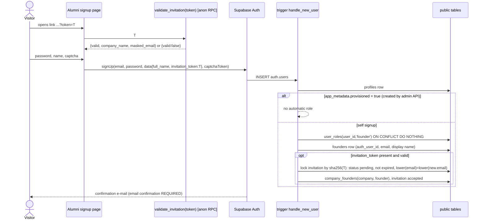

# Design 03 — Roles, Permissions and RLS

Status: **design only — nothing is implemented.** Labels: **[Decided]** = owner said so (`docs/11`, `docs/13`); **[As-is]** = found in code/DB (verified against `docs/06`, `docs/07`, `docs/09`, `docs/12` and read-only SELECTs on the local DB copy); **[Proposal]** = analyst recommendation (reason and alternatives given). Table names for the new model (`projects`, `nodes`, `edges`, `participants`, ...) are **provisional**: `04-database-design.md` is authoritative for the schema; this document defines who may touch them. No secrets or personal data appear here.

## 1. Goals and principles

| # | Principle | Label |
|---|---|---|
| P1 | RLS is the only real authorisation. UI guards (`RoleGuard`, `AlumniRouteGuard`) are convenience; role caches in `sessionStorage/localStorage` are UX only. | [Proposal] (today the same, but RLS is open: docs/07 §6) |
| P2 | Default deny: **no** `USING (true)` policy anywhere, anon has **no table grants**, only `EXECUTE` on a short list of narrow RPCs. | [Proposal] ([Decided] that open RLS must be fixed: docs/11 C1) |
| P3 | Authority never comes from `user_metadata` (user-editable). Roles come from `user_roles` only; membership from member tables; visibility from columns on the row. | [Proposal] |
| P4 | Every row-owning table carries `project_id` (denormalised, FK, NOT NULL) so a policy is one indexed check, not a join chain. | [Proposal] |
| P5 | Non-staff audiences (participants, anonymous) read **composed views through RPCs with a column whitelist**, never raw tables. | [Proposal] |
| P6 | Service role is used only inside server code (edge functions) after the caller has been authenticated and authorised; never in a browser or in Apps Script. | [Proposal] |

## 2. Role model

### 2.1 Facts [As-is]
- `app_role` enum: `super_admin | project_manager | alumni_manager | founder`; `user_roles(id, user_id, role, assigned_at, ...)` (docs/07 §5.3). Table `roles` (4 rows: `super_admin`, `project_manager`, `founder`, `alumni_manager`, with AR/EN names) is a legacy lookup, not referenced by FK.
- Live `user_roles` has `UNIQUE(user_id)` (one role per user) although migrations define `UNIQUE(user_id, role)`; local DB copy confirms: constraint `user_roles_user_id_unique`. Local data: **12 rows, all `super_admin`**; `project_managers` has **0 rows**.
- Frontend already treats roles as an array with priority `super_admin > project_manager > alumni_manager > founder` (docs/06 §3.1). No code assigns any role (`assignUserRole` has no callers). `me_team` / "M&E" is **not** a role in code or DB; the M&E team uses `alumni_manager` (docs/06 §2).
- `handle_new_user` (trigger on `auth.users`) creates only a `profiles` row.

### 2.2 Target model
- **[Decided]** A user can hold **several roles**; roles decide what the user sees (docs/11 C2).
- **[Proposal]** Storage: `user_roles(user_id uuid, role text REFERENCES roles(key), PRIMARY KEY(user_id, role))`, drop `UNIQUE(user_id)` and the redundant `id`, `assigned_at`/`created_at` pair collapses to `created_at, granted_by`. Using the existing `roles` table as an FK target (instead of the enum) lets the owner add roles (e.g. `me_team`) without an enum migration; alternative: keep the enum (stronger typing, but `ALTER TYPE ... ADD VALUE` per new role). Roles are **additive**: effective capability = union of capabilities.

| Role | Meaning | Granted by | Scope |
|---|---|---|---|
| `super_admin` | Platform owner; everything, including users/roles and secrets management | Another super_admin (bootstrap by SQL) | Global |
| `project_manager` (PM) | Creates Programs; manages Programs/Projects they are a member of | super_admin | Per program / per project via membership (§3) |
| `alumni_manager` | Runs the Alumni platform: founders, companies, invitations, notifications, opportunities, impact analytics | super_admin | Global over alumni data |
| `founder` | Founder of a startup in Athar programs | Automatically (§4) | Own data + projects they participate in |
| `integration` | Non-human account for server jobs (Apps Script poller) | super_admin | Only specific RPCs (§10) |
| `me_team` (optional) | See Open Decision 3 | super_admin | — |

- Membership is **not** a role: "PM of project X" = `project_manager` role **plus** a row in a member table. A `project_manager` with no membership sees nothing (except what they create).
- **[Proposal]** Role changes must take effect immediately for data access (RLS reads the table every query, with `(select auth.uid())` initplan caching). The client cache (60 s + stale-on-empty, docs/06 §3.1) may only affect which menu is drawn; add a sign-out/refresh on `SIGNED_IN`/`TOKEN_REFRESHED` and drop the "keep cache when server returns empty" rule.
- **[Proposal]** Guard-rails (trigger on `user_roles`): only `super_admin` may insert/update/delete; cannot delete the last `super_admin`; a user cannot grant themselves anything (already the case: writes are super_admin-only in docs/07 §6.2, this is kept).
- **[Proposal]** Multi-role UX: a user with `founder` + `project_manager` gets a context switcher; the guard evaluates "has any of the allowed roles", not `primaryRole` (fixes the RoleGuard/AlumniRouteGuard divergence, docs/06 §3.2).

## 3. Ownership and membership

### 3.1 Existing [As-is]
`project_managers(id, event_id, user_id, role_in_project owner|collaborator, assigned_at, assigned_by, project_id, added_at, added_by)` with **two duplicated column pairs** (`event_id`/`project_id` both FK to `events`; `assigned_*`/`added_*`) kept equal by trigger `sync_project_managers_columns`; `UNIQUE(event_id, user_id)`; RLS "own row / super_admin / owner" (docs/07 §4.6, §8.3). `programs` has **no** owner or member concept; its policies are "any authenticated user" (docs/07 §6.2). 0 rows, so nothing to migrate. `project_role` enum exists but is unused.

### 3.2 Target [Proposal]
```sql
program_members(program_id uuid FK, user_id uuid FK auth.users ON DELETE CASCADE,
                member_role text CHECK (member_role IN ('owner','manager')),
                added_by uuid, created_at timestamptz, PRIMARY KEY (program_id, user_id))
project_members(project_id uuid FK, user_id uuid FK, member_role text CHECK (member_role IN ('owner','manager')),
                added_by uuid, created_at timestamptz, PRIMARY KEY (project_id, user_id))
```
- One column per concept (no mirrors); `project_managers` is dropped (it is empty) and its two policies/triggers/functions with it. Owner = may manage members; manager = full edit of canvas and data. No finer role in v1 (the old `collaborator` maps to `manager`).
- Creator of a Program becomes its `owner`; creator of a Project inside it becomes its `owner`. **Program membership grants access to all its Projects** (`is_project_manager(p)` = project member OR member of `projects.program_id` OR super_admin) — so a PM does not need to be re-added to every project; per-project membership exists for guests working on one project only.
- Who adds PMs: a program/project `owner` or `super_admin`, but only users who already hold `project_manager` (enforced in an RPC `add_member`; direct INSERT only for super_admin).
- Visibility of the list: a PM sees only programs/projects they are a member of; super_admin sees all. Alternative (all PMs see all programs, edit only own) rejected as the default because programs hold participant PII; see Open Decision 2.

## 4. How a founder gets the `founder` role

### 4.1 Facts [As-is]
Neither flow exists today: no code or migration writes `user_roles('founder')`; `acceptInvitation` runs entirely in the browser (signUp with `user_metadata.role='founder'`, then client-side writes to `founders`/`company_founders`/`alumni_invitations`), and `user_metadata.role` is never read (docs/06 §6.1, §3.6 #2). Invitation tokens are readable by anyone (`alumni_invitations` SELECT `true`), revoked invitations still validate, tokens come in two formats, no e-mail is sent.

### 4.2 Requirement [Decided] (docs/11 C8–C10, docs/13 §4)
1. **Invitation link** → role `founder` automatically, user **linked to the existing company** from the invitation.
2. **Open signup on the Alumni page** → role `founder` automatically, **no company**; the founder creates their own.

### 4.3 Why `user_metadata` must not be trusted
`supabase.auth.signUp({options:{data}})` and `auth.updateUser({data})` let the user write any key into `raw_user_meta_data`, and that object is copied into the JWT as `user_metadata`. A policy or trigger that reads `user_metadata->>'role'` lets anyone mint `super_admin`. Only `raw_app_meta_data` (writable by service role / Admin API only) and DB tables are trustworthy. The role string is therefore **hard-coded inside the server function** (`'founder'`), and the client may only pass an opaque invitation token, which is validated against the database.

### 4.4 Mechanism [Proposal]
Extend the existing trigger `handle_new_user` (AFTER INSERT on `auth.users`, SECURITY DEFINER, `SET search_path = ''`):



Rules:
1. **Role is always the literal `founder`**; it never comes from metadata. The trigger wraps the invitation part in an EXCEPTION block so a bad token never blocks signup (the user simply becomes an unlinked founder = scenario 2), and never raises information to the caller.
2. **Invitation acceptance requires** token hash match, `status='pending'`, `sent_at + interval '14 days' > now()` (server clock; fixes the client-enforced expiry), **and** the invitation e-mail equals the signing-up e-mail (token possession plus confirmed mailbox). `revoked` is rejected (today it validates, docs/06 §6.1). The whole step runs under `SELECT ... FOR UPDATE` so a token is single-use.
3. **Admin-created accounts** (PMs, alumni managers, integration users) are created by an edge function `admin-create-user` (service role, super_admin only) that sets `app_metadata = {provisioned:true}`; the trigger then grants nothing, and the function writes the intended roles. This is the one place where "who is a staff member" is decided, using `app_metadata`, which users cannot edit.
4. **Already-registered invitee** (account exists): authenticated RPC `accept_invitation(token)` runs the same internal function `app_private.apply_invitation(auth.uid(), auth.email(), token)`; no client-side writes to `founders`/`company_founders`.
5. **E-mail confirmation must be on** (Auth setting; today the effect of this setting is unknown, docs/06 §5.1). Unconfirmed accounts have no session, hence no data access. Add CAPTCHA (e.g. Cloudflare Turnstile via Supabase Auth) and leaked-password protection (advisor WARN today, docs/07 §8.7) to limit scripted mass signup, because open signup = open creation of `founder` accounts.
6. **No automatic linking by e-mail** to a pre-existing `founders` row/company (today `getFounderProfileByAuth` auto-links by e-mail, docs/06 §3.6 #3): a self-registered founder is unlinked (matches [Decided] C10). Admin can link explicitly. See Open Decision 8.
7. Invitation tokens: generated server-side (`gen_random_bytes(24)`, base64url), only the **sha256 hash** is stored, the clear token is returned once to the manager (copied into the e-mail/link). One format only.
8. Anyone who signs up gets zero access beyond: own profile/founder row, own notifications, own company (if linked/created), and projects where they are participants (§5).

Alternatives considered: (a) a post-signup RPC only (needs a session; breaks when e-mail confirmation delays the first session) — kept only for the existing-account case; (b) disable Auth signups and route all signups through an edge function with service role (strongest control and rate limiting, but a custom endpoint to maintain) — acceptable fallback if CAPTCHA proves insufficient; (c) Auth Hook "before user created" — viable but adds an edge-function dependency on the signup path.

## 5. Participants: who may see a project, and what

### 5.1 Rule [Decided]
A founder sees a Program/Project if (a) **manually assigned** to the project by a PM, or (b) filled the project's outreach form and was **accepted through Selection** (docs/13 §4, docs/design/00 §6–7). Participant status `accepted | attended | withdrawn`; **certificates only for `attended`** (docs/13 update 3).

### 5.2 Data [Proposal]
```sql
participants(id uuid PK, project_id uuid FK NOT NULL, program_id uuid FK NOT NULL,   -- program_id denormalised
             user_id uuid NULL FK auth.users, company_id uuid NULL FK companies,
             status text CHECK (status IN ('accepted','attended','withdrawn')),
             source text CHECK (source IN ('manual','selection')), source_node_id uuid NULL,
             created_by uuid, created_at, updated_at,
             CHECK (user_id IS NOT NULL OR company_id IS NOT NULL))
```
- A row can target a **user** (assigned directly) or a **company** (then every founder linked to that company via `company_founders` is covered — co-founders see the program, and invited founders arrive already linked).
- Only PMs write it: manual add, status changes, and `accept_submission(submission_id)` RPC for Selection (the RPC inserts the participant, never the founder). Founders have **no** write path. Withdrawal initiated by a founder, if wanted, is an RPC that can only set `withdrawn` on their own row (Open Decision 6).
- Helper: `app_private.is_participant(project_id)` = exists participant row (`status IN ('accepted','attended')`) where `user_id = auth.uid()` or `company_id IN (companies of the caller via company_founders → founders.auth_user_id)`.

### 5.3 What a participant may read [Proposal]
| Item | Rule |
|---|---|
| Programs page (list) | Own participant rows → program/project name, cover, status. `withdrawn`: row visible with status only, no content. |
| Program page blocks | Only blocks the PM enabled: `projects.founder_page jsonb`, e.g. `{"enabled":true,"blocks":{"description":true,"agenda":true,"mentors":true,"companies":true,"details":true,"library":true,"certificate":true}}`. Nothing appears by default [Decided: docs/13 §11]. Served by RPC `get_participant_project_page(project_id)` which re-checks `is_participant` and the flags and returns a whitelisted JSON. |
| Agenda view | The agenda of that project only, tabs from nodes whose visibility is `platform` or `public` (§6). Served by `get_project_view(project_id)`. |
| Companies / mentors tabs | Only whitelisted fields per list (`exposed_fields` in the node config, default: name, logo, sector, bio; **never** e-mail/phone/national id unless the PM explicitly adds the field). |
| Certificate | Only when `participants.status='attended'` **and** the Program is `completed` [Decided: docs/13 §12]; row in `certificates` is created by a PM-side RPC (or the Certificates node), never by the founder. |
| Anything private | Never. |

## 6. Per-item visibility and anonymous public access

### 6.1 Model
- **[Decided]** Each item (program/project link, form, landing page, node view) is **public link** or **platform only**, optional per item (docs/13 §4). 00 §6 names the three values `private | platform | public`.
- **[Proposal]** Column `visibility text CHECK (visibility IN ('private','platform','public')) DEFAULT 'private'` on `nodes` (and on `projects` for the project's founder page). Semantics:
  - `private` — project members only (PM team).
  - `platform` — project members **plus participants of that project** (§5). Not "any logged-in user": because open founder signup exists (§4), "any authenticated user" would be effectively public (Open Decision 1).
  - `public` — additionally reachable anonymously through a capability link.
- **Edge rule [Proposal]:** an edge never raises exposure. A tab fed by node S inside agenda A is shown to audience X only if both `S.visibility` and `A.visibility` allow X. A private Companies list connected to a public Agenda yields no Companies tab for anonymous viewers.

### 6.2 Anonymous access without anon table policies [Proposal]
Today every public page (agenda, forms, booking, mentoring live view, Join Athar, certificate verifier) reads tables directly with the anon key and `USING (true)` (docs/07 §6.2, docs/09 SEC-1/2/5). Replace by:

```sql
public_links(id uuid PK, project_id uuid, node_id uuid NULL, resource_type text,  -- 'project'|'node'
             token text UNIQUE NOT NULL,          -- >=128-bit random, base64url; legacy ids allowed (see below)
             slug text UNIQUE NULL,               -- cosmetic, never an authorisation factor
             is_enabled boolean DEFAULT true, expires_at timestamptz NULL, created_by, created_at)
```
- Anonymous reads = **SECURITY DEFINER RPCs** keyed by token: `get_public_view(token)`, `get_public_form(token)`, `submit_form_response(token, answers, hp, captcha)`, `get_public_booking_page(token)`, `create_booking(token, slot_id, ...)`, `get_public_landing(token)`, `track_landing_event(token, ...)`, `verify_certificate(code)`. Each re-checks `public_links.is_enabled`, expiry, `visibility='public'`, and returns an explicit column list in JSON (no `*`, no mentor e-mail/meet link unless the owner adds them).
- Why RPC rather than anon policies or views: a view cannot take the token as a parameter, so it would have to expose all `public` rows to anyone who enumerates it through PostgREST; an anon `SELECT` policy cannot express "the caller knows this token". A function can (`WHERE token = $1`). Alternative: edge functions with service role for everything — adds a hop and cold starts for read-only pages; kept for **writes** (§9).
- Disabling a link is one UPDATE; rotating a token invalidates old shares. Links never contain a database primary key as the only secret **for new items**.
- **Legacy links:** shared URLs today embed `events.event_id` (`#/view/<eventId>/...`, `?agenda=<id>`, docs/09 A-22). Migration seeds `public_links.token = event_id::text` for existing public items so already-circulated links keep working (UUID v4 = 122 random bits, acceptable as a capability **once the table is no longer listable**); new items get fresh tokens. See Open Decision 9.
- Mutating public actions (form submit, booking, analytics) go through RPC/edge code that enforces: token valid, form `is_active`, field whitelist and size limits, honeypot, CAPTCHA, per-IP/per-token rate limit (edge function), uniqueness rules (e.g. one booking per slot — atomic `UPDATE mentor_slots SET is_available=false WHERE id=$1 AND is_available RETURNING`), and never echo stored data back.

## 7. Permission matrix (role × resource × action)

C=create, R=read, U=update, D=delete, —=none. "PM-member" = PM who is a member of the program/project (owner or manager); "PM-other" = PM with no membership. "Participant" = founder with a participant row. [Proposal] throughout; fixed items are noted.

| Resource | Anonymous | Founder (not participant) | Founder (participant) | PM-member | PM-other | Alumni manager | Super admin |
|---|---|---|---|---|---|---|---|
| Programs (settings, completed flag) | R only via public link RPC, if enabled | — | R own via page RPC | CRU (D owner only) | C (own new) | R (counts only) | CRUD |
| Projects (details, founder_page flags) | public RPC if public | — | R enabled blocks | CRUD (owner D) | — | — | CRUD |
| Canvas: nodes, edges, node config | — | — | — | CRUD | — | — | CRUD |
| Node data: list items, agenda days/slots, distribution, resource library | public RPC if node public | — | R via view RPC if platform/public | CRUD | — | — | CRUD |
| Forms (definition) | R definition via token if public | — | R if platform | CRUD | — | — | CRUD |
| Form responses / selection submissions (PII) | C via submit RPC only | — | own submission only (R) | R U (status), D owner | — | — | CRUD |
| Mentor / Ather-team booking: slots | R via public RPC | — | R if platform | CRUD | — | — | CRUD |
| Bookings | C via RPC (atomic) | — | own via RPC | RU, D | — | — | CRUD |
| Participants | — | — | R own row | CRUD | — | R (read-only, analytics) | CRUD |
| Certificates | verify by code (RPC) | — | R own if `attended` | issue/revoke (CUD) | — | R | CRUD |
| Email settings (templates, sender) per project | — | — | — | CRU | — | — | CRUD |
| Own Gmail credentials (per-PM, design 07) | — | — | — | own only: connect/revoke; no read of tokens | own only | — | revoke any (no read of tokens) |
| Athar Network (`master_experts`, mentor registry) | — | — | — | R (all), C/U via sync | R | R | CRUD |
| Companies | — | CRU **own** (via `company_founders`) | CRU own, R co-participants if enabled | R companies in their projects, U overlay via lists | — | CRUD `is_alumni` | CRUD |
| Founders (PII) | — | RU own row | RU own row | R only founders referenced by participants/submissions in their projects | — | CRUD | CRUD |
| Company snapshots, opportunities, applications, investor requests | — | own company snapshots C/R, applications C/R | same | — | — | CRUD | CRUD |
| Alumni invitations | validate via RPC (masked) | — | — | — | — | CRUD | CRUD |
| Notifications | — | R/U own | R/U own | — | — | C (broadcast), R sent | CRUD |
| Users / `user_roles` / members of others' projects | — | — | — | members of own project (owner only) | — | — | CRUD |
| `google_settings`, `smtp_settings`, Vault secrets | — | — | — | — | — | — | write via edge function only; **no read** of secret values from any client |
| Storage objects | public bucket read only | own profile photo | read project public assets | write under own project prefix | — | alumni prefix | all |

## 8. RLS design (replaces the current open policies)

### 8.1 Baseline grants and hardening [Proposal]
```sql
-- 1) Nothing for anon by default; Supabase default privileges grant everything to anon/authenticated.
REVOKE ALL ON ALL TABLES    IN SCHEMA public FROM anon, authenticated;
REVOKE ALL ON ALL SEQUENCES IN SCHEMA public FROM anon, authenticated;
REVOKE EXECUTE ON ALL FUNCTIONS IN SCHEMA public FROM PUBLIC, anon, authenticated;
ALTER DEFAULT PRIVILEGES IN SCHEMA public REVOKE ALL ON TABLES FROM anon, authenticated;
ALTER DEFAULT PRIVILEGES IN SCHEMA public REVOKE EXECUTE ON FUNCTIONS FROM PUBLIC, anon, authenticated;
-- 2) Grant per table to authenticated only the verbs its policies use; ENABLE + FORCE RLS everywhere
ALTER TABLE public.<t> ENABLE ROW LEVEL SECURITY;   -- including the 4 tables that have it off today
-- 3) Only whitelisted public RPCs get GRANT EXECUTE ... TO anon (section 6.2)
```
- Every table (incl. `master_experts`, `booking_notifications`, `email_audit_log`, `ather_team_bookings` which are **RLS-off** today, docs/07 §1) gets RLS enabled; policies are written **per command** (`FOR SELECT/INSERT/UPDATE/DELETE`), `TO authenticated` explicitly, no `ALL`, no `PUBLIC`.
- Policies are replaced as a set: `DROP POLICY` for all 132 existing policies in one migration (local DB count), then create the new set; no "merge" with the old ones, because permissive policies OR together (this is why today's role-based policies are inert, docs/07 §6.2).
- Performance: wrap calls as `(select app_private.is_project_manager(project_id))` so the planner caches per statement; index every `project_id`, `user_id`, `company_id` used in policies.

### 8.2 Helper functions [Proposal]
Placed in a **non-exposed schema** `app_private` (not in PostgREST "Exposed schemas"), so they are usable in policies but not callable as `/rest/v1/rpc/*`. Today's `public.is_super_admin/has_role/is_project_*` are callable by anon with arbitrary user ids, `get_user_roles(uuid)` has a mutable `search_path` and returns any user's roles (docs/07 §5.1, §8.5 #7).

```sql
CREATE FUNCTION app_private.has_role(r text) RETURNS boolean
LANGUAGE sql STABLE SECURITY DEFINER SET search_path = '' AS $$
  SELECT EXISTS (SELECT 1 FROM public.user_roles WHERE user_id = (SELECT auth.uid()) AND role = r) $$;
CREATE FUNCTION app_private.is_super_admin() RETURNS boolean ... has_role('super_admin') ...
CREATE FUNCTION app_private.is_program_member(p uuid) ...   -- program_members row, or super_admin
CREATE FUNCTION app_private.is_project_manager(p uuid) RETURNS boolean ... $$
  SELECT app_private.is_super_admin()
      OR EXISTS (SELECT 1 FROM public.project_members m WHERE m.project_id = p AND m.user_id = (SELECT auth.uid()))
      OR EXISTS (SELECT 1 FROM public.projects j JOIN public.program_members pm ON pm.program_id = j.program_id
                 WHERE j.project_id = p AND pm.user_id = (SELECT auth.uid())) $$;
CREATE FUNCTION app_private.is_project_owner(p uuid) ...
CREATE FUNCTION app_private.is_participant(p uuid) ...       -- section 5.2
CREATE FUNCTION app_private.my_company_ids() RETURNS SETOF uuid ...   -- via founders.auth_user_id + company_founders
CREATE FUNCTION app_private.node_project(n uuid) RETURNS uuid ...     -- only where a table lacks project_id
```
Rules: no `user_id` parameters (only `auth.uid()`), `SECURITY DEFINER` + `SET search_path = ''` + fully qualified names, `STABLE`, `REVOKE EXECUTE ... FROM PUBLIC` then `GRANT EXECUTE TO authenticated` (policies of anon-reachable tables never call them; anon has no table access anyway). The same `SET search_path` fix applies to the 9 mutable-path trigger functions (`update_*_updated_at`, `handle_expert_auto_index`, `broadcast_master_expert_updates`, `sync_project_managers_columns` (dropped), docs/07 §8.7). Role lookups read the table, **not** JWT claims, so revocation is instant; an Auth "custom access token hook" that embeds roles is an optional later optimisation (stale until token refresh).

### 8.3 Policy design by table family
`PM` below always means `app_private.is_project_manager(project_id)` (includes super_admin). Policy names follow `<table>_<cmd>_<who>`.

| Family / tables | SELECT | INSERT | UPDATE | DELETE | Notes |
|---|---|---|---|---|---|
| **Identity**: `profiles` | own, or any user who is a member of one of my projects (for names/avatars) | via trigger only | own | — | `avatar_url` stays |
| `user_roles` | own rows; super_admin all | super_admin | super_admin | super_admin | + last-super_admin trigger (§2.2) |
| `roles` | authenticated | — | — | — | static |
| `program_members`, `project_members` | members of the program/project; super_admin | owner (via `add_member` RPC) / super_admin | owner (role change) | owner / super_admin / self (leave) | |
| **Structure**: `programs` | member; super_admin | PM role holder (creator becomes owner via trigger) | member (owner for status `completed`) | owner | replaces "any authenticated" |
| `projects` (≈`events`) | member; participants via RPC only | PM role holder who is program member | PM | owner | `visibility`, `founder_page` writable by PM |
| `nodes`, `edges` | PM | PM | PM | PM | `project_id` on both; `edges` CHECK both nodes in same project |
| `participants` | PM; own rows (`user_id = uid` or company in `my_company_ids()`) | PM / RPC `accept_submission` | PM (status); founder never | PM | |
| `public_links` | PM | PM | PM | PM | tokens are generated by trigger, not by client |
| **Forms**: form definitions, field configs, `form_covers`, `form_share_events` | PM | PM | PM | PM | public read via RPC. `form_share_events` INSERT via `track_*` RPC |
| `library_forms` (global templates) | PM role holders (read), super_admin writes global | super_admin (global) / PM (project-scoped) | same | same | `scope` column decides |
| `form_responses`, `company_submissions`, `expert_submissions` (PII, `national_id`, phone, email) | PM; the submitting founder reads own (`user_id`/email match) if logged in | **none for clients** (RPC/edge only) | PM (status, review fields only; column list enforced by RPC or `REVOKE UPDATE (cols)`) | owner | Realtime: only authenticated PM channel; table removed from anon-readable realtime |
| **Lists / experts / companies (project-scoped)**: list nodes and items, `experts`, `companies` (event-scoped part) | PM; founders: companies via `my_company_ids()` | PM | PM; founder: own company columns whitelist via RPC | PM | overlay fields (status, notes) are PM-only |
| `master_experts` (Athar Network) | any PM role holder, alumni_manager | PM role holder | PM role holder (trigger syncs) | super_admin | RLS enabled (off today) |
| **Agenda & library**: `event_days`, `agenda_slots`, `library_resources` | PM | PM | PM | PM | public/participant via view RPC |
| **Booking** (mentors, slots, bookings, Ather-team clones, notifications, day config) | PM | PM for slots/config; bookings by RPC only | PM; booker cancel via signed token RPC | PM | `booking_notifications`, `ather_team_bookings` RLS ON. No `meet_link`/mentor e-mail in public RPC output |
| **Mentoring distribution**: config, day config, `mentoring_sessions` | PM | PM | PM | PM | timer channel see §9.4 |
| **Landing / Join Athar**: pages, cards, share presets | PM | PM | PM | PM | public via `get_public_landing`; `join_athar_analytics` INSERT via RPC only, SELECT PM |
| **Alumni**: `founders` | self (`auth_user_id = uid`); alumni_manager; PM for referenced founders | trigger / alumni_manager | self (whitelist, not `auth_user_id`/`email` after link); alumni_manager | alumni_manager | removes public PII |
| `company_founders` | own links; alumni_manager | alumni_manager / invitation RPC / founder when creating own company | alumni_manager | alumni_manager | |
| `program_participations` (legacy) | — | — | — | — | folded into `participants`; read-only archive until migrated |
| `company_snapshots` | `company_id IN my_company_ids()`; alumni_manager; PM-of-participating | own company (founder) / alumni_manager | none (immutable) / alumni_manager | none | |
| `certificates` | founder own `attended`; alumni_manager; PM | PM RPC | PM | super_admin | verification via RPC only |
| `opportunities` | authenticated founder/manager roles, `is_active` | alumni_manager | alumni_manager | alumni_manager | |
| `opportunity_applications`, `investor_requests` | own company; alumni_manager | own company founder | alumni_manager | — | `investor_requests` no longer open to every authenticated user (docs/07 §8.5 #6) |
| `alumni_invitations` | alumni_manager, super_admin only | alumni_manager | same (revoke, resend) | same | no anon/founder access; token stored hashed; validation by RPC (§4.4) |
| `notifications` | `recipient_id = uid`; sender manager | alumni_manager | own `is_read` only | — | the `recipient_id IS NULL` rows visible to everyone are removed: broadcasts to unregistered founders are materialised when the founder registers |
| **Settings / secrets**: `google_settings`, `smtp_settings`, `email_audit_log`, per-PM Gmail credentials | see §11 | | | | no client policy at all |

### 8.4 Policy templates (sketch)
```sql
-- project-owned table
CREATE POLICY t_select_pm ON public.<t> FOR SELECT TO authenticated
  USING ((SELECT app_private.is_project_manager(project_id)));
CREATE POLICY t_write_pm  ON public.<t> FOR INSERT TO authenticated
  WITH CHECK ((SELECT app_private.is_project_manager(project_id)));   -- + UPDATE (USING + WITH CHECK, so project_id cannot be moved) / DELETE
-- own-row table
CREATE POLICY n_select_own ON public.notifications FOR SELECT TO authenticated USING (recipient_id = (SELECT auth.uid()));
```
`UPDATE` policies always carry **both** `USING` and `WITH CHECK`, and a trigger forbids changing `project_id`, so a PM cannot move rows into someone else's project.

## 9. Server-side code, public writes and realtime

### 9.1 Edge functions [As-is → Proposal]
[As-is] All functions use the **service-role** client and `Access-Control-Allow-Origin: *`; `process-booking` accepts any `booking_id` from anyone; senders accept any `{eventId, submissionIds}`; `verify_jwt` settings are not in the repo (docs/09 S-7, SEC-6, docs/08).

| Function | Caller | Authentication / authorisation [Proposal] |
|---|---|---|
| `send-acceptance/rejection/interview-emails` | PM in browser | `verify_jwt = true`; read `Authorization` JWT, create a **user-scoped** client; check `is_project_manager(project_id)` through RPC `can_manage_project(project_id)`; load rows **with the user client** (RLS enforces); use service role only for secrets (SMTP/Gmail) and `email_audit_log` insert; derive recipients from stored rows, not from the request body |
| `send-booking-notifications`, `process-booking`, `generate-google-meet` | public booking flow or PM | not callable directly by anon: invoked by the `create_booking` RPC/edge flow with an **HMAC-signed booking reference**, or by PM JWT; verify the booking exists, is `pending` and belongs to the token's project; idempotency via atomic claim (§10) |
| public form submit / upload-URL / landing analytics | anonymous | `verify_jwt = false` **by design**, but token check, field whitelist, size/MIME limits, CAPTCHA, rate limit, then service-role insert |
| `admin-create-user`, `rotate/ revoke secrets` | super_admin | `verify_jwt = true` + `has_role('super_admin')` |
| `share` (OG/meta HTML) | anyone | read-only RPC on `get_public_view_meta(token)`, no PII |
| `notify-google-apps-script` | — | retire with the poller (§10) |

General: restrict CORS to `https://athareg.com` (+ local dev origins), never `*` for authenticated functions; return generic errors; log caller `user_id`; never accept `user_id`/`role` from the body.

### 9.2 Form portal files [Proposal]
Replace the anon upload (`event-assets/portal-uploads/`, docs/09 S-4) by an edge function that validates the token and issues a **signed upload URL** to a private bucket with size/MIME limits.

### 9.3 Content safety [Proposal]
Manager-authored HTML (notifications) must be sanitised (DOMPurify) on render in both portals (`dangerouslySetInnerHTML`, docs/06 §5.3); Sheets export must write with `RAW` or prefix formula-leading cells (docs/09 S-5) — both belong to the implementation of their nodes but are listed in §12.

### 9.4 Realtime [As-is → Proposal]
[As-is] Mentoring timer uses a **public broadcast channel** `mentoring_timer_<eventId>` (anyone knowing/guessing the id can send PAUSE/RESET/ADJUST) and `presence:<roomId>` for active users; `company_submissions` is in the `supabase_realtime` publication (docs/09 SEC-5, docs/07 §5.5). [Proposal] Use **private channels** (`config:{private:true}`) with Realtime Authorization policies on `realtime.messages`:
```sql
-- receive: project members, participants (platform) or anyone for a public live view
CREATE POLICY timer_receive ON realtime.messages FOR SELECT TO authenticated, anon
  USING (extension IN ('broadcast','presence')
         AND app_private.can_view_timer(realtime.topic()));   -- topic 'mentoring_timer:<node_id>'; checks node visibility
-- send: only PMs of that node's project
CREATE POLICY timer_send ON realtime.messages FOR INSERT TO authenticated
  WITH CHECK (extension = 'broadcast' AND app_private.is_project_manager(app_private.node_project_from_topic(realtime.topic())));
```
Presence channels: authenticated only, topic bound to a project the user can read. Postgres-changes subscriptions respect table RLS automatically once §8 is in place (confirm the installed Realtime version on the local stack supports Realtime Authorization before relying on it).

## 10. Server-side jobs after RLS is tightened

### 10.1 Apps Script poller [As-is]
Time-driven every minute in `startups@athareg.com`; reads **all** rows of `bookings` and `ather_team_bookings`, and the whole `events` table per booking, with a **hard-coded anon key**, then PATCHes `status/meet_link/calendar_event_id/error_message` on the booking and `meet_link` on the slot; it may duplicate work done by `process-booking` (docs/12 §3–§6). It works only because anon can read/update those tables today. **Any** RLS tightening breaks it; the anon key must not be given rights again.

### 10.2 Options [Proposal]
| Option | How it authenticates | Pros | Cons |
|---|---|---|---|
| **A. Retire the poller**; Calendar/Meet created by an edge function (per-PM Gmail design in doc 07) triggered synchronously by `create_booking` or by a database webhook | service role inside the function | removes the external secret and the double-creation window; no polling | needs doc 07's design; `pg_net` is not installed today (docs/07 §5.4) if DB webhooks are used |
| **B. Keep it, dedicated identity (recommended as the transition)** | A real Auth user `poller@…` with role `integration`; script signs in (`/auth/v1/token?grant_type=password`) with credentials stored in **Script Properties** (not source), uses the returned JWT | RLS-compatible, revocable, auditable, no service key outside Supabase | password in Script Properties; token refresh logic in the script |
| C. Static shared secret header to an edge function using service role | secret in Script Properties | simplest to write | one secret = full service-role power behind it; weaker audit |

B detail: the integration user has **no table grants beyond RPCs**:
```sql
CREATE FUNCTION public.poller_claim_bookings(p_limit int DEFAULT 20) RETURNS TABLE (...)  -- SECURITY DEFINER, search_path=''
-- checks app_private.has_role('integration'); SELECT ... WHERE meet_link IS NULL AND status IN (NULL,'pending')
-- FOR UPDATE SKIP LOCKED; sets status='processing', processing_started_at=now(); returns only the columns needed
-- (times, mentor/booker e-mails, meeting_link_mode, shared link, attendee lists) joined server-side (no full events download)
CREATE FUNCTION public.poller_complete_booking(p_kind text, p_id uuid, p_meet_link text, p_calendar_event_id text) ...
CREATE FUNCTION public.poller_fail_booking(p_kind text, p_id uuid, p_error text) ...
```
`GRANT EXECUTE ... TO authenticated` only, each function begins with `IF NOT has_role('integration') THEN RAISE`. The atomic claim also closes the double Calendar-event race with `process-booking` (that function must use the same claim). Stuck `processing` rows older than N minutes are reclaimable. The script's `doPost` web-app endpoint (no auth, docs/12 §2) is undeployed or protected by a secret. The old hard-coded anon key in `Code.gs` and `api-agennda-intervew.gs` is removed from source (it is public-by-design and needs no rotation, but must stop being a capability).

### 10.3 Other server jobs
Edge functions run as service role **after** §9.1 checks; scheduled jobs (if any are added, e.g. reminder e-mails) use `pg_cron` + edge function with a function-specific secret, never the anon key.

## 11. Sensitive tables and secrets

| Asset | As-is | Target [Proposal] |
|---|---|---|
| `google_settings.service_account_key` | Plaintext column, **public SELECT/INSERT/UPDATE**, read in the browser to sign a JWT (docs/09 S-1/SEC-2); owner says the key was **not rotated** and the full key is also in a tracked repo file (docs/11 C6) | Remove the column. Key lives in **Supabase Vault** (or function secrets) and is read only by edge functions with the service role. Table keeps non-secret config (`calendar_id`, `impersonate_email`, `secret_ref`) with PM-only policies. Sheets sync moves server-side. **Owner action: rotate the key now and purge it from git history; deleting it from the table does not undo the exposure.** |
| `smtp_settings` (`smtp_pass`) | RLS on, no policy (service role only) — good, but plaintext and grants still given to anon/authenticated | Keep zero client policies, `REVOKE ALL` from anon/authenticated, store password in Vault; super_admin edits via edge function |
| Per-PM Gmail tokens (doc 07 design) | n/a | Table `user_email_credentials` with refresh token encrypted (Vault/pgsodium); **no SELECT policy for any client**, not even the owner; connect/revoke via edge function; only the sending function reads it with service role |
| `founders` (e-mail, phone) | public read/write | §8.3: self / alumni_manager / minimal PM view |
| `company_submissions` (`national_id`, phone, e-mail) | anon read + insert; realtime | PM-only; insert via RPC; **`national_id` stored encrypted or removed** (Open Decision 7); PM exports audited |
| `alumni_invitations` (`token`) | anon-readable, two formats, revoked tokens valid | managers only; hashed token; server-side expiry/revocation; masked validation RPC |
| `notifications` | rows with NULL recipient visible to every authenticated user | §8.3 |
| Realtime timer / presence | public broadcast | §9.4 |
| `email_audit_log` | RLS **off**, anon-writable | RLS on, insert by service role only, SELECT PM of its project / super_admin |
| `certificates.verification_code` | 12 hex chars, open table | codes ≥ 16 random chars for new ones; table closed; `verify_certificate(code)` returns name/program/date only; rate-limited |

### 11.1 Storage [As-is → Proposal]
[As-is] One **public** bucket `event-assets` (112 objects), policies: public SELECT; **public INSERT**; no UPDATE/DELETE policy; orphan policies for a non-existent bucket `event-covers`; no size or MIME limit (docs/07 §7; confirmed on local DB).

| Bucket | Public? | Content | Policies |
|---|---|---|---|
| `public-assets` | read public | covers, logos, expert photos, landing images, form covers | SELECT public; INSERT/UPDATE/DELETE `TO authenticated` only when `(storage.foldername(name))[1]` = a project/program id the user manages; `file_size_limit` 5 MB, MIME `image/png,jpeg,webp,gif` (no SVG unless sanitised) |
| `form-uploads` | private | files uploaded through public forms | no direct policy for anon; signed upload URL from edge function; SELECT PM of the project (signed read URLs) |
| `founder-assets` | private | founder photos, company logos by founders | prefix `founders/<auth.uid()>/…` self write/read; alumni_manager read; display copies go through signed URLs or are copied to `public-assets` only if the founder opts in |
| `certificates` | private | generated certificate PNG/PDF | write by PM RPC/edge; read by the attended founder and PMs |

`event-covers` is **not created**: its three orphan policies are dropped and the Join Athar images move to `public-assets/<project>/landing/` (Open Decision in docs/07 §11 #8 resolved by this design). Existing 112 objects are moved/copied and URLs rewritten during migration (design 05).

## 12. Threats and how the design closes them

| # | Threat / finding (source) | Closed by |
|---|---|---|
| T1 | Anonymous read/write of 33 tables via anon key (docs/07 §6.2, docs/09 S-2) | §8.1 revokes anon grants, per-command policies, anon only via RPC |
| T2 | 4 tables with RLS disabled, `smtp_settings` policy-less (docs/07 §8.7) | RLS ON everywhere, FORCE, zero client grants for secrets |
| T3 | Service-account private key readable by anyone, used in browser, not rotated (S-1, SEC-2/3, C6) | Vault, server-side Sheets, owner rotates + purges history (§11) |
| T4 | PII exposed: founders, submissions (`national_id`), invitation tokens (docs/07 §8.5 #4) | §8.3 PM/self/alumni_manager policies, hashed tokens, `national_id` decision |
| T5 | Role escalation through `user_metadata.role` (written, never read; would be unsafe to read) (docs/06 §3.6) | §4.3: roles only from `user_roles`; trigger writes literal `'founder'`; staff created with `app_metadata` by service role |
| T6 | Invitation abuse: public tokens, revoked still valid, client-side expiry, two formats (docs/06 §6.1) | §4.4 rules 2, 7; manager-only table |
| T7 | Mass fake founder signup | CAPTCHA + e-mail confirmation + leaked-password check; founder role carries near-zero rights; edge-function signup as fallback |
| T8 | `get_user_roles`/`is_*` callable by anon with arbitrary user ids; mutable `search_path` (docs/07 §5.1, §8.5 #7) | `app_private` schema, no user-id params, `search_path=''`, revoke from PUBLIC/anon |
| T9 | Edge functions with service role, CORS `*`, no caller check; `process-booking` for any booking id (S-7, SEC-6) | §9.1: JWT + project check, user-scoped reads, signed booking reference, atomic claim, origin allow-list |
| T10 | Poller uses anon key; RLS change breaks it; duplicate Meet events (docs/12 §5–6) | §10: integration user + RPCs, atomic claim, or retirement |
| T11 | Public mentoring/booking pages read and **write** with anon (SEC-1, SEC-5); mentor e-mail/meet link in public responses | token-keyed RPC with column whitelist; writes only PM; atomic slot claim |
| T12 | Unauthenticated timer channel (SEC-5) | §9.4 private channels with send restricted to PMs |
| T13 | Public bucket upload with no limits; orphan `event-covers` policies (S-4, docs/07 §7) | §11.1 buckets, folder-scoped write policies, signed uploads, limits |
| T14 | Bots/duplicate submissions, formula injection, stored XSS (S-5, S-6, docs/06 §5.3) | RPC/edge submit with CAPTCHA, rate limit, honeypot; Sheets `RAW`; DOMPurify |
| T15 | Founder opens any company id; notifications with NULL recipient visible to all (docs/06 §3.3, §6.3) | §8.3 `my_company_ids()`, per-recipient notifications |
| T16 | Stale cached roles after revocation (docs/06 §3.1) | RLS authoritative; client cache UX-only |
| T17 | Hard-coded Supabase URL/anon key (docs/09) | Not a secret, but with §8 the anon key has no data power; move to env for maintainability (design 06) |
| T18 | Cross-project data move/ID guessing (event_id TEXT without FK) | `project_id` FK on every table, immutable by trigger; capability tokens ≥128 bit |
| T19 | Certificate forgery/enumeration (12-hex codes, open table) | RPC-only verify, longer codes, rate limit, `attended` + completed required to issue |
| T20 | Public enumeration of public links by listing tables | `public_links` has no anon access; lookup only by exact token |

## 13. Migration and rollout of access control [Proposal]
1. Build and test everything on the **local** stack only (no remote action without owner approval, docs/13 §7).
2. Order: (a) create `app_private` helpers, new member/participant/public-link tables; (b) migrate data (design 05): `user_roles` cleanup, `project_managers` (0 rows) dropped; (c) add RPCs and edge functions; (d) switch the frontend to RPCs; (e) **only then** drop the old policies and revoke anon grants — otherwise public pages and the poller break.
3. Add an automated test per table: for roles `anon`, founder, participant, PM-member, PM-other, alumni_manager, super_admin run `SELECT/INSERT/UPDATE/DELETE` under `SET ROLE` + `request.jwt.claims` and assert allow/deny (matrix §7). Re-run the Supabase security advisor (expected: zero "RLS disabled", zero "policy always true", zero anon-executable SECURITY DEFINER).
4. Seed: the 12 current `super_admin` accounts are preserved (migration must not lock the owner out); see Open Decision 4.

## 14. Notes on 00-conceptual-model
1. §6 says "Users can have several roles (live DB currently enforces one)"; confirmed (`UNIQUE(user_id)`), this doc specifies the migration to `(user_id, role)`.
2. 00 has **no Program-level membership** (who may see/manage a Program) — added in §3 (`program_members`) and needed by the Program Settings page.
3. 00 §6 uses `platform` visibility without defining the audience; with open founder signup it must not mean "any authenticated user" — defined in §6.1 (Open Decision 1).
4. 00 §7: "Selection nodes write participant records" — in RLS terms only an RPC executed by a PM can write `participants` (§5.2); the Selection node calls it, founders never do.
5. 00 §10 lists no row for secrets/credential handling or realtime channels; they are covered here (§9–§11) and should be cross-referenced from design 07 (Gmail tokens) and 04 (buckets).
6. `ME`/M&E team appears in user requests but is not a role in code or in 00 (docs/06 §2); see Open Decision 3.
7. Legacy `program_participations` (alumni impact) overlaps the new `participants`; the migration plan (05) must decide the archive/merge so alumni analytics keep working.

## 15. Open Decisions for the Owner

| # | Question | Options | Recommendation |
|---|---|---|---|
| 1 | What does "platform only" mean? | (a) any logged-in user; (b) participants of that project + staff; (c) all founders in any Athar program | (b). With open founder signup, (a) is effectively public. |
| 2 | Can a PM see programs/projects they are not a member of? | (a) no, membership-scoped; (b) read-all, edit-own | (a), because projects hold founder PII; super_admin sees all. |
| 3 | Is the M&E team a separate role? | (a) keep as `alumni_manager`; (b) add `me_team` (read analytics + create snapshots, no invitations/notifications) | (a) now; the `roles`-table design lets (b) be added without migration. |
| 4 | All 12 existing accounts are `super_admin` (the Phase-2 migration seeded every profile as super admin) | keep / demote chosen ones to `project_manager` or `alumni_manager` | Review each account before the cut-over; least privilege. |
| 5 | Signup abuse control | CAPTCHA+confirm (recommended); disable Auth signup and use an edge function | CAPTCHA + mandatory e-mail confirmation first; edge function if abuse appears. Also: should the main-app login stay separate from the Alumni login? |
| 6 | Can a founder withdraw themselves, and what does a `withdrawn` founder still see? | PM-only / founder-initiated; nothing / status only | Founder may request, PM confirms; `withdrawn` sees the program card with status only. |
| 7 | Do we need to store `national_id` in submissions? | remove / encrypt in Vault with audited reveal / keep | Remove unless a real need exists; otherwise encrypt. |
| 8 | Link existing `founders` rows to a new account by e-mail? | never / only via invitation / auto on confirmed e-mail | Only via invitation or manual admin link (keeps [Decided] C10 clean). |
| 9 | Legacy public links (event_id inside URLs) | keep working via `token = event_id`, then rotate gradually / reissue all | Keep working; rotate per item when a PM asks or after a deadline. |
| 10 | Poller | retire after doc 07's Gmail/Calendar design / keep with integration user | Integration user (option B) as the bridge, retire when per-PM Gmail ships. |
| 11 | Rotation of the leaked service-account key | now / later | **Now** (owner action in Google Cloud); history purge of `مشكلة روابط جوجل ميت لا تعمل.md`. |
| 12 | Should alumni_manager see project-level participants (names/status) for impact analytics? | read-only participants / aggregates only | Read-only participants (needed by the existing analytics; no write). |
| 13 | Are co-founders of a participating company all participants? | all linked founders / only the named user | All founders linked to the company (rule §5.2), unless the PM assigns a single user. |
