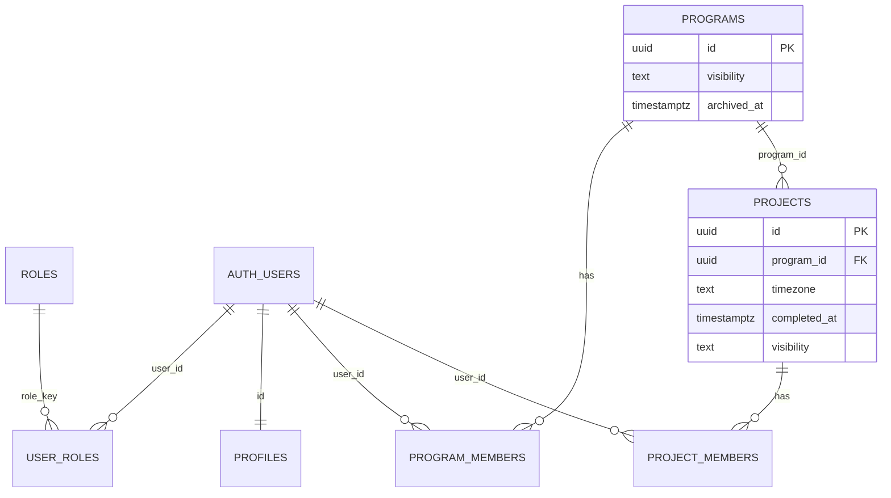
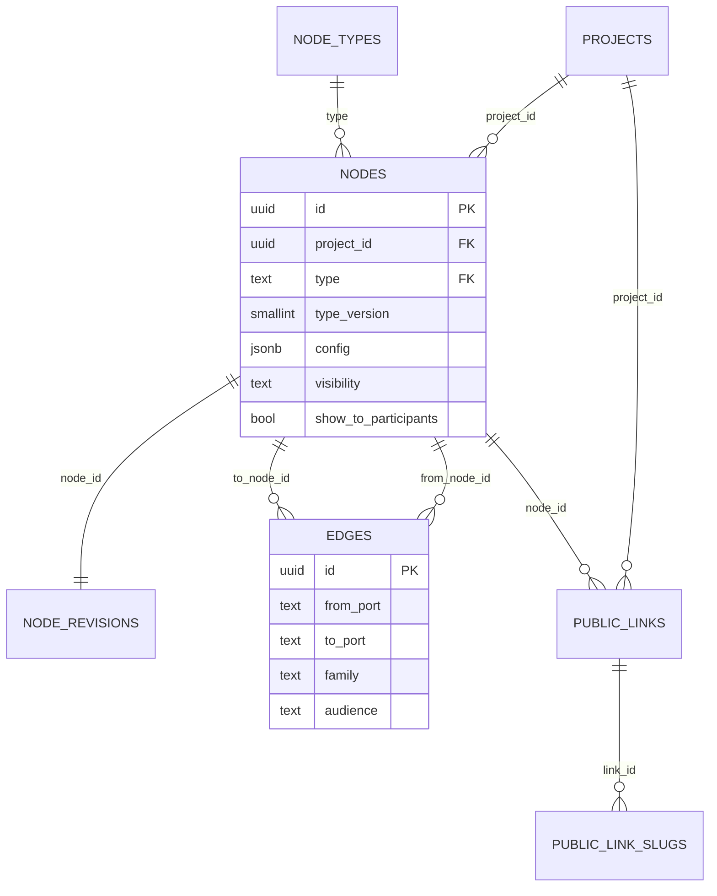
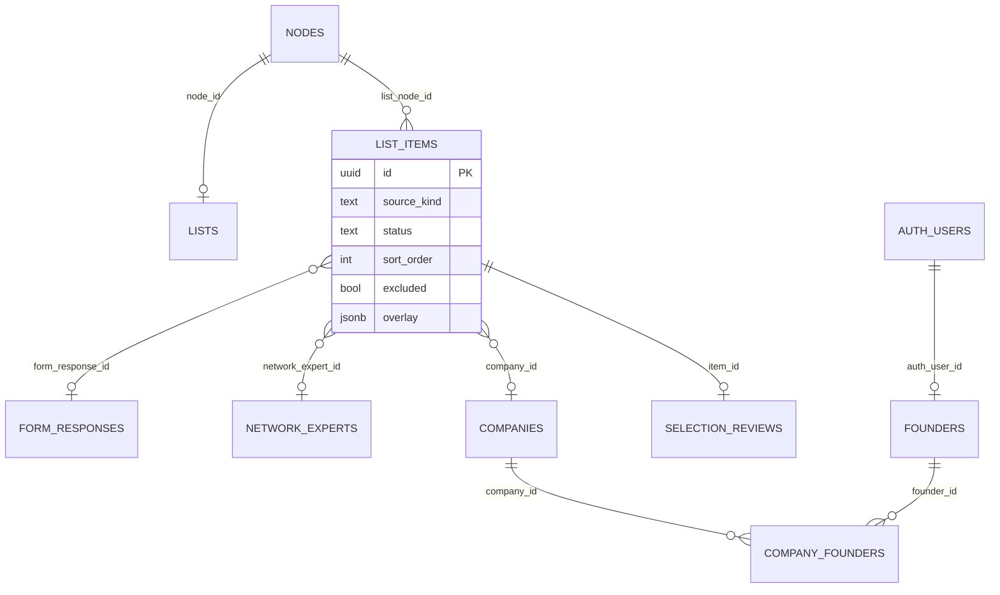
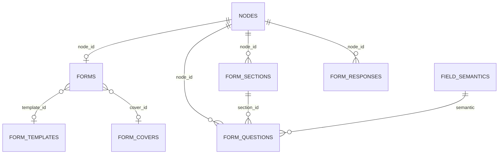
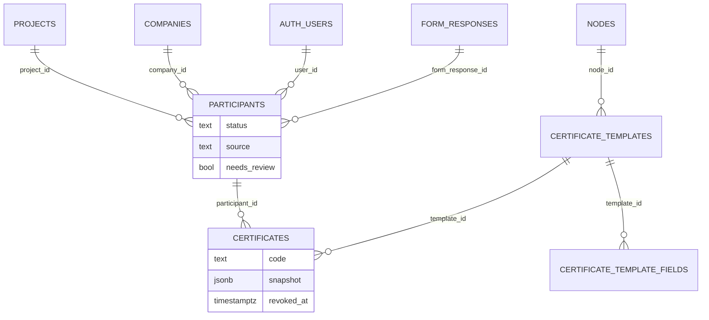
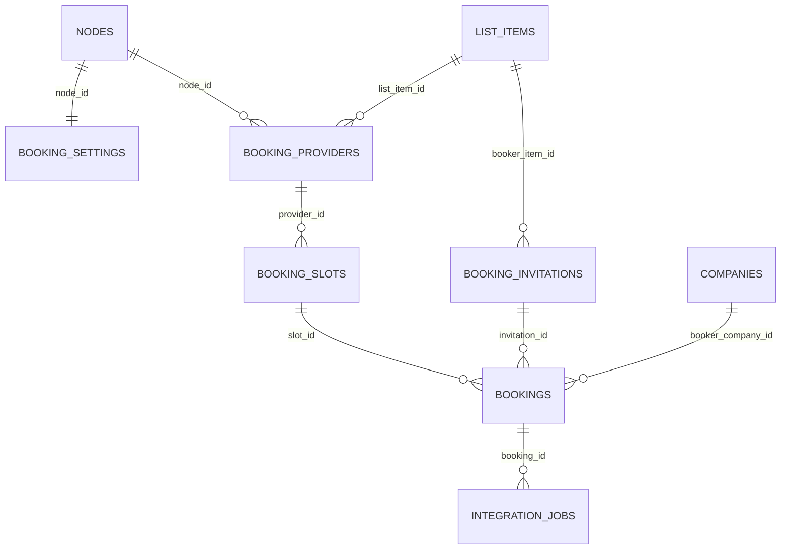
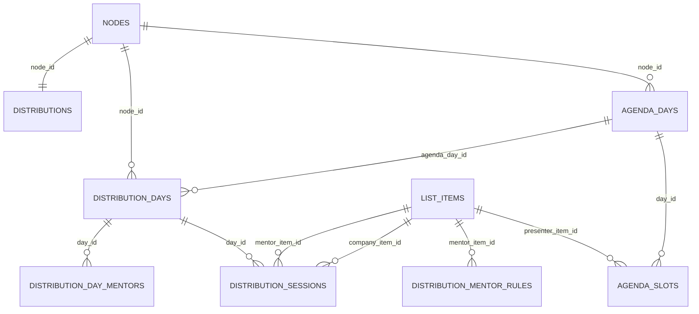
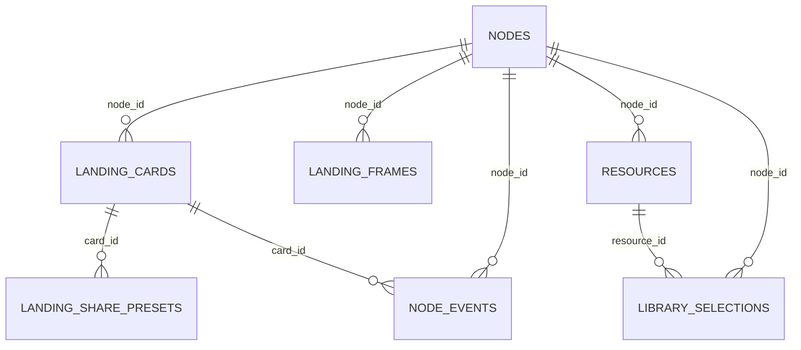
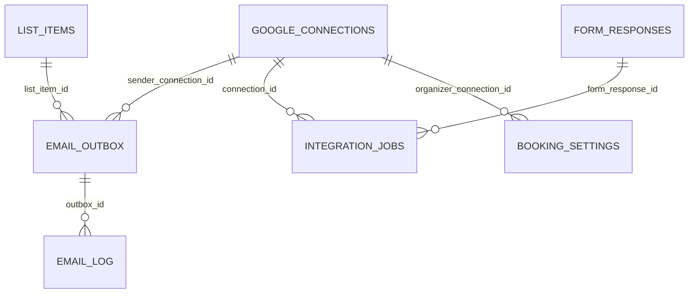

# Design 04 - Target Database Design (PostgreSQL / Supabase) (DRAFT for owner review)

Status: **design only. Nothing is implemented; no migration was written or run; no database (local or live) was modified.** Facts about the current database were obtained with read-only `SELECT`s on the local copy only (row counts, column lists, index lists, storage sizes; no personal data and no secrets were read or printed).

Labels: **[Decided]** = owner said so (`docs/11`, `docs/13`); **[Decided-by-delegation]** = recorded in `08-decisions-log.md` (authoritative, applied here, not reopened); **[As-is]** = found in the current DB/code (table/column named, or `docs/0x` section); **[Proposal]** = analyst recommendation (reason and alternatives given). Unless a table or paragraph carries another label, the schema below is a **[Proposal]** that implements the labelled decisions. Terms follow `00-conceptual-model.md`. The two owner goals recorded in `08` are the yardsticks for every choice: **G1 no data duplication** (one source of truth per fact; connected data by reference) and **G2 a fast, light platform**.

Related documents: `01` node catalogue (what each node needs), `02` data flow (reference + overlay, revisions), `03` roles/RLS (policy details live there; this document only **names the policy family** of each table, section 3.0), `05` migration plan (old to new data transforms; this document gives the crosswalk, section 4.2), `06` frontend (consumes the RPCs of section 5), `07` emails/integrations/certificates (consumes the tables of sections 3.14-3.15).

Contents: 1 Summary and design rules - 2 Conventions - 3 Target tables by domain (3.0 policy families, 3.1 identity ... 3.16 alumni touch points, 3.17 derived views) - 4 No-duplication audit of the current 48 tables (4.1 findings, 4.2 crosswalk) - 5 Functions and RPCs - 6 Performance design - 7 ER diagrams - 8 SQL sketches - 9 Open Decisions for the Owner - 10 Notes on 00..08.

---

## 1. Summary and design rules

### 1.1 What the target schema looks like in one paragraph
A **Program** has **Projects**; a Project owns a **graph**: `nodes` (typed by `node_types`, each with a small versioned `config jsonb`), `edges` (typed ports, per-edge audience), and a one-row-per-node `node_revisions` counter that makes refresh cheap. Everything a node *owns* lives in a typed relational table keyed by `node_id` (days and slots, questions and responses, list items, providers and slots, sessions, cards, templates). Things that are *shared between nodes and projects* live once, in entity tables (`network_experts`, `companies`, `founders`) and are **referenced** by typed foreign keys: a `list_items` row is "reference to a source row + list-specific overlay" and nothing else. Participants, bookings, sessions, certificates point at `list_items`, `companies`, `participants` by foreign key and never store names, times or e-mail addresses that can be derived. Public access goes through `public_links` + slugs and token-keyed RPCs, never through table grants.

### 1.2 Rules that follow from G1/G2 (applied in every section)
| # | Rule | Serves |
|---|---|---|
| R1 | **One home per fact.** A column that can be computed or joined is not stored (examples removed: `mentoring_sessions.mentor_name/company_name/slot_*_time`, `bookings.mentor_*/company_name/start_time/end_time`, `events.name`/`events.id` mirrors, `project_managers` mirrored column pairs). | G1 |
| R2 | **Real foreign keys everywhere**, `ON DELETE` chosen explicitly; no `TEXT` ids that "point at" uuids (today 12 columns do: section 4.1 #25). | G1, integrity |
| R3 | **Reference, do not copy**: connected data is read through typed references (`form_response_id`, `network_expert_id`, `company_id`, `list_item_id`). Intentional point-in-time copies are allowed only when the fact itself is a *record* (certificate snapshot, tombstone label) and are listed in section 1.3. | G1 |
| R4 | **`jsonb` only where the shape is variable by design or display-only and never joined/filtered/FK'd**; each such column has a schema note and a size cap (register in 2.6). Anything an RLS policy, a unique index, a foreign key, a server-side gate or a hot filter needs is a typed column. | G2, integrity |
| R5 | **Every foreign key column is indexed**; every filter/sort used by a screen has an index; no index that another index already covers (today there are duplicates: 4.1 #14). | G2 |
| R6 | **Hot read paths are one query**: set-returning RPCs/views return a screen's data in one round trip (no N+1), with a column whitelist for non-staff audiences. | G2, security |
| R7 | **Small rows, narrow hot tables**: revision counters, analytics events and queues are separate narrow tables so that frequent writes do not bloat wide rows. | G2 |
| R8 | **No data is lost in migration** [Decided]: every current column has a destination or an explicit "dropped because duplicate/unused" entry in the crosswalk (4.2). | [Decided] |

### 1.3 The only deliberate copies (exhaustive list)
| Copy | Where | Why it is not duplication |
|---|---|---|
| `certificates.snapshot` (participant, company, program names and dates at issue time) | `certificates` | An issued certificate is a legal-style record: later renames must not change it (`07` section 4.5). |
| `list_items.source_label` | `list_items` | Tombstone only: written by a `BEFORE DELETE` trigger on a source row at the moment it is hard-deleted; never maintained otherwise (improves `02` section 3.6 which refreshed it on every overlay write). |
| `form_templates.definition` and the rows created by "import template into this form" | `form_templates` to `form_questions` | A template is a *starting point by design* [Decided: library of forms]; the instantiated form is independent. Lineage is the nullable `forms.template_id`. |
| `email_outbox.subject/body_html` | `email_outbox` | The rendered message that was actually sent (audit record), deleted after the retention period (6.7). |
| `detach to manual` (`list_items.manual_fields`) | `list_items` | One-time, user-initiated action (`02` section 3.6). |

---

## 2. Conventions

### 2.1 Schemas
| Schema | Content | Exposure |
|---|---|---|
| `public` | all tables/views the app uses and the RPCs of section 5 | PostgREST; **no grant to `anon`**, tables granted to `authenticated` only per `03` section 8.1; RPCs granted explicitly |
| `app_private` | RLS helper functions (`has_role`, `is_project_manager`, ...), trigger functions, **internal worker tables** (`email_outbox`, `email_log`, `integration_jobs`, `google_connections`) | not exposed; worker access through service role / `SECURITY DEFINER` RPCs |
| `vault` | Supabase Vault secrets (refresh tokens) | service role only; referenced by `google_connections.vault_secret_id` (soft reference: Vault is a separate extension schema, so no FK) |
| `storage` | buckets (section 6.9) | per-bucket policies |

### 2.2 Names
- Tables: **plural `snake_case`** (`list_items`, `form_responses`); join tables are the two plural names or a role name (`company_founders`, `library_selections`). 1:1 *extension tables* of a node type are named after the concept and keyed by `node_id` (`forms`, `lists`, `distributions`, `booking_settings`).
- Columns: `snake_case`; foreign keys `<singular>_id` (`project_id`, `node_id`, `company_id`); role-named FKs keep the role (`created_by`, `booker_item_id`). Booleans start with `is_`/`has_`/`show_` only when read as a flag (`is_locked`, `show_to_participants`).
- **Primary key is always `id uuid`** in new and changed tables (today: `event_id`, `company_id`, `expert_id`, `slot_id`, `response_id`, `form_id`, `founder_id`, `program_id`, `resource_id`, `snapshot_id` ... 20 different names for the same idea). Rename list in 4.2; the alumni-only tables I do not otherwise touch keep their current PK names until the Alumni design (Open Decision 3).
- Booleans/enums: no `NULL` meaning "false"; `NOT NULL DEFAULT`.
- Indexes: `<table>_<cols>_idx`, unique `<table>_<cols>_key`, partial adds `_p`. Constraints: `<table>_<what>_chk`. Policies: `<table>_<cmd>_<who>` (see `03` 8.3).

### 2.3 Types and ids
| Topic | Rule |
|---|---|
| Primary keys | `uuid DEFAULT gen_random_uuid()` (PostgreSQL 17.6 locally has no `uuidv7()`; random uuids are fine at this scale: largest table has 1,148 rows). Where the old table maps 1:1 to the new one **the old id is preserved** in migration (events -> projects, event_forms -> nodes/forms, mentors -> booking_providers, ...) so shared links keep working (`06` section 2.7, note 7; Open Decision 15). |
| Foreign keys | Real `REFERENCES` with explicit `ON DELETE`: `CASCADE` for owned children, `RESTRICT` for facts others depend on (bookings -> slots, sessions -> items, certificates -> participants), `SET NULL` only for lineage (`forms.template_id`). **No cascade deletes of bookings from slot or provider deletes** (current bug BUG-9, `docs/05`). |
| Time | `timestamptz` (UTC) for instants. `date` for calendar days with no time-of-day (`agenda_days.day_date`). `time` for wall-clock times inside a day (`agenda_slots.start_time`); interpreted in `projects.timezone`. Never `text` for times (today `agenda_slots.start_time text` caused the `HH:MM` vs `HH:MM:SS` bug, `docs/03` section 7.1 #6). |
| Audit columns | `created_at timestamptz NOT NULL DEFAULT now()`, `updated_at timestamptz NOT NULL DEFAULT now()` maintained by one trigger `app_private.touch_updated_at()` (replaces the 9 `update_*_updated_at` functions with mutable search_path, `03` section 8.2); `created_by uuid REFERENCES auth.users ON DELETE SET NULL` where a human creates the row. Append-only/event tables carry only `created_at`. |
| Soft delete | `deleted_at timestamptz NULL` **only** on: `programs`, `projects`, `nodes`, `form_responses`, `companies`, `network_experts`, `founders`, `resources`. Reason [Decided-by-delegation 02-3]: sources must be soft-deleted so lists can show "source removed"; programs/projects/nodes get undo and safe restore (`08` section 2 "forgiving"). All other tables hard-delete (cascade from their owner). Every read path filters `deleted_at IS NULL` through a **partial index** and the RPCs/views; a nightly `purge_soft_deleted(p_older_than interval)` hard-deletes rows older than 90 days (Open Decision 6). |
| Enumerations | **`text` + `CHECK (col IN (...))`**, not PostgreSQL `ENUM` (adding a value to a CHECK is a one-line migration; `ALTER TYPE ... ADD VALUE` cannot run inside a transaction block with other changes and cannot remove values). The one existing enum `app_role` is replaced by `roles.key` FK (`03` section 2.2). |
| Case-insensitive text | `citext` for e-mail columns (extension available locally). |
| Bilingual text | **Two columns `<x>_en`, `<x>_ar`** on entity/content tables (indexable, searchable, RLS-neutral). Inside `config jsonb`, bilingual values are `{ "en": "", "ar": "" }`. One convention replaces today's mix of `name`/`name_ar`, `title_en`/`title_ar`, `name_en`/`name_ar`, `form_name`/`form_name_ar`, `event_name`/`event_name_ar`. At least one of the two is required (`CHECK (name_en IS NOT NULL OR name_ar IS NOT NULL)`); reading applies `pick(lang)` with fallback to the other language (`06` section 7). |
| Media | Columns store a **storage path** (`image_path`), never a full URL (URLs embed the project host and bucket: today `logo_url`, `photo_url`, `cover_url`, `image_url` all hold absolute URLs or Google Drive links). The client builds the URL; variants are derived from the path (6.9). External images (Drive links) are rejected at save time except where a `*_url` column is explicitly named (e.g. `website_url`, `cta_url`). |
| Money / counts | none in this model (alumni snapshots stay as-is). |
| Order | `sort_order integer` (dense, rewritten on reorder; lists are at most hundreds of rows); `NULL` = "not manually ordered yet" and sorts after ordered rows. |
| Visibility | `visibility text NOT NULL DEFAULT 'private' CHECK (visibility IN ('private','platform','public'))` on `programs`, `projects`, `nodes` (`03` section 6.1). |
| Project scoping | Every row owned by a node carries `project_id` **and** a composite foreign key `(project_id, node_id) REFERENCES nodes (project_id, id)`, so the database itself proves they agree (no trigger, no drift) and every RLS policy is one indexed check on `project_id` (`03` P4). It is a structural key, not a fact, so it does not violate R1. Second-level leaf tables (e.g. `agenda_slots`) carry `project_id` and their parent id only. |

### 2.4 The node-data rule (what is relational and what is `config`)
[Proposal] **`nodes.config jsonb` holds only presentation and behaviour settings that no query joins, filters, orders by or references by foreign key.** Anything that is (a) referenced by another row, (b) enforced server-side (gates, uniqueness, deadlines), (c) filtered/sorted by a screen, or (d) a collection that is edited item by item, is a **typed table**. Applied:

| Node type | In `nodes.config` (display/behaviour) | In typed tables |
|---|---|---|
| `agenda` | header look (colour, height, overlay title, font), `showDayNames`, defaults | `agenda_days`, `agenda_slots` |
| `form_builder` | thank-you text, social-channel toggles, export column mapping | `forms` (gates, cover FK, template FK), `form_sections`, `form_questions`, `form_responses` |
| `list` | column mapping (`mapping`), `overlay_schema`, card style, `titleOverride`, accent colour | `lists` (subkind), `list_items` |
| `selection` | `stages[]` (keys, labels, types, transitions), e-mail templates, importer settings | `list_items` (+`status`), `selection_reviews` |
| `booking` | slot-generation defaults, booking rules, e-mail templates, page texts | `booking_settings`, `booking_providers`, `booking_slots`, `bookings`, `booking_invitations` |
| `distribution` | alert/timer settings, display texts | `distributions`, `distribution_days`, `distribution_day_mentors`, `distribution_mentor_rules`, `distribution_sessions` |
| `library` | grouping, search toggle, include-pool mode | `resources`, `library_selections` |
| `landing_page` | theme, nav, hero, cards-section intro, personalize texts and labels | `landing_cards`, `landing_share_presets`, `landing_frames` |
| `certificates` | issue mode, e-mail-on-issue template | `certificate_templates`, `certificate_template_fields`, `certificates` |
| `view_host` (system, section 3.4) | tab defaults | tabs are `edges` |

Every config has a **schema version**: `nodes.type_version smallint` (the version of the node type's config schema the row was written with); `node_types.latest_version` says what the deployed code expects; `manifest.migrateConfig(config, from)` upgrades lazily on save (`06` section 4.5). The schema itself is stored in `node_types.config_schema jsonb` (JSON Schema) so the database can validate every save (Open Decision 9: use the `pg_jsonschema` extension if enabled on the project, otherwise validate in the `save_node` RPC for the top-level keys plus a size cap).

### 2.5 Extension-table pattern (type safety without polymorphism)
A 1:1 extension table is keyed by `node_id` and pins its node type, so a `forms` row can never hang on a `list` node:

```sql
create table public.forms (
  node_id    uuid primary key,
  node_type  text not null default 'form_builder' check (node_type = 'form_builder'),
  project_id uuid not null,
  -- typed settings ...
  foreign key (project_id, node_id) references public.nodes (project_id, id) on delete cascade,
  foreign key (node_id, node_type)  references public.nodes (id, type)       on delete cascade
);
```
(`nodes` therefore has `unique (project_id, id)` and `unique (id, type)`.) The same pattern is used by `lists`, `distributions`, `booking_settings`.

### 2.6 `jsonb` register (every remaining jsonb column, with schema note and cap)
Today: **24 jsonb columns** in 564 columns [As-is, local DB]. Target keeps 17 (including 2 registry columns, 2 worker-private columns and 1 alumni column kept as-is), each justified; the others became typed columns or tables. Caps are `CHECK (octet_length(col::text) <= N)` (Open Decision 9 for `pg_jsonschema`).

| Column | Shape (schema note) | Cap | Why jsonb is justified |
|---|---|---|---|
| `nodes.config` | per node type and `type_version` (section 2.4); bilingual leaves `{en,ar}` | 256 KB | settings differ per type, never joined |
| `node_types.config_schema`, `node_types.ports` | JSON Schema; `[{ key, direction: in/out, family, kind, cardinality, required, label{en,ar} }]` | 64 KB | registry data seeded from manifests; read as a whole |
| `edges.filter` | `{ "status_in": ["approved"], ... }` (allow-listed keys) | 4 KB | per-edge optional filter, evaluated by the resolver |
| `list_items.overlay` | object validated against the list's `overlay_schema`: custom columns, `display_override`, `card.show` | 16 KB | per-list custom columns are user-defined |
| `list_items.manual_fields` | `{ title_en, title_ar, subtitle_*, image_path, email, ... }` same keys as the list mapping | 8 KB | manual items only; shape = list mapping |
| `form_questions.options`, `.validation` | `[{ value, label_en, label_ar, is_other }]`; `{ min_length, max_length, min, max, pattern, custom_error{en,ar}, allowed_countries[] }` | 32 KB / 4 KB | per-question-type variable shape, display-only |
| `form_responses.answers` | `{ "<question.key>": value }`; keys are `form_questions.key` of that form | 64 KB | the answer set is variable by form (**the** legitimate use; avg 8 KB, max 25 KB today in the legacy store) |
| `form_responses.tracking` | `{ source, referrer, utm_* }` | 2 KB | free tracking tags |
| `form_templates.definition` | `{ schema_version, sections[], questions[], settings }` | 128 KB | template snapshot (1.3) |
| `agenda_slots.bullets` | `[{ "en": "", "ar": "" }]` | 4 KB | display-only list of short strings (replaces the two parallel arrays) |
| `companies.links` | `[{ "type": "facebook", "url": "https://..." }]` | 2 KB | free social links, display-only |
| `certificates.snapshot` | `{ participant_name, company_name, program_name, project_name, completed_on, template_version }` | 4 KB | frozen record (1.3) |
| `integration_jobs.payload`, `.result` | per `kind` (calendar/sheets) | 16 KB | worker-private |
| `company_snapshots.data` | [As-is, alumni] | unchanged | alumni side kept as-is |

Removed jsonb (became typed): `events.header_settings` (-> agenda config), `event_forms.integrations/social_channels_config` (-> edges + config), `library_forms.fields` (-> `definition`), `mentoring_distribution_config.break_slots/mentor_availability/timer_state` (-> tables / dropped), `bookings`-side none, `join_athar_pages.canvas_overlay_position` (dropped), `company_submissions.additional_data/email_send_count` (-> `form_responses.answers` + `selection_reviews` + e-mail log), `companies.display_config` and `experts.display_config` (-> list card config), `company_submissions` reviewer data stuffed in `additional_data` (-> typed `selection_reviews`).

---

## 3. Target tables by domain

Format per table: purpose and label; columns; **constraints/CHECKs**; **FKs**; **indexes**; **RLS family** (section 3.0). Unless said otherwise: `id uuid PK`, `created_at`/`updated_at` as in 2.3, and `ON DELETE` as stated.

### 3.0 RLS policy families (names used in every table below)
Policy detail is in `03` section 8.3; the family names below are the rows of that table, so each table here points at exactly one family.

| Family code | `03` 8.3 row | Rule in one line |
|---|---|---|
| `ID` | Identity: `profiles`, `user_roles`, `roles` | own row / super_admin; roles static read |
| `MEMBER` | `program_members`, `project_members` | members of the scope; owner writes via `add_member` |
| `STRUCT` | `programs`, `projects` | member (or participant via RPC); PM role holder creates; owner deletes |
| `GRAPH` | `nodes`, `edges`, `node_revisions`, `node_types` | PM of `project_id`; `node_types` read-only to authenticated |
| `PM` | Agenda & library, Distribution, Landing, Booking config, Forms definition, Lists config | `app_private.is_project_manager(project_id)` for all four commands; public/participant reads only through RPCs |
| `LIST` | Lists / experts / companies (project-scoped part) | PM; founders read their company through `my_company_ids()`; overlay writes PM-only |
| `PII` | `form_responses`, `selection_reviews`, `booking_*` personal columns | PM read/update (status/review columns only); **no client INSERT** (RPC/edge); founder reads own submission |
| `NETWORK` | `master_experts` row | any PM role holder + alumni_manager read; PM role holder write; super_admin delete |
| `ENTITY` | Companies, Founders, `company_founders` (alumni side) | founder: own company/founder via `company_founders`; alumni_manager CRUD `is_alumni`; PM read companies referenced in their projects |
| `PARTICIPANT` | `participants` | PM; own rows (`user_id` or my companies); writes by PM RPCs only |
| `LINK` | `public_links`, `public_link_slugs` | PM of project; token/slug lookup only through `resolve_ref` |
| `BOOKING` | Booking row | PM config; bookings only by RPC (atomic); booker cancels by signed token; no `meet_link`/mentor e-mail in public output |
| `CERT` | `certificates` | founder reads own `attended` row; PM issue/revoke; verify by RPC only |
| `EVENTS` | analytics inserts | `INSERT` only through `track_node_event` RPC; SELECT PM |
| `INTERNAL` | Settings / secrets row | **no client policy at all**; service role / `SECURITY DEFINER` RPCs; owner sees own connection through a view |
| `ALUMNI` | Alumni rows | as `03` 8.3 (unchanged tables) |

### 3.1 Identity and roles
**`roles`** [As-is: 4 rows `super_admin, project_manager, founder, alumni_manager`, unreferenced lookup] [Proposal: becomes the FK target]
| Column | Type | Notes |
|---|---|---|
| `key` | `text` PK | `super_admin`, `project_manager`, `alumni_manager`, `founder`, `integration`; `me_team` can be added without migration [Decided-by-delegation 03-3] |
| `name_en`, `name_ar`, `description` | `text` | |
| `is_staff` | `boolean NOT NULL DEFAULT false` | drives the "staff area" check |
Replaces PostgreSQL enum `app_role`. RLS: `ID` (read: authenticated).

**`user_roles`** [As-is: 12 rows, all `super_admin`; `UNIQUE(user_id)` on live blocks multi-role] [Decided: several roles per user]
| Column | Type | Notes |
|---|---|---|
| `user_id` | `uuid` FK `auth.users` `ON DELETE CASCADE` | |
| `role_key` | `text` FK `roles(key)` `ON DELETE RESTRICT` | |
| `granted_by` | `uuid` FK `auth.users` `ON DELETE SET NULL` | |
| `created_at` | `timestamptz` | |
PK `(user_id, role_key)` (drops the surrogate `id`, the redundant `assigned_at`/`created_at` pair, `updated_at`, `idx_user_roles_user_id` covered by the PK, and `UNIQUE(user_id)`). Index `(role_key, user_id)` for "list members of role". Trigger: only super_admin writes; cannot remove the last super_admin (`03` 2.2). RLS: `ID`.

**`profiles`** [As-is: 12 rows]
| Column | Type | Notes |
|---|---|---|
| `id` | `uuid` PK FK `auth.users` `ON DELETE CASCADE` | |
| `full_name` | `text` | |
| `avatar_path` | `text` | replaces `avatar_url`; `avatar_color` dropped (derived from `id` in the client) |
| `language` | `text NOT NULL DEFAULT 'ar' CHECK (language IN ('ar','en'))` | new, `06` section 7.1 |
| `created_at`, `updated_at` | | |
RLS: `ID`. Created by `handle_new_user` (`03` 4.4).

### 3.2 Memberships [Proposal per `03` 3.2]
**`program_members`**: `program_id uuid` FK `programs` CASCADE, `user_id uuid` FK `auth.users` CASCADE, `member_role text CHECK (member_role IN ('owner','manager'))`, `added_by uuid`, `created_at`. PK `(program_id, user_id)`; index `(user_id, program_id)` (RLS lookup "my programs"). RLS: `MEMBER`.

**`project_members`**: same shape with `project_id` FK `projects` CASCADE. PK `(project_id, user_id)`; index `(user_id, project_id)`. A program member is implicitly a manager of all its projects (`app_private.is_project_manager`), so `project_members` holds only *guests of one project* (`03` 3.2). Replaces `project_managers` (0 rows; dropped with its mirrored `event_id`/`project_id`, `assigned_*`/`added_*` pairs, the trigger `sync_project_managers_columns` and the unused `project_role` enum). RLS: `MEMBER`.

### 3.3 Programs and projects
**`programs`** [As-is: 3 rows, all `accelerator`, all `active`]
| Column | Type | Notes |
|---|---|---|
| `id` | `uuid` PK | was `program_id` |
| `name_en`, `name_ar` | `text` | was `name`, `name_ar` |
| `description_en`, `description_ar` | `text` | [Decided] Program Settings holds the description |
| `program_type` | `text` | kept (`accelerator` ...), free text now, lookup later if needed |
| `year` | `smallint` | |
| `cover_path` | `text NULL` | optional fallback / Programs-list thumbnail [Decided-by-delegation 01-2] |
| `visibility` | `text` (2.3) | program-level public link [Decided: per item] |
| `archived_at` | `timestamptz NULL` | replaces the unused `status` text (see below) |
| `created_by`, `deleted_at`, `created_at`, `updated_at` | | |
**Status semantics** [Decided-by-delegation 01-11: completion is per project]: *a program is "completed" when all its (non-deleted) projects are completed*; this is **derived** by view `v_programs` (`is_completed`, `completed_projects`, `projects_total`), not stored, so it cannot disagree with the projects (R1). The old `programs.status` (always `active`) is dropped; "Complete all" in Program Settings calls `complete_all_projects(program_id)`. Index: `(deleted_at) WHERE deleted_at IS NULL` is unnecessary at 3 rows; `(archived_at)` not indexed. RLS: `STRUCT`.

**`projects`** (today `events`, 16 rows) [Decided: Project belongs to one Program; Project Details fields; timezone per Decided-by-delegation 07-10]
| Column | Type | Notes |
|---|---|---|
| `id` | `uuid` PK | = old `events.event_id`, preserved |
| `program_id` | `uuid NOT NULL` FK `programs` `ON DELETE RESTRICT` | 3 of 16 events have `program_id NULL` today: migration assigns them to a "Legacy" program (Open Decision 5) |
| `name_en`, `name_ar` | `text` | was `event_name`, `event_name_ar`; `events.name` and `events.id` mirror columns dropped |
| `description_en`, `description_ar` | `text NULL` | project-level description; if NULL the founder page uses the program's (`06` OD-7) |
| `cover_path` | `text NULL` | **the agenda cover = project cover** [Decided-by-delegation 01-2]; replaces `events.header_image_url` and `form_cover_image_url` duplicates |
| `timezone` | `text NOT NULL DEFAULT 'Africa/Cairo'` | IANA; validated by trigger against `pg_timezone_names` [Decided-by-delegation 07-10] |
| **Project Details** [Decided: only these four] | | |
| `location_en`, `location_ar` | `text NULL` | venue/address text |
| `map_url` | `text NULL CHECK (map_url ~* '^https?://')` | |
| `offline_days` | `smallint NULL CHECK (offline_days >= 0)` | a typed count only [Decided-by-delegation 01-5] |
| `transportation` | `text NULL CHECK (transportation IN ('provided','self_arranged'))` | NULL renders nothing |
| **Founder page toggles** | | |
| `show_description`, `show_details` | `boolean NOT NULL DEFAULT false` | "nothing appears by default" [Decided]; replaces `03`'s `founder_page jsonb` (typed, no schema drift) |
| `visibility` | `text` (2.3) | the project's public/platform link |
| `completed_at`, `completed_by` | `timestamptz NULL`, `uuid NULL` | **completion is per project**; unlocks certificates [Decided-by-delegation 01-11]. `status` text (always `active`) dropped: `completed_at IS NULL` = active. |
| `created_by`, `deleted_at`, `created_at`, `updated_at` | | |
Indexes: `(program_id) WHERE deleted_at IS NULL`. Moved out of the old `events` row (to avoid a 50-column table): header/background/footer visuals, `header_height`, `show_day_names`, `gsheets_url` -> `agenda` node config; `experts_color`/`startups_color` -> list node config; `company_portal_*`/`expert_portal_*`, `submission_deadline` -> `forms` (`closes_at`) and form config; `seo_title/description/image` -> `public_links.og_*` (one place for link previews); `interview_*/rejection_*/acceptance_*/mentor_*` e-mail groups (16 columns) -> node configs; `meeting_link_mode`, `shared_google_meet_link` -> `booking_settings`; `selection_process_gsheets_url` -> selection config; `admin_email` (dead). Details in 4.2. RLS: `STRUCT`.

### 3.4 The graph: node types, nodes, revisions, edges, public links
**`node_types`** (registry mirror, small, seeded from the frontend manifests by a CI step; see `06` section 4)
| Column | Type | Notes |
|---|---|---|
| `key` | `text` PK | `agenda`, `form_builder`, `list`, `selection`, `booking`, `distribution`, `library`, `landing_page`, `certificates`, `view_host` |
| `name_en`, `name_ar`, `category` | `text` | |
| `latest_version` | `smallint NOT NULL` | current config schema version |
| `is_singleton`, `is_system` | `boolean` | `view_host`: system, created with the project, not deletable |
| `ports` | `jsonb` | schema in 2.6; used by `connect()` to validate family/kind/cardinality |
| `config_schema` | `jsonb NULL` | JSON Schema of `nodes.config` |
| `save_children_fn` | `text NULL` | name of `app_private.save_children_<type>(node_id, jsonb)` called by `save_node` |
`view_host` is the answer to `01` Decision 3 [Decided-by-delegation 01-3: every project has an implicit view-page host; the Agenda node is one tab]: a hidden system node auto-created with the project; tabs are `edges` into its `tabs` port; its public link is the project's agenda link. Additional hosts are allowed later (not a singleton) (Open Decision 14). RLS: `GRAPH` (read all authenticated).

**`nodes`** (new)
| Column | Type | Notes |
|---|---|---|
| `id` | `uuid` PK | node ids of migrated modules reuse the old id where one exists (form id, join page id, ...) |
| `project_id` | `uuid NOT NULL` FK `projects` `ON DELETE CASCADE` | |
| `type` | `text NOT NULL` FK `node_types(key)` | |
| `type_version` | `smallint NOT NULL DEFAULT 1` | config schema version (2.4) |
| `name_en`, `name_ar` | `text` | PM-editable instance title (`01` 1.2 `title`) |
| `config` | `jsonb NOT NULL DEFAULT '{}'` | cap 256 KB; schema per type |
| `visibility` | `text` (2.3) | `private`/`platform`/`public` per item [Decided] |
| `show_to_participants` | `boolean NOT NULL DEFAULT false` | founder Program-page block [Decided: nothing by default] |
| `position_x`, `position_y` | `double precision NOT NULL DEFAULT 0` | canvas position (library-neutral, `06` section 3) |
| `is_system` | `boolean NOT NULL DEFAULT false` | |
| `deleted_at`, `created_by`, `created_at`, `updated_at` | | soft delete gives canvas undo |
Constraints: `unique (project_id, id)`, `unique (id, type)`, config size CHECK, `CHECK (name_en IS NOT NULL OR name_ar IS NOT NULL)`. Indexes: `(project_id, type) WHERE deleted_at IS NULL` (canvas load and "find the node of type X" for legacy redirects). Position-only updates do **not** bump the revision (trigger `WHEN` clause excludes `position_x, position_y`). RLS: `GRAPH`.

**`node_revisions`** (one narrow row per node; section 6.5)
`node_id uuid PK FK nodes ON DELETE CASCADE`, `project_id uuid NOT NULL` (for the Realtime filter), `rev bigint NOT NULL DEFAULT 1`, `updated_at timestamptz`. Index `(project_id)`. The only table added to the Realtime publication for editors (`02` 5.3). RLS: `GRAPH` (SELECT PM; no client writes at all: bumped by triggers/RPCs).

**`edges`** (new; composite FKs prove "same project" without a trigger, answering `03` 8.3's CHECK)
| Column | Type | Notes |
|---|---|---|
| `id` | `uuid` PK | |
| `project_id` | `uuid NOT NULL` | |
| `from_node_id`, `to_node_id` | `uuid NOT NULL` | composite FKs `(project_id, from_node_id)` and `(project_id, to_node_id)` -> `nodes (project_id, id)` `ON DELETE CASCADE` |
| `from_port`, `to_port` | `text NOT NULL` | validated against `node_types.ports` by `connect()` |
| `family` | `text NOT NULL CHECK (family IN ('rows:form-response','rows:list-item','rows:participant','view','schedule','link'))` | stored so cycle checks run **per family** [Decided-by-delegation 02-13] |
| `is_enabled` | `boolean NOT NULL DEFAULT true` | tab on/off |
| `audience` | `text NOT NULL DEFAULT 'platform' CHECK (audience IN ('public','platform','participants','pms'))` | per-edge audience [Decided-by-delegation 02-14]; effective exposure = min(source, host, edge) (`03` 6.1) |
| `label_en`, `label_ar` | `text NULL` | tab title override (replaces `header_settings.customExpertsLabel`) |
| `order_index` | `integer NOT NULL DEFAULT 0` | tab order / merge tie-break |
| `filter` | `jsonb NOT NULL DEFAULT '{}'` | cap 4 KB |
| `created_at` | | |
Constraints: `CHECK (from_node_id <> to_node_id)`; `unique (from_node_id, from_port, to_node_id, to_port)`. Indexes: `(to_node_id, to_port, order_index)` (resolve inputs, tab order), `(from_node_id)` (downstream walk, `eff_rev`), `(project_id)`. The DAG rule is enforced in `connect()` (recursive CTE per family) and re-checked by a deferred constraint trigger. Edge insert/delete bumps `to_node`'s revision (data it shows changed). RLS: `GRAPH`.

**`public_links`** (new; capability handles for anonymous access, `03` 6.2; `resolve_ref` backs `06` section 9)
| Column | Type | Notes |
|---|---|---|
| `id` | `uuid` PK | |
| `project_id` | `uuid NOT NULL` FK `projects` CASCADE | |
| `node_id` | `uuid NULL` | composite FK to `nodes (project_id, id)`; NULL = the project/program page itself |
| `kind` | `text NOT NULL CHECK (kind IN ('project','agenda','form','landing','booking','view'))` | what the URL shows (`06` section 2.4) |
| `view_key` | `text NULL` | for `/view/:nodeRef/:viewKey` (`matrix`, `live`) |
| `is_enabled` | `boolean NOT NULL DEFAULT true` | kill switch; public access = `visibility = 'public'` **and** `is_enabled` **and** not expired |
| `expires_at` | `timestamptz NULL` | |
| `legacy_ref` | `uuid NULL UNIQUE` | the old id embedded in circulated URLs (`events.event_id`, `form_id`, join page project id) so old links keep working [Decided-by-delegation 03-9] |
| `og_title_en`, `og_title_ar`, `og_description_en`, `og_description_ar`, `og_image_path` | `text` | link-preview metadata (replaces `events.seo_*`, `event_forms.share_*`, landing `seo`) |
| `created_by`, `created_at`, `updated_at` | | |
Constraint: `unique nulls not distinct (project_id, node_id, kind, view_key)` (PostgreSQL 15+; Open Decision 13). Indexes: `(node_id)`, partial `(legacy_ref) WHERE legacy_ref IS NOT NULL` (covered by the unique). The link row is created lazily when an item first becomes public (`ensure_public_link`). RLS: `LINK`.

**`public_link_slugs`** (replaces the proposed `slug_history`; **all** slugs of a link, current and old, live here once)
`slug text PK CHECK (slug ~ '^[a-z0-9][a-z0-9-]{2,63}$')`, `link_id uuid NOT NULL FK public_links CASCADE`, `is_current boolean NOT NULL DEFAULT true`, `created_at`. `UNIQUE (link_id) WHERE is_current` (exactly one current slug). Generated slugs are 10 characters from a 32-letter alphabet (50 bits); vanity slugs allowed in node Settings. `resolve_ref(kind, ref)` looks at slug first, then `legacy_ref`. Slugs are **never an authorization factor**: visibility and `is_enabled` decide (`03` 6.2). Deviation from `03` (which sketched `token text` + `slug`): see section 10 note on `03`. RLS: `LINK`.

### 3.5 Lists, list items and selection
**`lists`** (extension of `node_type='list'`; typed subkind) [`02` 2.1: subkind is immutable after creation]
`node_id` PK (pattern 2.5), `project_id`, `subkind text NOT NULL CHECK (subkind IN ('company','expert','generic'))` (immutable by trigger). Everything else (mapping, overlay schema, card style, dedupe setting) is `nodes.config`. RLS: `PM`.

**`list_items`** (the reference + overlay table; used by List **and** Selection nodes, `02` 7.1)
| Column | Type | Notes |
|---|---|---|
| `id` | `uuid` PK | |
| `project_id` | `uuid NOT NULL` | |
| `list_node_id` | `uuid NOT NULL` | composite FK `(project_id, list_node_id)` -> `nodes` `ON DELETE CASCADE` (type `list` or `selection`, checked by trigger) |
| `source_kind` | `text NULL CHECK (source_kind IN ('form_response','network_expert','company'))` | NULL = manual item |
| `form_response_id` | `uuid NULL` FK `form_responses` `ON DELETE SET NULL` | typed source references [Decided: reference to the source row]; typed FKs instead of `00`'s polymorphic `source_ref` (`02` 3.1) |
| `network_expert_id` | `uuid NULL` FK `network_experts` `ON DELETE SET NULL` | |
| `company_id` | `uuid NULL` FK `companies` `ON DELETE SET NULL` | |
| `source_label` | `text NULL` | tombstone, written only by the `BEFORE DELETE` trigger of a source (1.3) |
| `manual_fields` | `jsonb NULL` | manual items only (2.6) |
| `status` | `text NULL` | list status or the **Selection stage key**; validated against the node's configured values by the RPC; typed and indexed because the Selection board filters on it |
| `sort_order` | `integer NULL` | |
| `excluded` | `boolean NOT NULL DEFAULT false` | "hidden from this list" |
| `overlay` | `jsonb NOT NULL DEFAULT '{}'` | custom columns, `display_override`, `card` (2.6) |
| `created_by`, `created_at`, `updated_at` | | |
Constraints: `CHECK (num_nonnulls(form_response_id, network_expert_id, company_id) <= 1)`; `CHECK ((source_kind IS NULL AND manual_fields IS NOT NULL) OR (source_kind IS NOT NULL AND manual_fields IS NULL))`; coherence checks (`form_response_id IS NULL OR source_kind = 'form_response'`, same for the other two). One overlay per (list, source): three partial unique indexes `(list_node_id, form_response_id) WHERE form_response_id IS NOT NULL` and the same for `network_expert_id`, `company_id` (`02` 3.1). Indexes: `(list_node_id, sort_order, id)` (ordered render), `(list_node_id, status)` (Selection board), and one index per FK column (`form_response_id`, `network_expert_id`, `company_id`) for "where is this entity used" (the Athar Network "how many programs" query, 3.17). **Virtual membership** [Decided-by-delegation 02-1]: a row exists only after `ensure_item` (first PM edit, reorder, or anything that points at the item: booking provider, session, invitation). Rows are never auto-created by triggers. RLS: `LIST`.

**`selection_reviews`** (Selection-only facts that used to be stuffed into `company_submissions.additional_data`) [As-is: `docs/04` 4.10]
`item_id uuid PK FK list_items CASCADE`, `project_id`, `reason text NULL`, `origin_stage text NULL` (for holding -> back), `reviewed_at timestamptz NULL`, `reviewed_by uuid NULL FK auth.users`. `tech_status` and other PM columns are normal overlay custom columns. E-mail send counts are **not stored** (they are `count(*)` over `email_outbox` per item and key, 3.14). Fixes `reviewed_at` being nulled on non-final statuses and sheet re-sync overwriting reviewer data (`01` 3.4). RLS: `PII`.

### 3.6 Entities: Athar Network experts, companies, founders
**`network_experts`** (today `master_experts`, 42 rows; **the Athar Network** [Decided concept unchanged]) [Proposal: also absorbs `ather_team_members` and `mentors`, see 4.1 #2]
| Column | Type | Notes |
|---|---|---|
| `id` | `uuid` PK | `master_experts.id` preserved |
| `kind` | `text NOT NULL DEFAULT 'expert' CHECK (kind IN ('expert','team'))` | `team` = Athar staff used as interview providers (Open Decision 2) |
| `name_en`, `name_ar`, `title_en`, `title_ar`, `company_en`, `company_ar`, `bio_en`, `bio_ar` | `text` | same content as `master_experts` |
| `photo_path` | `text NULL` | |
| `linkedin_url` | `text NULL` | |
| `email` | `citext NULL` | **new**: needed as booking e-mail (today in `mentors.email` / `ather_team_members.email`); never in public RPC output |
| `deleted_at`, `created_by`, `created_at`, `updated_at` | | |
Indexes: `(kind) WHERE deleted_at IS NULL`; `gin (name_en gin_trgm_ops, name_ar gin_trgm_ops)` for the import search dialog (pg_trgm available). A **profile edit propagates by reference**: nothing is pushed into per-project rows (removes `updateMasterExpert` fan-out, `docs/03` 4.10). RLS: `NETWORK`.

**`companies`** (today per-event rows: 161 rows, 145 distinct names) [Decided-by-delegation 02-11: keep per-event rows at migration; canonical registry later; Decided 01-10 minimal registry view]
The table is designed **canonical** (no `project_id` scoping column) so a later cleanup is a data operation, not a schema change; at migration each old per-event row becomes one company row with `origin_project_id` set and (Open Decision 1) an assisted `merge_companies(keep, drop)` RPC repoints references.
| Column | Type | Notes |
|---|---|---|
| `id` | `uuid` PK | `companies.company_id` preserved (alumni FKs keep working) |
| `name_en`, `name_ar` | `text` | |
| `description_en`, `description_ar` | `text` | merges the two parallel `bio`/`description` columns (160 rows use `description`, 0 use `bio`) |
| `industry_en`, `industry_ar` | `text` | merges `sector` (0 rows use it) and `industry` (113) |
| `location_en`, `location_ar`, `governorate_en`, `governorate_ar` | `text` | `province` dropped (0 rows) |
| `stage`, `employees` | `text` | kept as-is for alumni compatibility |
| `founding_year` | `smallint` | |
| `logo_path`, `website_url`, `linkedin_url` | `text` | |
| `links` | `jsonb` | 2.6 |
| `is_alumni` | `boolean NOT NULL DEFAULT false` | alumni-manager policy filters on it |
| `origin_project_id` | `uuid NULL` FK `projects` `ON DELETE SET NULL` | provenance only, **not** a visibility scope |
| `name_key` | `text GENERATED ALWAYS AS (lower(btrim(coalesce(name_en, name_ar)))) STORED` | duplicate detection for `merge_companies` |
| `deleted_at`, `created_by`, `created_at`, `updated_at` | | |
Dropped columns (moved to the list overlay or dead): `event_id`, `sort_order`, `display_config`, `role`, `status` (all NULL), `founder`/`founder_ar` (founder identity belongs to `founders` + `company_founders`; migration creates a founder row only when the text is non-empty and a manual link is wanted, else keeps the text in the list item overlay; 47 rows have it). Indexes: `(name_key)`, `(is_alumni) WHERE is_alumni`, `(origin_project_id)`. RLS: `ENTITY`.

**`founders`** [As-is, alumni side, 0 rows locally] kept, with consistency changes only: PK `id` (was `founder_id`), `photo_path` (was `photo_url`), `deleted_at`, `email citext` unique where not null, `auth_user_id uuid NULL UNIQUE` FK `auth.users` `ON DELETE SET NULL`. Other columns unchanged (`name_en/ar`, `phone`, `linkedin_url`, `bio_en/ar`). Index `auth_user_id` is the unique index (hot: `my_company_ids()`). RLS: `ENTITY`. Watch item: founders with accounts also have `profiles.full_name` (display name in two places); resolved by rule "profiles = platform identity for staff, founders = alumni identity" and the client reading only one (4.1 #19).

**`company_founders`** [As-is: 0 rows] PK `(company_id, founder_id)` (replaces `id` + the separate unique), one `role text` (merges `role` and `role_in_company`), `is_primary boolean`, `created_at`. FKs both `ON DELETE CASCADE`. Index `(founder_id, company_id)` (my companies). RLS: `ENTITY`.

### 3.7 Forms (Form Builder node)
**`field_semantics`** (small lookup, extensible without a migration): `key text PK` (`company_name`, `founder_name`, `founder_email`, `phone`, `logo`, `bio`, plus the alumni snapshot keys once decided, `02` OD-10), `label_en`, `label_ar`. Replaces name-guessing heuristics (`docs/04` A-8, A-19). RLS: read authenticated.

**`form_covers`** [As-is: 3 rows] `id`, `project_id uuid NULL` FK `projects` CASCADE (**NULL = global library cover**), `name`, `image_path`, `created_by`, timestamps. Index `(project_id)`. RLS: `PM` (global ones: read PM role holders, write super_admin).

**`form_templates`** (today `library_forms`, 1 row) [As-is] `id`, `project_id uuid NULL` (replaces `scope` + `event_id`: NULL = global), `name_en`, `name_ar`, `description_en`, `description_ar`, `definition jsonb` (2.6), `schema_version smallint`, `cover_id` FK `form_covers` SET NULL, `created_by`, timestamps. Dropped: `target_module` (modules are gone; edges say where a form goes), `integrations`, `import_count` (derived: `count(forms WHERE template_id = id)`), the duplicated header/thank-you/share columns (live inside `definition`). RLS: `PM` (global: read PM role holders, write super_admin).

**`forms`** (extension of `node_type='form_builder'`; typed settings that are enforced server-side or referenced) [As-is: `event_forms`, 7 rows]
| Column | Type | Notes |
|---|---|---|
| `node_id` | `uuid` PK (pattern 2.5) | old `form_id` preserved as node id |
| `project_id` | `uuid NOT NULL` | |
| `template_id` | `uuid NULL` FK `form_templates` `SET NULL` | lineage only (replaces `library_form_id`) |
| `cover_id` | `uuid NULL` FK `form_covers` `SET NULL` | one cover reference (the old `cover_image_url` copy of the cover and `events.form_cover_image_url` are dropped) |
| `is_active` | `boolean NOT NULL DEFAULT true` | accepting responses; enforced **server-side** in `submit_form_response` (today client-only, `docs/04` S-6) |
| `opens_at`, `closes_at` | `timestamptz NULL` | server-enforced (replaces `events.submission_deadline` and portal flags) |
| `max_responses` | `integer NULL`, `one_response_per_email` `boolean` | |
| `export_sheet_id`, `export_sheet_tab` | `text NULL` | optional server-side Sheets export target (`07` section 3); the column mapping lives in `config` |
Thank-you text/image, social-channel toggles, share texts live in `nodes.config`; the **link preview** (title/description/image) lives in `public_links.og_*`. Index `(project_id)`. RLS: `PM`.

**`form_sections`** [As-is: `form_sections` relational store + `integrations.form_sections` + unread `event_forms.sections` = three stores, `docs/04` 6.3] -> one table: `id`, `project_id`, `node_id` (composite FK CASCADE), `title_en/ar`, `description_en/ar`, `order_index`. Index `(node_id, order_index)`. RLS: `PM`.

**`form_questions`** [As-is: `form_field_configs`, 56 rows; its `event_id`, `entity_type`, `show_in_card` and legacy-engine fields are gone]
| Column | Type | Notes |
|---|---|---|
| `id` | `uuid` PK | |
| `project_id`, `node_id` | composite FK `nodes` CASCADE | |
| `section_id` | `uuid NULL` FK `form_sections` `SET NULL` | |
| `key` | `text NOT NULL` | stable key = the key in `form_responses.answers` (not `custom_<timestamp>`) |
| `type` | `text NOT NULL CHECK (type IN ('text','textarea','email','tel','number','url','select','multiselect','file','hidden','date'))` | `01` 3.2 plus `date` |
| `semantic` | `text NULL` FK `field_semantics(key)` | semantic role used by downstream lists/selection/e-mails; **a question with a semantic role must use that role as its `key`**, so `answers->>'founder_email'` is a direct, indexable expression and nothing is duplicated into columns |
| `label_en`, `label_ar`, `description_en`, `description_ar`, `placeholder_en`, `placeholder_ar` | `text` | |
| `is_required` | `boolean NOT NULL DEFAULT false` | |
| `options`, `validation` | `jsonb` | 2.6 |
| `order_index` | `integer NOT NULL` | |
Constraints: `unique (node_id, key)`; `unique (node_id, semantic) WHERE semantic IS NOT NULL`; `CHECK (semantic IS NULL OR key = semantic)`. Index `(node_id, order_index)`. Saved atomically by `save_node` (no more DELETE-then-INSERT, `docs/04` A-28). RLS: `PM`; public read only via `get_public_form`.

**`form_responses`** (the **only** submission store; absorbs `company_submissions` 384 rows, `expert_submissions` 0, and today's `form_responses` 0) [Decided: one form engine; `02` section 9]
| Column | Type | Notes |
|---|---|---|
| `id` | `uuid` PK | legacy `submission_id`/`response_id` preserved |
| `project_id`, `node_id` | composite FK `nodes` CASCADE | form node |
| `answers` | `jsonb NOT NULL` | 2.6; no PII columns: `national_id` is **not carried** (Open Decision 7; [Decided-by-delegation needs-owner #4]) |
| `source` | `text NULL` | tracking `?source=` tag |
| `tracking` | `jsonb NOT NULL DEFAULT '{}'` | cap 2 KB |
| `external_key` | `text NULL` | stable key from an importer (sheet row identity) so re-import updates instead of duplicating; `unique (node_id, external_key) WHERE external_key IS NOT NULL` |
| `status` | `text NOT NULL DEFAULT 'submitted' CHECK (status IN ('submitted','reviewed','spam'))` | response-level state; **stage decisions live in Selection overlay**, never here (`02` section 9) |
| `submitted_by` | `uuid NULL` FK `auth.users` `SET NULL` | logged-in submitters (alumni update forms) |
| `submitted_at`, `updated_at`, `deleted_at` | | soft delete [Decided-by-delegation 02-3] |
Indexes: `(node_id, submitted_at DESC, id) WHERE deleted_at IS NULL` (keyset-paginated Responses tab and `resolve_list`); `(submitted_by) WHERE submitted_by IS NOT NULL`; optional expression index `((lower(answers->>'founder_email')))` for dedupe/match once needed. A statement-level trigger bumps the form node's revision on insert (counter only, `02` 5.3). Fixes the legacy gap: `company_submissions.form_id` is NULL on 382 of 384 rows, so migration creates a "Legacy import" form node per project and re-parents them (`05`). RLS: `PII`.

**`node_events`** (shared analytics, section 3.12) also serves form share clicks (`form_share_events` is dropped into it).

### 3.8 Participants
**`participants`** [Decided: status accepted/attended/withdrawn; source manual/selection; certificates only for attended] [Decided-by-delegation 02-7, 03-13]
| Column | Type | Notes |
|---|---|---|
| `id` | `uuid` PK | |
| `project_id` | `uuid NOT NULL` FK `projects` `ON DELETE CASCADE` | `program_id` is **not** denormalised (derivable; `03` 5.2 sketched it) |
| `company_id` | `uuid NULL` FK `companies` `RESTRICT` | covers every founder linked via `company_founders` |
| `user_id` | `uuid NULL` FK `auth.users` `SET NULL` | a single assigned user |
| `form_response_id` | `uuid NULL` FK `form_responses` `SET NULL` | identity of a selection-sourced applicant who is not yet a company/user |
| `source` | `text NOT NULL CHECK (source IN ('manual','selection'))` | |
| `source_node_id` | `uuid NULL` | composite FK to the Selection node; NULL for manual |
| `status` | `text NOT NULL DEFAULT 'accepted' CHECK (status IN ('accepted','attended','withdrawn'))` | |
| `status_changed_at`, `status_changed_by` | | audit of the status |
| `needs_review` | `boolean NOT NULL DEFAULT false` | selection reverted after enrolment: **flag, never auto-delete** (an `attended` row is kept) [Decided-by-delegation 02-7] |
| `withdrawal_requested_at` | `timestamptz NULL` | founder requests, PM confirms [Decided-by-delegation 03-6] |
| `notes` | `text NULL` | replaces `program_participations.notes` |
| `created_by`, `created_at`, `updated_at` | | |
Constraints: `CHECK (company_id IS NOT NULL OR user_id IS NOT NULL OR form_response_id IS NOT NULL)`; **unique per company per project**: `unique (project_id, company_id) WHERE company_id IS NOT NULL`; `unique (project_id, user_id) WHERE user_id IS NOT NULL`; `unique (project_id, form_response_id) WHERE form_response_id IS NOT NULL`. Indexes: `(user_id) WHERE user_id IS NOT NULL`, `(company_id) WHERE company_id IS NOT NULL` (founder "my programs"), `(project_id, status)` (PM table, certificate eligibility). Rows are created lazily (virtual from Selection `accepted`; materialised when the PM acts or clicks "Enrol all accepted"). Legacy `program_participations` (0 rows) is replaced by the view `v_program_participations` (3.17). RLS: `PARTICIPANT`.

### 3.9 Booking (one node type, two modes) [Decided-by-delegation 01-1, 01-15]
**`booking_settings`** (extension of `node_type='booking'`)
`node_id` PK (2.5), `project_id`, `mode text NOT NULL CHECK (mode IN ('mentor','interview'))`, `default_advance_notice_min integer NOT NULL DEFAULT 1440`, `meeting_link_mode text NOT NULL DEFAULT 'unique' CHECK (meeting_link_mode IN ('unique','shared'))`, `shared_meet_link text NULL` (`CHECK (meeting_link_mode <> 'shared' OR shared_meet_link IS NOT NULL)`: an empty shared link is invalid at save time, fixing `docs/08` C-3), `organizer_connection_id uuid NULL` FK `app_private.google_connections` `SET NULL`. Slot-generation defaults, booking rules, e-mail templates, page texts: `nodes.config`. Replaces `events.meeting_link_mode/shared_google_meet_link`, `mentors.advance_notice_minutes`. RLS: `BOOKING`.

**`booking_providers`** (today `mentors` 4 rows + `ather_team_members` 3 rows; **providers are list items** [Decided: 01-1, `01` 6.2])
| Column | Type | Notes |
|---|---|---|
| `id` | `uuid` PK | old `mentors.id` / `ather_team_members.id` preserved (public per-host links keep working) |
| `project_id`, `node_id` | composite FK `nodes` CASCADE | booking node |
| `list_item_id` | `uuid NOT NULL` FK `list_items` `RESTRICT` | the person: an expert list item (mentor mode) or an Athar-team item (interview mode); name/photo/bio come from the source via the resolver, **never copied** (removes the `mentors` copy of `master_experts`, and `01` 6.3's `bioOverride/photoOverride`) |
| `advance_notice_min` | `integer NULL` | override of the node default |
| `booking_email` | `citext NULL` | override; default = the source expert's `email` |
| `is_active` | `boolean NOT NULL DEFAULT true` | |
| `sort_order`, `created_at` | | |
Constraints/Indexes: `unique (node_id, list_item_id)`; `(list_item_id)`. RLS: `BOOKING`.

**`booking_slots`** (today `mentor_slots` 10 + `ather_team_slots` 54)
`id`, `project_id`, `node_id`, `provider_id` FK `booking_providers` `RESTRICT` (**no cascade of bookings from slot or provider deletes**), `starts_at timestamptz NOT NULL`, `ends_at timestamptz NOT NULL`, `is_blocked boolean NOT NULL DEFAULT false` (admin closes a slot), `created_at`. **No `is_available` column and no `meet_link`**: availability is derived (`NOT is_blocked` and no confirmed booking), the meet link belongs to the booking (R1). Constraints: `CHECK (ends_at > starts_at)`; **no overlapping slots per provider**: `EXCLUDE USING gist (provider_id WITH =, tstzrange(starts_at, ends_at) WITH &&)` (`btree_gist` is available; implements the overlap guard of the unused `mentor_day_config` engine, `01` 6.3 `overlapCheck`). Indexes: `(node_id, starts_at) WHERE NOT is_blocked`, `(provider_id, starts_at)`. RLS: `BOOKING`.

**`bookings`** (today `bookings` 2 + `ather_team_bookings` 29; ~90% identical columns, `docs/05`)
| Column | Type | Notes |
|---|---|---|
| `id` | `uuid` PK | legacy ids preserved |
| `project_id`, `node_id` | composite FK `nodes` `RESTRICT` | |
| `slot_id` | `uuid NOT NULL` FK `booking_slots` `RESTRICT` | |
| `status` | `text NOT NULL DEFAULT 'confirmed' CHECK (status IN ('confirmed','cancelled'))` | |
| `booker_email` | `citext NOT NULL` | |
| `booker_name` | `text NULL` | |
| `booker_item_id` | `uuid NULL` FK `list_items` `SET NULL` | interview mode: the Selection item that is booking |
| `booker_company_id` | `uuid NULL` FK `companies` `SET NULL` | optional link in mentor mode |
| `booker_company_name` | `text NULL` | free text **only when no company is linked** (open mentor booking) |
| `invitation_id` | `uuid NULL` FK `booking_invitations` `SET NULL` | tokenised interview booking |
| `meet_link` | `text NULL` | result of the calendar step (single home) |
| `legacy_calendar_event_id` | `text NULL` | for migrated bookings whose Google event id was generated by Google |
| `calendar_event_id` | `text GENERATED ALWAYS AS (coalesce(legacy_calendar_event_id, replace(id::text,'-',''))) STORED` | **idempotent**: the event id is the booking id's 32 hex characters (valid Google id alphabet, `07` section 2.2); retries adopt the existing event on HTTP 409 |
| `calendar_owner_connection_id` | `uuid NULL` FK `app_private.google_connections` `SET NULL` | whose calendar holds the event (cancel/reschedule hit the right one) |
| `cancelled_at`, `cancelled_by`, `cancel_reason` | | |
| `created_at`, `updated_at` | | |
Dropped as derivable: `event_id` (via node), `mentor_id`/`ather_team_member_id` (via slot -> provider), `mentor_name`, `mentor_email`, `start_time`, `end_time`, `company_name` when linked, `submission_id` (never set), `status` values `pending/failed/...` and `error_message` (sync state belongs to `integration_jobs`, R1; deviation from `07` which put `sync_*` columns on the booking). **One confirmed booking per slot is a database guarantee**: `UNIQUE (slot_id) WHERE status = 'confirmed'` (fixes the read-then-write double booking BUG-8). Indexes: `(node_id, created_at DESC)`, `(booker_email)`, `(booker_item_id) WHERE booker_item_id IS NOT NULL`. RLS: `BOOKING`/`PII`.

**`booking_invitations`** (tokenised interview links [Decided-by-delegation 01-15])
`id`, `project_id`, `node_id` (composite FK), `booker_item_id uuid NOT NULL` FK `list_items` CASCADE (the Selection item), `token_hash text NOT NULL UNIQUE` (sha256; the clear token appears once in the e-mail link, `03` 4.4 rule 7), `expires_at`, `revoked_at`, `created_at`. One active invitation per booker: `UNIQUE (node_id, booker_item_id) WHERE revoked_at IS NULL`. "Used" = a booking row references it (no duplicate flag). RLS: `BOOKING` (no client policy; RPC only).

### 3.10 Mentoring distribution [Decided-by-delegation 01-7]
**`distributions`** (extension of `node_type='distribution'`; today `mentoring_distribution_config`, 2 rows): `node_id` PK, `project_id`, `slot_duration_min smallint NOT NULL DEFAULT 20`, `gap_min smallint NOT NULL DEFAULT 5` (per-day gap only; the second break model `break_slots jsonb` is dropped), `start_time time NOT NULL DEFAULT '10:00'`, `unique_pairing boolean NOT NULL DEFAULT true`, `is_published boolean NOT NULL DEFAULT false` (**enforced server-side** by the public RPC, today UI-only), `published_at`, `seed bigint NULL` (reproducible generation instead of the unseeded `Math.random()` shuffle). Dropped: `num_days` (= count of day rows), `total_round_minutes` (per day), `finalized_days text[]` (= `distribution_days.is_locked`), `timer_state` (unused; the timer is a Realtime broadcast). RLS: `PM`.

**`distribution_days`** (today `mentoring_distribution_day_config`, 3 rows + `finalized_days`): `id`, `project_id`, `node_id`, `day_index smallint NOT NULL`, `agenda_day_id uuid NULL` FK `agenda_days` `SET NULL` (**date by reference** from the connected `schedule` port), `day_date date NULL`, `start_time time NULL`, `total_round_min smallint`, `slot_duration_min smallint NULL`, `gap_min smallint NULL` (NULL = node default), `is_locked boolean NOT NULL DEFAULT false` (Generate never overwrites locked days). Constraints: `unique (node_id, day_index)`; `CHECK (agenda_day_id IS NULL OR day_date IS NULL)` (a date is stored only when there is no agenda day to read it from, `02-12` standalone mode). RLS: `PM`.

**`distribution_day_mentors`** (today `mentor_ids uuid[]` array): `day_id` FK `distribution_days` CASCADE, `mentor_item_id` FK `list_items` CASCADE, `project_id`; PK `(day_id, mentor_item_id)`; index `(mentor_item_id)`. RLS: `PM`.

**`distribution_mentor_rules`** (today `mentor_availability jsonb`): `node_id`, `mentor_item_id` FK `list_items` CASCADE, `project_id`, `days smallint[] NULL` (day indexes; NULL = all), `max_slots smallint NULL`, `available_from time NULL`, `available_to time NULL`; PK `(node_id, mentor_item_id)`. Availability is a property of the Distribution node keyed by the list item (`02` 3.8). RLS: `PM`.

**`distribution_sessions`** (today `mentoring_sessions`, 1,148 rows): `id`, `project_id`, `node_id`, `day_id` FK `distribution_days` CASCADE, `slot_index smallint NOT NULL`, `mentor_item_id uuid NOT NULL` FK `list_items` `RESTRICT`, `company_item_id uuid NULL` FK `list_items` `RESTRICT`, `is_manual_override boolean NOT NULL DEFAULT false`, `created_at`, `updated_at`. **Not stored** (derived, R1): `mentor_name`, `company_name` (resolver), `slot_start_time`/`slot_end_time` (view `v_distribution_sessions` computes `day.start_time + slot_index * (duration + gap)` in the project timezone), `is_break` (breaks are gaps, 0 rows true today), `has_conflict`/`conflict_reason` (validation function). Constraints: `unique (day_id, slot_index, mentor_item_id)`; `unique (day_id, slot_index, company_item_id) WHERE company_item_id IS NOT NULL` (a company cannot be in two places in one slot: a rule that was unvalidated before, BUG-2). Indexes: `(node_id, day_id, slot_index)`, `(company_item_id)` (founder "my meetings"), `(mentor_item_id)`. [As-is: 432 of 1,148 rows have an **empty** `event_id` and 138 have no company: migration quarantines orphans, Open Decision 17.] RLS: `PM`; founder/public through `my_meetings` / `get_public_view`.

### 3.11 Agenda, resource library, landing page
**`agenda_days`** (today `event_days`, 37 rows): `id`, `project_id`, `node_id` (composite FK CASCADE), `sort_order smallint NOT NULL` (was `day_number`), `day_date date NULL`, `name_en`, `name_ar`. `unique (node_id, sort_order) DEFERRABLE INITIALLY DEFERRED` (drag reorder in one transaction). Index covered by the unique. RLS: `PM`.

**`agenda_slots`** (today `agenda_slots`, 248 rows; **each slot row is one agenda item**: a time window with its content): `id`, `project_id`, `day_id` FK `agenda_days` CASCADE, `sort_order smallint NOT NULL`, `start_time time NOT NULL`, `end_time time NOT NULL` (proper `time`, fixing the text comparison bug), `title_en`, `title_ar`, `presenter_en`, `presenter_ar`, `presenter_item_id uuid NULL` FK `list_items` `SET NULL` (optional **reference** to a speaker in an expert list instead of typed text; free text stays allowed), `show_presenter boolean NOT NULL DEFAULT true`, `bullets jsonb NOT NULL DEFAULT '[]'` (merges `bullet_points` + `bullet_points_ar`). Constraint `CHECK (end_time > start_time)`. Index `(day_id, sort_order)`. RLS: `PM`.

**`resources`** (today `library_resources`, 26 rows; one table for the **central pool and node resources**): `id`, `project_id uuid NULL`, `node_id uuid NULL` (composite FK; **NULL both = central pool**, replacing the `is_central` flag and `event_id`), `title_en`, `title_ar`, `type text CHECK (type IN ('readable','audible','visual','link'))`, `url text NULL`, `file_path text NULL`, `mime text`, `bytes integer`, `sort_order`, `deleted_at`, `created_by`, `created_at`. `CHECK ((project_id IS NULL) = (node_id IS NULL))`, `CHECK (url IS NOT NULL OR file_path IS NOT NULL)`. Indexes: `(node_id, sort_order) WHERE deleted_at IS NULL`, `(type)`. RLS: `PM` (central: read PM role holders, write super_admin).
**`library_selections`**: `node_id` (library node), `resource_id` FK `resources` CASCADE (a **reference** to a central resource, no copy), `project_id`, `sort_order`; PK `(node_id, resource_id)`. RLS: `PM`.

**`landing_cards`** (today `join_athar_cards`, 4 rows) **stable ids on save** (update/insert/delete by id, never delete-all, so analytics survive, `docs/04` A-36): `id`, `project_id`, `node_id` (composite FK CASCADE), `sort_order`, `cover_path`, `chip_label_en/ar`, `title_en/ar`, `body_en/ar`, `see_more_lines smallint`, `cta_label_en/ar`, `cta_url text NULL`, `cta_node_id uuid NULL` (composite FK: bind the CTA to another node's public link instead of copying a URL, the `link` port), `cta_dot boolean`, `share_enabled boolean`, `share_url text NULL`, `share_node_id uuid NULL` (defaults to the CTA target [Decided-by-delegation 01-13]); `CHECK (cta_url IS NULL OR cta_node_id IS NULL)` and the same for share. Index `(node_id, sort_order)`. RLS: `PM`.
**`landing_share_presets`** (today per **page**; now **per card per platform** [Decided]): `card_id` FK `landing_cards` CASCADE, `platform text CHECK (platform IN ('whatsapp','facebook','linkedin','instagram','telegram','x','copy'))`, `project_id`, `body text NOT NULL` (contains `{link}`, replaced everywhere it occurs); PK `(card_id, platform)`. RLS: `PM`.
**`landing_frames`** [Decided: PM-uploaded frame; `01` 3.9]: `id`, `project_id`, `node_id`, `name`, `image_path`, `aspect text DEFAULT '4:5'`, `window_x smallint`, `window_y`, `window_w`, `window_h`, `window_shape text CHECK (window_shape IN ('rect','circle'))`, `sort_order`. Index `(node_id, sort_order)`. Replaces `canvas_background_url`, `canvas_overlay_position` (no UI today). RLS: `PM`.
Landing hero/nav/theme/personalize texts: `nodes.config`. `join_athar_pages` (1 row, `project_id` TEXT) is absorbed by the node.

### 3.12 Analytics events (one narrow table)
**`node_events`** (merges `join_athar_analytics` 26 rows and `form_share_events`): `id bigint GENERATED ALWAYS AS IDENTITY PK`, `project_id`, `node_id` (composite FK CASCADE), `event_type text NOT NULL CHECK (event_type IN ('tab_view','card_share','share_copy','cta_click','image_upload','image_download','form_share','form_view'))`, `card_id uuid NULL` FK `landing_cards` `SET NULL`, `platform text NULL`, `created_at timestamptz NOT NULL DEFAULT now()`. No IP, no user agent (the old `form_share_events.user_agent` is dropped), no PII. Insert only through `track_node_event(ref, type, card, platform)`. Indexes: `(node_id, created_at DESC)`, `(card_id) WHERE card_id IS NOT NULL`. Reporting through view `v_node_event_counts` (per node/type/day). RLS: `EVENTS`.

### 3.13 Certificates [Decided: attended only, after project completion; `07` section 4]
**`certificate_templates`** (the uploaded template, versioned; replaces JSON `fields` in config so positions are typed and validated): `id`, `project_id`, `node_id` (composite FK CASCADE, node type `certificates`), `version integer NOT NULL`, `language text NOT NULL CHECK (language IN ('ar','en'))` [Decided-by-delegation 07-8: one template per language], `file_path text NOT NULL` (private bucket `certificate-templates`), `file_kind text CHECK (file_kind IN ('image','pdf'))`, `width_px integer`, `height_px integer`, `created_by`, `created_at`. `unique (node_id, language, version)`. A template version is **immutable once any certificate references it** (trigger); editing creates a new version, so `certificates.template_id` always renders the original. RLS: `CERT`.
**`certificate_template_fields`**: `id`, `template_id` FK `certificate_templates` CASCADE, `project_id`, `var text NOT NULL CHECK (var IN ('participant_name','company_name','program_name','project_name','issue_date','completion_date','verification_code','verification_qr'))`, `x`, `y`, `w` `numeric(6,5) CHECK (... BETWEEN 0 AND 1)` (fractions of the template, so preview scale never matters), `align text CHECK (align IN ('left','center','right'))`, `font text`, `size numeric(6,5)`, `color text CHECK (color ~ '^#[0-9a-fA-F]{6}$')`, `weight smallint`, `direction text CHECK (direction IN ('auto','ltr','rtl'))`, `max_lines smallint`, `shrink_to_fit boolean`. `unique (template_id, var)`. RLS: `CERT`.
**`certificates`** (issued; today `certificates`, 0 rows, so no data migration)
| Column | Type | Notes |
|---|---|---|
| `id` | `uuid` PK | |
| `project_id`, `node_id` | composite FK `nodes` `RESTRICT` | |
| `participant_id` | `uuid NOT NULL` FK `participants` `RESTRICT` | founder, company, project and (via project) program are **derived** from here: `founder_id`, `program_id`, `event_id`, `template_id text` of the old table are dropped |
| `template_id` | `uuid NOT NULL` FK `certificate_templates` `RESTRICT` | |
| `code` | `text NOT NULL UNIQUE CHECK (code ~ '^[0-9A-HJKMNP-TV-Z]{4}(-[0-9A-HJKMNP-TV-Z]{4}){2}$')` | 12 Crockford-base32 characters from `gen_random_bytes` (`07` 4.5) |
| `snapshot` | `jsonb NOT NULL` | frozen record (1.3) |
| `issued_at`, `issued_by` | | |
| `revoked_at`, `revoked_by`, `revoked_reason` | | manual revocation with a warning [Decided-by-delegation 07-9] |
`unique (node_id, participant_id)` (idempotent issue). Eligibility is **not** a column: `issue_certificate` checks `participants.status = 'attended'` and `projects.completed_at IS NOT NULL` inside the transaction (`pdf_url` is dropped: certificates are rendered on demand in the client, [Decided-by-delegation 06-5], nothing stored in a public bucket). Index `(participant_id)`. RLS: `CERT`.

### 3.14 E-mail and Google integrations (schema `app_private`; **no client policy**) [`07` sections 1-3]
**`google_connections`** (today `google_settings` 2 rows + `smtp_settings` 1 row, both with plaintext secrets, are **replaced and dropped**)
`id`, `owner_user_id uuid NULL` FK `auth.users` `SET NULL` (NULL = system sender), `kind text CHECK (kind IN ('user','system'))`, `email citext NOT NULL UNIQUE`, `scopes text[] NOT NULL`, `vault_secret_id uuid NOT NULL` (the refresh token lives in Vault only), `status text NOT NULL DEFAULT 'active' CHECK (status IN ('active','needs_reauth','revoked'))`, `last_ok_at`, `last_error`, `created_at`. The owner sees only status through view `public.my_google_connection` (no `vault_secret_id`); connect/revoke only via edge functions. Calendar id/impersonation columns of `google_settings` disappear (OAuth as the PM, no domain-wide delegation).

**`email_outbox`** [Decided-by-delegation 07-3, 07-12; `07` 1.6]
| Column | Type | Notes |
|---|---|---|
| `id` | `uuid` PK | |
| `project_id`, `node_id` | `uuid NOT NULL` FKs (composite) `CASCADE` | replaces `email_audit_log.event_id text` |
| `email_key` | `text NOT NULL` | `acceptance`, `rejection`, `interview_invitation`, `booking_confirmation`, `booking_cancellation`, ... |
| `sender_connection_id` | `uuid NOT NULL` FK `google_connections` | acting PM, fallback system |
| `recipient_email` | `citext NOT NULL` | derived server-side from stored data, never from the request body |
| `list_item_id` / `booking_id` / `participant_id` | `uuid NULL` FKs `SET NULL` | **typed recipient reference** (replaces `07`'s `recipient_ref jsonb`); `CHECK (num_nonnulls(list_item_id, booking_id, participant_id) <= 1)` |
| `subject`, `body_html`, `cc text[]` | | rendered at enqueue (the record of what was sent, 1.3); body nulled after retention |
| `idempotency_key` | `text NOT NULL UNIQUE` | `sha256(node_id | email_key | recipient id | round)` |
| `status` | `text CHECK (status IN ('queued','sending','sent','failed','dead','cancelled','needs_review'))` | |
| `attempts`, `next_attempt_at`, `gmail_message_id`, `error_code`, `error_message` | | |
| `created_by`, `created_at`, `sent_at` | | |
Indexes: partial `(next_attempt_at) WHERE status = 'queued'` (worker claim, `FOR UPDATE SKIP LOCKED`), `(sender_connection_id, status)`, `(node_id, list_item_id, email_key)` (per-item send counts replace `email_send_count`). Daily cap per sender is a count over `sent_at`.
**`email_log`** (append-only audit; replaces `email_audit_log`, 0 rows): `id bigint identity`, `outbox_id` FK `email_outbox` CASCADE, `event text`, `detail text`, `created_at`. Index `(outbox_id)`.

**`integration_jobs`** (one queue for calendar create/update/cancel and Sheets append; merges `07`'s `calendar_sync_jobs` and `integration_jobs`)
`id`, `kind text CHECK (kind IN ('calendar_create','calendar_update','calendar_cancel','sheets_append'))`, `project_id`, `booking_id` FK `bookings` `SET NULL`, `form_response_id` FK `form_responses` `SET NULL`, `connection_id` FK `google_connections`, `status text CHECK (status IN ('pending','processing','done','failed','dead'))`, `attempts int`, `next_attempt_at`, `locked_until`, `error`, `payload jsonb`, `result jsonb`, `idempotency_key text NOT NULL UNIQUE` (`'cal:' || booking_id || ':' || kind`, `'sheet:' || response_id || ':' || sheet_id`), `created_at`, `updated_at`. Index partial `(next_attempt_at) WHERE status IN ('pending','failed')`, `(booking_id)`. The per-booking sync state the UI shows is read from the latest job (single source). The poller bridge RPCs of `03` 10.2 operate on this table.

### 3.15 Integrations summary
No separate "integrations" table: a Form -> Selection/List integration is an **edge**; the Sheets export is two columns on `forms` + `integration_jobs`; per-PM Gmail/Calendar is `google_connections`; the legacy Apps Script poller is retired through `integration_jobs` + RPC bridge (`03` 10, `07` 2.3). The browser holds no credential at all.

### 3.16 Alumni side: only where it touches this model
Kept **as-is** (no structural change, listed so the table census is complete): `alumni_invitations`, `notifications`, `opportunities`, `opportunity_applications`, `investor_requests`, `company_snapshots` (with two fixes: drop the duplicate `id`/`snapshot_id` pair, keep one PK `id`; `form_response_id` now references the unified `form_responses`; one canonical snapshot key set is the Alumni design's decision, `02` OD-10). Touch points:
| Touch point | Treatment |
|---|---|
| `program_participations` (0 rows, 2 duplicate index pairs) | **Replaced by `participants`**; compatibility view `v_program_participations` exposes `(company_id, program_id, project_id, status -> graduation_status)` for alumni analytics. `start_date/end_date` derive from `min/max(agenda_days.day_date)` of the project (no stored dates). |
| `certificates` | rebuilt (3.13); alumni "my certificates" reads through `participants`. |
| `companies`, `founders`, `company_founders` | shared entity tables (3.6): the Alumni platform and the PM platform use the **same** rows. |
| `alumni_invitations` | stays; `company_id` FK to `companies.id`. Tokens hashed per `03` 4.4 (that is an Alumni-side change). |
| `form_responses.submitted_by` + `company_snapshots.form_response_id` | the "annual update" form becomes an ordinary form whose answers map to snapshot keys through `form_questions.semantic`. |

### 3.17 Derived views (no storage)
| View | Definition (summary) | Used for |
|---|---|---|
| `v_programs` | program + `count(projects)`, `count(projects WHERE completed_at IS NOT NULL)`, `is_completed` | Programs page, Program Settings |
| `v_network_expert_programs` | `network_experts` join `list_items(network_expert_id)` join `nodes`/`projects`/`programs`; columns: `expert_id, project_id, program_id, list_node_id, first_used_at`; with `count(DISTINCT project_id)` aggregation view `v_network_expert_usage` | **Athar Network relationships** [Decided concept]: "which programs each joined and how many times" computed, nothing stored (`02` section 9) |
| `v_company_programs` | `companies` join `participants` (and list items) -> projects/programs; `v_company_usage` counts | company registry [Decided-by-delegation 01-10] and alumni analytics |
| `v_program_participations` | from `participants` (3.16) | alumni compatibility |
| `v_distribution_sessions` | session + day + config -> `starts_at`, `ends_at` (timestamptz in project tz) | live view, matrix, founder "next meeting" |
| `v_booking_slots_open` | slots with `NOT is_blocked` and no confirmed booking and `starts_at >= now() + notice` | public booking page |
| `v_node_event_counts` | `node_events` grouped | landing analytics |
Views are `security_invoker = true` so they inherit the caller's RLS (PostgreSQL 15+), and anonymous reads never touch them (RPC only).

---

## 4. No-duplication audit of the current 48 tables

Method: read-only `SELECT`s on the local DB copy (`docker exec supabase_db_stack psql ...`): `information_schema.columns`, `pg_indexes`, `pg_constraint`, row counts, value-usage counts (counts only; no personal data was printed). Current census [As-is]: **48 tables in `public`, 564 columns, 24 `jsonb` columns, 60 foreign keys, 145 indexes, 132 RLS policies**.

### 4.1 Findings (each with the target that absorbs it)
| # | Duplicated / redundant structure | Evidence (local DB) | Absorbed by |
|---|---|---|---|
| 1 | **`experts` vs `master_experts`**: same person profile (name, title, company, bio, photo, linkedin, `_ar` copies) stored per event and globally; edits are pushed to every copy | `experts` 65 rows, **all 65 have `master_id`**; `master_experts` 42 rows | `network_experts` (one row) + `list_items(network_expert_id)` (reference + overlay). `experts.role/sort_order/display_config` -> `list_items.overlay`/`sort_order`/list card config |
| 2 | **Three notions of "mentor"**: `experts`, `master_experts`, `mentors` (+`master_id` as *text*) and a fourth clone **`ather_team_members`** | `mentors` 4 rows (all with `master_id`); `ather_team_members` 3 rows (identical columns to `mentors` minus `master_id`) | `network_experts` (`kind='expert'|'team'`) + `booking_providers(list_item_id)`. Per-provider extras: `advance_notice_min`, `booking_email` only |
| 3 | **Booking system twice (~90%)**: `mentor_slots`/`ather_team_slots`, `bookings`/`ather_team_bookings` have the same columns; both copy mentor name/e-mail/times | `mentor_slots` 10 / `ather_team_slots` 54; `bookings` 2 / `ather_team_bookings` 29 | `booking_slots`, `bookings` (mode in `booking_settings`) |
| 4 | **Slot/day structure three times**: `event_days`+`agenda_slots` (agenda), `mentor_day_config` (unused), `mentoring_distribution_day_config` (+ `break_slots jsonb`, `finalized_days[]`) | `mentor_day_config` 0 rows; day_config 3 rows | `agenda_days`/`agenda_slots` (dates) + `distribution_days.agenda_day_id` (reference); `mentor_day_config` dropped |
| 5 | **`mentoring_distribution_config` derived/dead columns**: `num_days` (= day rows), `total_round_minutes` (also per day), `finalized_days` (= lock flag), `timer_state` (dead), `break_slots` (second break model), `mentor_availability` jsonb (ids not FK-checked) | 2 config rows | `distributions` (+`distribution_days`, `distribution_mentor_rules`) |
| 6 | **`mentoring_sessions` copies**: `mentor_name`, `company_name`, `slot_start_time`, `slot_end_time`, `is_break`, `has_conflict`, `conflict_reason`; ids typed `uuid` pointing at *string* ids; `event_id text` | 1,148 rows; **432 with an empty `event_id`**, 0 `is_break`, 138 without company | `distribution_sessions` (items by FK; names/times derived in `v_distribution_sessions`) |
| 7 | **`project_managers` mirrored column pairs**: `event_id`/`project_id` (both FK to `events`) and `assigned_*`/`added_*`, kept equal by a trigger; 3 indexes on the two mirrored FKs; unused `project_role` enum | 0 rows; indexes `idx_project_managers_event`, `_project`, `_user`, and the unique | `project_members` / `program_members` (3.2) |
| 8 | **`company_founders.role` vs `role_in_company`**, plus surrogate `id` and a second unique (`company_id, founder_id`) | 0 rows (both role columns exist) | `company_founders` (one `role`, composite PK) |
| 9 | **`events` e-mail template column groups**: 4 groups x (admin emails, cc emails, subject, body) = **16 columns** (interview, rejection, acceptance, mentor) copied per event | 16 events but **only 2 distinct bodies** (interview/rejection/acceptance) and 1 distinct mentor body: the same default copied 16 times | node `config.emails` of the Selection/Booking node; one default set owned by the node type (`07` 1.5) |
| 10 | **`events` mirrors and strays**: `name` = `event_name` and `id` = `event_id` on all 16 rows; `admin_email` (no UI); `header_image_url` / `form_cover_image_url` / `seo_image_url` as separate copies; two Sheet URLs; colours; portal flags; `status text` always `active` | 16 rows; `events` has 49 columns | `projects` (22 columns) + agenda/list/selection/booking config + `public_links.og_*` (3.3) |
| 11 | **`event_forms` vs `library_forms`**: ~14 columns copied between them (`form_name(_ar)`, `description`, `target_module`, `cover_id` **and** `cover_image_url`, `thank_you_message/image/show`, `share_*`, `social_channels_config`, `integrations`) and `import_count`; `form_responses.library_form_id` and `event_forms.library_form_id` lineage; `cover_image_url` duplicates `cover_id` -> `form_covers.image_url` | `event_forms` 7, `library_forms` 1; both `cover_id` and `cover_image_url` set on the 1 form that has a cover | `forms` (+`nodes.config`, `public_links.og_*`) and `form_templates.definition` (one snapshot); `import_count` derived |
| 12 | **Questions stored three ways**: relational `form_field_configs`, `library_forms.fields jsonb`, `integrations.form_sections`/`event_forms.sections`; `form_field_configs.event_id` redundant with `form_id`; `entity_type` legacy engine; `show_in_card` is a *display* concern living on the form | 56 `form_field_configs` rows | `form_questions` + `form_sections`; `show_in_card` -> list card config |
| 13 | **Submissions stored three ways**: `company_submissions` (status, reviewer fields, answers in `additional_data`), `expert_submissions`, `form_responses`; `startup_name` **and** `company_name` both present; `founder_name/email/phone` columns **and** the same facts inside `additional_data`; `form_id` NULL on 382/384 | `company_submissions` 384 rows = **3.4 MB (avg 8 KB `additional_data`)**; `expert_submissions` 0; `form_responses` 0 | `form_responses` (answers) + `list_items` (+`status`) + `selection_reviews`; e-mail counts -> `email_outbox` |
| 14 | **Duplicate / redundant indexes**: `program_participations` has two pairs on the same columns (`idx_program_participations_comp` = `_company`; `_prog` = `_program`); `user_roles` has `idx_user_roles_user_id` (covered by `user_roles_user_id_unique`); `company_snapshots` has `(company_id)` covered by `(company_id, snapshot_date DESC)`; `project_managers` 3 indexes for 2 mirrored columns | from `pg_indexes` | removed in the target; R5 rule + CI check for duplicate indexes |
| 15 | **`join_athar_*`**: share presets **per page** (not per card); `join_athar_pages.project_id text`; `canvas_background_url`, `canvas_overlay_position` without UI; save = delete-all-cards-and-reinsert (card ids change, analytics detach) | pages 1, cards 4, presets 0, analytics 26 | `landing_cards` (stable ids), `landing_share_presets` (per card per platform), `landing_frames`, `node_events` |
| 16 | **`is_central` + `event_id`** (`library_resources`) and **`scope` + `event_id`** (`library_forms`): two flags for "global or project" | 26 resources all non-central | `resources.node_id NULL` = central; `form_templates.project_id NULL` = global |
| 17 | **Booking row copies**: `company_name`, `mentor_name`, `mentor_email`, `start_time`, `end_time`, `event_id`, `meet_link` also on the slot; status values `pending/failed`, `error_message` mixing sync state into the booking; `booking_notifications` (0 rows) vs `email_audit_log` (0) vs future outbox = three notification logs | 31 bookings | `bookings` (FKs only) + `integration_jobs` + `email_outbox`/`email_log`; `booking_notifications` dropped |
| 18 | **Secrets/config tables**: `google_settings.service_account_key` (plaintext, public RLS), `smtp_settings.smtp_pass` (plaintext), `email_audit_log.event_id text` | `google_settings` 2 rows, `smtp_settings` 1 row | `google_connections` (Vault), `email_outbox`/`email_log`; both settings tables dropped after cutover |
| 19 | **Identity in two places**: `profiles.full_name`/`avatar_*` and `founders.name_en/ar`/`photo_url` for the same founder user | profiles 12, founders 0 | kept separate by purpose (staff vs alumni); rule: UI reads exactly one (watch item) |
| 20 | **`certificates` redundancy**: `founder_id`, `program_id`, `event_id` all stored though `participant -> project -> program` is derivable; `template_id text`; `pdf_url` holding a PNG; 12-hex code | 0 rows | `certificates` (participant FK + snapshot), `certificate_templates` |
| 21 | **`companies` duplicates**: per-event rows for the same company; `sector`/`industry`, `province`/`governorate`, `bio`/`description` parallel columns; `founder` text vs `founders`; list-specific `sort_order`, `display_config`, `role`, `status`; `event_id` as scope | **161 rows / 145 distinct names**; `sector` used by 0, `province` 0, `bio` 0, `status` 0; `founder` set on 47 | canonical `companies` + `list_items` overlay; `merge_companies` for the 16 probable duplicates |
| 22 | **Parallel `_ar` column copies** on 17 tables (`name_ar`, `title_ar`, `bio_ar`, ...): a naming mess (`name`/`name_ar`, `title_en`/`title_ar`, `name_en`/`name_ar`) | 30 matching columns | one `_en`/`_ar` convention (2.3); jsonb `{en,ar}` inside config |
| 23 | **`agenda_slots` text times and two bullet arrays**: `start_time text` (6 bytes), `bullet_points` + `bullet_points_ar` | 248 rows | `agenda_slots` (`time`, one `bullets jsonb`) |
| 24 | **`user_roles` vs `roles` vs enum `app_role`**: three representations of the role set; `id` + `assigned_at` + `created_at` + `updated_at` for a pair table | 12 rows, 4 roles | `roles` (FK target) + `user_roles(user_id, role_key)` |
| 25 | **`event_id` typed TEXT without a foreign key** on 11 tables and `join_athar_pages.project_id text` | `ather_team_bookings, ather_team_members, ather_team_slots, bookings, email_audit_log, google_settings, mentor_day_config, mentor_slots, mentoring_distribution_config, mentoring_sessions, mentors` | every node-owned row is `(project_id, node_id)` composite-FK'd (2.3) |
| 26 | **`notifications.recipient_id` and `founder_id`** both identify the recipient (user vs founder row) | alumni, 0 rows | left as-is (Alumni design), flagged |
| 27 | **Booking "join" duplicates in `event_forms.integrations`**: `selection_process/companies_list/mentors_list/attendees_list/alumni_annual_update` booleans, i.e. a copy-on-submit data flow | 7 forms | **edges** (no storage) |

### 4.2 Crosswalk: every one of the 48 current tables -> target
(Column-level detail for the migration scripts is `05`; "preserved id" means the old PK value becomes the new `id`.)

| Current table | Rows | Target | Disposition |
|---|---|---|---|
| `agenda_slots` | 248 | `agenda_slots` | renamed columns, `time` types, one `bullets` |
| `alumni_invitations` | 0 | `alumni_invitations` | kept (alumni); `company_id` -> `companies.id` |
| `ather_team_bookings` | 29 | `bookings` | merged (mode `interview`); derivable columns dropped |
| `ather_team_members` | 3 | `network_experts(kind='team')` + `booking_providers` | merged |
| `ather_team_slots` | 54 | `booking_slots` | merged |
| `booking_notifications` | 0 | `email_log`/`email_outbox` | dropped (empty, replaced) |
| `bookings` | 2 | `bookings` | merged (mode `mentor`) |
| `certificates` | 0 | `certificates` + `certificate_templates` | rebuilt |
| `companies` | 161 | `companies` + `list_items` | canonical rows; list-specific columns -> overlay |
| `company_founders` | 0 | `company_founders` | composite PK, one `role` |
| `company_snapshots` | 0 | `company_snapshots` | one PK; FK to `form_responses` |
| `company_submissions` | 384 | `form_responses` + `list_items` + `selection_reviews` | answers -> `answers`, decisions -> list item/status/review; `national_id` not carried |
| `email_audit_log` | 0 | `email_log` | replaced |
| `event_days` | 37 | `agenda_days` | |
| `event_forms` | 7 | `nodes(form_builder)` + `forms` + `public_links.og_*` | preserved id = node id |
| `events` | 16 | `projects` (+ agenda/list/selection/booking node configs, `public_links`) | preserved id |
| `expert_submissions` | 0 | `form_responses` | empty |
| `experts` | 65 | `list_items(network_expert_id)` | overlay carries `role`, `sort_order`, `display_config` |
| `form_covers` | 3 | `form_covers` | `project_id NULL` = global |
| `form_field_configs` | 56 | `form_questions` | |
| `form_responses` | 0 | `form_responses` | |
| `form_share_events` | 0 | `node_events` | |
| `founders` | 0 | `founders` | PK `id` |
| `google_settings` | 2 | `google_connections` / dropped | key to be rotated; not migrated |
| `investor_requests` | 0 | `investor_requests` | alumni |
| `join_athar_analytics` | 26 | `node_events` | |
| `join_athar_cards` | 4 | `landing_cards` | |
| `join_athar_pages` | 1 | `nodes(landing_page)` config | |
| `join_athar_share_presets` | 0 | `landing_share_presets` | per page -> per card |
| `library_forms` | 1 | `form_templates` | |
| `library_resources` | 26 | `resources` + `library_selections` | |
| `master_experts` | 42 | `network_experts` | preserved id |
| `mentor_day_config` | 0 | - | dropped (dead) |
| `mentor_slots` | 10 | `booking_slots` | |
| `mentoring_distribution_config` | 2 | `distributions` + `distribution_mentor_rules` | |
| `mentoring_distribution_day_config` | 3 | `distribution_days` + `distribution_day_mentors` | |
| `mentoring_sessions` | 1,148 | `distribution_sessions` | 432 empty-`event_id` rows quarantined |
| `mentors` | 4 | `booking_providers` | |
| `notifications` | 0 | `notifications` | alumni |
| `opportunities` | 0 | `opportunities` | alumni |
| `opportunity_applications` | 0 | `opportunity_applications` | alumni |
| `profiles` | 12 | `profiles` | |
| `program_participations` | 0 | `participants` (+ view) | replaced |
| `programs` | 3 | `programs` | `status` dropped (derived) |
| `project_managers` | 0 | `project_members` / `program_members` | replaced |
| `roles` | 4 | `roles` | FK target |
| `smtp_settings` | 1 | `google_connections` (system sender) | dropped after cutover |
| `user_roles` | 12 | `user_roles` | composite PK |

Net effect [Proposal]: 48 -> **59 tables** (incl. 6 untouched alumni tables and 4 internal worker tables in `app_private`); the project-management part goes from 42 to 53 tables because a few jsonb blobs and arrays become small tables (`distribution_*`, `landing_*`, `certificate_template_fields`) and four missing concepts are added (`nodes`, `edges`, `participants`, `public_links` + slugs). In exchange, **the 27 duplicated or redundant structures of 4.1 disappear, `events` (49 columns) becomes `projects` (22 columns), and jsonb columns drop from 24 to 17 (every one with a schema and a cap)**. Table count is not the lightness measure: row counts stay tiny (6.1) and every screen is one query.

---
## 5. Functions and RPCs

All are **[Proposal]**. Conventions: `SECURITY DEFINER`, `SET search_path = ''`, fully qualified names, first statement re-checks the caller (`app_private.is_project_manager(project_id)` etc.), `REVOKE EXECUTE ... FROM PUBLIC`, then `GRANT EXECUTE` to `authenticated` (or `anon` only for the public list in 5.9). Detailed policies: `03`. Table-returning functions return **one row set per screen** (R6).

### 5.1 Helpers (schema `app_private`, not exposed)
| Function | Semantics |
|---|---|
| `has_role(r text) -> bool`, `is_super_admin()` | reads `user_roles` for `auth.uid()`; `STABLE`; used as `(select app_private.has_role('x'))` (initplan) |
| `is_program_member(p uuid)`, `is_project_manager(p uuid)`, `is_project_owner(p uuid)` | project member OR member of `projects.program_id` OR super_admin (`03` 8.2; note the column is `projects.id`) |
| `is_participant(p uuid)`, `my_company_ids() -> setof uuid` | `participants` by `user_id` or company via `company_founders` -> `founders.auth_user_id` |
| `touch_updated_at()` | trigger, sets `updated_at` |
| `bump_node_revs()` | statement-level trigger function (8.3) |
| `gen_slug()`, `gen_cert_code()` | random slug / Crockford certificate code from `gen_random_bytes` |
| `validate_edge(...)` | family/kind/cardinality/self/duplicate/cycle check (recursive CTE per family) |
| `save_children_<type>(node_id, children jsonb)` | per-type atomic writer called by `save_node` |

### 5.2 Graph, nodes and revisions
| Signature | Semantics |
|---|---|
| `create_program(name_en, name_ar, ...) -> programs`, `create_project(program_id, name_en, name_ar, timezone default 'Africa/Cairo') -> projects` | inserts the row, makes the caller `owner` in `*_members`, and (project) creates the system `view_host` node + its `node_revisions` row in one transaction |
| `add_member(scope text, scope_id uuid, user_id uuid, role text)` | owner/super_admin only; target must hold `project_manager` |
| `get_project_graph(p_project uuid) -> jsonb` | **one call** for the canvas: `{ project, nodes[], edges[], revisions[] }`; no children, config only for light fields |
| `add_node(p_project uuid, p_type text, p_name jsonb, p_x float, p_y float) -> nodes` | validates singleton rule, sets `type_version = node_types.latest_version`, default config, creates the revision row |
| `save_node(p_node uuid, p_expected_rev bigint, p_patch jsonb, p_children jsonb default null, p_force bool default false) -> jsonb {rev}` | **atomic**: `SELECT ... FOR UPDATE` on the node and its revision row; if `rev <> p_expected_rev` raises SQLSTATE `40001` with the current rev (client shows Reload/Overwrite; `p_force` only for the node's owner); applies whitelisted columns (`name_*`, `visibility`, `show_to_participants`, `config`), validates size/schema, calls `save_children_<type>` for typed children (questions, days/slots, cards ...), bumps the revision **once**, returns `{rev}` (02 5.4) |
| `move_nodes(p_project uuid, p_positions jsonb)` | layout only, never bumps revisions |
| `delete_node(p_node)`, `restore_node(p_node)` | soft delete / undo; returns the impact list (edges, links, dependents); system nodes refused |
| `connect(p_project, p_from_node, p_from_port, p_to_node, p_to_port, p_config jsonb default '{}') -> edges`, `update_edge(edge_id, patch)`, `disconnect(edge_id)` | validates ports against `node_types.ports`, family/kind (02 2.5), cardinality, no cycle in that family; bumps the `to_node` revision |
| `get_graph_revisions(p_project uuid) -> table(node_id uuid, rev bigint, eff_rev bigint)` | `eff_rev` = hash of own `rev` and all upstream `eff_rev` (walk edges topologically); tiny payload for the 30 s / focus check (02 5.3) |

### 5.3 Lists, items and entities
| Signature | Semantics |
|---|---|
| `ensure_item(p_list uuid, p_kind text, p_source uuid) -> uuid` | verifies the source is reachable by the list (connected edge, or a network/company pick), inserts the `list_items` row if missing (conflict-safe through the partial unique indexes), returns its id. **Every reference to an item from another node goes through it** (02 3.2). Batch form `ensure_items(p_list, p_sources jsonb) -> setof uuid` |
| `resolve_list(p_list uuid, p_filter jsonb default '{}', p_limit int default 100, p_after jsonb default null) -> setof jsonb` | the single resolver (02 3.2): union of edge-fed sources (form responses, upstream list/selection output, picks) left-joined to `list_items`, plus manual items; returns `{item_id, source{kind,id,state}, display, fields, overlay, status, sort_order, lineage}` with keyset pagination; `state = 'missing'` when the source is soft-deleted or NULL; excluded items omitted unless `filter.include_excluded` |
| `patch_item_overlay(p_item uuid, p_patch jsonb)`, `set_item_status(p_item uuid, p_status text, p_reason text default null)`, `reorder_items(p_list uuid, p_ids uuid[])`, `exclude_item(p_item uuid, p_excluded bool)` | row-level, merge-safe writes; each lazily calls `ensure_item` and bumps the list revision; `set_item_status` also upserts `selection_reviews` |
| `add_manual_item(p_list, p_fields jsonb)`, `add_network_pick(p_list, p_expert uuid)`, `add_company_pick(p_list, p_company uuid)`, `detach_item_to_manual(p_item)` | 02 3.7 / 3.6 |
| `merge_companies(p_keep uuid, p_drop uuid)` | repoints `list_items`, `participants`, `bookings`, `company_founders`, `company_snapshots`, soft-deletes `p_drop`; super_admin/alumni_manager |
| `network_expert_usage(p_expert uuid) -> table(project_id, program_id, list_node_id)` | Athar Network "which programs" via `v_network_expert_programs` |

### 5.4 Participants and completion
| Signature | Semantics |
|---|---|
| `list_participants(p_project uuid, p_status text default null) -> setof jsonb` | union of materialised rows and eligible-from-selection rows (virtual, default `accepted`) with display fields resolved; PM and (read-only) alumni_manager |
| `enroll_accepted(p_project uuid, p_selection_node uuid) -> int` | materialises rows for every item in the terminal stage (`source='selection'`); idempotent |
| `assign_participant(p_project uuid, p_company uuid default null, p_user uuid default null) -> participants` | `source='manual'` |
| `set_participant_status(p_participant uuid, p_status text)`, `mark_all_attended(p_project uuid)` | PM only; records `status_changed_*` (01-6: bulk then unmark absentees) |
| `request_withdrawal(p_participant uuid)` | founder: sets `withdrawal_requested_at` only [Decided-by-delegation 03-6] |
| `complete_project(p_project)`, `reopen_project(p_project)`, `complete_all_projects(p_program)` | sets/clears `completed_at/by` [Decided-by-delegation 01-11] |
| `get_my_programs() -> setof jsonb` | founder Programs list from participants (own user or own companies); `withdrawn` rows return status only |
| `get_founder_program_page(p_project uuid) -> jsonb` | ordered enabled blocks (`06` 10.2); omits `certificate` unless `attended` and `completed_at IS NOT NULL` |
| `my_meetings(p_project uuid) -> setof jsonb` | sessions of the caller's company items, now/next/later, mentor display via the list resolver (02 11.2) |

### 5.5 Public access, refs and links
| Signature | Semantics |
|---|---|
| `resolve_ref(p_kind text, p_ref text) -> table(link_id, node_id, project_id, kind, visibility, slug, title_en, title_ar)` | looks up `public_link_slugs.slug`, then `public_links.legacy_ref`; for `anon` returns a row only if `visibility = 'public'`, link enabled and unexpired; for authenticated users also rows they may read; otherwise empty (no existence leak) |
| `ensure_public_link(p_node uuid, p_kind text, p_view_key text default null) -> uuid` | creates link + slug lazily when an item becomes public |
| `set_public_slug(p_link, p_slug)`, `rotate_public_link(p_link)` | old slug kept (`is_current = false`); rotation disables the legacy ref |
| `get_agenda_view(p_ref text) -> jsonb` | host page: `{ project_cover, tabs: [{edge_id, title, view_key, node_id}], revisions }` in one query; applies edge `audience` and node `visibility` per viewer |
| `get_public_tab(p_ref text, p_edge uuid, p_after jsonb default null) -> jsonb` | one tab's whitelisted data (list cards, library, landing, matrix); lazy per tab |
| `get_public_form(p_ref text) -> jsonb`, `submit_form_response(p_ref, p_answers jsonb, p_tracking jsonb)` | definition with a whitelist; submit enforces `is_active`, `opens_at/closes_at`, `max_responses`, key whitelist and size cap; called by the edge function after CAPTCHA/rate limit (service role) |
| `track_node_event(p_ref text, p_type text, p_card uuid default null, p_platform text default null)` | insert-only analytics |

### 5.6 Booking
| Signature | Semantics |
|---|---|
| `get_public_booking_page(p_ref text, p_host uuid default null, p_invite text default null) -> jsonb` | providers and open slots from `v_booking_slots_open`; **no `meet_link`, no provider e-mail**; interview mode requires a valid invitation token |
| `create_booking(p_ref text, p_slot uuid, p_booker jsonb, p_invite text default null) -> jsonb` | one transaction: lock slot, check notice window, per-company limit, invitation validity; insert booking (the unique index guarantees one confirmed booking per slot, a concurrent loser gets a clean conflict); enqueue `calendar_create` job and confirmation e-mail; bumps revision; the booking is never rolled back because Google fails |
| `cancel_booking(p_booking uuid, p_token text default null)` | PM or signed booker token; sets `cancelled`, enqueues `calendar_cancel` + cancellation e-mail; the slot reopens by derivation |
| `create_invitations(p_node uuid, p_items uuid[]) -> table(item_id uuid, token text)` | server-side only (edge function): returns the clear token once, stores `token_hash` |

### 5.7 Certificates
| Signature | Semantics |
|---|---|
| `issue_certificate(p_participant uuid, p_node uuid) -> certificates` | caller = PM; requires `participants.status = 'attended'` **and** `projects.completed_at IS NOT NULL`; picks the template for the node language; writes `snapshot`; `ON CONFLICT (node_id, participant_id)` returns the existing row (idempotent) |
| `issue_certificates_bulk(p_node uuid) -> int` | the explicit "Issue certificates" action [Decided-by-delegation 01-11] |
| `revoke_certificate(p_cert uuid, p_reason text)` | manual, with a warning in the UI [Decided-by-delegation 07-9] |
| `get_certificate_render_payload(p_cert uuid) -> jsonb` | signed template URL, field rows, snapshot values, code, for the client canvas renderer |
| `verify_certificate(p_code text) -> jsonb` | `{valid, revoked, participant_name, program_name, completed_on, issuer}` only; throttled |

### 5.8 E-mail, integrations and jobs (service role / edge functions)
| Signature | Semantics |
|---|---|
| `enqueue_email(p_node, p_email_key, p_item_ids uuid[], p_round int default 1) -> table(outbox_id, status)` | resolves sender (acting PM, fallback system), derives recipients from stored data, renders and snapshots subject/body, inserts with `ON CONFLICT (idempotency_key) DO NOTHING`; enforces the per-sender daily cap and the >100 recipients confirm flag [Decided-by-delegation 07-12] |
| `claim_email_batch(p_sender uuid, p_limit int) -> setof email_outbox`, `complete_email(id, gmail_message_id)`, `fail_email(id, code, msg, retry bool)` | `FOR UPDATE SKIP LOCKED`, marks `sending` |
| `claim_integration_jobs(p_kind text, p_limit int) -> setof integration_jobs`, `complete_job(id, result jsonb)`, `fail_job(id, error text)` | calendar and Sheets workers; stale `processing` rows (lock expired) are reclaimable |
| `poller_claim_bookings(...)`, `poller_complete_booking(...)`, `poller_fail_booking(...)` | the `integration`-role bridge of `03` 10.2 over `integration_jobs` until the poller is retired [Decided-by-delegation 03-10] |
| `validate_invitation(p_token)`, `accept_invitation(p_token)` | Alumni invitations per `03` 4.4 |
| `purge_soft_deleted(p_older_than interval)`, `prune_email_bodies(p_older_than interval)`, `report_orphan_assets()` | maintenance (`pg_cron`) |

### 5.9 Which RPCs `anon` may execute (exhaustive)
`resolve_ref`, `get_agenda_view`, `get_public_tab`, `get_public_form`, `get_public_booking_page`, `create_booking`, `cancel_booking` (token), `track_node_event`, `verify_certificate`, `validate_invitation`. Everything else: `authenticated` or service role only (`submit_form_response` is called by the edge function).

---

## 6. Performance design (G2)

### 6.1 Current volumes and capacity [As-is, local DB]
| Table | Rows | Size | Note |
|---|---|---|---|
| `mentoring_sessions` | 1,148 | 360 kB | largest row count |
| `company_submissions` | 384 | **3.5 MB** | avg 8 KB answers per row, heaviest table |
| `agenda_slots` | 248 | 104 kB | |
| `companies` / `experts` | 161 / 65 | 240 / 120 kB | |
| `form_field_configs` | 56 | 152 kB | |
| everything else | under 60 rows each | under 120 kB | |
| `storage.objects` | 112 objects | **about 70 MB** | `experts/` 44 MB in 48 files (largest 24 MB), `visuals/` 12 MB, `library/` 10 MB |

Total relational data is **single-digit megabytes**. With a 50x growth allowance the biggest tables stay below 100,000 rows. **Partitioning is not needed and not proposed.** The tables that can grow without bound are `form_responses`, `node_events`, `email_outbox`/`email_log` and `integration_jobs`; each has a retention rule or keyset index (6.7); `node_events` could be range-partitioned by month later if it passes several million rows.

### 6.2 Index per access path
| Access path | Index |
|---|---|
| RLS membership checks (every request) | `project_members (user_id, project_id)`, `program_members (user_id, program_id)`, `user_roles` PK `(user_id, role_key)`, `participants (user_id)` / `(company_id)`, `founders (auth_user_id)` unique, `company_founders (founder_id, company_id)` |
| Programs page | `program_members (user_id, program_id)`; `projects (program_id) WHERE deleted_at IS NULL` |
| Canvas load | `nodes (project_id, type) WHERE deleted_at IS NULL`, `edges (project_id)`, `node_revisions (project_id)`: one RPC |
| Resolve a list | `list_items (list_node_id, sort_order, id)` + PKs of sources; `form_responses (node_id, submitted_at DESC, id) WHERE deleted_at IS NULL` |
| Selection board by stage | `list_items (list_node_id, status)` |
| Inputs of a node / tab order | `edges (to_node_id, to_port, order_index)` |
| Downstream walk, `eff_rev` | `edges (from_node_id)` |
| Public link lookup | `public_link_slugs` PK; `public_links (legacy_ref)` unique; `(node_id)` |
| Responses tab | keyset on `(node_id, submitted_at DESC, id)` |
| Open booking slots | `booking_slots (node_id, starts_at) WHERE NOT is_blocked` + unique `bookings (slot_id) WHERE status = 'confirmed'` |
| Provider overlap guard | GiST exclusion on `(provider_id, tstzrange)` |
| Founder "my meetings" | `distribution_sessions (company_item_id)` |
| Distribution editor | `distribution_sessions (node_id, day_id, slot_index)` |
| E-mail worker | `email_outbox (next_attempt_at) WHERE status = 'queued'` |
| Calendar/Sheets worker | `integration_jobs (next_attempt_at) WHERE status IN ('pending','failed')` |
| Per-item send counts | `email_outbox (node_id, list_item_id, email_key)` |
| Landing analytics | `node_events (node_id, created_at DESC)`, `(card_id)` partial |
| Athar Network usage | `list_items (network_expert_id)` |
| Company registry/dedupe | `companies (name_key)`; trigram index on expert names for the import dialog |

**Rule R5 plus a CI check**: a query over `pg_constraint`/`pg_index` fails the migration if a foreign-key column lacks a leading index, or two indexes share the same leading columns (the duplicate cases of 4.1 #14 cannot recur).

### 6.3 Avoiding N+1
| Screen | Current [As-is] | Target |
|---|---|---|
| Canvas | n/a | `get_project_graph` (1 call) |
| Agenda view page | `getFullAgenda` + experts fetched twice per 30 s refresh (`docs/03` 4.16) | `get_agenda_view` (tabs + revisions), then **one lazy `get_public_tab` per visible tab**; refresh = `get_graph_revisions` (a few hundred bytes), refetch only changed tabs |
| Lists/cards | `getExperts`, `getMasterExperts`, per-consumer flatten | `resolve_list` (one SQL join, server-side mapping) |
| Selection board | whole `company_submissions` (3.5 MB) to the browser | `resolve_list` with status filter and keyset paging; answers fetched per detail view |
| Distribution | experts + companies + sessions + configs as 4 fetches, names stored per row | `v_distribution_sessions` with joined names in one query |
| Founder programs | several fetches per card | `get_my_programs` (1), `get_founder_program_page` (1) |

Rule: a read RPC returns one screen's data, projected to needed columns; RLS helpers use the `(select auth.uid())` initplan form and `STABLE` (08 P5).

### 6.4 Views and set-returning functions
Views of 3.17 are `security_invoker`; heavy joins live in `LANGUAGE sql STABLE` RPCs so the planner can inline them. No materialised views at this scale; if `v_network_expert_usage` ever slows (thousands of items), make it materialised and refresh on revision bump.

### 6.5 Revision table design (cheap refresh) [Decided-by-delegation 02-5]
- One narrow row per node: `node_revisions(node_id, project_id, rev, updated_at)` (about 40 bytes). **Writers**: `save_node` and the row-level RPCs bump inside their transaction; statement-level triggers on node-owned tables (`list_items`, `form_responses`, `agenda_*`, `distribution_*`, `landing_*`, `resources`, `library_selections`, `booking_*`) bump the owner node **once per statement** (transition tables, `INSERT ... ON CONFLICT DO UPDATE SET rev = rev + 1`). The trigger moves **no data**; it only increments a counter, so "no trigger-driven data flow" holds (02 5.3).
- **Readers**: PMs subscribe to Realtime on `node_revisions` filtered by `project_id` (one table, tiny payload; the table must be in the publication with an authorising policy; owner checks the Realtime version first, `08` section 4 #9). Founders/phones call `get_graph_revisions` on load, tab switch, `visibilitychange`, `online`, and every 30 s while visible. The client cache key is `(node, port, eff_rev)` (`06` 5.3).
- **What bumps what**: node config/children save bumps its own node; overlay/status patch bumps the list node; edge insert/delete bumps `to_node`; form submission bumps the form node; booking/cancel bumps the booking node; participant change bumps the project's `view_host` and `eff_rev` carries it downstream. Position moves do not bump.
- **Contention**: the counter row is locked only for the statement; at tens of writes per second this is negligible, and the narrow row keeps update cost and WAL small (R7).

### 6.6 JSON size limits (enforced by CHECK; register in 2.6)
`nodes.config` 256 KB, `form_responses.answers` 64 KB (largest legacy `additional_data` is 25 KB), `form_templates.definition` 128 KB (current 14 KB), `list_items.overlay` 16 KB, `manual_fields` 8 KB, `form_questions.options` 32 KB, `edges.filter` 4 KB, `tracking` 2 KB, `snapshot` 4 KB, `integration_jobs.payload/result` 16 KB. Public RPC responses are capped by pagination (`limit` at most 200) and never return `answers` or `config` wholesale.

### 6.7 Retention and growth control
| Table | Policy |
|---|---|
| `email_outbox` | `subject`/`body_html` nulled after 90 days (rows kept for idempotency and counts); `email_log` kept |
| `integration_jobs` | `done` rows deleted after 30 days |
| `node_events` | raw rows kept 24 months, then rolled into daily counts if needed |
| soft-deleted rows | hard-purged after 90 days by `purge_soft_deleted` (Open Decision 6) |
| `form_responses.answers` | no automatic deletion; per-form export plus explicit PM delete |

### 6.8 Other performance rules
- Pagination is **keyset**, never `OFFSET`, on responses and events.
- Wide-column discipline: `nodes.config` is excluded from list queries (the canvas returns config only for the selected node via `get_node`); `form_responses.answers` is excluded from board lists.
- `ANALYZE` after bulk loads in migration; autovacuum defaults are sufficient.
- RPCs are short; `save_node` holds one node's locks only.

### 6.9 Storage buckets and image variants [Proposal on `03` 11.1, 08 P6]
| Bucket | Public | Contents | Limits | Path convention |
|---|---|---|---|---|
| `public-assets` | read public | covers, logos, expert/company photos, landing images and frames, form covers | 5 MB, MIME `image/png, jpeg, webp, gif` (no SVG unless sanitised) | `<project_id or 'global'>/<kind>/<uuid>.<ext>`; write policy keyed on the first folder = a project the caller manages |
| `form-uploads` | private | files uploaded through public forms | signed upload URL from an edge function, 10 MB, MIME allow-list | `<project_id>/<form_node_id>/<uuid>` |
| `founder-assets` | private | founder photos and logos by founders | 2 MB | `founders/<auth.uid()>/<uuid>` |
| `certificate-templates` | private | uploaded PNG/JPEG/PDF templates | 10 MB | `<project_id>/<node_id>/v<version>.<ext>` |
| `resources` | private (signed) | library PDFs/audio | 50 MB | `<project_id>/<node_id>/<uuid>` |

Certificates are rendered on demand in the client and not stored [Decided-by-delegation 06-5]. The old `event-assets` bucket is split into the above; orphan policies for the non-existent `event-covers` are dropped.

**Image variants** (08 P6): the browser resizes/compresses **before** upload (canvas to WebP) and uploads two files, `<uuid>.webp` (full, max 1600 px) and `<uuid>_t.webp` (thumbnail, 320 px). The database stores **only the full path** (`image_path`); the thumbnail path is derived by convention, so there is no second column. Objects are immutable and uuid-named, served with `Cache-Control: public, max-age=31536000, immutable`; below-the-fold images lazy-load with an explicit aspect ratio. Expected effect: the 70 MB bucket (four `experts/` files above 1 MB, one of 24 MB) drops to a few MB because lists load thumbnails and only the detail view loads the full image. Alternative: Supabase image transformation on the fly (plan-dependent): not relied on (Open Decision 11). An orphan sweep compares bucket listings with `*_path` references.

---

## 7. ER diagrams (per domain)

### 7.1 Identity, membership, structure


### 7.2 Graph and public links


### 7.3 Lists, entities and the Athar Network


### 7.4 Forms


### 7.5 Participants and certificates


### 7.6 Booking


### 7.7 Distribution and agenda


### 7.8 Landing page, library, analytics


### 7.9 E-mail and Google integrations (schema app_private)


---

## 8. SQL sketches (design excerpts; not migrations)

### 8.1 `nodes`
```sql
create table public.node_types (
  key text primary key, name_en text not null, name_ar text, category text not null,
  latest_version smallint not null default 1, is_singleton boolean not null default false,
  is_system boolean not null default false, ports jsonb not null default '[]',
  config_schema jsonb, save_children_fn text
);

create table public.nodes (
  id                   uuid primary key default gen_random_uuid(),
  project_id           uuid not null references public.projects(id) on delete cascade,
  type                 text not null references public.node_types(key),
  type_version         smallint not null default 1,
  name_en              text, name_ar text,
  config               jsonb not null default '{}'
                         check (octet_length(config::text) <= 262144),
  visibility           text not null default 'private'
                         check (visibility in ('private','platform','public')),
  show_to_participants boolean not null default false,
  position_x           double precision not null default 0,
  position_y           double precision not null default 0,
  is_system            boolean not null default false,
  deleted_at           timestamptz,
  created_by           uuid references auth.users(id) on delete set null,
  created_at           timestamptz not null default now(),
  updated_at           timestamptz not null default now(),
  constraint nodes_name_chk check (name_en is not null or name_ar is not null),
  unique (project_id, id),
  unique (id, type)
);
create index nodes_project_type_idx on public.nodes (project_id, type) where deleted_at is null;
```

### 8.2 `edges`
```sql
create table public.edges (
  id           uuid primary key default gen_random_uuid(),
  project_id   uuid not null,
  from_node_id uuid not null,
  from_port    text not null,
  to_node_id   uuid not null,
  to_port      text not null,
  family       text not null check (family in
                 ('rows:form-response','rows:list-item','rows:participant','view','schedule','link')),
  is_enabled   boolean not null default true,
  audience     text not null default 'platform'
                 check (audience in ('public','platform','participants','pms')),
  label_en text, label_ar text,
  order_index  integer not null default 0,
  filter       jsonb not null default '{}' check (octet_length(filter::text) <= 4096),
  created_at   timestamptz not null default now(),
  foreign key (project_id, from_node_id) references public.nodes (project_id, id) on delete cascade,
  foreign key (project_id, to_node_id)   references public.nodes (project_id, id) on delete cascade,
  check (from_node_id <> to_node_id),
  unique (from_node_id, from_port, to_node_id, to_port)
);
create index edges_to_idx      on public.edges (to_node_id, to_port, order_index);
create index edges_from_idx    on public.edges (from_node_id);
create index edges_project_idx on public.edges (project_id);
```

### 8.3 `node_revisions` and the counter trigger
```sql
create table public.node_revisions (
  node_id    uuid primary key references public.nodes(id) on delete cascade,
  project_id uuid not null,
  rev        bigint not null default 1,
  updated_at timestamptz not null default now()
);
create index node_revisions_project_idx on public.node_revisions (project_id);

-- statement-level counter only; the owner node is a column of the changed rows
create function app_private.bump_node_revs() returns trigger
language plpgsql security definer set search_path = '' as $$
begin
  insert into public.node_revisions (node_id, project_id)
  select distinct c.node_id, c.project_id from changed c
  on conflict (node_id) do update
    set rev = public.node_revisions.rev + 1, updated_at = now();
  return null;
end $$;

-- transition tables cannot be shared across events: one trigger per event
create trigger form_responses_rev_ins after insert on public.form_responses
  referencing new table as changed for each statement execute function app_private.bump_node_revs();
create trigger form_responses_rev_upd after update on public.form_responses
  referencing new table as changed for each statement execute function app_private.bump_node_revs();
-- same pattern for list_items, agenda_*, distribution_*, landing_*, booking_*, resources, ...
-- (tables whose owner node is reached through a parent, e.g. agenda_slots -> agenda_days, use a small variant)
```

### 8.4 `save_node` (semantics sketch)
```sql
create function public.save_node(p_node uuid, p_expected_rev bigint, p_patch jsonb,
                                 p_children jsonb default null, p_force boolean default false)
returns jsonb language plpgsql security definer set search_path = '' as $$
declare v_project uuid; v_type text; v_rev bigint; v_fn text;
begin
  select n.project_id, n.type into v_project, v_type
    from public.nodes n where n.id = p_node and n.deleted_at is null for update;
  if not found or not app_private.is_project_manager(v_project) then
    raise exception 'forbidden' using errcode = '42501';
  end if;
  select rev into v_rev from public.node_revisions where node_id = p_node for update;
  if v_rev <> p_expected_rev and not p_force then
    raise exception 'conflict: current rev %', v_rev using errcode = '40001';
  end if;
  update public.nodes set
      name_en = coalesce(p_patch->>'name_en', name_en),
      name_ar = coalesce(p_patch->>'name_ar', name_ar),
      visibility = coalesce(p_patch->>'visibility', visibility),
      show_to_participants = coalesce((p_patch->>'show_to_participants')::boolean, show_to_participants),
      config = case when p_patch ? 'config' then p_patch->'config' else config end,
      type_version = coalesce((p_patch->>'type_version')::smallint, type_version)
    where id = p_node;
  select save_children_fn into v_fn from public.node_types where key = v_type;
  if p_children is not null and v_fn is not null then
    execute format('select app_private.%I($1,$2)', v_fn) using p_node, p_children;
  end if;
  update public.node_revisions set rev = rev + 1, updated_at = now()
    where node_id = p_node returning rev into v_rev;
  return jsonb_build_object('rev', v_rev);
end $$;
```

### 8.5 `list_items` and `ensure_item`
```sql
create table public.list_items (
  id                uuid primary key default gen_random_uuid(),
  project_id        uuid not null,
  list_node_id      uuid not null,
  source_kind       text check (source_kind in ('form_response','network_expert','company')),
  form_response_id  uuid references public.form_responses(id)  on delete set null,
  network_expert_id uuid references public.network_experts(id) on delete set null,
  company_id        uuid references public.companies(id)       on delete set null,
  source_label      text,
  manual_fields     jsonb check (octet_length(manual_fields::text) <= 8192),
  status            text,
  sort_order        integer,
  excluded          boolean not null default false,
  overlay           jsonb not null default '{}' check (octet_length(overlay::text) <= 16384),
  created_by        uuid references auth.users(id) on delete set null,
  created_at        timestamptz not null default now(),
  updated_at        timestamptz not null default now(),
  foreign key (project_id, list_node_id) references public.nodes (project_id, id) on delete cascade,
  check (num_nonnulls(form_response_id, network_expert_id, company_id) <= 1),
  check ((source_kind is null and manual_fields is not null)
      or (source_kind is not null and manual_fields is null)),
  check (form_response_id  is null or source_kind = 'form_response'),
  check (network_expert_id is null or source_kind = 'network_expert'),
  check (company_id        is null or source_kind = 'company')
);
create unique index list_items_resp_key    on public.list_items (list_node_id, form_response_id)  where form_response_id is not null;
create unique index list_items_expert_key  on public.list_items (list_node_id, network_expert_id) where network_expert_id is not null;
create unique index list_items_company_key on public.list_items (list_node_id, company_id)        where company_id is not null;
create index list_items_order_idx   on public.list_items (list_node_id, sort_order, id);
create index list_items_status_idx  on public.list_items (list_node_id, status);
create index list_items_resp_idx    on public.list_items (form_response_id)  where form_response_id is not null;
create index list_items_expert_idx  on public.list_items (network_expert_id) where network_expert_id is not null;
create index list_items_company_idx on public.list_items (company_id)        where company_id is not null;

-- ensure_item, branch for a form response (the other two kinds are analogous)
insert into public.list_items (project_id, list_node_id, source_kind, form_response_id, created_by)
values (v_project, p_list, 'form_response', p_source, (select auth.uid()))
on conflict (list_node_id, form_response_id) where form_response_id is not null
  do update set updated_at = public.list_items.updated_at     -- no-op that still returns the id
returning id into v_id;
```

### 8.6 `participants`
```sql
create table public.participants (
  id                      uuid primary key default gen_random_uuid(),
  project_id              uuid not null references public.projects(id) on delete cascade,
  company_id              uuid references public.companies(id) on delete restrict,
  user_id                 uuid references auth.users(id) on delete set null,
  form_response_id        uuid references public.form_responses(id) on delete set null,
  source                  text not null check (source in ('manual','selection')),
  source_node_id          uuid,
  status                  text not null default 'accepted'
                            check (status in ('accepted','attended','withdrawn')),
  status_changed_at       timestamptz,
  status_changed_by       uuid references auth.users(id) on delete set null,
  needs_review            boolean not null default false,
  withdrawal_requested_at timestamptz,
  notes                   text,
  created_by              uuid references auth.users(id) on delete set null,
  created_at              timestamptz not null default now(),
  updated_at              timestamptz not null default now(),
  foreign key (project_id, source_node_id) references public.nodes (project_id, id)
    on delete set null (source_node_id),
  check (company_id is not null or user_id is not null or form_response_id is not null)
);
create unique index participants_company_key  on public.participants (project_id, company_id)       where company_id is not null;
create unique index participants_user_key     on public.participants (project_id, user_id)          where user_id is not null;
create unique index participants_response_key on public.participants (project_id, form_response_id) where form_response_id is not null;
create index participants_user_idx    on public.participants (user_id)    where user_id is not null;
create index participants_company_idx on public.participants (company_id) where company_id is not null;
create index participants_status_idx  on public.participants (project_id, status);
```

### 8.7 `public_links` and slugs
```sql
create table public.public_links (
  id          uuid primary key default gen_random_uuid(),
  project_id  uuid not null references public.projects(id) on delete cascade,
  node_id     uuid,
  kind        text not null check (kind in ('project','agenda','form','landing','booking','view')),
  view_key    text,
  is_enabled  boolean not null default true,
  expires_at  timestamptz,
  legacy_ref  uuid unique,
  og_title_en text, og_title_ar text, og_description_en text, og_description_ar text, og_image_path text,
  created_by  uuid references auth.users(id) on delete set null,
  created_at  timestamptz not null default now(),
  updated_at  timestamptz not null default now(),
  foreign key (project_id, node_id) references public.nodes (project_id, id) on delete cascade,
  unique nulls not distinct (project_id, node_id, kind, view_key)
);
create index public_links_node_idx on public.public_links (node_id);

create table public.public_link_slugs (
  slug       text primary key check (slug ~ '^[a-z0-9][a-z0-9-]{2,63}$'),
  link_id    uuid not null references public.public_links(id) on delete cascade,
  is_current boolean not null default true,
  created_at timestamptz not null default now()
);
create unique index public_link_slugs_current_key on public.public_link_slugs (link_id) where is_current;
```

### 8.8 `certificates`
```sql
create table public.certificates (
  id             uuid primary key default gen_random_uuid(),
  project_id     uuid not null,
  node_id        uuid not null,
  participant_id uuid not null references public.participants(id) on delete restrict,
  template_id    uuid not null references public.certificate_templates(id) on delete restrict,
  code           text not null unique
                   check (code ~ '^[0-9A-HJKMNP-TV-Z]{4}(-[0-9A-HJKMNP-TV-Z]{4}){2}$'),
  snapshot       jsonb not null check (octet_length(snapshot::text) <= 4096),
  issued_at      timestamptz not null default now(),
  issued_by      uuid references auth.users(id) on delete set null,
  revoked_at     timestamptz,
  revoked_by     uuid references auth.users(id) on delete set null,
  revoked_reason text,
  foreign key (project_id, node_id) references public.nodes (project_id, id) on delete restrict,
  unique (node_id, participant_id)
);
create index certificates_participant_idx on public.certificates (participant_id);
-- eligibility (status = 'attended' AND projects.completed_at IS NOT NULL) is enforced inside issue_certificate()
```

---

## 9. Open Decisions for the Owner

Each item: options, then the recommendation. None reopens a decision of `08`.

| # | Decision | Options | Recommendation |
|---|---|---|---|
| 1 | **Canonical `companies` now?** 08 02-11 keeps per-event rows at migration (161 rows, 145 distinct names) | (a) schema canonical, migrate rows 1:1 with `origin_project_id`, offer `merge_companies` for the roughly 16 probable duplicates; (b) per-project company rows permanently | (a): the later cleanup then needs no structural change; merge only on PM/alumni_manager confirmation |
| 2 | **Where do Athar team members (interviewers) live?** | (a) `network_experts.kind = 'team'`; (b) a separate table; (c) `profiles` (platform users only) | (a): one person registry, no copies; (c) fails for staff without accounts |
| 3 | **Primary-key naming on alumni-only tables** | rename all to `id` now / only tables touched here / never | only the tables touched here (`companies`, `founders`, `company_founders`, `company_snapshots`) now; the rest with the Alumni design |
| 4 | **Program completion is derived** from projects (01-11): confirm `programs.status` disappears and "program completed" is a computed badge | derived / stored flag set by "complete all" | derived: cannot disagree with the projects |
| 5 | **Projects without a program** (3 of 16) | create a "Legacy" program / allow `program_id NULL` | `NOT NULL` plus a Legacy program (membership inheritance and the founder page need a program) |
| 6 | **Soft-delete scope and retention** (8 tables; 90-day purge) | as proposed / more tables / no purge | as proposed |
| 7 | **`national_id`**: not carried to `form_responses`; the legacy column exists on `company_submissions` | drop / encrypt in Vault | drop (needs-owner #4 of `08`); give the owner a one-time export before cut-over |
| 8 | **Slug format** (10 random characters, global uniqueness, vanity allowed) instead of `03`'s 128-bit token | as proposed / add a separate secret token | as proposed: public items are public by design; secret capability links are the hashed invitation tokens |
| 9 | **JSON validation depth** | `pg_jsonschema` extension (if available on the live project) / top-level key whitelist plus size cap in `save_node` | the extension if available (check without touching live data) |
| 10 | **E-mail body retention** | 90 days / 30 / forever | 90 days |
| 11 | **Image variants** | client-side resize and two uploads / Supabase image transformation (plan-dependent) | client-side |
| 12 | **Distribution session times derived** (view) or stored | derived / stored | derived; revisit only if PMs need frozen times after changing durations |
| 13 | **PostgreSQL version of the live project** (local is 17.6): the design uses `UNIQUE NULLS NOT DISTINCT` and `security_invoker` views (PostgreSQL 15+) | confirm / avoid both | confirm the version in the dashboard without running SQL on live |
| 14 | **More than one `view_host` per project** | single system host in v1 / allow extra hosts | single in v1; the schema already allows more |
| 15 | **Preserve primary keys in migration** (events to projects, forms to nodes, mentors to providers ...) | preserve / new ids plus a legacy table | preserve: legacy links and the `06` redirects stay trivial |
| 16 | **Sync state in `integration_jobs`** instead of columns on `bookings` (deviation from `07`) | job table / columns | job table (single source) |
| 17 | **432 `mentoring_sessions` rows with an empty `event_id`** | quarantine into an archive table / delete / attach manually | quarantine and show the owner |
| 18 | **`forms.is_active` next to `visibility`** | keep both (open/closed vs who can see) / merge | keep both: different questions |
| 19 | **Realtime on `node_revisions`**: private-channel authorisation depends on the Realtime version (`08` section 4 #9) | publication plus RLS / polling only | proposed; polling fallback already exists |

---

## 10. Notes on 00..08

### Notes on 00-conceptual-model
1. 00 section 1 gives `Program` a `status (active/completed)`; 08 01-11 makes completion **per project**. This design stores `projects.completed_at` and derives the program badge (`v_programs`).
2. 00 section 3 lists no system node for the view-page host; 08 01-3 requires one. Added `view_host` to `node_types`.
3. 00 section 5 sketches `source_ref: {kind, table, row_id}`; implemented as three typed FKs plus `source_kind` (as 02 already refined).
4. 00 has no **per-node revision** concept and no **public link/slug** concept; both are defined here (3.4, 6.5).
5. 00 section 3 item 6 left Ather Team Booking open; resolved by 08 01-1 and implemented as `booking_settings.mode`.
6. "Athar Network" is a concept in 00; it is `network_experts` here, and its "programs joined" relationships are views (3.17), not stored.

### Notes on 01-node-catalog
1. 01 3.1 gives the Agenda node a `tabs` input; with 08 01-3 the tabs input belongs to the `view_host` node and the Agenda node contributes the `agenda` tab. The "Program Agenda button per Agenda node" of 01 is preserved.
2. 01 6.3 `providers.overlay` contains `bioOverride` and `photoOverride`: **dropped** (copies of source data, G1). Only `advance_notice_min` and `booking_email` survive in `booking_providers`.
3. 01 puts `seo` in the agenda and landing configs and `share{title,description,imageUrl}` in the form config; all are link-preview data and live once in `public_links.og_*`.
4. 01 3.9 per-card presets are typed (`landing_share_presets`), and CTA/share bindings to other nodes' links are FKs (`cta_node_id`, `share_node_id`), so no URL is copied.
5. 01 3.10 template `fields` were config JSON; they are typed rows in `certificate_template_fields` with versioned templates.
6. 01 3.4 Selection `emailTemplates` stay in config; send counts are derived from `email_outbox`.
7. 01 3.2 `semantic` roles require the question `key` to equal the role (a constraint added here).

### Notes on 02-data-flow-and-connections
1. 02 names the participants table `project_participants` and 03 names it `participants`: **`participants`** is used.
2. 02 7.1 says Selection reuses `list_items` with a typed `status`: implemented as the `status` column plus `selection_reviews` for reason/origin/reviewer (not a jsonb overlay).
3. 02 3.6 refreshes `source_label` on every overlay write; here it is set **only** by a `BEFORE DELETE` trigger on the source, because soft-deleted sources can be read directly (less duplication).
4. 02 3.1 `source_kind` values were hyphenated (`form-response`); stored values are underscored (`form_response`).
5. 02 5.3: `eff_rev` is computed by `get_graph_revisions`, not stored; edge changes bump the **target** node's revision.
6. 02 2.6 cycle detection per family needs `edges.family` as a stored column (added).
7. Session times are derived by a view (not stated in 02, which kept `slot_start_time`).

### Notes on 03-roles-permissions-and-rls
1. 03 6.2 sketches `public_links(token, slug)`; here the identifiers are **slugs** (`public_link_slugs`) plus `legacy_ref`, with no secret token (Open Decision 8).
2. 03 5.2 `participants.program_id` is not stored (derivable through `projects`).
3. 03 6.1 `projects.founder_page jsonb` is replaced by typed `show_description`, `show_details` and per-node `show_to_participants`.
4. 03 8.2 `is_project_manager` joins `projects j ... j.project_id`; the target column is `projects.id`.
5. 03 2.2 `user_roles(role text REFERENCES roles(key))` is implemented as `role_key`.
6. 03 8.3 rows for `company_submissions`, `expert_submissions`, `program_participations`: the first two are `form_responses`, the third is `participants`.
7. 03 11.1 `certificates` bucket is unnecessary (client-side rendering, 08 06-5); `certificate-templates` (private) and `resources` are added.
8. 03 8.3 `edges` CHECK "both nodes in the same project" is implemented structurally with composite foreign keys.

### Notes on 06-frontend-architecture
1. 06 4.5 `type_version` is a column of `nodes`; `migrateConfig` runs lazily.
2. 06 9.1 `slug_history` became `public_link_slugs` (current and old slugs in one table).
3. 06 3.1 layout persistence maps to `nodes.position_x/y` and `move_nodes` (no revision bump).
4. 06 10.2 `get_founder_program_page` blocks are produced from `projects.show_*`, `nodes.show_to_participants`, `participants` and `projects.completed_at`.
5. 06 10.3 prefers server-side PDF; 08 06-5 decided client rendering; the schema stores no PDF.
6. 06 5.5 / OD-14: the Realtime channel is on `node_revisions` (not a broadcast event), per 02 5.3.

### Notes on 07-emails-integrations-and-certificates
1. 07 1.6 `email_outbox.recipient_ref jsonb` is replaced by typed nullable FKs (`list_item_id`, `booking_id`, `participant_id`).
2. 07 2.2 puts `sync_status`, `sync_error`, `sync_attempts` on the booking; here they live in `integration_jobs`, and `calendar_sync_jobs` + `integration_jobs` are one table.
3. 07 4.3 stores template field positions in node config; here they are typed rows and templates are versioned.
4. 07 4.5 `certificates` deltas are applied; `founder_id`, `program_id`, `event_id`, `template_id text`, `pdf_url` are dropped.
5. 07 2.2 deterministic calendar event id is a generated column.
6. 07 section 10 notes the timezone is not in Project Details; implemented as `projects.timezone` [Decided-by-delegation 07-10].
7. Vault secrets cannot be foreign-keyed (separate schema); `google_connections.vault_secret_id` is a soft reference.

### Notes on 08-decisions-log
1. 08 section 5 ("what is still being written") is outdated: 04 now exists; 05 remains.
2. 08 02-5 / P7 are implemented by `node_revisions`, `get_graph_revisions` and the revision-keyed cache.
3. 08 03-2 (PMs see only their programs) is reflected in `STRUCT`/`MEMBER`; companies are readable through references, not by scope (`ENTITY`).
4. 08 P6 (image resizing) is implemented as the bucket split and the variant convention (6.9).
5. 08 01-3 and 02-12 are implemented by `view_host` and the `agenda_day_id` / `day_date` exclusivity in `distribution_days`.
6. Needs-owner #6 (timezone field) is applied as proposed; #4 (`national_id`) is applied as "not carried" pending the owner's answer.
