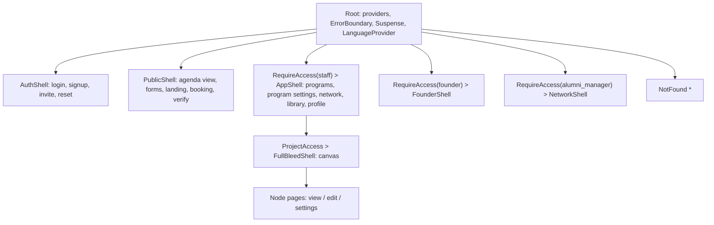
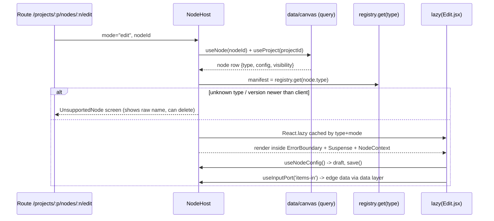
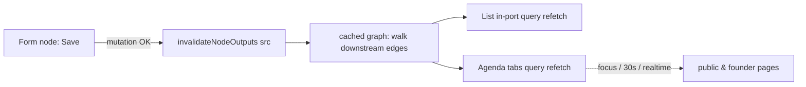
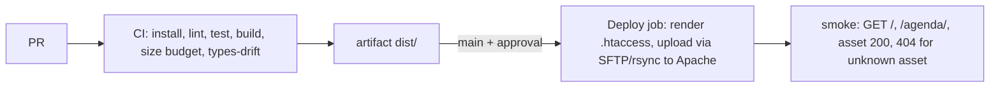

# Design 06 — Frontend Architecture (DRAFT for owner review)

Status: **design only — nothing is implemented.** Labels: **[Decided]** = owner said so (`docs/11`, `docs/13`); **[As-is]** = found in code/DB (file:line from `docs/01`–`09`); **[Proposal]** = analyst recommendation with reasons and alternatives. Terms follow `00-conceptual-model.md` (Program, Project, Canvas, Node, Node Type, Port, Edge, View/Tab, Founder/Participant). Other design docs are referred to by their planned names in `00` §10 (`02` data flow, `03` roles/RLS, `04` database, `05` migration, `07` emails/certificates); where this document needs something from them it is stated as an **assumption**.

## 0. Summary of choices

| Area | Choice | Label |
|---|---|---|
| Stack | React 19 + JavaScript + Vite + Tailwind + react-router, Supabase | [Decided] (`docs/13` §1) |
| Router | `BrowserRouter` (history API) with Apache SPA fallback; legacy `#/…` and `?agenda=` links redirected by a shim | [Proposal] (OD-2) |
| Canvas | `@xyflow/react` (React Flow), lazy-loaded on the canvas route only | [Proposal] (OD-1, owner decision) |
| Node mounting | Registry of manifests (eager, tiny) + lazy `Edit/View/Settings` components, mounted by one `NodeHost` | [Proposal] |
| Server state | TanStack Query + module-per-domain data layer replacing `api.js` | [Proposal] (OD-4) |
| UI duplication | `src/ui` (generic) + `src/shared` (domain-shared) + `src/lib` (pure utils) — §6 maps every absorbed duplicate | [Proposal] |
| i18n | One provider, JSON dictionaries per namespace, `Intl` for plurals/dates, logical (RTL-safe) Tailwind classes | [Proposal] (OD-5) |
| Auth | One `AuthProvider`, multi-role, one `RequireAccess` guard, one login page, role-aware landing | [Proposal] on [Decided] multi-role (`docs/11` C2) |
| Environments | `VITE_SUPABASE_URL` / `VITE_SUPABASE_ANON_KEY`; local Docker stack for the refactor | [Decided] local DB (`docs/13` §13–14) / [Proposal] mechanics |
| Deploy | Static build on Apache at athareg.com | [Decided] (`docs/11` C4) |

---

## 1. Application structure

### 1.1 Folder layout [Proposal]

```text
src/
  main.jsx                 # providers + RouterProvider
  app/
    routes.jsx             # the ONE route table (§2) — data router objects, lazy()
    shells/                # AppShell (PM), FounderShell, NetworkShell, PublicShell, AuthShell, FullBleedShell
    guards/                # RequireAccess, ProjectAccess, VisibilityGate, RoleHome
    legacy/                # LegacyRedirects (old /event/:id/..., #/agenda/..., ?agenda=)
    pages/                 # thin route-level pages (compose features); no business logic
  features/
    programs/              # ProgramsPage, ProgramSettingsPage, ProjectDetailsPanel
    canvas/                # ProjectCanvas, ToolSidebar, NodeInspector, edges validation
    agenda-view/           # AgendaViewPage (tabs host)
    founder/               # FounderProgramsPage, FounderProgramPage, blocks/
    participants/
    auth/                  # LoginPage, SignupPage, InvitePage, hooks
    alumni/                # existing alumni/network pages (moved, not redesigned)
  nodes/                   # §4: one folder per Node Type + registry.js + _kit/
  data/                    # §5: client, errors, queryKeys, one module per domain
  ui/                      # §6: generic components (Modal, Toast, Img, SearchBar, ...)
  shared/                  # §6: domain-shared (EntityCard, ReviewDesk, BookingSlotTable, ...)
  lib/                     # §6: pure utils (cn, time, tz, drive, excel, links, constants)
  i18n/                    # §7
  styles/                  # tokens, fonts, print
```

Rules enforced by lint (§13): `features/*` and `nodes/*` import Supabase only through `data/*`; a node folder never imports another node folder; `ui/` imports nothing domain-specific; no import cycles (as-is cycle `App.jsx` <-> `Dashboard.jsx`/`EventDashboard.jsx` via `prefetch`, `docs/01` §5.5).

### 1.2 Shell (layout-route) model [Proposal]
[As-is] layouts are wrapper components repeated per route for alumni (`docs/01` §5.2) and `Outlet`-based only for `PublicLayout`. Target: **every area is a react-router layout route** with an `Outlet`; guards are layout routes too, so a guard appears once per area, never per page.



---

## 2. Route table (replaces the as-is table in `docs/01` §5)

Design principles [Proposal]: (1) **one URL per thing** — no `/event/` vs `/events/`, no four shapes for a form; (2) the **project id** (`projectId`) is the only scope id in URLs; (3) node pages are **deep-linkable** (`/projects/:projectId/nodes/:nodeId/edit`); (4) public content uses short stable prefixes and accepts `:ref` = slug or id (§9); (5) `*` renders a 404 page (as-is none, `docs/01` §15.1 #6); (6) guards are layout routes.

Access column: `public` = no login (subject to per-item visibility, §9), `staff` = `super_admin` or `project_manager` (project-scoped via `ProjectAccess`), `SA` = `super_admin`, `AM` = `alumni_manager`, `F` = `founder`.

### 2.1 Auth and utility
| Path | Page | Access | Note |
|---|---|---|---|
| `/login` | LoginPage (all roles, `?next=` full path+query) | public | replaces `/login`, `/alumni/login`, `/alumni/signin`; role-aware redirect after login (§8) |
| `/signup` | Open founder sign-up (role `founder`, creates own company) | public | [Decided] scenario C (`docs/11` C8/C10) |
| `/invite/:token` | Invitation accept (founder linked to existing company) | public | [Decided] scenario B; replaces `/alumni/signup` |
| `/forgot-password`, `/reset-password` | Password recovery | public | [As-is] none exists (`docs/01` §6.6); [Proposal] add |
| `/no-access` | Authenticated but lacking permission / no role | any signed-in | replaces the as-is "role-less user lands on Dashboard" (`docs/01` §15.1 #10) |
| `/profile` | UserProfile (+ change password, language, linked Gmail status per `07`) | any signed-in | |
| `*` | NotFound | public | |

### 2.2 Staff app (PM) — `RequireAccess(staff) > AppShell`
| Path | Page | Access | Replaces (as-is) |
|---|---|---|---|
| `/` | `RoleHome` (redirect by role/last area, §8.3) | signed-in | `/` Dashboard |
| `/programs` | **Programs page**: programs with their projects, create program/project, move project between programs | staff | `Dashboard` |
| `/programs/:programId` | Program overview (projects grid) — optional deep link to a program | staff | — |
| `/programs/:programId/settings` | **Program Settings**: name/description/cover, status active/completed (unlocks certificates), PM access | staff (owner/SA) | new ([Decided] `docs/13` §12) |
| `/network/experts` | Athar Network — master experts/trainers registry | staff | `/experts` |
| `/network/companies` | Companies registry | staff | `/companies` |
| `/library` | Central Resource Library (global pool) | staff | `/library` |
| `/form-library` | Central form library | SA | `/form-library` + `/forms-library` |
| `/team` | Project managers / roles admin | SA | panel inside EventDashboard |

### 2.3 Project canvas and nodes — `RequireAccess(staff) > ProjectAccess > FullBleedShell`
| Path | Page | Replaces |
|---|---|---|
| `/projects/:projectId` | **Project canvas** (sidebar library, canvas, inspector); `?node=:nodeId` selects a node | `/event(s)/:id` EventDashboard + module cards |
| `/projects/:projectId/details` | Project Details panel: location, map link, offline days count, transportation | new ([Decided] `docs/13` §11, §14 #4) |
| `/projects/:projectId/participants` | Participants (status accepted/attended/withdrawn, source manual/selection) | new (`00` §7) |
| `/projects/:projectId/nodes/:nodeId` | Node **view** mode (read-only preview of the node as configured) | — |
| `/projects/:projectId/nodes/:nodeId/edit` | Node **edit** mode (PM configures; explicit Save) | `/event(s)/:id/{agenda,forms,experts,startups,lists,selection,library,join-athar,mentor-booking,ather-team-booking,mentoring-distribution}` |
| `/projects/:projectId/nodes/:nodeId/settings` | Node **settings** (name, visibility public/platform/private, node emails, tab label) | new |

Nested admin sub-pages of a node (e.g. mentor details, form responses) are **node-internal routes**: a node may declare `routes: [{ path: 'mentors/:mentorId', component }]` in its manifest; the host mounts them under `…/nodes/:nodeId/edit/*` (replaces `/event/:id/mentor-booking/:mentorId`).

### 2.4 Agenda view page and other public content — `PublicShell`
| Path | Page | Visibility check | Replaces |
|---|---|---|---|
| `/agenda/:ref/:tab?` | **Agenda view page with tabs** (§3.7) | item visibility | `/agenda/:eventId`, `/view/:eventId/{experts,startups,library,join-athar}`, `?agenda=` links |
| `/forms/:ref` | Public form portal | form visibility | `/events/:id/register/{company,expert}`, `/events/:id/{register/,}form/:formId`, `/forms/:eventId/:formId`, `/forms/:formId` |
| `/join/:ref` | Landing page node (view) | node visibility | `/view/:eventId/join-athar` |
| `/book/:nodeRef/:hostRef` | Public booking page (mentor or Ather team member) | node visibility | `/book/:mentorId`, `/ather-team-book/:memberId` |
| `/view/:nodeRef/:viewKey` | Generic full-screen node view (e.g. mentoring `live`, `matrix`) | node visibility | `/view/:eventId/mentoring/{live,matrix}` |
| `/verify/:code?` | Certificate verification | public | `/verify-certificate/:code` (declared twice, `docs/01` §15.1 #2) |

### 2.5 Founder platform — `RequireAccess(founder) > FounderShell` [As-is prefix kept]
| Path | Page | Note |
|---|---|---|
| `/alumni/founder` | → `dashboard` | |
| `/alumni/founder/dashboard` | FounderDashboard | stays |
| `/alumni/founder/programs` | **Founder Programs list** (§10.1) | [Decided] `docs/13` §4 |
| `/alumni/founder/programs/:projectId` | **Founder Program page** (§10.2) | [Decided] `docs/13` §11 |
| `/alumni/founder/programs/:projectId/agenda/:tab?` | Agenda view embedded in the founder shell (platform-only content reachable) | same `AgendaViewPage`, other shell |
| `/alumni/founder/programs/:projectId/library` | Resource Library view | same pattern |
| `/alumni/founder/{opportunities,notifications,profile,progress}` | stay | |
| `/alumni/founder/company/:id` | CompanyProfilePage | stays |

### 2.6 Alumni manager / Network — `RequireAccess(alumni_manager) > NetworkShell` [As-is stays]
`/alumni/admin/{dashboard,invitations,notifications,analytics,opportunities,impact,workspace,directory,company/:id}` — unchanged paths and pages (`docs/01` §5.2, scope per `docs/13` §1). Only the guard and shell wiring change (§8).

### 2.7 Legacy redirect table (one file, `app/legacy/`) [Proposal]
Shared links already exist in the field, so old shapes redirect (replace-history) instead of 404. Assumption: **project id = former event id** (`05` should preserve UUIDs so mapping is 1:1).

| Old | New |
|---|---|
| `/#/agenda/:id?lang&tabs`, `/?agenda=:id&…` (shim at boot, replaces `App.jsx:100-116`) | `/agenda/:id?lang&tabs` |
| `/#/view/:id/experts`·`startups`·`library`·`join-athar` | `/agenda/:id/<tab>` |
| `/#/event(s)/:id` | `/projects/:id` |
| `/#/event(s)/:id/<module>` | `LegacyModuleRedirect`: finds the node of the matching type in project `:id` → `/projects/:id/nodes/:nodeId/edit` (or the canvas if none/ambiguous) |
| `/#/events/:id/(register/)form/:formId`, `/#/forms/:formId`, `/#/forms/:eventId/:formId` | `/forms/:formId` |
| `/#/book/:mentorId`, `/#/ather-team-book/:memberId` | `/book/:nodeRef/:hostRef` (resolved by lookup) |
| `/#/alumni/login`, `/alumni/signin`, `/alumni/signup` | `/login`, `/invite/:token` or `/signup` |
| `/#/verify-certificate/:code` | `/verify/:code` |

The hash shim is a 10-line boot script: if `location.hash` starts with `#/`, `history.replaceState` to the path form before React mounts (the as-is code already does this for `?agenda=`).

---

## 3. Canvas

### 3.1 UX anatomy [Proposal on [Decided] concept, `docs/13` §2]
```text
┌──────────────┬──────────────────────────────────────────┬───────────────┐
│ Tool library │  Canvas (pan / zoom / grid)               │ Inspector     │
│ (sidebar)    │   [Form]──►[List]──►[Agenda]◄──[Landing]  │ (selected     │
│  Agenda      │   node = card: icon, name, status chips,  │  node/edge)   │
│  Form        │   input ports left, output ports right    │  name, type,  │
│  Lists       │                                          │  ports, links │
│  Selection   │  top bar: project name · Save layout ·   │  Edit/View/   │
│  ...         │  Project Details · Participants · Share  │  Settings     │
└──────────────┴──────────────────────────────────────────┴───────────────┘
```
- **Sidebar tool library**: built from the registry grouped by `category`, searchable, bilingual names. Drag a tool onto the canvas **or** tap/click "+" to add at the viewport centre (needed on touch, where HTML5 drag-and-drop does not work). The same tool can be added many times ([Decided]); new node gets a default name `"<Type> 2"`.
- **Connect ports**: drag from an output port to an input port. `isValidConnection(conn)` consults the registry (port type compatibility, cardinality, no self loop, no duplicate edge, cycle policy from `02`); invalid targets are dimmed while dragging, with a tooltip reason. Edge click opens the inspector in "edge" state (delete edge, see what flows).
- **Node inspector**: summary (type, version, name editable inline), configuration status ("needs a connected form"), ports with connected counterparts, **Open (view)**, **Edit**, **Settings**, Duplicate, Delete (with impact list: "3 edges, public link will stop working").
- **Touch/mobile alternative to dragging**: inspector has "Connect output → pick target node/port" pickers (also a11y keyboard path). Canvas editing is **desktop/tablet-first**; on phones the canvas is a read-only pan/zoom plus the picker-based edit (OD-13).
- **Persistence**: node positions and edges are saved by **explicit "Save layout"** plus an autosave of layout only (debounced, 800 ms, positions only), kept separate from node *configuration* saves (which are explicit per node and drive downstream refresh, §5.5). Dirty guard on navigation.
- **Empty state**: a new project opens an empty canvas with a centered hint "Drag a tool from the left" ([Decided] concept).

### 3.2 React Flow vs custom [Proposal — OD-1 is the owner's decision]

| Criterion | `@xyflow/react` (React Flow 12) | Custom (SVG + pointer events + own pan/zoom) |
|---|---|---|
| React 19 + JavaScript | Supports React 18/19; plain JS usable (types optional) | Native |
| Features out of box | Pan, zoom, minimap, selection, drag nodes, handles/ports, edge routing (bezier/step), `isValidConnection`, keyboard delete, viewport fit, `onConnect` | All must be written: hit-testing, snapping, edge path routing, zoom-to-cursor, marquee select, undo |
| Effort / risk | Low; node internals are plain React components (our `NodeCard`) | High: realistically 1–2 K lines + ongoing bug surface (touch pinch, wheel zoom inertia, edge hit area) |
| Bundle size | Order of tens of KB gzip (core + d3-zoom/drag/selection + a small zustand store); **to be measured**, loaded only on the canvas route via `lazy()`, so no cost for public/founder pages | Smaller (maybe 10–20 KB of our code) but we maintain it |
| RTL | Canvas world is LTR by design (x grows right). Put the canvas container in `dir="ltr"` and give each node card's *content* `dir` = UI direction; keep port convention **left = inputs, right = outputs** in both languages (graph semantics, not text direction), or mirror positions in RTL via a `mirror` flag (OD list) | Same constraint; we would implement mirroring ourselves |
| Touch | Pointer events: one-finger pan, pinch zoom, tap select, drag from a handle works; small handles are hard to hit → enlarge handle hit area (`connectionRadius`, 24 px transparent handle) | We must implement and test gestures |
| Accessibility | Keyboard focus/delete on nodes; edge creation by keyboard is limited → inspector pickers cover it | Fully ours |
| Licence / branding | MIT; library shows a small attribution by default (owner should confirm acceptable; removing it is subject to the project's terms) | None |
| Fit with registry | Node `type` → our `NodeCard` wrapper receiving `manifest`; ports render from `manifest.ports` | Same |
| Lock-in | Moderate; positions/edges are plain JSON in our DB (`04`), so replaceable | None |

**Recommendation:** React Flow for v1; the persisted model (`nodes[{id,type,position,…}]`, `edges[{id,source,sourcePort,target,targetPort}]`) is library-neutral so a later custom renderer is possible. **Alternative considered:** custom canvas — only worth it if the attribution/licence or bundle size proves unacceptable, or if the canvas must be fully usable on phones. **Reference for sizing:** keep the canvas chunk and the node library lazy, and budget it in CI (§13).

### 3.3 Canvas components [Proposal]
`ProjectCanvas` (RF provider, load graph query, handlers) · `ToolSidebar` (registry groups, drag source + add button) · `NodeCard` (registry-driven: icon, name, status badges, `<Handle>` per port) · `EdgeLine` (type colour by port family) · `NodeInspector` (desktop right panel; mobile bottom sheet `ui/Sheet`) · `CanvasToolbar` · `useCanvasGraph(projectId)` (query + mutations: `addNode`, `moveNodes`, `connect`, `disconnect`, `renameNode`, `deleteNode`) in `data/canvas.js`.

---

## 4. Node registry implementation

### 4.1 Folder layout [Proposal]
```text
src/nodes/
  registry.js                 # builds the registry from manifests (eager, manifests only)
  manifest.contract.js        # shape validation (dev + test), port-type table
  _kit/                       # node SDK used by every node
    NodeHost.jsx              # mounts a node in a mode (§4.3)
    NodeContext.js            # { node, project, config, mode, lang, can, ... }
    useNodeConfig.js          # draft state + explicit save()
    useInputPort.js           # resolves data arriving over edges
    NodeFrame.jsx             # standard header/save bar/error/loading for Edit pages
  agenda/
    manifest.js
    Edit.jsx  View.jsx  Settings.jsx          # lazy
    views/ExpertsTab.jsx ...                  # contributed Agenda tabs (public)
    data.js                                   # this node's queries/mutations + output resolvers
    i18n.ar.js  i18n.en.js
  form-builder/ lists/ selection/ mentor-booking/ ather-team-booking/
  mentoring-distribution/ resource-library/ landing-page/ certificates/
```

### 4.2 Manifest (extends `00` §4) [Proposal]
Manifests are tiny and eager (no React component code, only dynamic-import thunks), so the sidebar, validation and edge checks work without loading any node.

```js
// nodes/lists/manifest.js
export default {
  key: 'lists', version: 1,
  name: { en: 'List', ar: 'قائمة' }, icon: 'list', category: 'data',   // icon = key into ui/iconMap (explicit lucide imports)
  singleton: false,                                        // may be added many times
  configSchema: {/* field defs or zod-like, used for default config + validation */},
  defaultConfig: () => ({ kind: 'custom', title: '' }),
  ports: {
    in:  [{ key: 'items-in', type: 'rows:form-response', multiple: true, label: {…} }],
    out: [{ key: 'items-out', type: 'rows:list-items', label: {…},
            resolve: () => import('./data.js').then(m => m.resolveItemsOut) }]   // output resolver, data only
  },
  contributesViews: [{ key: 'list', title: {…}, component: () => import('./views/ListTab.jsx') }],
  visibility: { supported: ['private','platform','public'], showToParticipants: true },
  emails: [],                                              // [{key, trigger, templateFields}] (07)
  components: {                                            // lazy, one per mode (§4.3)
    Edit:     () => import('./Edit.jsx'),
    View:     () => import('./View.jsx'),
    Settings: () => import('./Settings.jsx'),
  },
  routes: [],                                              // optional node-internal sub-routes
  ownsTables: ['list_items'],                              // documentation + lint boundary
};
```
Additions versus `00` §4 (recorded in "Notes on 00" below): `ports.out[].resolve` (the **only** way another node gets this node's data), `components` as lazy thunks, `routes`, `singleton`, `defaultConfig`.

### 4.3 How a node mounts in each mode [Proposal]

| Mode | Component | Who/where | Contract |
|---|---|---|---|
| `edit` | `Edit` | PM, `/nodes/:id/edit` | Draft state in `useNodeConfig`; **explicit Save** writes via the node's `data.js`, then triggers saved-state refresh (§5.5) |
| `view` | `View` | PM preview, `/nodes/:id`; also reused by Agenda preview | Read-only render of the node as participants would see it, including connected input ports |
| `settings` | `Settings` | PM, `/nodes/:id/settings` | Common fields (name, visibility, tab label) are rendered by the kit; node adds its own sections (emails, share presets) |
| contributed view | `contributesViews[i].component` | Public/participant in Agenda tab or `/view/:nodeRef/:viewKey` | Receives `{ node, lang, audience }`; reads **only** through `useInputPort` / its own `data.js` |

Disambiguation of "view" (recorded in Notes on 00): `00` uses *view* for both the node's View mode and an Agenda **View/Tab**. This doc uses **View mode** (PM preview) and **contributed view** (participant-facing tab) respectively.

`NodeHost` is the only place that knows about lazy loading, error isolation (one failing node cannot take down the canvas page) and the standard loading skeleton. `React.lazy` wrappers are memoised in `registry.js` (`getComponent(type, mode)`) to keep stable component identity (as-is `ImageSection` re-created per render, `docs/03` §7.1 #13, is the anti-pattern).

### 4.4 Input ports in the client [Proposal]
`useInputPort(portKey)` → finds edges whose target is `(thisNode, portKey)` in the cached graph, and for each source node calls the source manifest's `ports.out[…].resolve()` function through TanStack Query with key `['node', sourceId, 'out', sourcePortKey]`. Returns `{ status, items, sources }`. Items are references + overlay (per `00` §5 and [Decided] `docs/13` §14 #2); the resolver joins source row + overlay server-side or via one query so no component re-implements it. A node cannot read another node's tables: `no-restricted-imports` forbids `nodes/*` → `nodes/<other>/*`, and `data/*` modules per node are private.

### 4.5 Version and unknown types
`node.type_version` (DB `04`) vs `manifest.version`: the host runs `manifest.migrateConfig(config, from)` if present; a node from a newer deployment shows `UnsupportedNode` instead of crashing.

---

## 5. State management and data access layer

### 5.1 Problems being replaced [As-is]
`src/lib/api.js`: 4,971 lines, 168 exports, two error conventions (throw vs swallow), a cache that monkey-patches `supabase.from` and clears everything on any write, keys that alias slug/UUID, client-side aggregation, non-atomic multi-step writes, per-feature libs (`mentorBooking.js`, `atherTeamBooking.js`, `mentoringDistribution.js`) with duplicated logic, ~20 components calling Supabase directly (`docs/02` §1.2, §2.3, §5.2).

### 5.2 Target shape [Proposal]
```text
src/data/
  client.js          # the single supabase-js instance (env-driven, §11)
  errors.js          # AppError + fromSupabase(error) mapping
  queryClient.js     # TanStack QueryClient: defaults, global onError
  queryKeys.js       # key factory: keys.project(id), keys.node(id), keys.nodeOut(id, port) ...
  functions.js       # invoke edge functions with the same error contract
  storage.js         # uploadImage(file, {kind, ownerId}) — one folder convention
  refs.js            # resolveRef(kind, ref) — slug or id (§9)
  programs.js  projects.js  canvas.js  participants.js
  people.js          # experts + companies: the ONE way (§5.4)
  lists.js  forms.js  responses.js  agenda.js  selection.js  booking.js
  distribution.js  library.js  landing.js  certificates.js
  auth.js            # profile, roles, invitations
  alumni/...         # existing alumni API moved as-is (split by sub-domain)
  *.hooks.js         # useProgram(id), useProjects(programId) ... thin useQuery/useMutation wrappers
```
Conventions:
- A data module exports **plain async functions** (callable from tests/edge cases) and a sibling `*.hooks.js` exports hooks. Components use hooks only.
- **One error contract:** functions **throw `AppError`** `{ code: 'forbidden'|'not_found'|'conflict'|'validation'|'network'|'unknown', messageKey, cause, retryable }`. Postgres/PostgREST codes are mapped once (`42501` → forbidden, `23505` → conflict, `PGRST116` → not_found). No function swallows errors and returns `[]` (as-is "S" pattern, `docs/02` §1.2).
- Multi-step writes that must be atomic (`duplicateProject`, save form with fields, accept invitation) are **Postgres RPCs** (`04`), the client calls one function (as-is: 0 `.rpc()` calls, non-atomic sequences, `docs/02` §1.2).
- Aggregations (alumni analytics) move to SQL views/RPCs (`04`); the client no longer pulls whole tables (as-is `docs/02` §1.2).
- No `console.log` noise; logging via `lib/log.js` (level-gated).

### 5.3 Caching with TanStack Query [Proposal — OD-4]
Replaces `withCache` + monkey-patch. Reasons: per-key invalidation (as-is clears everything), request de-duplication, retry/backoff, stale-while-revalidate, `isFetching` states, devtools, window-focus refetch (keeps the public agenda fresh without custom timers). Cost: ~13 KB gzip. Alternatives: SWR (similar, fewer mutation helpers), keeping a custom cache (we would re-write what the library provides). Defaults: `staleTime` 30 s for lists, 5 min for static registry-like data, `retry` 1 for network errors only, no retry for `forbidden/not_found`. **Local UI state** stays `useState/useReducer`; **editor drafts** use `useDraft` (explicit Save, dirty guard), which replaces the ad-hoc staged-save logic (`docs/03` §7.3 "immediate vs staged persistence").

### 5.4 One way to fetch experts and companies [Proposal]
As-is the same people are reached through `getExperts`, `getMasterExperts`, `getAgendaTabs`, `getFullAgenda`, `getExperts` inside viewers, `getCompanies`, `getStartups`, and `supabase.from('experts')` directly (`docs/02` §5.2, `docs/03` P8) with divergent field names (`startup_name` vs `name`, `docs/03` §7.4). Target:
- **Source of truth for display = list items** (`00` §5): a List node's items resolve to a normalized entity view.
- `data/people.js`: `getPersonCards(listNodeId)`, `getMasterExperts(filters)` (Athar Network), `getCompanyDirectory(filters)`; **all return normalized `ExpertView` / `CompanyView`** produced by `shared/entities/normalizeExpert.js` and `normalizeCompany.js` (single field-name mapping, bilingual `pick()`), so no component sees `expert_id || id`.
- Viewers, managers, the Agenda tabs and the founder program page use the same hooks: `useListItems(nodeId)` / `useInputPort`.

### 5.5 Saved-state refresh (how a save reaches other views) [Proposal, per `00` §5 / design 02]
Rule [Decided]: connected data refreshes **after the source is saved**, not per keystroke, not trigger-based.
1. Each node's `save()` ends with `await invalidateNodeOutputs(sourceNodeId)`.
2. `invalidateNodeOutputs` reads the cached graph (nodes/edges are already on the client), walks edges **downstream** of the source and invalidates `['node', targetId, 'in', port]` and `['node', sourceId, 'out', *]` plus the Agenda tab list (`['agendaTabs', agendaNodeId]`). Views mounted anywhere in the same session re-render with fresh data.
3. **Other sessions** (a founder with the agenda open, another PM): public/participant pages use `refetchOnWindowFocus` + a 30 s interval for agenda-like views (as-is `AgendaViewer` already polls every 30 s, `docs/03` §7.5). Optional upgrade (OD-14): a Supabase Realtime broadcast `project:<id>` event `node-saved {nodeId}` that triggers the same invalidation immediately; costs one channel per open page.
4. Node pages show a "Saved · refreshed N views" toast after a successful save; failures show the AppError message and keep the draft.



---

## 6. Shared UI library — what is shared and what each item absorbs

Location: `ui/` generic, `shared/` domain-shared, `lib/` pure. All items [Proposal]; "absorbs" cites the as-is duplicates (`docs/03` §6 P1–P26, `docs/04` §9.1, `docs/05` §9.1–9.2, `docs/06` §12.4, `docs/01` §9, §15).

### 6.1 Generic UI (`src/ui`)
| Component / hook | Absorbs |
|---|---|
| `Modal`, `ConfirmDialog`, `useConfirm()` | Hand-built modals in every page; custom confirm in `EventBuilder`; `window.confirm/alert/prompt` (Dashboard 4/2, EventDashboard 9, ExpertManager 12/0/1, StartupManager 9/0/1 … `docs/03` §5 "Native alert"); `approve/reject` `prompt()` (P2); INC-5 |
| `ToastProvider`, `useToast()` | `alert()` feedback; `EventBuilder` toast (and its `'warning'` rendered red, `docs/03` §7.5); `MentorBookingAdmin` toast |
| `FormModal` (idle → loading → success state machine) | P21 (Dashboard create event/program, 1500 ms vs 1000 ms timers) |
| `Sheet` (bottom sheet, mobile) | inspector on phones; `modal-mobile` CSS utility |
| `Popover`/`Menu` + `useOutsideClick` | P14 (3 copies), P24 (kebab/move-to-program menus), P22 (EN vs AR dropdown duplicated blocks) |
| `Tabs`, `Badge/StatusPill`, `Toggle`, `IconButton` | per-page tab/badge/toggle markup; the 11 "Show on Card" toggle blocks (P4) |
| `SearchBar` (+ `useListFilter(fields, term)`) | P15 (7 search filters, different fields), P16 (mobile search toggle ×3) |
| `Img` (replaces `LazyImage`) with Drive URL fallbacks | `LazyImage` (192 lines, localStorage auto-heal with emoji logs), P19 (two Drive helper families), CON-16 (plain `` in distribution views) |
| `ImageField` (URL + upload + preview) | P18 (5 copies, ad-hoc folders `covers`, `visuals`, `experts/<id>`, `startup-logos`, `expert-photos`, `company-logos`, `library/...`) → one `uploadImage(file,{kind,ownerId})` |
| `BilingualField` / `BilingualInput` (`xxx` + `xxx_ar`) | P20 (ExpertManager, StartupManager, MasterExpertsList, EventBuilder, LibraryManager) |
| `LoadingState`, `ErrorState` (retry), `EmptyState`, `Skeleton` | P17 (every page hand-written; different tones/copy), `LoadingFallback` English-only |
| `NoiseBackground` (CSS class `.bg-noise` from one SVG asset) | P12 (7+ inline data-URI copies; `LoginPage`, `MentoringDistributionAdmin`; `athar-branding.md` remote texture) |
| `PageBackground`, `PublicHeader` (image/colour/overlay/title) | P10 (3 header variants), P11 (5 background style objects, different default colours) |
| `SortableGrid`/`useSortableSensors` (dnd-kit setup) | P6 (3 copies of sensors config) |
| `ExpandableText`, `RichTextEditor` (callback-ref safe) | stay, fix stale `onChange` closure (`docs/01` §8) |
| `cn()` (`lib/cn.js`: `clsx` + `tailwind-merge`) | P13 (4 local definitions: Dashboard, EventDashboard, JoinAtharDashboard, JoinAtharView) |
| `DirIcon` / `rtl:` helpers | physical arrows/chevrons flipped manually in places |

### 6.2 Domain-shared (`src/shared`)
| Component | Absorbs |
|---|---|
| `EntityCard` + `PersonCard`/`OrgCard` configs (field visibility from one `cardFields` config) | `ExpertCard` + `CompanyCard` (~400 lines each, P9, dead list variants), the three overlapping card-visibility sources (`docs/03` §7.3) |
| `EntityManager` (generic curated grid + review desk + add/edit modal + card settings + preview) | `ExpertManager` ≈ `StartupManager` (P1–P5, ~1,300 vs ~1,240 lines), approve/reject handlers (P2), default `display_config` literals ×7 (P5) |
| `ReviewDesk` (status-agnostic submissions list; approve/reject with reason dialog) | the two review lists; the `screening` vs `pending` mismatch (`docs/03` §7.1 #3) becomes impossible by one status vocabulary in `04` |
| `EntityViewer` (public list page) | `ExpertViewer` ≈ `StartupViewer` (P8) |
| `RegistrationPortal`/`FormPortal` (renders a form node publicly) | `ExpertPortal`, `CompanyPortal` (P7, both currently crash on translation keys, `docs/03` §7.1 #1), `GenericFormPortal` and its four URL shapes |
| `QuestionEditor` (single question builder) | `QuestionsBuilder` + library inline editor + legacy editors in StartupManager/ExpertManager (A-1), `isCoreField/getIconForType` ×2 (A-2) |
| `ShareChannels` (+ `constants/platforms.js`) | `PLATFORM_META` ×2 and social lists in `SourceTrackingToolbar`, `GenericFormPortal`, `FormClicksAnalyticsTab`, `FormResponsesTab` (A-7) |
| `BookingSlotTable`, `SlotSeriesForm`, `MeetLinkButton`, `PublicBookingPage` (host-agnostic) | DUP-6..9 (MentorBooking ≈ AtherTeamBooking admin and public pages), DUP-3..5 (data side → `data/booking.js`) |
| `TimerControls`, `useCountdownTimer` | DUP-21 (3 copies of the timer bar), `useMentoringTimer` |
| `ParticipantStatusBadge`, `CertificateButton` | new (founder page, participants table) |
| `LanguageSwitch`, `UserMenu` (`ROLE_LABELS` in `constants/roles.js`) | `UserNavDropdown` vs layout headers (`docs/06` §12.4), `ROLE_LABELS` hard-coded in layouts |
| `AreaSwitcher` | new: users with several roles (§8) |

### 6.3 Pure utilities (`src/lib`)
| Util | Absorbs |
|---|---|
| `time/slots.js`: `parseHHMM`, `formatHHMM`, `to12h`, `slotsBetween`, `isWithinNotice`, `currentSlotIndex`, `secondsUntilSlotEnd`, `resolveDayConfig`, `ADVANCE_NOTICE_OPTIONS`, `DEFAULTS` (notice 1440, slot 30/5/1) | DUP-1, 2, 11, 12 (constants and notice logic ×2–5), DUP-13..17 (HH:MM helpers ×3, two functions both named `calculateDaySlotTimes`, 12-hour formatter ×3, current-slot ×3, seconds-until-end ×3), `utils.formatTime` |
| `time/tz.js`: one `APP_TIMEZONE` (event/project timezone, default `Africa/Cairo` as in `process-booking`), `toInstant(dateStr, timeStr, tz)`, `formatInTz(instant, tz, opts)`, `todayInTz(tz)` | CON-1 (UTC-midnight vs local-midnight slot instants), CON-3 (Cairo vs UTC calendar), CON-10 (Live View "today" in UTC vs local clock), CON-11 (editor shows UTC, rows local). **Rule:** store `timestamptz` (UTC), construct/display only through these helpers; never `new Date('YYYY-MM-DD')` |
| `time/format.js`: `formatDate`, `formatDateTime` driven by the current language | `utils.formatDate` (options spread bug) and per-page locale handling |
| `export/xlsx.js`: `exportRows(rows, columns, filename)` (dynamic `import('xlsx')`), `parseWorkbook/agenda import` kept in `import/` | `lib/excel.js` plus local exports in `AlumniDirectory` (local fn also named `exportToExcel`), `ImpactDashboard`, `MEWorkspace` calling `XLSX.writeFile` directly (`docs/01` §9.2, #42); `utils.exportToCSV` (no callers) |
| `drive.js`: `driveImageUrls(url)` returning ordered candidates; one `isDriveUrl` | `getGoogleDriveFallbackUrls/FullSizeUrls/DirectLink` + duplicated predicate (`docs/01` §9.1) |
| `links.js`: `buildPublicUrl(kind, ref, {lang, tab})`, `buildInviteUrl(token)`, `buildShareUrl` | P26 (4+ event link builders), invitation link builders ×3 (`docs/06` §12.4), `getAppBaseUrl`, `getShareUrl`, hard-coded `https://athareg.com/share` |
| `people/contact.js`: `extractPrimaryEmail`, `displayName`, `extractFirstName` (also copied into edge function by build step or kept in sync by test) | A-8 (4 implementations incl. `nameParser.ts` copy `test-founder-name.js`) |
| `constants/`: `stages`, `governorates` (or country-agnostic list from DB), `resourceTypes` (+icon/colour map), `platforms`, `roles`, `brand` tokens | P25 (stage list, 27 governorates, link icons ×2, resource-type maps ×4, accent colours scattered, template sheet id) |
| `phone.js` | `phoneValidation.js` moved; sanitise by declared field type, not key-name substring (A-9) |

Also: **tokens** — brand colours only in `tailwind.config.js` (fixes `#1a27c9` hard-coded in components and the yellow mismatch `docs/01` §12); **fonts** loaded once (as-is twice, `docs/01` §2.4); remove custom `line-clamp-*` duplicates of Tailwind 3.4.

---

## 7. Internationalization (Arabic/English, RTL)

[As-is] four mechanisms (`docs/01` §10): central dictionary by component, URL `?lang`, `useLanguage` hook (alumni, localStorage), and inline strings (LoginPage Arabic, ChangePasswordModal/ErrorBoundary English…).

### 7.1 Approach [Proposal — OD-5]
- **One `LanguageProvider`** at the root exposing `{ lang, dir, setLang, t, tn, pick, formatDate, formatNumber }`. It sets `document.documentElement.lang/dir` on change (global, not per wrapper element).
- **Resolution order:** `?lang=ar|en` on the URL (public/share links; not persisted) → explicit user choice (`localStorage['athar.lang']`, and `profiles.language` when signed in, `03/04` to add the column) → default by area: public and founder pages `ar` (matches the share redirect forcing `lang=ar`, `App.jsx:100-116`), staff app `en` (as-is admin copy is predominantly English), switchable everywhere.
- **Dictionaries:** JSON/JS objects by **namespace**, lazy-loaded: `i18n/common.{ar,en}`, `i18n/auth`, and per node `nodes/<type>/i18n.{ar,en}.js` loaded together with the node's chunk. `useT('agenda')` returns `t('key', {vars})`. Missing key → English fallback → key (and a dev-time console warning + the parity test in §13).
- **No third-party library by default**: two languages; plural rules via `Intl.PluralRules` (Arabic has 6 forms) and a `tn(key, count)` helper; dates/numbers via `Intl` with the active language. **Alternative:** `i18next` + `react-i18next` (~20 KB gzip, ICU plugins) — choose it if non-developers will edit translations through a tool or more languages are expected.
- **Content bilingual fields** (`name` + `name_ar`): `pick(obj, 'name')` returns the localized value with fallback to the other language; used by `BilingualField` read side so no component writes `lang === 'ar' ? x.name_ar : x.name` (as-is everywhere).
- **Tailwind logical utilities** (`ms-*`, `me-*`, `ps-*`, `pe-*`, `start-*`, `end-*`, `text-start`, `border-s`) are mandatory; physical `ml-/mr-/pl-/pr-/left-/right-/text-left` are flagged by lint (§13). Direction-sensitive icons use `DirIcon` (`rtl:-scale-x-100`).
- **Fonts:** Tajawal for Arabic (`font-arabic`), Manrope for Latin, switched by `[dir=rtl]`/`:lang(ar)` in CSS rather than per-component classes; loaded once.
- **Canvas exception:** the canvas container is `dir="ltr"` (§3.2); node card content and all panels follow the UI direction.
- **Numerals:** OD-12 (Western `0-9` vs Arabic-Indic). Default recommendation Western digits (`ar-u-nu-latn`) for consistency with data entry and phone numbers.
- **Email/PDF content** language is per recipient/template (`07`), not the UI language.
- **Landing page** view is currently English LTR only (`docs/13` §8); its node view must read the same provider; bilingual card content is part of its config (`01`).

---

## 8. Auth, session and roles on the client

### 8.1 Provider [Proposal on [As-is] `docs/01` §6]
`AuthProvider` becomes thin and uses the same query layer:
- `useSession()` — wraps `supabase.auth.onAuthStateChange`/`getSession` once.
- `useProfile()` and `useRoles()` — TanStack Query keyed by `userId`; **no hand-rolled dual localStorage/sessionStorage role cache** (as-is two modules parse the same key with different shapes, empty server result keeps stale cached roles → revoked roles linger, `docs/01` §6.3, §15.2 #14). First paint waits for `useRoles` (skeleton); if it fails, show an error with retry, never trust a stale role to grant access.
- Context value is memoised and stable; `TOKEN_REFRESHED` does **not** refetch roles (as-is full refetch each refresh).
- Remove the global `visibilitychange → getSession()` and the no-op auth `lock` unless a reproduced problem justifies them (as-is purpose unknown, `docs/01` §16 Q18) — see §11.
- API: `{ user, profile, roles, status: 'loading'|'authed'|'anon', hasRole(r), can(permission), signIn, signOut, changePassword, updateProfile }`.

### 8.2 Multi-role model [Decided: several roles per user, `docs/11` C2]
Roles: `super_admin`, `project_manager`, `alumni_manager`, `founder`. Instead of the as-is single `primaryRole` priority and role-specific redirects embedded in guards:
- `lib/permissions.js` maps roles → **permissions/areas** (`area:staff`, `area:network`, `area:founder`, `program:create`, `form-library:manage`, `team:manage`, …). `super_admin` implies all (explicit in the map, not a special-case in each guard).
- **Areas** are what the user can enter. A user with `founder` + `project_manager` has two areas; `AreaSwitcher` in the user menu switches and the last area is remembered (`localStorage['athar.area']`).
- Client checks are **UX only**; authority is RLS (`03`).

### 8.3 One guard [Proposal]
Replaces `RoleGuard` + `AlumniRouteGuard` + dead `ProtectedRoute` (`docs/01` §6.5):

```jsx
<RequireAccess area="staff" />                    // layout route; renders <Outlet/>
<RequireAccess area="network" />
<RequireAccess area="founder" />
<RequireAccess permission="form-library:manage" />
<ProjectAccess />                                 // loads project; checks membership (owner/collaborator) or super_admin
```
Decision table (single implementation, unit-tested):
| State | Result |
|---|---|
| auth loading | full-screen spinner (localised) |
| anonymous | `Navigate /login?next=<path+search+hash>` |
| signed in, no roles | `/no-access` (not the dashboard) |
| signed in, lacks required area/permission | `/no-access`, or if the user has another area → toast + that area's home |
| ok | `<Outlet/>` |

`RoleHome` (route `/`): staff-capable → `/programs`; only founder → `/alumni/founder/dashboard`; only alumni_manager → `/alumni/admin/dashboard`; several → last remembered area, else a small chooser. Login redirects to `?next` if the user can access it, else `RoleHome`. Sign-out goes to `/login` for everyone (as-is split between `/login` and `/alumni/login`).

### 8.4 Sign-up and invitations [Decided behaviour, Proposal mechanics]
`/signup` (open) assigns role `founder` and starts company creation; `/invite/:token` assigns `founder` and links the existing company (`docs/11` C8, C10). The role assignment happens **server-side** (DB function/trigger or edge function, `03`) — the client cannot write `user_roles` (as-is no path assigns the role, `docs/11` C8). Client flow: validate token (`data/auth.js: validateInvitation`) → sign up → `acceptInvitation` RPC (atomic) → redirect to founder dashboard.

---

## 9. Public vs platform-only links and slug resolution

[Decided] public or platform-only is optional per item (`docs/13` §4); `00` §6 visibility values `private | platform | public`.

### 9.1 Resolution [Proposal]
`/agenda/:ref`, `/forms/:ref`, `/join/:ref`, `/book/:nodeRef/…`, `/view/:nodeRef/…`: `:ref` is a **slug or UUID**.
- `data/refs.js: resolveRef(kind, ref)` → one RPC `resolve_ref(kind, ref)` (`04`) that returns `{ id, kind, slug, visibility, projectId, title }` or not-found **without** leaking private items to anon (RLS-aware: for anon it only returns `public`).
- Slugs are **generated short ids** (e.g. 8-char) with optional vanity edit in node Settings, unique per `kind`. This replaces name-based matching (`getEvent`: `ilike` on `event_name`, normalised in-memory scan, prefix match — ambiguous, slow, and the same entity cached under slug and uuid, `docs/02` §1.2, §2.3). Old slugs are kept in a `slug_history` so old links keep working (`04`).
- On success the page canonicalises the URL (`replace`) to the slug form; the query cache uses the **resolved id** as key (no slug/uuid aliasing).

### 9.2 Visibility gate
`VisibilityGate` (inside `PublicShell`, used by each public page):
| item.visibility | anonymous | signed in |
|---|---|---|
| `public` | render | render |
| `platform` | `/login?next=…` with message "this link is available to program members" | render if participant/staff of the project (RLS decides, UI shows `/no-access` on forbidden) |
| `private` | not-found page (do not reveal existence) | staff only |

Agenda tabs apply the same check **per contributed view** (the tab disappears if its node is not visible to the viewer), so a public agenda can include a platform-only tab.

### 9.3 Share links and OG meta (see §12.3)
All share UI uses `buildPublicUrl`; presets per platform with `{link}` come from node config ([Decided] share text per platform per card, `docs/13` §14 #3).

---

## 10. Founder platform

### 10.1 Programs list — `/alumni/founder/programs`
A founder sees a project here if **(a)** a participant row exists from manual assignment, or **(b)** they filled the outreach form and were accepted via Selection (`00` §6; both produce a `participants` row, `00` §7). Card: cover (project agenda cover), program + project name, participant status chip (accepted/attended/withdrawn), dates/location line if Project Details has them, "Open" CTA. Sorted active first; empty state "No programs yet". Query: `useMyPrograms()` → one server query joining participants → projects → programs (RLS-scoped).

### 10.2 Program page — `/alumni/founder/programs/:projectId` — **block list driven by what the PM enabled** [Decided `docs/13` §11, `docs/11`]
Rule: **nothing appears by default**; a block exists in the response only if the PM added/enabled it.

Data contract [Proposal, assumption for `03/04`]: one RPC `get_founder_program_page(project_id)` returns the project header and an **ordered array of enabled blocks** — computed on the server under RLS so the client cannot show more than permitted and never needs to infer "is this enabled":
```json
{
  "project": { "id": "…", "name": {"en":"…","ar":"…"}, "program": {"id":"…","name":{…}}, "cover_url": "…", "status": "active|completed" },
  "participant": { "status": "accepted|attended|withdrawn" },
  "blocks": [
    { "type": "description", "data": { "html": {"en":"…","ar":"…"} } },
    { "type": "agenda",      "data": { "agenda_node_id": "…", "slug": "…" } },
    { "type": "mentors",     "data": { "items": [ /* ExpertView */ ] } },
    { "type": "companies",   "data": { "items": [ /* CompanyView */ ] } },
    { "type": "details",     "data": { "location": "…", "map_url": "…", "offline_days": 3, "transportation": "provided|self" } },
    { "type": "library",     "data": { "node_id": "…", "count": 12 } },
    { "type": "certificate", "data": { "participant_id": "…", "available": true } }
  ]
}
```
Client: `founder/blocks/index.js` is a **block registry** `{ description, agenda, mentors, companies, details, library, certificate }` → `{ order, Component }`. The page maps `blocks` → components in server order; **unknown block types are ignored** (forward compatible); a missing block simply isn't rendered.

| Block | Appears when | Source | UI |
|---|---|---|---|
| Header (always) | the founder has access to the project | project + cover | cover image, program/project name, status chip, back |
| `description` | PM wrote a description | Program Settings / project | rich text, expandable |
| `agenda` | Agenda node exists, enabled for participants (toggle) | Agenda node of that project only | large "Program Agenda" button → `/alumni/founder/programs/:projectId/agenda` |
| `mentors` | a connected list of mentors is enabled for participants | List node (`rows:list-items`) | avatar list, tap → bottom sheet with bio |
| `companies` | a connected companies list is enabled | List node | logo/name list |
| `details` | Project Details has any field and offline days > 0 or location | Project Details | location + "Open map" link, offline days count, transportation chip |
| `library` | Resource Library node enabled | Library node | "Resources (N)" → library view |
| `certificate` | program `completed` **and** participant `attended` ([Decided] `docs/13` update 3) | Certificates node + Program Settings | "Download certificate" button |

Participants who are `accepted` (not yet attended) or `withdrawn` never get the `certificate` block (the server omits it; no "locked" teaser).

**Mobile-first layout [Proposal]:** single column; sticky compact header on scroll; full-bleed cover (aspect 16:9); blocks as stacked cards with 16 px gutters; primary CTAs (Agenda, Certificate) are full-width buttons ≥ 44 px tall; lists are vertical rows (no multi-column grids below `md`); at `md+` two columns (content + side column for details/mentors); safe-area insets for sticky bars; bottom sheet for entity details; images lazy with explicit aspect ratio (avoid layout shift); RTL via logical utilities; each block independently handles loading/error so one failing block does not hide the page. Tested at 360×640 and 768×1024 in RTL and LTR (§13).

### 10.3 Certificate download [Proposal; mechanism owned by `07`]
`certificates.download(participantId)` → returns a signed storage URL (PDF generated server-side from the PM-uploaded template with variables, also stored so `/verify/:code` works) → client opens/downloads via `<a download>`. Button states: idle → generating (spinner, "up to a few seconds") → done/retry. **Alternative** (client-side render of template to PDF with `pdf-lib`/canvas, no server): cheaper to build but font/Arabic shaping and verify-code issues; decided in `07` (OD-8). The as-is unused `CertificateGenerator` + `html-to-image` are removed or superseded.

### 10.4 Alumni / Network areas that stay [Decided scope `docs/13` §1]
Pages are moved to `features/alumni/` with their data calls split from `api.js` into `data/alumni/*` and their i18n moved to the new provider; paths unchanged (§2.5–2.6). Layout wrappers become layout routes. `getFounderProfileByAuth` becomes one cached query (`useFounder()`), removing the per-page duplicate call (`docs/06` §12.4). The founder layout's unread badge subscribes to the notifications query so "mark all read" updates it (as-is counted once).

---

## 11. Supabase client and environments

### 11.1 Configuration [Proposal on [As-is] hard-coded keys `src/lib/supabase.js:3-4`]
```text
VITE_SUPABASE_URL=            # required
VITE_SUPABASE_ANON_KEY=       # required (publishable key; public by design, still not hard-coded)
VITE_APP_ENV=local|staging|production
VITE_BASE_PATH=/              # §12
VITE_APP_PUBLIC_URL=https://athareg.com
```
- `data/client.js` reads these; if missing, the app renders a **ConfigError** screen listing the missing variable names (no silent fallback to a live project — the as-is code cannot be pointed anywhere else, `docs/01` §15.2 #21).
- No secret ever goes in `VITE_*`: the service-account key currently readable by the browser (`google_settings`, `docs/11` C6, SEC-2) is removed from the client entirely (`03/07`).
- `.env.example` documents all variables; `.env.local`/`.env.*.local` are git-ignored. Dead `GOOGLE_APPS_SCRIPT_WEB_APP_URL` is removed.

### 11.2 Local vs live switching [Proposal; local stack is [Decided] `docs/13` §13–14]
| Command | Mode file | Target |
|---|---|---|
| `npm run dev` / `dev:local` | `.env.development` (committed, only the standard local URL `http://127.0.0.1:54321`; the anon key is taken from the developer's `.env.local`, printed by `supabase status`) | local Docker Supabase (used during the refactor) |
| `npm run dev:live` | `--mode live` reading `.env.live.local` (git-ignored) | live project; **requires** typing a confirm flag (`VITE_ALLOW_LIVE=1`) |
| `npm run build` | `--mode production` | production values from CI variables |

- `EnvBanner` (shown only when `VITE_APP_ENV !== 'production'`): green "LOCAL DB" or red "LIVE DATA — writes are real"; derived from the URL host, not only the variable, so it cannot lie.
- Edge function URLs derive from `VITE_SUPABASE_URL` (`${url}/functions/v1/…`), so the same code works against the local stack (`supabase functions serve`) and live.
- Type generation: `supabase gen types typescript --local` (replaces the script with the hard-coded live project id, `docs/01` §2.3); output kept for `// @ts-check` JSDoc in `data/` (no TypeScript migration, [Decided]).
- Client options: default `supabase-js` storage/lock; the no-op lock and visibility refresh are removed unless the cause is found (OD list in `docs/01` §16 Q18 — mark as **unknown, to ask the owner**); one Realtime channel per feature, cleaned up by hooks.

---

## 12. Build and deploy (Apache on athareg.com) [Decided target: `docs/11` C4]

### 12.1 Base path and router [Proposal — OD-2, OD-3]
[As-is] `HashRouter` + `base:'./'`, which made the app relocatable and needed no rewrite rules (`docs/01` §2.1). `BrowserRouter` gives real URLs (`/agenda/xyz`), which **enables OG meta for shares on the same URL** (§12.3) and clean paths, but requires (a) Apache fallback and (b) **absolute asset URLs** (relative `./assets/…` would break on `/agenda/xyz/tab`). Therefore: `vite.config.js` `base = process.env.VITE_BASE_PATH || '/'`, router `basename = import.meta.env.BASE_URL`. If the owner keeps the app under `/EventsOperations/` the same build works (set `VITE_BASE_PATH=/EventsOperations/`). Alternative: stay on `HashRouter` (zero server config, no OG per page) — rejected because founders and PMs share public agenda links on WhatsApp/Facebook where previews matter (`docs/13` §10 3a).

### 12.2 `.htaccess` (generated from a template at build) [Proposal]
```apache
# public/.htaccess.template  (scripts/render-htaccess.mjs substitutes %BASE%, %SHARE_URL%)
Options -MultiViews
<IfModule mod_rewrite.c>
  RewriteEngine On
  RewriteBase %BASE%

  # 1. Social crawlers on shareable URLs get OG meta from the share function
  RewriteCond %{HTTP_USER_AGENT} (facebookexternalhit|WhatsApp|Twitterbot|TelegramBot|LinkedInBot|Slackbot|Pinterest|embedly) [NC]
  RewriteRule ^(agenda|forms|join)/([^/]+) %SHARE_URL%?kind=$1&ref=$2 [QSA,L,R=302]

  # 2. Static files and directories are served as-is
  RewriteRule ^index\.html$ - [L]
  RewriteCond %{REQUEST_FILENAME} !-f
  RewriteCond %{REQUEST_FILENAME} !-d
  # 3. Everything else is the SPA
  RewriteRule . %BASE%index.html [L]
</IfModule>

# caching: hashed assets immutable, index.html never cached
<IfModule mod_headers.c>
  <FilesMatch "\.(js|css|woff2|svg|png|jpg|webp)$"> Header set Cache-Control "public, max-age=31536000, immutable" </FilesMatch>
  <Files "index.html"> Header set Cache-Control "no-cache" </Files>
  Header always set X-Content-Type-Options "nosniff"
  Header always set Referrer-Policy "strict-origin-when-cross-origin"
</IfModule>
<IfModule mod_deflate.c> AddOutputFilterByType DEFLATE text/html text/css application/javascript application/json image/svg+xml </IfModule>
```
Notes: (1) as-is `RewriteBase /` while the app was described under `/EventsOperations/` and the function name `share-event` vs repo folder `share` (`docs/01` §15.3 #24) — the template removes both mismatches by taking the base and the function URL from env at build. (2) `.nojekyll` and the GitHub Pages workflow/homepage field are removed (GitHub Pages is not the primary target, `docs/11` C4). (3) A CSP is a later hardening step (`Content-Security-Policy-Report-Only` first); not blocking.

### 12.3 Share / OG meta function [Proposal]
- Edge function `share` (one name, generic): `?kind=agenda|forms|join&ref=…` → resolves via the same `resolve_ref` logic, reads title/description/image (project `seo_*`, cover, `seo_image_url`), returns minimal HTML with `og:title/description/image/url`, `twitter:card=summary_large_image`, language per item, **canonical = the clean app URL**; for human user agents returns 302 to the app URL (as-is behaviour, `supabase/functions/share/index.ts`).
- Only **public** items produce rich previews; platform-only/private items return a generic Athar card (no title leak).
- The function reads the app origin from an env secret (`APP_PUBLIC_URL`) instead of the hard-coded `https://athareg.com/#/agenda/<id>` (as-is); as-is `og:image` is missing in `index.html` and Drive-image URLs are rewritten to `lh3…/d/<id>` — keep that helper in the function.
- Because crawlers are redirected at Apache level, users share the **plain clean URL**; no separate "branded share link" is needed. A copy of the redirect to the function remains for hosts where `mod_rewrite` bot matching is not allowed (OD-11 depends on hosting capabilities).

### 12.4 Pipeline [Proposal]

Build variables come from CI repository variables; the deploy credentials are CI secrets (transport OD-11). One lockfile (OD-10). Rollback = re-deploy the previous artifact (keep last N builds).

---

## 13. Error handling, loading, testing and lint

### 13.1 Errors and loading [Proposal]
- **Boundaries:** root (`ErrorBoundary`, localised, "Reload" + "Go home", reports to `lib/log.js`), **per route** (route `errorElement`), **per node host** (§4.3), **per founder block**. Async errors (not caught by boundaries) flow through `AppError` + toasts, plus `queryClient` global `onError` for unexpected failures.
- **Loading:** route-level `Suspense` fallback = localised skeleton (as-is English-only `LoadingFallback`); data-level skeletons from `ui/Skeleton`; mutations show pending state on buttons and disable double submits; a "slow network" hint after 8 s.
- **Not found / forbidden / offline** are distinct full-page states (`NotFound`, `NoAccess`, offline banner).
- **No `alert/confirm/prompt`** (lint-enforced).

### 13.2 Testing [Proposal] (as-is none: no runner, no test script, `docs/01` §1)
| Layer | Tool | What |
|---|---|---|
| Unit | Vitest | `lib/time/*` and `tz` (the CON-1/10/11 class), `links`, `contact`, `permissions`, guard decision table, `AppError` mapping, registry manifest contract, `isValidConnection`, `resolveRef` canonicalisation |
| Component | Vitest + Testing Library + jsdom | `ui/*`, `NodeHost` (modes, unknown type, error isolation), `RequireAccess`, founder block list rendering (given blocks JSON → expected DOM; unknown block ignored; no certificate block unless present), i18n provider (`dir`, fallback), `LanguageSwitch` |
| Data/integration | Vitest against **local Supabase** (`supabase start`) | each `data/*` module against a seeded local DB; **RLS tests** per role (anon, founder, PM, SA) shared with `03` — verifies that public/platform/private rules hold |
| E2E smoke | Playwright (Chromium, plus one mobile viewport and one RTL run) | login → create program → project → add nodes → connect → save → open public agenda link; founder logs in → programs list → program page → certificate block only for attended participant; legacy-redirect checks |
| Contract/parity | Vitest | every manifest imports and its lazy components resolve; ar/en dictionaries have identical keys; every route in the table resolves |

CI target: unit+component < 2 min; integration/E2E on PR to main using the CLI-started local stack (no live project touched, consistent with the rule that nothing runs against live without the owner).

### 13.3 Lint and static checks [Proposal]
Keep the flat ESLint config (`docs/01` §2.2) and add: `eslint-plugin-jsx-a11y`; `import/no-cycle`; `no-restricted-imports` (supabase only in `data/`; `nodes/*` cannot import other nodes; `ui/*` cannot import `features|shared|data`); `no-restricted-globals`/`no-restricted-syntax` for `alert|confirm|prompt` and for physical-direction Tailwind classes in `className` literals (`/\b(ml|mr|pl|pr|left|right|text-left|text-right)-/`); `react-hooks` (existing); a rule against `console.log` outside `lib/log`. Prettier (check in CI). **`// @ts-check` + `tsc --noEmit --allowJs --checkJs`** scoped to `data/`, `nodes/registry`, `lib/` using the generated types — typing help without converting to TypeScript ([Decided] stay JS). CI also fails on: lint errors (as-is CI runs none, `docs/01` §2.4), unresolved imports (as-is ~37 untracked files imported by tracked ones), bundle budget exceeded (e.g. initial JS ≤ target, canvas chunk tracked separately), generated-types drift.

---

## 14. Suggested incremental build order (no dates)

Each step is shippable on the local stack and leaves the old app usable until cutover.
1. **Foundations:** env-driven Supabase client + ConfigError + EnvBanner; Vite base/BrowserRouter; lint/test/CI skeleton; `data/` core (client, errors, queryClient, keys); i18n provider; tokens/fonts; `ui/` kit (Modal, Toast, ConfirmDialog, Img, SearchBar, states, cn).
2. **Auth shell:** `AuthProvider` (query-based), `RequireAccess`, `RoleHome`, `/login`, `/no-access`, shells as layout routes, `*` route, legacy redirect shim. (Depends on multi-role DB change from `03`.)
3. **Shared libs extracted with tests:** `lib/time` + `tz`, `links`, `drive`, `export/xlsx`, `contact`, constants; adapt old pages incrementally to them if needed.
4. **Registry + NodeHost + node kit** with a throwaway "Note" node proving modes, lazy loading, error isolation, input ports and saved-state refresh.
5. **Programs page, Program Settings, project creation, Project Details panel.**
6. **Canvas:** sidebar, drag/add, connect with validation, inspector, layout persistence.
7. **Nodes as wrappers/rewrites, in dependency order:** Lists (+ `people.js`, `EntityCard/Manager`) → Form Builder (+ `/forms/:ref` portal) → Agenda (+ **Agenda view page with tabs**) → Selection → Mentor Booking / Ather Team Booking (shared booking components) → Mentoring Distribution → Resource Library → Landing Page → Certificates.
8. **Participants** page and **founder platform:** programs list, program page (block registry), certificate download.
9. **Public/platform-only gate, slug resolution, share/OG function, `.htaccess` template, Apache deploy job.**
10. **Move alumni/network pages** onto the new data layer/i18n/guards; remove old `api.js` modules, `.bak`, dead components; remove legacy routes after redirects are proven.

---

## 15. Open Decisions for the Owner

| # | Decision | Options | Recommendation |
|---|---|---|---|
| OD-1 | Canvas library ([Decided] open, `docs/13` §1; `00` §8) | (a) React Flow `@xyflow/react`; (b) custom SVG canvas | (a): fastest, robust touch/zoom, lazy-loaded, library-neutral stored graph; revisit if the default attribution/licence terms or bundle weight are unacceptable |
| OD-2 | Router mode | (a) `BrowserRouter` + Apache fallback + legacy-hash shim; (b) keep `HashRouter` | (a): clean URLs and OG previews per page; costs the Apache config in §12.2 (confirm `mod_rewrite` and `.htaccess` override are enabled on the hosting) |
| OD-3 | App base path | (a) root `/`; (b) `/EventsOperations/` (current default in `utils.js`) | (a) if athareg.com root is free for the app; otherwise (b); both work with the same build |
| OD-4 | Server-state library | (a) TanStack Query; (b) SWR; (c) keep a custom cache | (a) |
| OD-5 | i18n implementation | (a) small custom provider + `Intl`; (b) i18next | (a) for two languages; (b) if translators need tooling or more languages are planned |
| OD-6 | Founder URL prefix | (a) keep `/alumni/founder/*`; (b) rename to `/founder/*` | (a): no migration of links/bookmarks; legacy redirects can add (b) later |
| OD-7 | Founder "Program page" key | (a) per **project** (`:projectId`), program name shown as parent; (b) per **program** listing its projects | (a), because the page shows project-level things (agenda, details, certificate); description text comes from Program Settings unless the project has its own |
| OD-8 | Certificate rendering | (a) server-side PDF from template (signed URL, verify code); (b) client-side render | (a); finalise in `07` |
| OD-9 | Dark mode | (a) drop for now (as-is unreachable, `docs/01` §11); (b) implement with the existing tokens | (a) |
| OD-10 | Package manager / lockfile | npm (`package-lock.json`) or Bun (`bun.lock`); as-is both exist | pick one; recommend npm unless the server build already uses Bun |
| OD-11 | How the build reaches Apache | SFTP/rsync from CI, cPanel git deploy, manual upload; and whether `mod_rewrite` bot matching + `.htaccess` are allowed | CI build + SFTP/rsync; confirm hosting capabilities and provide credentials as CI secrets |
| OD-12 | Digits in Arabic UI | Western (0-9) or Arabic-Indic | Western for consistency with phone/ids |
| OD-13 | Canvas editing on phones | (a) full editing; (b) read-only canvas + picker-based connect on phones, full editing desktop/tablet | (b) for v1; founder and public pages are fully mobile-first |
| OD-14 | Cross-session freshness | (a) focus + 30 s polling; (b) add Realtime broadcast on save | (a) first, (b) later if live agenda updates matter |
| OD-15 | RTL canvas ports | left=inputs/right=outputs in both languages, or mirror in RTL | keep fixed (graph semantics) |
| OD-16 | `visibilitychange` refresh and no-op auth lock (`docs/01` §16 Q18) | keep or remove | remove unless the owner knows of a real multi-tab issue |

---

## 16. Notes on 00-conceptual-model
1. **Manifest gaps (§4):** `00` lists `EditComponent/ViewComponent/SettingsComponent` and `contributesViews[].component` but not (a) the **output-port resolver** (how data leaves a node without the target reading its tables), (b) lazy loading thunks, (c) node-internal routes, (d) `singleton`/`defaultConfig`/`migrateConfig`. Added here as a proposal.
2. **"View" is overloaded:** `00` §1 defines *View/Tab* (Agenda panel), §4 also has `ViewComponent`. This doc separates **View mode** (PM preview) from **contributed view** (participant tab).
3. **Founder "Program" vs `Program`/`Project`:** `00` §6 and `docs/13` §11 say the founder's program page shows the *project's* agenda and cover, but the *Program Settings* page holds the description and completed status. The founder-facing "program" is effectively a **project** under a program; where the description lives (program vs project) is not decided (OD-7). Certificates unlock by **program** completion while eligibility is per **participant of a project** — the join is `participant → project → program.status`.
4. **Participants** (`00` §7) are not a node but need their own pages/routes (`/projects/:projectId/participants`) and a port family (`participants`) — consistent with `00` §5, but not listed in the node catalogue or in the document map of `00` §10 as a UI.
5. **Project Details** is a project-level panel (`00` §3); route `/projects/:projectId/details` and its fields (location, map link, offline days, transportation only, `docs/13` §14 #4) are the founder `details` block source.
6. **Slugs/refs:** `00` does not define public identifiers; this doc assumes a `slug` per publicly linkable item and a `resolve_ref` function (to be defined in `04`).
7. **Project id = event id** is assumed for legacy link redirects; if `05` regenerates ids, the redirect table needs an `old_id → new_id` lookup instead.
8. `00` §8 defers canvas library choice to "design 05"; per the document map (`00` §10) it belongs to `06` (this document).
