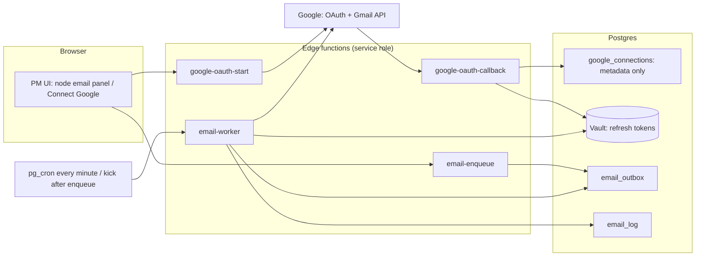

# Design 07 - Emails, Google Integrations, Certificates, Share Presets and Secrets

Status: **design only, nothing implemented, nothing changed on any Supabase/Google project.** Labels: **[Decided]** = owner said so (`docs/11`, `docs/13`); **[As-is]** = found in code/DB (file:line or table); **[Proposal]** = analyst recommendation with reasons/alternatives. Terms follow `00-conceptual-model.md` (Program, Project, Node, Port, Edge, Participant). External Google/Supabase facts were checked against official documentation on 2026-10-11 (sources in section 10); anything not confirmed is marked **verify**.

Names of tables/functions below are proposals; final naming belongs to design 04 (database) and must be reconciled with it.

---

## 0. Summary of design choices

| Area | Choice |
|---|---|
| Email sender | Per-PM Gmail via **OAuth2 (offline access) with an Internal consent screen**; refresh tokens in **Supabase Vault**, used only by one server-side function. Fallback sender = `startups@athareg.com` linked through the **same OAuth mechanism** (not a plaintext SMTP password). |
| Sending | Outbox table + queue worker, per-sender throttling, idempotency key, audit log, retry with backoff; at-most-once on unknown outcome. |
| Calendar/Meet | One server-side function, **as the PM (OAuth)**, event id **derived from the booking id** (idempotent), one explicit project timezone, create/update/cancel handled. The four Meet-generation places and the every-minute poller are retired. |
| Apps Script | Disable trigger **before** new sync goes live; shadow-run first; archive, do not delete, for 30 days. |
| Sheets | Server-side append via edge function with a **new, narrowly scoped service account** (sheet shared with it); no key ever readable by the browser. |
| Certificates | Template (image/PDF) + positioned fields; server RPC issues a code only for `attended` + program `completed`; rendering on demand in the client canvas (Arabic shaping); public verifier through a minimal RPC. |
| Share presets | Per card x per platform text with `{link}`; correct URL builders; Instagram = copy; Facebook/LinkedIn cannot prefill text. |
| Photo frame | PM uploads a transparent 4:5 PNG; client canvas 1080x1350 composite; photo never leaves the browser. |
| Secrets | Inventory in section 8; **the leaked service-account key must be rotated/disabled** (owner confirmed not rotated, `docs/11` C6). |

---

## 1. Email architecture

### 1.1 Requirements
- **[Decided]** Preferred: each PM sends from **their own Gmail** by linking their Google account in the platform. All PMs are on one Google Workspace (`@athareg.com`) (`docs/13` section 10 row 1). Fallback: `startups@athareg.com` (`docs/13` section 5).
- **[Decided]** Emails live **inside nodes** (Selection: acceptance / rejection / interview invitation; Booking: online-session invitations/notifications), not a separate node (`00` section 3).
- **[As-is]** Today: three near-identical edge functions send via SMTP (nodemailer) using one global row of `smtp_settings` (plaintext `smtp_pass`, RLS on with no policies) (`docs/08` sections 4.5, 11 A-3). Sender is always `"Athar Startups" <smtp_user>`. Audit in `email_audit_log` (RLS disabled; `event_id` text). Functions never check the caller and trust `submissionIds` from the body (`docs/08` section 3.4). Mentor-booking templates are stored but never rendered (`docs/08` section 7.1). `project_manager_name` is the constant `Athar Team` (`docs/08` A-18). `first_name` and `founder_name` are the same string (`docs/08` C-9).

### 1.2 Technical options

| # | Option | How it works | Pros | Cons / risks |
|---|---|---|---|---|
| A | **Per-user OAuth2 + Gmail API `users.messages.send`** (recommended) | PM clicks "Connect Google"; consent screen, `access_type=offline`, scope `gmail.send`; server stores the refresh token; sends RFC 2822 MIME (base64url in `raw`) to `POST /gmail/v1/users/me/messages/send` | True "sent by the PM": appears in their Sent folder, replies go to them, SPF/DKIM aligned by Google. Least-privilege scope (send only, cannot read mail). Each user can revoke at any time (Google Account permissions). No shared master key. | Needs a one-time consent per PM; refresh token can be invalidated (user revocation, password change for Gmail scopes, 6 months unused, admin policy) so the platform must handle `invalid_grant`. A GCP project + OAuth client must be maintained. |
| B | **Domain-wide delegation (DWD)**: service account impersonates each PM (`sub=pm@athareg.com`) | One service-account key signs JWTs; Workspace super admin authorizes the client ID + `gmail.send` scope in Admin console | No per-PM consent; works for users who never log in. | **One key can send as (and, with calendar scope, read/write the calendars of) any user in the domain** - highest blast radius, and the owner already leaked such a key. Requires a super admin to configure; the logs say the team did **not** have admin console access (`docs/08` section 10.3). Not recommended. |
| C | **SMTP with Gmail app passwords** | Per-PM app password in a table, nodemailer to `smtp.gmail.com:465` | Closest to today's code. | Requires 2-Step Verification and app passwords enabled by the admin; the password gives **full mailbox access via IMAP/SMTP**, is a long-lived secret that must be stored per PM; SMTP limit 100 recipients/message vs 500 via API; no granular revoke; Google is steering away from it. Rejected as primary; acceptable only as a short-term bridge for the fallback sender during migration. |
| D | Shared mailbox `startups@` via the **same OAuth mechanism as A** (fallback) | An admin of that mailbox links it once as a "system sender" | Same code path as A, no plaintext password, can replace `smtp_settings` entirely. | One mailbox shared by all projects: its daily limit is shared and replies go to a shared inbox. |

**[Proposal]** A for PMs + D for fallback. One code path (`send-email` function) for both; `smtp_settings` becomes legacy and is removed after cutover.

### 1.3 Google facts that shape the design (verified)
- **Scope class:** `https://www.googleapis.com/auth/gmail.send` is listed as a **sensitive** scope (not restricted).
- **Internal user type:** the OAuth consent screen can be set to *Internal* when the Google Cloud project belongs to the Workspace organization; only users of that organization can authorize, and the unverified-app/verification regime applies to externally available ("In production"/Testing) apps. **[Proposal]** Create the GCP project **inside the Athar Workspace organization** and set user type Internal; no Google app verification is then needed. (The consent-screen help page checked does not explicitly state the verification exemption - **verify** in the console when creating; the owner's Workspace admin must also allow the app under Admin console > Security > API controls if third-party access is restricted.)
- **Refresh-token expiry:** Google documents the **7-day** expiry for projects with *external* user type in *Testing* status; other documented invalidations: 6 months of non-use, user revokes, 100 refresh tokens per account per client ID (new ones silently invalidate the oldest), password change when Gmail scopes are included, admin policy. Internal apps are not in the Testing/External case; **verify** with one real refresh after 8+ days during the pilot.
- **Quotas (Gmail API):** `messages.send` costs 100 quota units; per user 6,000 units/min (about 60 sends/min); per project 1,200,000 units/min; 500 recipients/message via API (SMTP: 100).
- **Workspace sending limits (paid accounts):** 2,000 messages/day per user, 10,000 total recipients/day, 3,000 external recipients/day, 3,000 unique recipients/day (2,000 external); rolling 24 h; mail-merge-style sends are capped lower (1,500) in the Gmail UI; exceeding a limit blocks sending for up to 24 h and repeated spam-like behaviour can suspend the account. Messages sent through aliases/delegation count. Trial accounts: 500/day. Limits can change without notice.
- **Edge function limits (Supabase):** 150 s wall clock (free) / 400 s (paid), 2 s CPU per request, 256 MB. A 100-recipient synchronous loop (today's design) is therefore fragile; the queue design below avoids it.

### 1.4 Component design



**Connect flow (PM)**
1. UI calls `google-oauth-start` (authenticated). Function creates a one-time `state` (random, bound to the user id, 10-minute expiry, stored server-side) and a PKCE verifier, and returns the Google authorization URL with `access_type=offline`, `prompt=consent` (forces a refresh token), `include_granted_scopes=true`, scopes `openid email gmail.send` (+ `calendar.events`, section 2), `hd=athareg.com`.
2. Google redirects to `google-oauth-callback` (an edge function URL; JWT verification off, protected by `state`). It exchanges the code, **validates the ID token** (`email_verified`, domain `athareg.com`, email equals the `hd` account), then stores the refresh token with `vault.create_secret` and writes a `google_connections` row.
3. Browser is redirected back to the platform and sees only "Connected as name@athareg.com".

**Where tokens live [Proposal]:** refresh tokens only in **Supabase Vault** (libsodium-encrypted at rest, root key held by Supabase outside the DB; decrypted via the `vault.decrypted_secrets` view). Never in a table readable by the `anon`/`authenticated` roles, never in the browser, never in a JSON column of a node config. Access to the vault view is granted to a single `SECURITY DEFINER` function or to the service role only (Vault docs: anyone with view access can read plaintext). Access tokens (1 h) are obtained per worker run and kept in memory only. Alternative considered: a custom `pgcrypto` column with a key in edge-function secrets - workable, but Vault is the managed equivalent. Note from Vault docs: a manual `pg_dump`/restore into a new project does **not** decrypt secrets (project-specific key), which matters for the local-DB migration: **connections must be re-linked on a new/local project**.

```sql
-- sketch
create table google_connections (
  id uuid primary key default gen_random_uuid(),
  owner_user_id uuid references auth.users(id),        -- null for the system sender
  kind text not null check (kind in ('user','system')), -- system = startups@
  email text not null,
  scopes text[] not null,
  vault_secret_id uuid not null,                        -- refresh token lives in vault
  status text not null default 'active' check (status in ('active','needs_reauth','revoked')),
  last_ok_at timestamptz, last_error text, created_at timestamptz default now(),
  unique (email)
);
-- RLS: owner can SELECT own row (without vault_secret_id via a view); only service role writes.
```

**Sender resolution [Proposal]** (executed server-side in `email-enqueue`):
1. The node's email config has `sender_mode`: `acting_pm` (default), `project_owner`, or `system`.
2. `acting_pm` = the user who clicked Send (or who last saved an automatic trigger rule). If they have no active connection, fall back to `system`, and the UI shows a visible "sent from startups@ because you have not connected Google" notice.
3. Whatever the mode, the `From` header must be the connected account (or a verified send-as alias); Gmail rewrites other From values.
4. Display name: `"<PM name> - Athar"`. **Fixes** the constant `project_manager_name`: `{{sender_name}}` resolves to the real sender.
5. `Reply-To` defaults to the sender; PMs can add a project CC list (today's `*_cc_emails`/admin emails, [As-is] sent as CC).

**Authorization [Proposal]:** `email-enqueue` verifies that the caller may manage that project/node and **derives recipients server-side** from the node's own data (selection submissions, participants, bookings), never from arbitrary addresses in the request body. This closes today's open-relay pattern (`docs/08` section 3.4). A per-sender daily cap (default 1,500, below the 2,000 Workspace limit) protects PM mailboxes.

### 1.5 Templates and placeholders
- **[As-is]** `{{var}}` double-curly syntax; subject replaces only three variables, body replaces all; values inserted raw; HTML detected by a regex else `\n` becomes `<br>`; three layers of defaults that disagree (`docs/08` section 7).
- **[Proposal]** Per-node templates stored in node config:
```json
{ "emails": {
    "acceptance":  { "enabled": true,  "subject": "...{{company_name}}", "body_html": "<p>Dear {{first_name}}...</p>",
                      "cc": ["a@athareg.com"], "reply_to": null, "version": 3 },
    "rejection":   { "...": "..." },
    "interview_invitation": { "...": "..." } } }
```
  - **One renderer** (shared module in the edge function) for subject and body; **HTML-escape values**, allow-list tags in the body (sanitize on save), literal `{{unknown}}` is a **save-time validation error**, not a silent leftover.
  - Each email key in the node manifest (`emails: [{key, trigger, templateFields}]`, `00` section 4) declares its variable catalogue, shown in the editor as clickable chips and in a live preview with sample data.
  - Variable catalogue **[Proposal]**: all emails: `{{company_name}}`, `{{founder_name}}`, `{{first_name}}`, `{{sender_name}}`, `{{project_name}}`, `{{program_name}}`; interview/booking: `{{booking_link}}`, `{{start_time}}`, `{{end_time}}`, `{{timezone}}`, `{{mentor_name}}`, `{{meet_link}}`; certificate-ready email (optional later): `{{certificate_link}}`. This also makes the mentor-booking templates (stored but unused today) functional.
  - **Migration:** `events.interview_*`, `rejection_*`, `acceptance_*`, `mentor_*` template columns and admin/cc lists move into the matching node configs (mapping belongs to doc 05). Three layers of defaults collapse to **one** default set owned by the node type.
  - First name vs full name rule is unresolved (`docs/08` C-9/C-10): see Open Decision 5.

### 1.6 Bulk sending, rate limiting, audit, idempotency

```sql
create table email_outbox (
  id uuid primary key default gen_random_uuid(),
  project_id uuid not null, node_id uuid not null,
  email_key text not null,                         -- 'acceptance' | 'rejection' | ...
  sender_connection_id uuid not null references google_connections(id),
  recipient_email text not null, recipient_ref jsonb,   -- {kind:'form-response', id:...}
  subject text not null, body_html text not null,       -- rendered at enqueue time (snapshot)
  cc text[] default '{}',
  idempotency_key text not null unique,            -- see below
  status text not null default 'queued'
    check (status in ('queued','sending','sent','failed','dead','cancelled','needs_review')),
  attempts int default 0, next_attempt_at timestamptz default now(),
  gmail_message_id text, error_code text, error_message text,
  created_by uuid, created_at timestamptz default now(), sent_at timestamptz
);
-- email_log (audit) = append-only record of every state change (replaces email_audit_log; event_id TEXT becomes project_id/node_id FKs)
```

- **Idempotency key [Proposal]:** `sha256(node_id | email_key | recipient_ref id | "round")`, where *round* is a PM-chosen counter. Clicking Send twice, or a retried HTTP request, hits the unique constraint and does nothing; a deliberate "Resend" increments the round. Fixes `docs/08` A-10/A-17 (non-idempotent functions, lost `email_send_count` increments); the per-company counters become a `count(*)` over `email_log`.
- **Worker:** `email-worker` (cron every minute and also kicked after enqueue) claims rows with `FOR UPDATE SKIP LOCKED`, grouped by sender; per sender it sends sequentially with a **target of at most 30 messages/minute** (Gmail allows about 60/min/user via API; headroom is deliberate) and stops after about 100 s to stay inside the 150 s wall clock; the next cron tick continues. One message per recipient (not Bcc), personalised.
- **Failure handling:**

| Condition | Action |
|---|---|
| HTTP 429 / 403 `rateLimitExceeded` / `userRateLimitExceeded` | truncated exponential backoff with jitter (Google's recommendation), max 6 attempts |
| 5xx / network error before request completed | retry with backoff |
| `invalid_grant` on token refresh | mark connection `needs_reauth`, pause that sender's queue, notify the PM, offer "send via startups@" |
| 400 invalid recipient | `failed` (permanent), no retry |
| Daily cap reached | rows stay `queued`, resume next day; UI banner |
| Process died after the HTTP call (outcome unknown; row stuck in `sending`) | **do not auto-resend**; set `needs_review`. We set our own `Message-ID` (`<outbox_id@athareg.com>`) so a human can search the PM's Sent folder. Auto-detection would need `gmail.readonly` (a **restricted** scope), deliberately avoided. At-most-once is chosen over possible duplicate rejection mails. |

- **UI results:** the PM sees per-recipient state (queued/sent/failed/needs review), not a blanket `success:true` as today (`docs/08` A-17).
- **Interview-link bug to fix:** `booking_link` currently depends on the browser `Origin` and a hard-coded fallback host (`docs/08` section 4.5); build it from a configured public base URL.

### 1.7 SPF / DKIM / DMARC
- Mail sent through the Gmail API as `pm@athareg.com` is submitted to Google's own infrastructure, so it is covered by the domain's existing Google SPF include and is DKIM-signed by Google **if DKIM is enabled for athareg.com** in the Admin console. Today's SMTP path to `smtp.gmail.com` has the same property. **[Proposal]** Checklist before go-live: SPF record contains Google's include and no second SPF record; DKIM key generated and "authenticating email" status on; DMARC policy at least `p=none` with reporting, moving to quarantine once reports are clean. (DNS state not checked from here - **verify** with the domain owner.)
- Messages appear in the PM's Sent folder and bounces/replies land with the PM. If the PM leaves the company, their connection is revoked and ownership of pending queued mail transfers to `system` (open decision 3).
- A non-Google sender (e.g. a transactional provider) would need its own SPF/DKIM entries; not proposed.

### 1.8 Migration / legacy
- Keep the three `send-*` functions running until the new worker passes a pilot with 2-3 PMs, then retire them with `smtp_settings`. After cutover remove `smtp_settings` and `SMTP_*` secrets.
- Existing `company_submissions.email_send_count` and `email_audit_log` rows are migrated into `email_log` (kept, nothing lost).

---

## 2. Google Calendar / Meet for booking nodes

### 2.1 As-is (what is being replaced)
Four implementations create Meet links: `generate-google-meet` (UTC, no attendees, creates a throw-away event per admin click), `process-booking` (Cairo TZ, attendees, `sendUpdates=all`, shared mode), and two Apps Script copies (`docs/08` D-13, C-2). The deployed Apps Script runs **every minute** on `startups@athareg.com`, fetches **all** rows of `bookings`, `ather_team_bookings` and, per booking, **all of `events`**, with the anon key, and only works because RLS is open (`docs/12` sections 3-6). The service-account path needs domain-wide delegation to add attendees/Meet, and the team reported having no admin-console access (`docs/08` section 10.3). No idempotency: up to 3 events per booking from FE retries plus the poller (`docs/08` A-10, `docs/12` section 5). `failed` rows are never retried; cancellations never delete the Calendar event.

### 2.2 Target design [Proposal]

**One component:** edge function `calendar-sync` plus table `calendar_sync_jobs`, triggered by a database trigger/RPC when a booking is created, rescheduled or cancelled (and by a minute cron only to retry failed/pending jobs - cheap indexed query, no table scans, no anon key). The booking UI never calls Google; it only writes the booking row. This replaces the FE `process-booking` retry loops, `generate-google-meet`, `notify-google-apps-script`, both `.gs` files and the poller.

**As whom:** the **PM's own Google Calendar through the same OAuth connection as email** (add scope `calendar.events`, sensitive; consent shown once as "Connect Google": send email + create events). Reasons: invitation emails and Meet ownership belong to the PM; no domain-wide delegation, no master key; consistent with the email decision. Fallback `system` connection = `startups@athareg.com` (also OAuth). A plain service account **without** DWD cannot invite attendees or create Meet conferences on a user's calendar in a Workspace, so the service-account route would require DWD (option B above) - rejected.

| Which calendar/owner | When |
|---|---|
| Node's `organizer` (default: the node's owning PM) | normal case |
| `system` (`startups@`) | PM not connected, or connection needs re-auth |
| Legacy (`startups@`) | bookings whose existing event was created by the poller/`process-booking` (stored as `calendar_owner_connection_id`), so later cancel/reschedule hits the correct calendar |

**Idempotency [Proposal]:** `booking.id` (uuid) -> Calendar event id = the uuid's 32 hex characters without dashes. Google requires event ids to use lowercase a-v and 0-9 (base32hex), 5-1024 chars, unique per calendar; hex digits are a valid subset. `events.insert` with that id: if Google answers 409 (already exists) the job calls `events.get` and adopts the existing event instead of creating another. `conferenceData.createRequest.requestId` = booking id too. Google notes id collisions are not guaranteed to be detected at creation time, so uniqueness of our own ids (uuid) is what we rely on. DB columns on the booking: `calendar_event_id`, `calendar_owner_connection_id`, `meet_link`, `sync_status` (`pending|synced|failed|cancelled`), `sync_error`, `sync_attempts`, `synced_at`. Job processing takes a row lock (`FOR UPDATE SKIP LOCKED`), so the minute cron can never double-process (the old script had no lock).

**Event content:** summary from node config (translatable template, e.g. `Mentor Session: {{company_name}} with {{mentor_name}}`; the as-is prefixes differ between copies); `start/end` as RFC 3339 with offset **and** `timeZone` = project timezone; `guestsCanModify=false`, `guestsCanInviteOthers=false`; `sendUpdates=all` (Google sends the invitation; this replaces `send-booking-notifications`, which is orphaned; custom booking emails via section 1 remain possible if the node wants branded text).

**Attendees [Proposal]:** booker, mentor/team member, plus the node's admin/CC lists (as-is behaviour), lower-cased and de-duplicated, invalid addresses dropped with a warning in `sync_error` rather than failing the whole call (today a bad JSON string aborts everything, `docs/08` section 4.2).

**Timezone rule [Proposal]:** one explicit **project timezone** (IANA name, field in Project Details, default `Africa/Cairo` which is what the live paths and `appsscript.json` use). Rules: slots are entered and displayed in the project timezone; stored as `timestamptz` (UTC); Calendar events carry the project timezone; email `{{start_time}}` is formatted in it with the zone label. Fixes `docs/08` C-7/A-26 (UTC vs Cairo vs server locale). Per-participant local-time display is a UI nicety, not part of the sync.

**Meet link modes [Proposal]** (keep the as-is two modes, make them strict):

| Mode | Behaviour |
|---|---|
| `unique` (default) | `conferenceData.createRequest` with `conferenceSolutionKey.type=hangoutsMeet` and `conferenceDataVersion=1`; creation is asynchronous, so the job re-reads the event until `createRequest.status=success` (bounded retries), then stores the `video` entry point. |
| `shared` | One link configured in the node; stored in `location` and `description`; **no hand-built `conferenceData`** (the `process-booking` approach is unverified, `docs/08` C-4). **Empty link is a validation error at save time and a `failed` sync with a clear message at runtime** - no silent switch to unique (today's conflict, `docs/08` C-3). |

The slot-level "Generate Meet link" admin button disappears (it only left orphan events, `docs/08` A-14). If PMs want a link before anyone books, they use shared mode, or the node can pre-create the event keyed by the **slot** id and patch attendees on booking (see Open Decision 6).

**Cancellation / reschedule:**
- Cancel booking -> job `delete`: `events.delete` with `sendUpdates=all`; booking `sync_status=cancelled`; slot becomes available. Event already gone (404/410) = success.
- Reschedule -> job `update`: `events.patch` start/end (+ attendees) on the same event; the Meet link stays the same.
- Change of mentor -> patch attendees; organizer does not change (stored owner).
- `needs_reauth` for the owner connection -> job pauses and the PM is notified; a PM can "move to startups@" (creates the event on the system calendar and deletes the old one if reachable).
- A booking is **never rolled back** because Google failed (as today), but the UI shows `sync_status` so a missing link is visible and retryable (today's poller never retries `failed`).

### 2.3 Fate of the deployed Apps Script (decision needed)
Facts: runs on `startups@athareg.com` every minute with the publishable key and relies on open RLS; the repo cannot say which copy is live; web app is `ANYONE_ANONYMOUS`; two systems acting on one booking can duplicate events (`docs/12` section 5). It must be switched off in a controlled order because the RLS fix (`docs/11` C1) will otherwise silently break it, and because running it next to the new sync would create duplicates (no shared lock/idempotency).

**Recommended sequence [Proposal]**
1. Before anything: capture the Apps Script *Executions* page and list `bookings`/`ather_team_bookings` rows with `status='failed'` or null `meet_link` (evidence + backlog).
2. Build `calendar-sync` and run it in **shadow mode** (computes what it would do, writes `sync_dry_run` logs, **no Google calls**) for a week.
3. **Cutover window:** (a) delete the time-driven trigger and undeploy/unpublish the web app in the `startups@` project; (b) deploy the RLS fixes; (c) enable `calendar-sync` for new bookings; (d) let it process rows with no `calendar_event_id` and status null/pending.
4. Existing `confirmed` rows keep their `calendar_event_id`; set `calendar_owner_connection_id` to the `startups@` system connection (so a later cancel works). Rows that are `failed` stay visible for the PM to retry.
5. Keep the script project **archived, not deleted**, for 30 days (rollback), then delete; revoke its authorizations in the `startups@` account.
6. Retire `process-booking`, `generate-google-meet`, `notify-google-apps-script`, `send-booking-notifications` after step 4 verification.

Rejected alternative: keep the poller "as a safety net" - it would race the new worker and keeps the anon-key/open-RLS dependency.

---

## 3. Google Sheets integration (target)

**[As-is]** `src/lib/googleSheets.js` reads `google_settings.service_account_key` through the browser's anon client (public RLS SELECT), parses it, signs an RS256 JWT with `crypto.subtle` **in the browser** (scope `spreadsheets` + `drive`, optional `sub` from `impersonate_email`) and appends one row per form response to `values/A1:append` (`googleSheets.js:91-234`). Failures are logged only (best-effort). The same key is used for Calendar by the edge functions (`docs/08` A-2, A-12).

**[Proposal] Target**
- A dedicated edge function `sheets-append`, called **from the outbox** (a `integration_jobs` row inserted by trigger/RPC when a `form_responses` row is saved), not from the browser. The browser never sees a credential.
- **Identity:** a **new service account used only for Sheets**, with **no domain-wide delegation** and only the `spreadsheets` scope (drop `drive`). The PM pastes the sheet URL and shares the sheet with the service account's email shown in the UI (the UI offers a "Test connection" button that appends nothing and just reads metadata). Key stored as an **edge-function secret** (or Vault), not in any table. Alternative: append as the PM through the OAuth connection (scope `spreadsheets`): avoids a key entirely but ties the integration to one person's connection and access; offered as a per-form choice if the owner prefers (Open Decision 7).
- **Idempotency:** unique `(response_id, spreadsheet_id)` on the job; the appended `updatedRange` is stored; at-most-once on unknown outcome plus a "re-sync" button that checks a hidden `response_id` column before appending.
- **Limits:** Sheets API quotas are 300 read and 300 write requests per minute per project, 60 per user per project; HTTP 429 -> backoff. Batch rows per sheet in one `values:append` per worker run.
- **Header/column mapping** is stored with the form node (field -> column), not inferred from `fields` order at submit time.
- Removed: `safeParseServiceAccount` (three copies, `docs/08` D-11), `getGoogleSheetsAccessToken`, the "Google Calendar Integration" key UI in `EventDashboard.jsx:63-131`, table `google_settings` (columns kept only until migration is verified).

---

## 4. Certificates node

### 4.1 As-is
- Table `certificates` (0 rows): `certificate_id, founder_id, program_id, event_id, template_id, issue_date, verification_code` (default `left(gen_random_uuid()::text,12)`, UNIQUE), `pdf_url, issued_by`; RLS `ALL true` public, so codes are enumerable (`07a`).
- `alumni/CertificateGenerator.jsx` has **no importer** (`docs/09` #38). It renders a fixed 960 px DOM design, rasterizes it with `html-to-image` (`toPng`, pixelRatio 2), uploads the PNG to the **public** bucket `event-assets` at `certificates/<id>.png` and stores the URL in `pdf_url` (a misleading column name; it is a PNG). The QR comes from a **third-party service** (`api.qrserver.com`), leaking each verification URL to it.
- `alumni/CertificateVerifier.jsx` + `verifyCertificate` (public select by `verification_code` with joined `founders(*)`, `programs(*)`, `events`). Routes `/verify-certificate/:code` and `/verify-certificate` exist (hash router).

### 4.2 Decided rules
- **[Decided]** Dedicated Certificates node; PM uploads a template containing variables (e.g. participant name) (`docs/13` section 12).
- **[Decided]** Eligible = participant status **attended** only (`docs/13` update 3); shown on the founder's program page **after the program is marked completed** in Program Settings.

### 4.3 Template and positioning editor [Proposal]
- **Upload:** PNG/JPEG or single-page PDF, max 10 MB, to a **private** bucket `certificate-templates` (PM-only write). PDFs are rendered to an image with `pdf.js` for the editor preview and generation (v1 output is raster; vector PDF overlay is a later optimization).
- **Config (stored in the node):**
```json
{ "template": { "path": "tpl/<node>/<file>.png", "kind": "image", "width": 3508, "height": 2480 },
  "fields": [
    { "key": "participant_name", "x": 0.5, "y": 0.46, "w": 0.6, "align": "center",
      "font": "Cairo", "size": 0.045, "color": "#1A1A2E", "weight": 700,
      "direction": "auto", "max_lines": 1, "shrink_to_fit": true },
    { "key": "program_name",   "x": 0.5, "y": 0.58, "w": 0.7, "align": "center", "...": "..." },
    { "key": "completion_date","x": 0.2, "y": 0.84, "...": "..." }
  ],
  "qr":   { "x": 0.82, "y": 0.78, "size": 0.1 },
  "code": { "x": 0.82, "y": 0.9, "font": "monospace", "size": 0.016 } }
```
  Coordinates and sizes are **fractions of the template's width/height** so the preview scale never matters.
- **Variables:** `{{participant_name}}` (founder name, language rule: Open Decision 8), `{{company_name}}`, `{{program_name}}`, `{{project_name}}`, `{{completion_date}}` (program completed date, project timezone), `{{issue_date}}`, `{{verification_code}}`; signatures/logos are baked into the uploaded template (no per-person variables needed).
- **Editor:** canvas showing the template; drag a field box, resize width, font/size/colour/alignment panel, toggle QR and code; sample-name preview with long Arabic and Latin names to test overflow; "Preview with a real attended participant".
- **Fonts:** a small bundled set including an Arabic font (e.g. Cairo or Noto Naskh Arabic), loaded with `FontFace` before drawing.

### 4.4 Generation: client canvas vs server
| Option | Pros | Cons |
|---|---|---|
| **Client canvas -> PNG, wrapped in PDF (pdf-lib/jsPDF)** (recommended) | Browsers shape Arabic text correctly; no heavy server dependency; per-founder download needs no queue; identical code for preview and output | Output is raster (300 dpi page image is fine for print); relies on the founder's device |
| Client `pdf-lib` drawing text on the original PDF | Vector output | `pdf-lib` does not do Arabic shaping/bidi - **Arabic names would render wrong**; rejected for names |
| Server (Deno edge) rendering | Single trusted renderer, can email the PDF | CPU limit 2 s/request and 256 MB on edge functions; Arabic shaping stack (e.g. wasm text shaper) is heavy and unproven here; later option for "email certificates to all" |

**Integrity does not depend on where pixels are drawn:** the **record** (code + snapshot) is created server-side; a founder who forges the image still cannot create a verifiable code.

### 4.5 Eligibility, issuing, verification
- **Issue RPC** `issue_certificate(participant_id, node_id)` (`SECURITY DEFINER`): checks caller (the participant themself, or a PM of the project), `participant.status = 'attended'` and `program.status = 'completed'` (**[Decided]** rules), then inserts or returns the existing row (`UNIQUE(node_id, participant_id)` makes it idempotent). It stores a **snapshot** `{participant_name, company_name, program_name, completed_on, template_version}` so later renames do not change an issued certificate. PM bulk action "Issue for all attended" calls it per participant.
- **Code [Proposal]:** 12 characters from a Crockford base32 alphabet generated with `gen_random_bytes` (60 bits), formatted `XXXX-XXXX-XXXX`; replaces `left(uuid,12)` (as-is, 48 bits, predictable format) - and, more importantly, the table is no longer publicly readable.
- **Verifier:** `verify_certificate(code)` RPC (`SECURITY DEFINER`, callable by `anon`) returns only `{valid, revoked, participant_name, program_name, completed_on, issuer}`; no founder email/phone; basic throttling. Public route stays `/#/verify-certificate/:code`; the QR encodes that URL. The QR is generated **locally** (small JS library) instead of `api.qrserver.com`.
- **Revocation:** `revoked_at`/`revoked_reason`; the verifier shows "revoked". Whether a later status change from `attended` auto-revokes: Open Decision 9.
- **Storage/download:** rendered on demand and **not stored** in v1 (nothing public). Optional cache in a private bucket with signed URLs if PMs want to email files. Founder's program page shows "Download certificate" only when `program.status='completed'` **and** own status `attended`; otherwise nothing (consistent with `docs/13` section 11 "nothing appears by default"). Existing public PNG convention (`event-assets/certificates/`) is dropped.
- **Schema deltas** vs the current table (0 rows, so no data migration): add `node_id`, `participant_id`, `snapshot jsonb`, `template_version`, `revoked_at`; drop public RLS; `pdf_url` is not needed.

---

## 5. Share presets for landing cards

### 5.1 As-is
- Tables `join_athar_share_presets (page_id, platform, preset_message)` UNIQUE(page_id, platform) - **per page, not per card** (`07a`); API reduces them to `{platform: message}` (`api.js:3028`). Message built with `preset.replace('{link}', pageUrl)` (**only the first occurrence is replaced**), fallback `"<card title>\n<url>"` (`JoinAtharView.jsx:53-57`).
- Platform builders (`JoinAtharView.jsx:8-14`): WhatsApp `https://wa.me/?text=`, Twitter/X intent, LinkedIn `share-offsite/?url=`, Telegram `https://t.me/share/url?url=<whole message>` (**bug: the message is passed as `url`**), Instagram: copy to clipboard only. **No Facebook** although the owner lists it.
- Share link = `window.location` + `?agenda=<id>&lang=..&tabs=join-athar`: a hash/SPA route with **no Open Graph tags**, so link previews are empty. The `share` edge function does exist for events (`docs/08` section 4.6) but is for events, unused by the FE and keyed on the wrong column (C-17).
- Analytics: `join_athar_analytics(event_type in tab_view|card_share|image_upload|image_download, card_id, platform, timestamp)`; insert errors swallowed; card ids regenerate at every save (delete-all + insert) so per-card history detaches (`docs/09` A-36).

### 5.2 Target [Proposal]
- **[Decided]** The PM writes a text **per platform per card** with a `{link}` placeholder (`docs/13` section 14 / update 2 row 3). Stored on the card: `share: { whatsapp, facebook, linkedin, instagram, telegram, copy }` (each text; empty = a default built from the card title + `{{link}}`). Replace **all** occurrences of `{link}`.
- `{link}` resolves to the card's **share target**: the opportunity/form URL (a public form link, or the landing page anchor), made through the server `share` endpoint so crawlers get OG tags (title/description/image from the card, with the escaping bug `docs/08` A-6 fixed).
- Stable card ids on save (update/insert/delete by id, never delete-all) so analytics survive.

| Channel | URL builder | What the web link can and cannot do |
|---|---|---|
| WhatsApp | `https://wa.me/?text=<encoded text>` (works with no phone number) | Full prefilled text including the link. Works on mobile and WhatsApp Web. |
| Telegram | `https://t.me/share/url?url=<link>&text=<text>` | Use **both** params (fix of the as-is bug). |
| Facebook | `https://www.facebook.com/sharer/sharer.php?u=<link>` | Only the URL can be passed; **the text cannot be prefilled** (Facebook ignores/has removed prefilled quote text). The preview comes from the link's OG tags. UI: copy the text to clipboard and tell the visitor to paste it. (Based on common platform behaviour, **verify** at build time; not re-fetched here.) |
| LinkedIn | `https://www.linkedin.com/sharing/share-offsite/?url=<link>` (as-is) | URL only, no prefilled text; same copy-then-paste hint. |
| X/Twitter (optional, exists as-is) | `https://twitter.com/intent/tweet?text=<text>` | Text prefilled. Not in the owner's list; keep as an optional toggle. |
| Instagram | **none** - Instagram has no web share-URL scheme | Copy the text, offer image download (relevant to the photo frame), and on mobile a "Share" button using the Web Share API (`navigator.share`) where available so the OS sheet can hand the file/text to the Instagram app. Cannot post automatically. |
| Copy | `navigator.clipboard.writeText` (needs HTTPS; fallback `execCommand` or a selectable textarea) | Always available; toast "Copied". |

- **Analytics [As-is kept]:** the four events stay; add `cta_click` and `share_copy` as new `event_type`s; keep `platform` and a stable `card_id`. Inserts through a small RPC with an enum check and no IP/PII. Insert policy for `anon` limited to insert-only (today `FOR ALL USING (true)`), reads restricted to the project's PMs.

---

## 6. Photo personalization with a PM-uploaded frame

**[As-is]** `landing-page.html:1656-1708` crops the visitor's photo to a **1080x1350 (4:5)** canvas with pan/zoom (white fill, `drawImage`, `toDataURL('image/png', 0.95)` - the quality argument is ignored for PNG); no overlay. `JoinAtharView.jsx` (different code) draws a branded background, the card title and wrapped description onto its canvas. `canvas_background_url` / `canvas_overlay_position` exist in the schema with no UI (`docs/13` section 8, `docs/09` A-36). **[Decided]** the PM uploads the overlay; the owner delegated the mechanism (`docs/13` update 1 row 4).

**[Proposal] Compositing spec**
1. **Frame asset:** PNG with alpha, exactly **1080x1350** (or any 4:5 size >= 1080x1350; scaled to canvas), <= 5 MB, uploaded in the Landing node's settings. Validation at upload: decode, check aspect 4:5, check that alpha contains both transparent pixels (the "window") and opaque pixels; reject otherwise. Optional list of up to N frames the visitor can pick from. Stored in public-read bucket `landing-frames` (PM-only write).
2. **Layer order on a 1080x1350 canvas:** (a) fill `#FFFFFF`; (b) draw the visitor's photo using the existing cover + pan + zoom (zoom 1-3.5) math from `landing-page.html:1672-1700`; (c) `drawImage(frame, 0, 0, 1080, 1350)` on top. Optional `frame.layer = "above" | "below"` for frames that are backgrounds rather than overlays (default above).
3. **Export:** `canvas.toBlob(cb, 'image/png')` (not `toDataURL`, which is large and synchronous); filename `<card-slug>-athar.png`; show the preview from an object URL and revoke it afterwards.
4. **Correctness details:** frame loaded with `crossOrigin="anonymous"` and the bucket must send CORS headers, otherwise the canvas becomes tainted and export throws; decode the photo with `createImageBitmap(file, {imageOrientation:'from-image'})` to honour EXIF rotation; downscale very large photos (> 4096 px) before drawing for mobile memory; `imageSmoothingQuality='high'`.
5. **Privacy:** the visitor's photo is processed only in the browser; nothing is uploaded; analytics records only `image_upload`/`image_download` (no image, no identity). Say so in the UI.
6. **PM safe-zone helper:** in the Landing editor, preview the frame over a sample photo and show the window area so PMs design frames correctly. Arabic/English text in the frame is part of the PNG (no runtime text), which sidesteps font loading; the card text overlay of today's `JoinAtharView` is dropped.

---

## 7. Edge functions after the refactor (overview)

| Function | Replaces | Caller |
|---|---|---|
| `google-oauth-start`, `google-oauth-callback` | new | browser (Connect Google) |
| `email-enqueue`, `email-worker` | `send-interview-invitations`, `send-rejection-emails`, `send-acceptance-emails`, `send-booking-notifications` | browser (enqueue), cron (worker) |
| `calendar-sync` | `process-booking`, `generate-google-meet`, `notify-google-apps-script`, both Apps Script files, the poller | DB trigger/cron |
| `sheets-append` | browser `googleSheets.js` | outbox/cron |
| `share` (extended) | `share` | public URLs (verify_jwt off, output escaped) |

All functions: shared CORS/auth/response-envelope helper (fixes `docs/08` D-1, D-14), JWT verified in code (not just gateway), config in a versioned `supabase/config.toml` (absent today, `docs/08` section 1), service-role key used only after the caller's rights are checked.

---

## 8. Secrets handling inventory and the rotation need

### 8.1 Inventory
| Secret | As-is location / exposure | Target |
|---|---|---|
| Google **service-account key** (calendar/sheets) | (1) table `google_settings.service_account_key`, plain TEXT, **RLS SELECT/INSERT/UPDATE for everyone** (`20260716000002`), read by the browser (`googleSheets.js:93-106`); (2) pasted **twice** in the tracked repo file `مشكلة روابط جوجل ميت لا تعمل.md` (in git history); (3) optional env `GOOGLE_SERVICE_ACCOUNT_KEY`. Git `origin` is a GitHub repository (visibility not checked). **Owner: not rotated** (`docs/11` C6). | Revoke/rotate (8.2). Calendar -> OAuth (no key). Sheets -> new SA key as edge secret/Vault. Table column dropped. |
| `smtp_settings.smtp_pass` (Gmail app password) | plaintext column; RLS on, no policy (only service role) | Delete; replaced by OAuth connections. Revoke the app password in the Google account. |
| Supabase **service-role key** | injected into edge functions by Supabase (not in repo) | Unchanged; never shipped to the browser, never in scripts. Rotate if it was ever pasted into chats/logs (**verify**). |
| Supabase **publishable/anon key** and project URL | hard-coded in `src/lib/supabase.js`, both `.gs` files, `test-meet-generation.js`, `scratch/*` (`docs/08` A-5, D-16) | Public by design, but move to `VITE_SUPABASE_URL/ANON_KEY` env, remove from scripts; the Apps Script copies disappear. Safety then rests on RLS (design 03). |
| Gmail/Calendar **refresh tokens** (new) | n/a | Supabase Vault only (1.4). |
| Google **OAuth client secret** (new) | n/a | Edge-function secret; never in the repo or the browser; client ID is public. |
| Apps Script web-app URL | hard-coded in `notify-google-apps-script`; unauthenticated | Undeployed at cutover. |
| Local DB export | git-ignored `local-db/` holds auth password hashes and personal data (`docs/13` update 4); stack binds to all interfaces with default dev keys | Keep ignored, stop when idle. |
| Claude API key | deferred feature | Edge secret when un-deferred. |
| Test scripts with real emails/UUIDs | `test-meet-generation.js`, `scratch/*` | Remove or sanitise (`docs/08` open question 16). |

### 8.2 Rotating the exposed Google service-account key (conceptual; no key shown)
Why it matters: anyone who ever saw the key can obtain Google access tokens as that service account, and **if domain-wide delegation was configured, can impersonate any user in the domain for the authorized scopes** (the code passes `sub = impersonate_email`). Deleting the markdown file or the table row does **not** un-leak it: the key remains in git history and in any clone/fork. Only revocation fixes it.

Procedure in Google Cloud / Workspace (by someone with access):
1. **Identify**: read the service-account email and key id from the key's JSON fields (`client_email`, `private_key_id`) - do not copy them into tickets/chats. Open Cloud Console > IAM & Admin > Service Accounts > that account > Keys.
2. **Assess usage**: check Cloud Audit Logs / "Service account insights" for key use from unknown IPs; check Admin console > Security > API controls > **Domain-wide delegation** for this client ID and which scopes it holds (this defines the blast radius). Check Workspace audit logs for unexpected calendar/mail access.
3. **Disable the old key** (reversible), confirm what breaks (today: Meet creation in `process-booking`/`generate-google-meet` and Sheets appends), then **delete the key**. If the service account is no longer needed (Calendar moves to OAuth), **delete the service account** and **remove its domain-wide delegation entry**.
4. **For Sheets**: create a *new* service account (no DWD, no Workspace role) and a new key only if the key-based Sheets design is chosen; download once, put it directly into the Supabase secret store, delete the local file; share target sheets with its email. Consider the org policy that disables service-account key creation after that.
5. **Platform changes required**: (a) close RLS on `google_settings` immediately (no anon access) - this is the first migration of the refactor; (b) stop reading it in the browser (`googleSheets.js`) and remove the key-entry UI in `EventDashboard.jsx`; (c) edge functions read credentials only from secrets/Vault; (d) purge the secret from the repo: remove the markdown log, and consider rewriting git history (`git filter-repo`) plus force-push **only after** the key is revoked (history rewriting is secondary hygiene; revocation is the real fix; GitHub/forks keep old objects); (e) enable secret scanning/push protection on the GitHub repository.
6. **Sequencing trade-off:** disabling the key stops the current calendar/Sheets paths. Because the key is publicly readable via the database API right now, **[Proposal] rotate/disable it as soon as the owner approves**, and accept a short Meet/Sheets outage or bridge it by temporarily creating events manually; waiting for the full refactor leaves the exposure open for months. (Open Decision 1.)

No remote action has been or will be taken by the analyst; these are steps for the owner/Google admin.

---

## 9. Open Decisions for the Owner

1. **Rotate the leaked service-account key now or at cutover?** Options: (a) disable/delete now and accept a gap in Meet creation and Sheets appends; (b) rotate at cutover. **Recommend (a)**, plus closing `google_settings` RLS first.
2. **Create the new GCP project inside the Athar Workspace organization with an Internal consent screen?** Needed for the no-verification path. Requires a Workspace/Cloud admin to create the project, OAuth client and to allow the app in API controls. Alternative if no admin is available: stay on `startups@` OAuth only. **Recommend yes.**
3. **Whose identity sends?** Options: acting PM (default), project owner, always `startups@`; and what happens to a departed PM's queued mail/future events (transfer to `startups@`). **Recommend acting PM with automatic fallback to `startups@`.**
4. **Who administers `startups@athareg.com`** (needed to link the system connection and to decommission the Apps Script)? Is Workspace admin console access available at all?
5. **Greeting rule:** `{{first_name}}` (first word) vs `{{founder_name}}` (current `nameParser`: up to two logical name units)? Keep the Arabic/compound-name handling (`docs/08` C-10)? **Recommend** keep the parser, make `first_name` the first logical unit and `founder_name` the full display name.
6. **Pre-generated Meet links per slot** (event keyed by slot id) or links only at booking time? **Recommend booking time + shared mode** for PMs who want a fixed link.
7. **Sheets identity:** dedicated service account (recommended) or the PM's OAuth connection?
8. **Certificate name language:** Arabic name, English name, or per-template language (one template per language)? Default rule when only one exists.
9. **Certificate revocation:** auto-revoke if a participant's status leaves `attended` or the program is re-opened, or manual only? **Recommend manual with a warning.**
10. **Timezone default** `Africa/Cairo` per project: confirm (live paths use it) and whether PMs may change it per project.
11. **Apps Script retirement date and the 30-day archive window**, and whether any Google Form/Sheet automation other than the poller lives in that script project.
12. **Daily send cap per PM** (proposal 1,500, below Google's 2,000) and a human-review threshold for bulk sends (e.g. confirm dialog above 100 recipients).
13. **Facebook/LinkedIn text limitation:** accept "copy text, then paste" for these two channels?
14. **Public base URL / share endpoint** for `{link}` (athareg.com rewrite to the `share` function, per `docs/11` C4 the production host is Apache; see also `docs/08` C-16): who controls the rewrite?

---

## 10. Notes on 00-conceptual-model

- Section 3 lists Certificates as a node but the eligibility link (participant status, program status) crosses node boundaries: the Certificates node needs input ports `participants` (status) and `program-status`; `00` section 5's port table has `participants` but no program-level data. Suggest adding a `program-context` port (or reading Program/Project settings as a platform service, not through edges).
- `00` section 4 puts `emails` in the NodeType manifest, but **sender identity** (Google connection) is per user/project, not per node; this document stores it in `google_connections` and resolves it at send time. The manifest needs `capabilities: ['email','calendar','sheets']` so the canvas can warn "connect Google" when such a node is added.
- Booking nodes need a project-level **timezone** field; `00` section 3 lists Project Details as location, map link, offline days, transportation only (`docs/13` update 2 row 4: "nothing else"). The timezone is therefore either a new Project Details field (needs owner approval) or a Program-level setting - see Open Decision 10.
- `00` treats "Ather Team Booking" as possibly a mode of the Booking node; this design treats both identically for calendar sync (same job, different attendee lists).

## 11. Sources (checked 2026-10-11)
- Gmail API usage limits (100 units per send, 6,000 units/min/user, 500 recipients): https://developers.google.com/workspace/gmail/api/reference/quota
- Workspace sending limits: https://knowledge.workspace.google.com/admin/gmail/gmail-sending-limits-in-google-workspace
- Gmail API sending / scopes (`gmail.send` is sensitive): https://developers.google.com/workspace/gmail/api/guides/sending , https://developers.google.com/workspace/gmail/api/auth/scopes
- OAuth 2.0 refresh token expiry rules: https://developers.google.com/identity/protocols/oauth2#expiration
- Consent screen user types (Internal): https://support.google.com/cloud/answer/15549945
- Calendar events (conferenceData, event id rules, sendUpdates): https://developers.google.com/workspace/calendar/api/guides/create-events , https://developers.google.com/workspace/calendar/api/v3/reference/events/insert
- Sheets API quotas: https://developers.google.com/workspace/sheets/api/limits
- Supabase Vault: https://supabase.com/docs/guides/database/vault
- Supabase edge function limits: https://supabase.com/docs/guides/functions/limits
