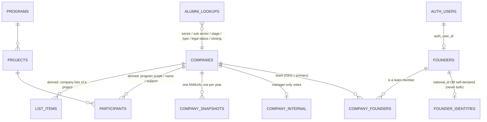

# Design 09 — The missing Alumni pages and the profile model (the owner's Excel, decisions 18.7 – 19)

Written 2026-10-14 for the two builders who will build the founder-side and the manager-side Alumni pages **in parallel**. Everything here is **implemented** on the local stack by `db/migrations/m49_alumni_profile_model.sql` and proved by `db/verify/v49_alumni_profile_model.sql` (320 role-switch / unit checks, rolled back). The client-side contract (RPC names, payload shapes, error tokens, shared UI blocks) is in `web/src/data/alumni.contract.md`; this document is the reasoning behind it.

**Owner decisions that govern this document** (`08-decisions-log.md`): 18.7 (finish the missing Alumni pages only; Athar Network pages are postponed), 18.8 (the 38 Excel columns must be part of the founder account and the company the founder adds), 19 (the national ID **is collected** and is the single source of the founder's date of birth, age, age category, governorate of origin and gender; the ID always wins). 03 (roles / RLS), 04 (database), and the no-duplication goal G1 / the light-and-fast goal G2 of `08` section 1 apply to every choice below.

## 0. Summary

- The owner's alumni database has **38 columns**. Each one now has exactly **one home** (section 4): typed columns on `companies` / `founders`, a private identity table for the **national ID**, a manager-only notes table for **Hint**, **yearly metric rows** keyed by year in `company_snapshots`, **derived** values (Program Scope / Program Name / Support provided from participations; CEO Age / Age Category / Gender / Governerate from the ID; the three founder counts from the founders), or computed at export time.
- **The national ID** (14 digits) is stored once, in `founder_identities.national_id` (unique, no API grant at all, no encryption by the owner's decision). Birth date, age, age category, governorate and gender are **never stored**: ten deterministic IMMUTABLE SQL functions (`app_private.id_*`) derive them at read time and every view / RPC / export uses those functions. **The ID wins**: typed birth date / gender exist only as a flagged "self-declared" fallback while there is no ID, and are erased the moment an ID is entered (a CHECK makes a second copy impossible).
- Access is least-privilege: the ID is readable by the founder himself, `alumni_manager` and `super_admin` through RPCs only. Other founders, PMs and anon cannot read it, it is in no list payload, no directory payload (member or public), no analytics, no log, no URL; the manager sees it **masked** by default (a reveal is audited) and in the Excel export (which is audited too).
- **25 RPCs** serve the pages (section 10). Both builders call the same functions; nothing is re-implemented in the browser (the form previews an ID through `preview_national_id`, the same SQL).
- The manager export reproduces the owner's **exact header order and header texts** (typos included) so the owner's Excel workflow keeps working (section 4.2).
- Existing data is mapped without losing or overwriting anything (section 12): 114 of the 141 companies got a `governorate_code`, 98 a `sector_key`, from the text they already held.

## 1. The Alumni pages: old, new, missing

### 1.1 The old application (22 files in `src/components/alumni/`, reference only; `docs/06` describes them and their bugs)

| Old file | New home | Status |
|---|---|---|
| `AlumniLoginPage` | `/login` (shared) | Done |
| `AlumniRouteGuard` | `RequireAccess` (areas `founder` / `network`) | Done |
| `CertificateVerifier`, `CertificateGenerator` | `/verify/:code?`, the Certificates node, the founder certificate block | Done |
| `FounderLayout` / `AlumniManagerLayout` | `FounderShell` (bottom tabs: Home, Programs, Notifications, Profile) / `NetworkShell` (header: Dashboard, Invitations, Opportunities, Notifications, Analytics) | Done |
| `FounderDashboard` (company cards, KPIs, update modal) | lean founder Home (programs only) | **Partial**: the company part is missing |
| `FounderProgramsPage` | `/alumni/founder/programs`, `/programs/:projectId` and its blocks | Done (step 8) |
| `AlumniSignupPage` | `/signup`, `/invite/:token` (ComingSoon placeholders) | **Missing** |
| `FounderProfilePage` (+ co-founder invitation) | `/alumni/founder/profile` (ComingSoon) | **Missing** |
| `CompanyProfilePage` (shared by founder and manager) | `/alumni/founder/company/:id`, `/alumni/admin/company/:id` (ComingSoon) | **Missing** (split in two pages here) |
| `FounderProgressPage` (a static mock) | `/alumni/founder/progress` (ComingSoon) | **Missing** (now real: yearly metrics) |
| `FounderOpportunitiesPage` | `/alumni/founder/opportunities` (ComingSoon) | **Missing** |
| `FounderNotificationsPage` | `/alumni/founder/notifications` (ComingSoon) | **Missing** |
| `AlumniManagerDashboard`, `AlumniAnalyticsPage`, `ImpactDashboard` | `/alumni/admin/dashboard`, `/analytics`, `/impact` | **Missing** |
| `AlumniDirectory` | `/alumni/admin/directory` | **Missing** |
| `MEWorkspace` | `/alumni/admin/workspace` | **Missing** |
| `AlumniInvitationsPage` | `/alumni/admin/invitations` | **Missing** |
| `AlumniNotificationsPage` | `/alumni/admin/notifications` | **Missing** |
| `OpportunitiesHub` | `/alumni/admin/opportunities` | **Missing** |

New in this design (not in the old app): the **national-ID / profile model** (all of section 3 – 9), the **member and public alumni directory** (RPCs only, no route is allocated: optional page, not under `/network/*`), and the **vocabulary administration** (`save_alumni_lookup`, optional page).

### 1.2 The missing pages, one by one

`F` = built by the founder-side builder, `M` = by the manager-side builder. "Direct" = the page reads / writes the table through PostgREST under the existing RLS (policies listed in `03` 8.3 and verified by `v02` / `v11`); no new RPC is needed.

| # | Page and route | Actor | Purpose | Data | RPCs / access |
|---|---|---|---|---|---|
| F1 | **Sign-up** `/signup` | anon | open founder sign-up (role `founder` is granted by the DB trigger, never by metadata) | `auth` | `supabase.auth.signUp`, then the DB trigger creates profile + role + `founders` row. Optional `invitation_token` in the user metadata links the company (existing trigger, `03` 4.4) |
| F2 | **Invitation** `/invite/:token` | anon, then founder | show the company the invitation belongs to, sign up or (already signed in) accept | `alumni_invitations` | `validate_invitation(token)` (exists: `{valid, company_name, masked_email}`), `accept_invitation(token)` (exists), sign-up as F1 |
| F3 | **Forgot / reset password** `/forgot-password`, `/reset-password` | anon | Auth recovery (step 2b) | `auth` | `supabase.auth` only |
| F4 | **Founder profile** `/alumni/founder/profile` | founder | personal profile: name, photo, phone, LinkedIn, bio, student / graduate, **national ID** (with the derived values shown), self-declared fallback, list of his companies | `founders`, `founder_identities` | `get_my_alumni_profile`, `save_my_founder_profile`, `preview_national_id`, photo through `data/storage.js` (`founder-assets/founders/<uid>/photo/`) |
| F5 | **Company profile** `/alumni/founder/company/:id` (and `/company/new`) | founder | the startup's profile: identity, classification (type / sector / sub sector / stage / legal status), location, established date, online presence (website, app, social), open / closed, directory visibility, **team** (co-founders as records, CEO), derived **programs** (read-only), logo | `companies`, `company_founders`, `company_snapshots` | `get_my_company_profile`, `save_my_company_profile` (create when `p_company` is null), `save_company_team_member`, `remove_company_team_member`, `set_company_ceo`, `create_alumni_invitation` / `list_alumni_invitations` / `revoke_alumni_invitation` (co-founder invitation), logo through `data/storage.js` (`public-assets/alumni/<uid>/logo/`) |
| F6 | **Progress / yearly update** `/alumni/founder/progress` | founder | the yearly metrics table (revenue, funding, headcount, freelancers, challenges, needs, traction) with an "add year" action and a chart | `company_snapshots` | `get_my_company_profile().snapshots`, `upsert_company_snapshot` |
| F7 | **Notifications** `/alumni/founder/notifications` | founder | inbox, mark read | `notifications` | Direct: select own (`recipient_id = uid` or `founder_id` mine), update `is_read` |
| F8 | **Opportunities** `/alumni/founder/opportunities` | founder | browse active opportunities, apply with a company | `opportunities`, `opportunity_applications` | Direct: select active; insert an application for an own company |
| F9 | **Home enrichment** `/alumni/founder/dashboard` | founder | profile completeness, "annual update due", unread count, company cards | — | `get_my_alumni_profile` (`completeness`, `latest_snapshot_year`), the notification count |
| F10 | *(optional)* **Alumni directory** | founder | browse the alumni companies that chose "alumni" or "public" visibility | — | `list_alumni_directory` (member audience); no route allocated |
| M1 | **Dashboard** `/alumni/admin/dashboard` | alumni_manager | KPIs: companies, open / closed, survival, founders, headcount, funding, revenue; invitations | — | `get_alumni_analytics`, `list_alumni_invitations` |
| M2 | **Directory** `/alumni/admin/directory` | alumni_manager | all alumni companies with filters, paging, bulk "mark as alumni", **Excel export** | — | `list_alumni_directory` (manager audience), `set_companies_alumni`, `export_alumni_rows` + `lib/export/xlsx` |
| M3 | **Company** `/alumni/admin/company/:id` | alumni_manager | everything about one company: profile (all fields), manager notes (Hint), review stamp, directory veto, team with **masked IDs** and a logged reveal, yearly metrics (add / correct / delete), derived programs, invitations, merge | all | `get_alumni_company`, `save_alumni_company`, `get_alumni_founder`, `save_alumni_founder`, `save_company_team_member`, `remove_company_team_member`, `set_company_ceo`, `upsert_company_snapshot`, `delete_company_snapshot`, `merge_companies` (exists), `create_alumni_invitation` |
| M4 | **Invitations** `/alumni/admin/invitations` | alumni_manager | list, filter by status, create (single / bulk = repeated calls), revoke, copy link (the e-mail itself waits for the outbox worker) | `alumni_invitations` | `list_alumni_invitations`, `create_alumni_invitation`, `revoke_alumni_invitation` |
| M5 | **Notifications** `/alumni/admin/notifications` | alumni_manager | compose and send a message to founders / a company / a program | `notifications` | Direct: insert one row per recipient (**always with `recipient_id` set**: the old NULL-recipient rows are visible to nobody now). Recipients are resolved client-side from `founders` / `company_founders` (managers read all) |
| M6 | **Opportunities** `/alumni/admin/opportunities` | alumni_manager | create / edit / deactivate opportunities, see and update applications | `opportunities`, `opportunity_applications` | Direct (RLS: manager insert / update / delete, update application status) |
| M7 | **Analytics** `/alumni/admin/analytics` | alumni_manager | filtered aggregates by sector / stage / governorate / gender / age category / program / year | — | `get_alumni_analytics(filters, year)` |
| M8 | **Impact** `/alumni/admin/impact` | alumni_manager | the cumulative impact view + export | — | the same `get_alumni_analytics` (no filter = all) |
| M9 | **M&E workspace** `/alumni/admin/workspace` | alumni_manager | the tracking table (latest figures per company, incomplete profiles, no update this year) and the "log a year" modal | — | `list_alumni_directory` (rows carry `latest` and `completeness_percent`, filters `incomplete`, `reviewed`), `upsert_company_snapshot` |
| M10 | *(optional)* **Vocabulary** `/alumni/admin/lookups` | alumni_manager | edit the lists of sectors, stages, legal statuses ... (labels, order, active) | `alumni_lookups` | `list_alumni_lookups`, `save_alumni_lookup`, `delete_alumni_lookup` |
| M11 | *(later)* **Excel import** | alumni_manager | bulk load of the owner's existing Excel | — | design only, section 13 |

### 1.3 What the two builders must agree on (details in section 14 and in the contract file)

1. **One data module** (`web/src/data/alumni.js`, written with this contract) wraps every RPC; the pages import it, nobody calls `rpc('...')` directly.
2. **One set of shared UI blocks** (`web/src/shared/alumni/*`) is created by the **founder builder first** (F4 / F5 need them most) and reused by the manager builder; the list is in 14.2.
3. **Disjoint files**: founder pages under `web/src/app/pages/founder/`, manager pages under `web/src/app/pages/alumni-admin/`, i18n keys `alumni.common.*` (shared), `alumni.founder.*`, `alumni.admin.*`. Route changes in `routes.jsx` replace the ComingSoon lines of one's own area only.
4. **The ID never leaves the form**: sent with POST only (every RPC that takes or returns an ID is VOLATILE, so PostgREST refuses GET), never put in a URL, a toast, a log line, an analytics event or a query key.

## 2. The model in one picture

**One fact, one home** (G1):

| Fact | The only place it is stored | How everyone else gets it |
|---|---|---|
| national ID | `founder_identities.national_id` | RPC payloads of the owner / manager, the manager export |
| birth date, age, age category, gender, governorate of origin | **nowhere** | `app_private.id_*` on the ID (or the self-declared fallback) via `app_private.alumni_founder_attrs(today)` |
| company operating location | `companies.governorate_code` (+ free text `location_*`) | payloads, directory, filters |
| program scope / program name / support provided | **nowhere** | `app_private.alumni_participations()` + `alumni_project_support()` |
| founding team size, female founders, founders below 35 | **nowhere** | counts over `company_founders` (`alumni_team_stats`) |
| Age category label, any bucket | **nowhere** | `id_age_category(age)` + the lookup label |
| yearly figures | `company_snapshots` (one annual row per year) | latest-as-of-year aggregation (section 7) |
| Hint, directory veto, review stamp | `company_internal` | manager payloads only |

## 2b. How this fits the existing role and linking rules

- **Roles**: the `founder` role is granted by the sign-up trigger (open sign-up, or an invitation) and **never** to a staff account (m25 exclusivity); every founder RPC checks `has_role('founder')`, every manager RPC `alumni_manager` / `super_admin`, so a PM or a manager cannot use the other side's RPCs (v49 P21, P10-P14).
- **Invited vs self-registered founder** (docs/11 C10): an invited founder is linked to the invitation's company by the existing trigger / `accept_invitation` (not as primary); a self-registered founder has no company and creates his own with `save_my_company_profile(null, ...)` (he becomes its primary founder). Linking an existing `founders` record by e-mail is still **only** via invitation or a manager (decision 03-8).
- **Participation vs company**: `link_my_participations` (m39) links a founder account to the participants accepted through Selection by a verified e-mail; the company profile derives programs from company-level participation (4.3).

## 3. Tables and columns (as built in m49)

### 3.1 `companies` (13 typed columns added; every one nullable or defaulted, so the PM list screens keep working unchanged)

| Column | Type | Rule |
|---|---|---|
| `startup_type_key` | text | lookup `startup_type` |
| `sector_key`, `subsector_key` | text | lookups `sector` / `subsector`; the sub sector must belong to the sector (trigger, `subsector:parent_mismatch`) |
| `stage` (existing) | text | lookup `stage`; the 11 keys ARE the values already stored |
| `governorate_code` | smallint | the company's **operating** governorate (list of 27; `88` is not a company location). Legacy text `governorate_en/ar` is kept as a one-way mirror written from the key |
| `established_on` | date | 1900-01-01 .. today (Cairo); `founding_year` (legacy) follows it |
| `app_url` | text | http(s), 500 chars |
| `legal_status_key` | text | lookup `legal_status` |
| `operating_status` | text, default `open` | `open` / `closed` |
| `closed_on`, `closing_reason_key`, `after_closing_key`, `closing_note` | date / text | allowed **only** when `closed` (CHECK `companies_closed_fields_chk`); re-opening clears them |
| `directory_visibility` | text, default `private` | `private` / `alumni` / `public` |

Existing columns kept as they are: names, descriptions (ar / en pairs), `logo_path`, `website_url`, `linkedin_url`, `links`, `location_en/ar` (free text address / city), `is_alumni` (manager-only), `origin_project_id`, `created_by`. **Legacy, unused by the Alumni pages**: `employees` (all NULL, the metric lives in the yearly row), `industry_en/ar` (mirror of the sector label). A `BEFORE INSERT OR UPDATE` trigger (`companies_bu_alumni_guard`) applies to **every writer** (the RPCs, a founder's direct PostgREST write, a PM creating a company in a list): only a manager can change `is_alumni` / `created_by`; changed lookup keys, the sub-sector pairing, the governorate and the dates are validated (`alumni_invalid`, detail `field:reason`). Values that did not change are not re-validated, so legacy values stay readable.

### 3.2 `founders` (1 column added)

`education_status` (`student` / `graduate` / `other`). Everything else already existed (`name_ar` NOT NULL, `name_en`, `email`, `phone`, `linkedin_url`, `photo_path`, `bio_*`, `auth_user_id`, `deleted_at`). A founder **record without an account** (`auth_user_id` NULL) is how a co-founder who has not registered is represented (the "team" of the company payload): it makes the derived counts possible without needing a registered account for every co-founder. The lead founder types only name, role, gender and birth date for such a record (self-declared); only a manager can enter a national ID for somebody else.

### 3.3 `founder_identities` (new; no privilege for anon / authenticated / PUBLIC, RLS enabled and forced; written only by the SECURITY DEFINER RPCs)

**Why a 1:1 table and not a column of `founders`**: a `founders` row is readable by the founder himself, by managers **and by the PMs of the projects the company took part in** (`pm_can_read_founder`, needed by the Participants page), and PostgREST would return any new column with `select=*`. A column cannot be hidden from one RLS audience and shown to another; a table can (here: from every API role). The owner-facing meaning is unchanged: the national ID **is** a field of the founder profile (`get_my_alumni_profile().founder.identity.national_id`).

| Column | Type | Rule |
|---|---|---|
| `founder_id` | uuid PK, FK `founders` ON DELETE CASCADE | one row per founder at most |
| `national_id` | text, **unique** | CHECK: `^[23][0-9]{13}$` and `id_invalid_reason(...) IS NULL` (structure: real date, known governorate) |
| `self_birth_date`, `self_gender` | date, text | the flagged self-declared fallback; CHECK `id_wins`: both NULL whenever `national_id` is set |
| `updated_by`, timestamps | | audit |

A CHECK refuses an empty row, so "no row" = "nothing known". A row never holds a typed value next to an ID.

### 3.4 `company_internal` (new; manager-only, no API privilege)

`company_id` PK, `hint` (≤ 2000), `directory_hidden` (the veto), `reviewed_at` / `reviewed_by`, audit columns. A founder can read his own company row but **not** this table; his payload only says `directory_blocked: true/false`.

### 3.5 `company_snapshots` (altered; typed yearly metrics)

New columns `period_year`, `revenue_total`, `funding_raised_total` (numeric 16,2, EGP), `employees_total`, `employees_female`, `freelancers`, `traction`, `challenges`, `needs` (≤ 4000 chars), `updated_by`, `updated_at`. CHECKs: type in (`annual`, `baseline`, `followup`, `manual`), source in (`founder`, `manager`, `import`, `form`), `annual` needs a year (1990 – 2100), amounts ≥ 0, `employees_female ≤ employees_total`. **Unique (company, year) for annual rows.** The old `data jsonb` and `form_response_id` stay for legacy / form-driven rows. Privileges: `authenticated` can only SELECT (policy: founders of the company + managers; **a PM of a participating project no longer reads financials**, a tightening of `03` 8.3); no INSERT / UPDATE / DELETE: only `upsert_company_snapshot` / `delete_company_snapshot` write.

### 3.6 `alumni_lookups` (new; no direct privilege, read through `list_alumni_lookups`)

`(kind, key)` PK, `parent_key` (sub sector → sector, enforced by a generated `parent_kind` + FK), `label_en`, `label_ar`, `sort_order`, `is_active`, `is_system`. Kinds: `startup_type`, `sector`, `subsector`, `stage`, `legal_status`, `closing_reason`, `after_closing`, `support_kind`, `age_category`, `gender`, `education_status`, `operating_status`, `directory_visibility`. **127 seed rows** (idempotent, a manager's edit is never overwritten). Closed vocabularies (`is_system`: gender, age category, education status, operating status, directory visibility, support kind) take no new key and cannot be deactivated or deleted (their keys are used by CHECKs and by the derivation functions); only their labels are editable. Open vocabularies are extended by managers (`save_alumni_lookup`); a used value cannot be deleted (`alumni_in_use`), it is deactivated.

### 3.7 Performance (goal G2)

Indexes on every filter column of the directory: `companies (sector_key)`, `(governorate_code)`, `(stage)`, partial `(directory_visibility) where <> 'private'`, partial `(operating_status) where closed`, the existing partial `(is_alumni)`; `company_snapshots` unique `(company_id, period_year)` for annual rows; `alumni_lookups` leading-column index for its FK. One request = one set-based query: the participations of **all** companies are computed once per call (`alumni_participations()`), never per row; the filter is one function (`alumni_filter_ids`) shared by the directory, the export and the analytics; the directory returns at most 100 rows (50 for anon) with a whitelisted payload; `list_alumni_lookups` is one small static call cached by the client (`version`); the analytics are one statement. Nothing is stored twice, so no trigger keeps copies in step.

### 3.8 Tables used as they are

`company_founders` (team; `is_primary` = the CEO; the CEO of a company is its primary founder, else the earliest linked, `alumni_company_ceo`), `participants` and `list_items` (participation), `programs` / `projects`, `alumni_invitations` (token stored as sha256, 14 days), `notifications`, `opportunities`, `opportunity_applications`, `investor_requests`, `certificates`. Audit / limiter tables in `app_private`: `founder_identity_access_log` (who revealed / exported, when, how many rows; never a number) and `alumni_probe_limits` (5 ID conflicts per account and hour).

## 4. The 38 columns: crosswalk

Header order is the owner's Excel order (this is also the export order, section 4.2). "Edited by": **F** = the founder (own company / own profile), **M** = alumni_manager / super_admin, **D** = derived, nobody edits it.

### 4.1 Crosswalk

| # | Excel header | Where it lives | Type / values | Edited by | Notes |
|---|---|---|---|---|---|
| 1 | Startup Name | `companies.name_en` / `name_ar` | text, one of them required | F, M | the export prints the name in the requested language (fallback: the other) |
| 2 | Program Scope | **derived** from participations | the program(s) the company took part in | D | see 4.3: interpretation to confirm |
| 3 | Program Name | **derived** from participations | the project(s) (editions / cohorts) | D | `; `-joined, alphabetical |
| 4 | Support provided | **derived** from the project's nodes | `mentoring` (booking / distribution), `training` (agenda), `resources` (library), `certification` (certificates) | D | labels from `support_kind`; a manual "grant / funding" kind needs a Project field (open question) |
| 5 | Startup type | `companies.startup_type_key` | lookup `startup_type` (startup / msme / social_enterprise / other) | F, M | |
| 6 | Hint | `company_internal.hint` | text ≤ 2000 | **M only** | never in a founder payload or any directory |
| 7 | Sector | `companies.sector_key` | lookup `sector` (18) | F, M | export falls back to the legacy industry text when the key is empty |
| 8 | Sub sector | `companies.subsector_key` | lookup `subsector` (55), child of the sector | F, M | |
| 9 | Description | `companies.description_en` / `_ar` | text ≤ 4000 | F, M | |
| 10 | Stage | `companies.stage` | lookup `stage` (11) | F, M | |
| 11 | Governerate | **the CEO's governorate FROM THE ID**; fallback the company's `governorate_code`; fallback the legacy typed text | list of 27 (+88 for a founder born abroad) | D | decision 19.2. The company's operating location stays a separate field ("Company location") |
| 12 | Date of company established | `companies.established_on` (`founding_year` legacy fallback) | date | F, M | |
| 13 | App | `companies.app_url` | http(s) URL | F, M | |
| 14 | Website | `companies.website_url` | http(s) URL | F, M | |
| 15 | Social media | `companies.links` (kinds facebook, instagram, x, tiktok, youtube, telegram, whatsapp) + `linkedin_url` | `Kind: url` joined by `; ` | F, M | the form edits canonical `{kind,url,label?}` entries (legacy shapes are normalised on read) |
| 16 | Traction/Validation | yearly row `company_snapshots.traction` | text ≤ 4000 | F, M | as of the export year (latest non-empty up to that year) |
| 17 | CEO Name | `founders.name_en/ar` of the CEO | text | F (own), M | CEO = primary founder |
| 18 | Phone | `founders.phone` of the CEO | E.164 | F (own), M | |
| 19 | Email | `founders.email` of the CEO | e-mail | M (the account e-mail is set at sign-up) | |
| 20 | ID | `founder_identities.national_id` of the CEO | 14 digits | F (own), M | export only, manager only |
| 21 | CEO Age | **derived** from the ID (self-declared fallback) | integer, completed years at the export date | D | never stored |
| 22 | Age Category | **derived** from the age | `under_18`, `18-24`, `25-34`, `35-44`, `45+` | D | one function, `id_age_category` |
| 23 | Student/Graduate | `founders.education_status` of the CEO | student / graduate / other | F (own), M | |
| 24 | CEO Gender | **derived** from the ID (self-declared fallback) | male / female | D | |
| 25 | Open/Closed | `companies.operating_status` | open / closed | F, M | |
| 26 | Reason for closing | `companies.closing_reason_key` (+ `closing_note`) | lookup + free note | F, M | only when closed |
| 27 | After closing | `companies.after_closing_key` | lookup | F, M | only when closed |
| 28 | Legal Status | `companies.legal_status_key` | lookup `legal_status` | F, M | |
| 29 | Founding team size | **derived**: number of founders linked to the company | integer | D | the founder adds co-founders as records (section 3.2) |
| 30 | Female founders | **derived**: linked founders whose gender (ID, else self-declared) is female | integer | D | |
| 31 | Nu. of founders below 35 | **derived**: linked founders whose age < 35 | integer | D | unknown ages are not counted |
| 32 | Nu. of employees | yearly row `employees_total` | integer | F, M | latest non-empty value up to the export year |
| 33 | Nu. of female employees | yearly row `employees_female` | integer ≤ employees | F, M | |
| 34 | Number of freelancers | yearly row `freelancers` | integer | F, M | |
| 35 | Funding raised | yearly row `funding_raised_total` | EGP, **cumulative** to the end of that year | F, M | latest non-empty value up to the export year |
| 36 | Revenue (2023) (Total) | yearly row `revenue_total` of the **exact** year | EGP, the year's total | F, M | the header carries the year: `Revenue (<year>) (Total)`; default year = the latest year with data, 2023 when there is none |
| 37 | Challenges | yearly row `challenges` | text ≤ 4000 | F, M | as of the export year |
| 38 | Needs | yearly row `needs` | text ≤ 4000 | F, M | as of the export year |

### 4.2 The export (`export_alumni_rows`)

Returns `{ columns: [{ key, header, type }] (38), rows: [[...38 cells...]], meta: { year, lang, as_of, count, generated_at, ceo_source: { id, self, none } } }`. One row per company. The header texts and their order, exactly:

`Startup Name | Program Scope | Program Name | Support provided | Startup type | Hint | Sector | Sub sector | Description | Stage | Governerate | Date of company established | App | Website | Social media | Traction/Validation | CEO Name | Phone | Email | ID | CEO Age | Age Category | Student/Graduate | CEO Gender | Open/Closed | Reason for closing | After closing | Legal Status | Founding team size | Female founders | Nu. of founders below 35 | Nu. of employees | Nu. of female employees | Number of freelancers | Funding raised | Revenue (<year>) (Total) | Challenges | Needs`

Labels are exported in the requested language (`p_lang` `en` / `ar`); dates are ISO; numbers are numbers; an empty cell is `null`. `meta.ceo_source` tells the manager how many CEO age / gender / governorate cells come from an ID, how many are self-declared and how many are unknown. Every export is logged (row count, never a number). The browser turns it into `.xlsx` with `lib/export/xlsx.js`.

### 4.3 Program Scope / Program Name / Support provided: what "derived" means here

A company **took part in a project** when it is a participant (`accepted` / `attended`) **or** an item of a company list of that project, and it is not withdrawn (the m40 predicate `app_private.is_withdrawn`) nor legacy-hidden. Today every migrated company is in exactly one program (Finland or Plan Asyut) and 18 of them in more than one project, through the company lists (there are no `participants` rows yet). **Interpretation to confirm with the owner** (open question 1): *Program Scope* = the **program** (the umbrella: Finland, Plan Asyut, ...), *Program Name* = the **project** (the cohort / edition: "Athar MSMEs incubation program R1"). The alternative reading, Scope = the program **type** (accelerator / incubator / hackathon), is a one-line change in the export because both values are derived; `program_type` is already in the company payload (`programs[].program_type`). **Known limit**: participation is derived at COMPANY level; a participant that is linked only to a user account and to no company (a self-registered founder accepted through Selection, linked by e-mail, m39) is not part of any company's programs until a PM attaches the company (decision 02-8: no automatic promotion of an applicant to a company); his programs still appear in his own Programs list (`list_my_programs`).

## 5. The national ID

### 5.1 Rules (decision 19.3), implemented once

14 numeric digits. Digit 1 = century (`2` = 1900s, `3` = 2000s; anything else is refused). Digits 2-7 = `YYMMDD`, which must be a **real calendar date** (leap years included: 1900-02-29 is refused, 2000-02-29 is accepted) and **not in the future** (checked against the date in **Cairo**, `app_private.alumni_today()`). Digits 8-9 = governorate code from the list (01 Cairo, 02 Alexandria, 03 Port Said, 04 Suez, 11 Damietta, 12 Dakahlia, 13 Sharqia, 14 Qalyubia, 15 Kafr El Sheikh, 16 Gharbia, 17 Monufia, 18 Beheira, 19 Ismailia, 21 Giza, 22 Beni Suef, 23 Fayoum, 24 Minya, 25 Assiut, 26 Sohag, 27 Qena, 28 Aswan, 29 Luxor, 31 Red Sea, 32 New Valley, 33 Matrouh, 34 North Sinai, 35 South Sinai, **88 born outside Egypt**). Digits 10-13 = serial; the **13th digit** gives the gender (odd male, even female). Digit 14 = check digit: **its algorithm is not public, no checksum is invented or validated**. Typed input is normalised first: Arabic-Indic and Persian digits become ASCII; spaces, dashes, dots, zero-width and bidi marks are removed; anything else stays and fails with `digits`.

### 5.2 The derivation functions (`app_private`, IMMUTABLE, pure; not executable by any API role)

| Function | Returns |
|---|---|
| `id_normalize(text)` | the cleaned digits (NULL when blank) |
| `id_invalid_reason(text, today date default NULL)` | NULL when valid; else `empty`, `digits`, `length`, `century`, `date`, `future` (only when `today` is given), `governorate` |
| `id_valid(text, today)` | boolean |
| `id_birth_date(text)` | date, or NULL when invalid |
| `id_age(text, today)` | completed years at `today` (the day before the birthday is still the previous age) |
| `id_age_category(age)` | `under_18`, `age_18_24`, `age_25_34`, `age_35_44`, `age_45_plus` ("below 35" = the first three) |
| `id_gender(text)` | `male` / `female` |
| `id_governorate_code(text)` / `id_governorate_name(text, 'en'|'ar')` | code / name (the names come from the ONE list `eg_governorates()`) |
| `id_mask(text)` | `**********1234` |

Everything that shows a derived personal value goes through `alumni_founder_attrs(today)` (one row per founder: birth date, age, category, gender, governorate code, `source` = `id` / `self` / NULL), so directory, export, analytics, the counts and the profile payloads cannot disagree.

### 5.3 "The ID wins": the conflict rule

| Situation | Result |
|---|---|
| founder has an ID | birth date, age, category, gender, governorate come from the ID only |
| founder has **no** ID, typed `self_birth_date` / `self_gender` | used, flagged `source: "self"` ("self-declared"); the governorate of origin is unknown |
| founder enters an ID while typed values exist | the typed values are **erased in the same transaction**; the response lists `replaced: [{ field, typed, from_id }]` for the ones that disagreed, so the form can say "we used the date in your ID" |
| founder (or anybody) tries to type a birth date / gender **while an ID exists** | refused: `alumni_invalid`, detail `self_birth_date:id_wins` / `self_gender:id_wins` |
| founder clears the ID | back to "unknown" (the typed values are gone; he may type new ones) |
| typed company governorate vs CEO's governorate | **not a conflict**: different attributes (company location vs founder origin). The Excel "Governerate" column uses the CEO's, falling back to the company's |
| two founders with the same ID | impossible (unique); see 5.5 |

### 5.4 Who can read the ID and its derived values

| | owner founder | other founder (member directory) | PM | alumni_manager / super_admin | anon / public directory |
|---|---|---|---|---|---|
| national ID | yes (own, full) | no | no | masked by default; full on an audited reveal and in the audited export | no |
| derived age / gender / governorate / birth date | yes (own) | no | no | yes | no |
| a co-founder **record** the lead typed (self-declared values) | yes | — | no | yes | no |
| a **registered** co-founder's derived values | no (only he sees them) | — | no | yes | no |
| the count-level values (team size, female founders, below 35) | yes (own company) | no | no | yes | no |

Mechanisms: no table privilege at all on `founder_identities` for any API role (a SELECT is a permission error, proved by v49 P05-P07, P15, P24); the RPCs are SECURITY DEFINER with `search_path = ''`; the helpers are not executable by API roles (v49 C03); `preview_national_id`, `get_my_alumni_profile`, `save_my_founder_profile`, `save_company_team_member`, `save_alumni_founder`, `get_alumni_founder` and `export_alumni_rows` are **VOLATILE** so PostgREST serves them by POST only (the number cannot be in a URL; v49 C13); error messages never contain the number (only a reason); the audit log stores who / how / which founder, never the number. **Encryption is not applied** (owner decision 19.4).

### 5.5 Uniqueness and the conflict probe

`national_id` is unique, normalised (14 ASCII digits). A founder who enters a number that already belongs to somebody else gets a **soft failure** `{ saved: false, error: "national_id_conflict" }`, with no information about the owner; five such attempts per account and hour are allowed, then `alumni_rate_limited` (the counter must survive the failed call, which is why this one outcome is a normal return, not an exception). A manager gets an **error** `national_id_conflict` (23505) whose detail is the other founder's **id** (not the number), to resolve it by merging the records.

### 5.6 What the form does (for the builders)

Digits-only input (up to 14, any digit script) → when 14 digits are present call `preview_national_id` (POST) and show the **derived card**: birth date, age, gender, governorate (a founder living in Cairo with an Aswan ID reads "From: Aswan"); invalid → the `reason` as a translated hint. The self-declared birth date / gender fields appear only **while there is no ID**, under the label "self-declared". After the save, show the `replaced` notice. A conflict shows "this number is already registered; contact the Athar team". No JavaScript re-implementation of the rules exists or is allowed.

### 5.7 Proof

`v49` U01-U22: both centuries, both genders, ten governorates incl. abroad, leap days (1988, 2000, the non-leap 1900), month 13 / April 31 / day 00, century 1 and 4, lengths 13 / 15, letters, blank, future, the 28 listed codes accepted and six unknown codes refused, age on / before the birthday, 29 February birthdays in a non-leap year, every age bucket edge, the mask, the free-text governorate and sector resolvers. A scan of the archived real-world values (section 5.8) found only 6 invalid out of 665 entries (all typos: month 00 / 25, codes 10 / 37 / 40 / 42), so the rules fit what people actually have.

### 5.8 The archived legacy IDs: what exists, and the optional prefill (NOT executed)

The old national IDs sit in the restricted `legacy` schema only (`legacy.company_submissions`: a typed column and four answer headers). **Nothing was copied, migrated or used** (decision 19.5). Aggregate facts (counts, no values), measured with the new rules:

| Measure | Count |
|---|---|
| submissions in the archive | 384 |
| typed `national_id` column: non-empty / valid under the new rules / invalid (free text) | 65 / 12 / 53 |
| submissions with a national-ID **answer** | 365 |
| answer entries: valid / invalid (typos) / distinct valid numbers | 659 / 6 / 585 |
| distinct valid numbers whose submission also carries a founder e-mail | 60 (behind 62 e-mails) |
| numbers shared by two different e-mails | 2 |
| e-mails that match an existing account or `founders` row today | **0** |
| century digit among valid | 2 (460), 3 (199) |

**Optional idea, requires the owner's approval, not done**: when a founder registers and verifies an e-mail that equals the `founder_email` of an archived submission with a valid ID, offer to **pre-fill** the national ID field (the founder confirms; it is never written silently), only for the 60 numbers tied to an e-mail, and only if the owner accepts keeping the archive as a source. Risks: the two numbers shared by two e-mails (must be skipped), the second-member entries that cannot be tied to a person, and e-mail verification being genuinely proven (the m43 `auth_email_verified` rule). Open question 6.

## 6. Vocabularies and validation per column

### 6.1 Governorates

`companies.governorate_code` takes one of the 27 codes (not 88). The list, with Arabic and English names, is `app_private.eg_governorates()` (the one definition; `list_alumni_lookups().governorates` serves it). A legacy typed governorate ("أسيوط", "Cairo", "Alex", "محافظة سوهاج", "Assiut, Egypt") is resolved by `eg_governorate_from_text` (normalises alef / ya / ta-marbuta, drops "محافظة" and the country, knows common aliases) **in the backfill only**; writes carry the code.

### 6.2 Stage (11)

`idea_stage`, `prototype`, `advanced_prototype`, `mvp`, `product`, `early_traction`, `revenue`, `steady_revenue`, `break-even_point`, `profit`, `scaling` (the keys already stored in `companies.stage`; labels in both languages).

### 6.3 Sector and sub sector

18 sectors (agriculture, food & beverage, healthcare & life sciences, technology, creative industries, manufacturing, retail, e-commerce, logistics & transportation, education, sustainability & environment, energy & utilities, services, finance & insurance, construction & real estate, media & communications, tourism & leisure, other) and **55 sub sectors = the 55 options of the industry question of the legacy application forms**, each under exactly one sector. This is a **seed**: the owner's own Excel values replace or extend it through `save_alumni_lookup` (open question 3). A company holds ONE sector and one sub sector; a legacy multi-valued text ("Technology, Manufacturing") is mapped to its **first** value and the full text stays in `industry_en/ar`.

### 6.4 The other lookups

`startup_type`: startup, msme, social_enterprise, other. `legal_status`: not_registered, sole_proprietorship, llc, joint_stock, nonprofit (the five options of the legacy form), other. `closing_reason`: funding, market, team, legal_regulatory, economic, personal, pivot, other. `after_closing`: new_startup, employed, studying, freelancing, seeking, other. Closed vocabularies: `gender` (male / female), `education_status` (student / graduate / other), `operating_status` (open / closed), `directory_visibility` (private / alumni / public), `age_category` (5 buckets), `support_kind` (mentoring, training, resources, certification).

### 6.5 Validation (server side, the same for the RPC path and a direct write where marked)

| Field | Rule | Error (`alumni_invalid` detail) |
|---|---|---|
| any text | trimmed; empty = NULL; names ≤ 200, descriptions / bios / metrics text ≤ 4000, location ≤ 300, notes ≤ 1000, hint ≤ 2000 | `<field>:too_long` |
| lookup keys | exist and active (only a changed value is checked, direct writes included) | `<field>:unknown` |
| sub sector | needs a sector; must be its child | `subsector:needs_sector`, `:parent_mismatch` |
| governorate | a listed code, not 88 | `governorate:unknown` |
| dates | ISO, ≥ 1900-01-01, established / closed not in the future | `<field>:bad_date`, `:future` |
| URLs (website, app, LinkedIn, links) | `http(s)://` only, ≤ 500; `javascript:` and others refused | `<field>:bad_url` |
| links | ≤ 12 entries, kind in facebook, instagram, x, tiktok, youtube, telegram, whatsapp, deck, video, other; LinkedIn goes to `linkedin_url` | `links:bad_kind`, `:use_linkedin_url`, `:bad_value` |
| phone | normalised to E.164 (Egypt default) | `phone:bad_value` |
| closing fields | only on a `closed` company | `closing:requires_closed` |
| snapshot numbers | amounts 0 – 10^12 (2 decimals), counts 0 – 10^6, female ≤ total, year 1990 – this year | `<field>:not_a_number`, `:out_of_range`, `employees_female:exceeds_total` |
| unknown key in a patch | refused (the form cannot silently lose a field) | `<field>:unknown_key` |
| national ID | section 5.1 | `national_id_invalid` (detail `national_id:<reason>`) |

## 7. Yearly metrics (snapshots)

One **annual** row per company and year, in `company_snapshots`. "Revenue (2023)" is therefore the row of 2023; 2024 / 2025 are added next year with the same RPC, nothing else changes. `upsert_company_snapshot(company, year, data)` has patch semantics (present keys are written, `null` clears, absent keys are kept), records `source` (`founder` / `manager`) and who / when, and refuses the future. Readers use a fixed rule:

- **Revenue (year Y)**: the row of **exactly** Y.
- **Funding raised, employees, female employees, freelancers, traction, challenges, needs**: the **latest non-empty value among the rows up to Y** ("as of Y"), so a year in which the founder skipped a metric does not blank the sheet.
- **Funding** is **cumulative to the end of the year** (the Excel column has no year); amounts are in **EGP** (open question 4).
- Completeness uses "an annual row for last year exists" (`annual_update`).

No history of edits is kept beyond `updated_by` / `updated_at` / `source` (keep it simple; open question 7).

## 8. Who edits what, and the (small) workflow

| | Founder (own company / profile) | alumni_manager / super_admin |
|---|---|---|
| founder profile fields, ID, self-declared fallback | yes (own) | yes (any founder; the only writer of e-mail and of the ID of a founder without an account) |
| company profile fields (section 4, the F / M rows) | yes (own company) | yes (any company) |
| team: add / edit / remove **records** without an account, set the CEO | yes (own company) | yes (anyone) |
| a national ID of someone else | never | yes |
| yearly rows | add / correct own | add / correct / **delete** any |
| `is_alumni` | **no** (trigger) | yes (single and bulk) |
| Hint, review stamp, directory veto | **no** | yes (`internal`) |
| directory visibility (`private` / `alumni` / `public`) | yes | yes |
| Program Scope / Program Name / Support provided, CEO age / gender / governorate, the three counts | read only (derived) | read only |
| create a company | yes: the founder becomes its **primary** founder; a duplicate name is refused (`alumni_company_exists`, the answer never says who owns it) | yes (without a founder link; duplicates are merged with `merge_companies`) |
| invite a co-founder | yes (his company; 20 per day) | any company |

Workflow, deliberately minimal: (1) a founder signs up (open) or accepts an invitation (linked to the existing company); (2) he completes his profile and his company, adds a yearly row; the completeness meter names what is missing; (3) a manager **vouches** by marking the company alumni (`set_companies_alumni`), can stamp it **reviewed** (`reviewed_at` older than `updated_at` means "changed since review"), and can veto it from the directory; (4) the directory lists only `is_alumni` companies whose founders chose `alumni` / `public` and that no manager vetoed. Concurrent edits by two founders are detected with `p_expected` (the `updated_at` the form was loaded with, error `alumni_stale`); a manager's note alone does not move that token.

## 9. Privacy and visibility

| Data | Owner founder | Co-founder | Other founder (alumni directory) | PM | alumni_manager / super_admin | Public directory |
|---|---|---|---|---|---|---|
| company profile fields | yes | yes | only the whitelist, only when `directory_visibility` ≥ `alumni`, `is_alumni`, not vetoed | the existing PM read (RLS `pm_can_read_company`) | yes | the whitelist, only `public` |
| company logo | yes | yes | yes (public bucket) | yes | yes | yes |
| team members' names / contact | yes (own) | yes | **no** | existing `founders` read | yes | no |
| national ID, age, gender, governorate of origin | own only | own only | **no** | **no** | yes (masked / audited) | **no** |
| yearly metrics (revenue, funding, headcount, text) | yes | yes | **no** | **no** (tightened) | yes | **no** |
| Hint, review stamp, veto | no (only "blocked: true") | no | no | no | yes | no |
| derived programs | yes | yes | names only | yes | yes | names only |

**Existence oracle, accepted**: creating a company whose name already exists is refused (`alumni_company_exists`), which tells a signed-in founder that a company of that name is in the registry (names of program participants; the answer never says who owns it or anything about it). A hard block was chosen over silent duplicates because the old data already needed 20 merges; sign-up controls (CAPTCHA, e-mail confirmation) limit probing.

The **whitelist** of a directory row (member and public identical) is exactly: `id, name_en, name_ar, logo_path, description_en/ar (280 chars), sector, subsector, stage, startup_type, governorate (company location), established_year, operating_status, website_url, app_url, social, programs[{names}]` (v49 V07, V08, V18). No person, no contact, no metric. Defaults: every company is `private`, none is alumni. PII minimisation: nothing about a person is in a list payload; the ID is in no analytics; the export is manager-only and audited; the `legacy` ID archive stays closed. Storage: company logos go to `public-assets/alumni/<uid>/logo/<uuid>.webp` (WebP only, a founder writes only his own folder, managers any; the file is public by design because a logo is public profile data), founder photos to the private `founder-assets/founders/<uid>/photo/` (own folder; managers read).

## 10. RPC reference (all `SECURITY DEFINER`, `search_path = ''`; error tokens in section 11)

Shapes below are the contract; the exact JSON examples are in `web/src/data/alumni.contract.md`.

| RPC | Caller | Arguments | Returns |
|---|---|---|---|
| `list_alumni_lookups()` | anon, authenticated | — | `{ governorates[], sectors[{…, subsectors[]}], stages[], startup_types[], legal_statuses[], closing_reasons[], after_closing[], support_kinds[], age_categories[], genders[], education_statuses[], operating_statuses[], directory_visibilities[], version }` |
| `save_alumni_lookup(kind, key, patch)` | manager | patch: `label_en`, `label_ar`, `sort_order`, `is_active`, `parent_key` | the row |
| `delete_alumni_lookup(kind, key)` | manager | — | void |
| `preview_national_id(id)` | authenticated | the typed number | `{ valid:false, reason }` or `{ valid:true, birth_date, age, age_category, gender, governorate:{code,name_en,name_ar,is_abroad} }` |
| `get_my_alumni_profile()` | founder | — | `{ founder:{…, identity:{ source, national_id, id_masked, has_national_id, self_birth_date, self_gender, derived:{birth_date,age,age_category,gender,governorate} }, completeness}, companies:[{id,name_*,logo_path,stage,sector,operating_status,role,is_primary,directory_visibility,is_alumni,completeness,latest_snapshot_year,updated_at}] }`; creates the missing `founders` row |
| `save_my_founder_profile(patch)` | founder | keys: `name_en`, `name_ar`, `bio_en`, `bio_ar`, `phone`, `linkedin_url`, `photo_path`, `education_status`, `national_id`, `self_birth_date`, `self_gender` | `{ saved:true, replaced[], founder }` or `{ saved:false, error:'national_id_conflict' }` |
| `get_my_company_profile(company)` | founder (member) | — | `{ company, team[], counts{team_size,female_founders,founders_under_35}, ceo_founder_id, programs[], snapshots[] }` |
| `save_my_company_profile(company, patch, expected)` | founder | `company` NULL = create; keys in 3.1 plus `name_*`, `description_*`, `location_*`, `logo_path`, `website_url`, `app_url`, `linkedin_url`, `links`; `expected` = `updated_at` | `{ saved:true, …same payload }` |
| `save_company_team_member(company, founder, patch)` | founder (member) / manager | `founder` NULL = add a record; patch: `role`, `name_*`, `phone`, `education_status`, `self_birth_date`, `self_gender` (+ `email`, `national_id` for a manager) | `{ saved, founder_id, …payload }` |
| `remove_company_team_member(company, founder)` | founder (records only) / manager | — | `{ saved, …payload }` |
| `set_company_ceo(company, founder)` | founder (member) / manager | — | `{ saved, …payload }` |
| `upsert_company_snapshot(company, year, data)` | founder (member) / manager | data keys: `revenue_total`, `funding_raised_total`, `employees_total`, `employees_female`, `freelancers`, `traction`, `challenges`, `needs` | `{ saved, snapshot, snapshots[] }` |
| `delete_company_snapshot(company, year)` | manager | — | `{ deleted, snapshots[] }` |
| `list_alumni_directory(filters, limit, offset, sort)` | manager, founder, PM | filters (below); limit ≤ 100; sort `name` / `updated` / `established` / `created` | `{ audience:'manager'|'member', total, limit, offset, rows[] }` |
| `list_public_alumni_directory(filters, limit, offset)` | anon | public filters only; limit ≤ 50 | `{ audience:'public', total, limit, offset, rows[] }` |
| `get_alumni_company(company)` | manager | — | the company payload + `internal`, masked IDs, derived values |
| `get_alumni_founder(founder, reveal)` | manager | `reveal` true = the full ID, logged | founder block + his companies |
| `save_alumni_company(company, patch, expected)` | manager | like the founder patch + `is_alumni`, `internal:{hint, directory_hidden, reviewed}`; `company` NULL = create | `{ saved, …payload }` |
| `save_alumni_founder(founder, patch)` | manager | the founder patch + `email` | `{ saved, replaced[], founder }` |
| `set_companies_alumni(ids, value)` | manager | ≤ 500 ids | `{ changed, requested }` |
| `export_alumni_rows(filters, year, lang, as_of)` | manager | | section 4.2 |
| `get_alumni_analytics(filters, year)` | manager | | `{ year, totals{…}, by_sector[], by_stage[], by_startup_type[], by_legal_status[], by_governorate[], by_ceo_governorate[], by_ceo_gender[], by_ceo_age_category[], by_program[], by_year[] }` (counts per **key**; labels are the client's lookup) |
| `create_alumni_invitation(company, email, language, app_url)` | manager / founder of the company | | `{ id, company_id, email, token, link, language, expires_at }` (the clear token only here) |
| `revoke_alumni_invitation(id)` | manager / founder of the company | pending only | void |
| `list_alumni_invitations(status, limit, offset)` | manager (all) / founder (own companies) | status `pending`, `accepted`, `expired`, `revoked` | `{ total, limit, offset, rows[] }` (never a token) |

**Directory filters** (`jsonb`, an unknown key is refused): `q` (name), `program_id`, `project_id`, `sector`, `subsector`, `stage`, `startup_type`, `legal_status`, `governorate` (company location), `operating_status`. **Manager only** (`manager_only` for others): `scope` (`alumni` default / `candidates` / `all`), `ceo_governorate`, `ceo_gender`, `age_category`, `has_female_founder`, `reviewed`, `directory_visibility`, `directory_hidden`, `incomplete`.

**Existing RPCs the pages also use**: `validate_invitation`, `accept_invitation` (invited founder joins the existing company, not as primary: decision C10), `merge_companies` (now also merges snapshots / notes / profile gaps), `list_my_programs`, `get_founder_program_page`, `list_my_certificates`.

## 11. Error tokens

All raised with the token as the message prefix **and** as the `hint`; `detail` carries `field:reason` where marked.

| Token | SQLSTATE | When |
|---|---|---|
| `alumni_invalid` | 22023 | any refused value; detail `field:reason` (section 6.5) |
| `national_id_invalid` | 22023 | detail `national_id:<empty|digits|length|century|date|future|governorate>` |
| `national_id_conflict` | 23505 (manager) / soft `{saved:false}` (founder) | the number belongs to another founder |
| `alumni_company_exists` | 23505 | a company with that name exists (no owner revealed) |
| `alumni_stale` | P0001 (hint `alumni_stale`; was 40001 before m52 because PostgREST retries 40001 forever) | `expected` is not the current `updated_at` |
| `alumni_not_found` | P0002 | missing row / not pending |
| `alumni_rate_limited` | P0001 | 5 ID conflicts per hour, 20 invitations per day |
| `alumni_in_use` | 23503 | deleting a lookup value that companies use |
| `forbidden` | 42501 | wrong role / not a member; also raw `permission denied` on the closed tables |

## 12. Existing data → the new fields (the m49 backfill; nothing lost, nothing overwritten)

| What exists today | Count | Mapped to | Result |
|---|---|---|---|
| companies | 141 (each in exactly one program, 18 in more than one project; 0 are alumni) | — | unchanged; `is_alumni` stays false (open question 5: should all 141 be marked alumni now? the manager does it in one bulk action) |
| `governorate_en/ar` or `location_en/ar` text | 114 | `governorate_code` via the resolver | **114 of 114** resolved (93 Assiut, the rest Cairo, Dakahlia, Gharbia, Monufia, Alexandria, Qalyubia, Sohag); the text stays |
| `industry_en/ar` text | 98 | `sector_key` (first listed value) | **98 of 98** resolved; the text stays (it is the multi-value original); sub sector stays empty |
| `stage` | 139 | unchanged (the 11 keys are now the lookup) | 0 values outside the lookup |
| `description`, `website_url`, `links`, `logo_path` | 140 / 55 / 55 / 42 | unchanged | `links` is shown canonically (the `globe` entry that only repeats the website is hidden, 2 LinkedIn entries surface as `linkedin_url`); a save writes the canonical form |
| `employees`, `founding_year`, `linkedin_url` | 0 / 0 / 0 | — | nothing to map |
| `company_snapshots`, `certificates` (legacy) | 0 | — | nothing to migrate |
| `founders` | 3 rows, 0 linked to a company or an account | — | unchanged |
| founder name / e-mail / phone of the 141 companies | 42 company list items carry a `founder_name` overlay; 80 / 81 form responses carry `founder_email` / `phone` | **not copied** | stays where it is (PM-side, by reference). It becomes alumni data when the founder registers (invitation) or when the owner's Excel is imported (section 13) |
| legacy national IDs | see 5.8 | **not migrated** | owner decision 19.5 |

The backfill disables the `updated_at` touch trigger for its two UPDATE statements, so the migrated companies keep their last-modified time. It is idempotent (a second run changes 0 rows). `v49` B01-B05 re-check all of it on the migrated companies only.

## 13. Bulk import of the owner's existing Excel (design only; the importer is optional and later)

**Goal**: load the owner's existing alumni sheet (38 columns, one row per startup) so the platform starts populated; later runs update, never duplicate.

1. **Input**: the sheet exported as `.xlsx` / `.csv` with the owner's exact headers (4.2). The browser parses it with the existing `lib/export/xlsx` pattern in a manager-only page; nothing is uploaded to Storage; the file is never kept.
2. **Staging, not guessing**: a manager-only RPC `import_alumni_rows(rows jsonb, dry_run boolean)` (to be written; one transaction, ≤ 500 rows per call) returns, per row, a **plan** (`create` / `update` / `skip` / `error`) with the proposed matches and every problem; `dry_run = true` writes nothing. The page shows the plan, the manager corrects and confirms, then the same call runs with `dry_run = false`.
3. **Matching** (in this order): company by the CEO's national ID → by the CEO's e-mail → by `name_key` (`lower(btrim(name))`, the same duplicate rule as `alumni_company_exists`); founder by national ID (unique), then e-mail. An ambiguous match is an `error` for the manager to resolve, never a silent merge.
4. **Column mapping**: header → field exactly as in 4.1. Derived columns (Program Scope / Name / Support, CEO Age / Age Category / Gender / Governerate, the three counts) are **ignored** on import (they are computed; a disagreement is reported as an informational warning, e.g. a typed gender that differs from the ID). `Revenue (YYYY) (Total)`: the year is parsed from the header and written as that year's annual row; funding, headcount, freelancers, challenges, needs, traction go to the row of the most recent year given (or an `p_year` argument). `ID` goes through the same validation and uniqueness rules as a typed one (manager path: a conflict is an error with the other founder's id). `Date of company established` accepts a date or a year.
5. **Lookups**: a Sector / Sub sector / Stage / Legal Status / Startup type value that matches no label (either language, case and punctuation insensitive) is **proposed as a new lookup value** in the plan (the manager accepts it with `save_alumni_lookup` or maps it), never created silently.
6. **People without an account**: the CEO (and, if the sheet has them, co-founders) are created as **founder records without an account**; the CEO is the primary team member. When the person later registers through an invitation, the manager links the record to the account (a `merge_founders` manager tool is the natural next step; until then the new account row is a second row for the same person and the counts would double, so the importer should create **invitations** only after the owner agrees the linking rule: open question 8).
7. **Idempotency and safety**: re-importing the same sheet changes nothing (it matches by ID / e-mail / name); import never deletes; every row result is returned; the access log records the call (row count). Each imported row has `source = 'import'` in its yearly row.

## 14. Contract between the two builders

### 14.1 Division of work

| Founder-side builder | Manager-side builder |
|---|---|
| F1 – F9 (and F10 if wanted) | M1 – M10 |
| files: `web/src/app/pages/founder/*` (new pages); the sign-up / invitation / recovery pages next to `LoginPage.jsx` in `web/src/app/pages/` | files: `web/src/app/pages/alumni-admin/*` |
| i18n `alumni.founder.*`, `alumni.auth.*` | i18n `alumni.admin.*` |
| creates `web/src/shared/alumni/*` (14.2) **first** | imports them; may add admin-only blocks next to them |
| replaces its own ComingSoon routes | replaces its own ComingSoon routes |

Both may add error tokens to `data/errors.js` (additive; the contract file lists the keys) and query keys to `data/queryKeys.js` (or use `alumniKeys` exported by `data/alumni.js`).

### 14.2 Shared UI blocks (reuse the `ui/` kit; extend it, never fork it)

`useAlumniLookups()` + `lookupLabel(kind, key, lang)` (one cached query, `staleTime` long; keys by `version`); **`ChipSelect`** (single / multi choice for stage, startup type, legal status, closing reason ...; `aria`, 44 px targets); **`SectorPicker`** (sector then sub sector, the sub sector list depends on the sector); **`GovernoratePicker`** (27, Arabic / English by language); **`NationalIdField`** (digits input, `preview_national_id`, derived card, "self-declared" fields only while no ID, `replaced` notice, masked display, conflict message); **`DerivedValue`** badge ("from your ID" / "self-declared"); **`ProfileSection`** layout pieces for the founder form (identity, contact, education) and the company form (basics, classification, location, online presence, status, directory); **`TeamEditor`** (records, CEO, add / remove); **`ProgramsReadOnlyList`** (derived scope / name / support chips); **`MetricsTable`** (rows = metrics, columns = years, an "add year" action, validation `female ≤ total`, `source` / `updated_at` hint); **`CompletenessMeter`**; **`DirectoryFilters`** (shared by the member directory and the manager directory); an `exportToXlsx(result)` helper that turns the `export_alumni_rows` payload into the sheet (headers and order exactly as returned).

### 14.3 Rules both must follow

1. Pages never call `rpc()` directly: `data/alumni.js` functions and hooks only; every function throws `AppError` (the existing error contract).
2. Forms send **patches** (only changed keys); an `alumni_invalid` error carries `detail = field:reason` → map to the field. `alumni_stale` → "reload" prompt, never a silent overwrite.
3. Labels come from the lookups (`label_ar` / `label_en` by the UI language), not from hard-coded lists; the payloads carry **keys** (and the governorate as a numeric **code**).
4. The national ID: POST only, shown only in the owner's own form (full) and in the manager's explicit reveal; lists show the masked value or nothing; never in a URL, a log, an analytics event or a query key.
5. Mobile-first for the founder pages, desktop-first for the manager pages; Arabic RTL and English; empty / loading / error states; confirmations only for irreversible actions (`ConfirmDialog`).
6. Founder payloads never contain manager-only data (`internal`, other founders' derived values): do not add them client-side.
7. Directory pages page through `limit` / `offset` and send only filters; no page loads "all companies".
8. Every new component gets a test; `npm run lint`, `npx vitest run`, `npm run build` stay green. The DB side is already proved by `v49`; a new RPC needs a new migration number allocated by the lead.

### 14.4 What m49 does **not** cover (a builder needing it asks the lead for a migration number)

An RPC that sends notifications to an audience server-side (M5 resolves recipients in the browser today); an e-mail for invitations (queued by the future outbox worker, so the manager copies the link); `merge_founders`; a server-side `import_alumni_rows`; an opportunity-application RPC (direct tables are enough under RLS).

## 15. Open questions for the owner

1. **Program Scope / Program Name / Support provided** (4.3): confirm Scope = the program, Name = the project, Support = derived from the project's nodes; or give the real meaning (e.g. Scope = program type; Support values that no node implies, such as "grant", would need a field in Project Details).
2. **Age categories**: confirm the buckets (under 18, 18-24, 25-34, 35-44, 45+; "below 35" = the first three). They are computed at read time, so changing them is free.
3. **Sector / Sub sector / Stage / Startup type / Legal Status values**: send the distinct values of those columns in the Excel; the seeds (legacy form lists) are replaced or extended with `save_alumni_lookup`. Is one sector + one sub sector per company enough (the legacy data has multi-valued industries)?
4. **Currency**: all amounts are EGP, funding is cumulative to the end of the year. Confirm (or need a currency per figure).
5. **Which companies are "alumni"**: mark all 141 migrated companies now, only those whose project is completed and who attended, or case by case? (`set_companies_alumni` does any of these in one call.)
6. **Prefilling the ID from the archive** (5.8): approve, restrict, or drop. Not executed.
7. **History of yearly edits**: is "who / when / source" enough, or is a full revision history of a year's figures needed?
8. **Linking a founder record (from the Excel) to a later account**: by invitation with the record attached, or by a manager "merge" tool? Until decided the importer should not create invitations.
9. **Public directory**: wanted at all? It exists as an RPC, returns nothing until founders choose "public" for a company a manager has marked alumni, and has no page. Should a manager approval be required before "public" (today: the manager's alumni mark is the approval, plus a veto)?
10. **E-mail confirmation (decision 17.4)** must be ON in the live Auth settings: the invited-founder linking and any future ID prefill rely on a genuinely verified e-mail.
11. **The old "Request Investor Intro" and the "Impact" survival percentages**: carried over? The yearly open / closed status and the survival rate (open / all) in the analytics replace the hard-coded 94 / 86 / 74 of the old page.

## 16. Deviations from earlier documents (and why)

| Where | Deviation | Why |
|---|---|---|
| `08` 18.8 ("ID not collected by default") | superseded by 19: collected | owner decision |
| `03` 8.3 `company_snapshots` ("PM of a participating project reads") | PMs no longer read snapshots | financial figures are private by default |
| `04` 3.16 (snapshots stay jsonb, one canonical key set decided later) | typed columns keyed by year (`data jsonb` kept) | aggregations, CHECKs, speed (G2); the key set is decided here |
| `04` 4 / `03` (all alumni writes through RLS on tables) | writes through RPCs; the identity, notes and lookup tables have **no** API privilege | least privilege for the ID |
| `02` OD-10 (snapshot key set) | decided: section 7 | the owner's columns |
| `company_founders.role` | stays a free label (a title); every row is a team member and is counted | simplest rule; a "non-founder" role would need a vocabulary nobody asked for |
| old app: opportunities / notifications through the browser's own queries | unchanged (direct under RLS) | no need for an RPC |
| old `notifications.recipient_id IS NULL` visible to everybody | now visible to nobody (RLS); managers must always set the recipient | removes a leak |

## Appendix A — Test vectors (synthetic)

| ID | Birth | Governorate | Gender |
|---|---|---|---|
| `29501010101234` | 1995-01-01 | 01 Cairo | male (13th digit 3) |
| `30303152804527` | 2003-03-15 | 28 Aswan | female (2) |
| `28802298811171` | 1988-02-29 (leap) | 88 abroad | male (7) |
| `30002292999980` | 2000-02-29 (century leap) | 29 Luxor | female (8) |
| `20002290101230` | refused: 1900-02-29 is not a date | | |
| `29513010101234` / `29504310101234` | refused: month 13 / April 31 | | |
| `19501010101234` / `49501010101234` | refused: century 1 / 4 | | |
| `29501010501234` | refused: governorate 05 | | |
| `39912310101234` | structurally valid, refused as `future` | | |

## Appendix B — Files

`db/migrations/m49_alumni_profile_model.sql` (re-runnable; run after m44), `db/verify/v49_alumni_profile_model.sql`, `docs/design/09-alumni-pages-and-profile-model.md` (this file), `web/src/data/alumni.contract.md` (the contract), `web/src/data/alumni.js` (the data module), `db/MIGRATION-LOG.md`, `db/README.md`, `web/PROGRESS.md`. The stage gates `v02` / `v10` were updated for m49 (two anon-callable functions, the seeded lookup table, the FK index rule).
